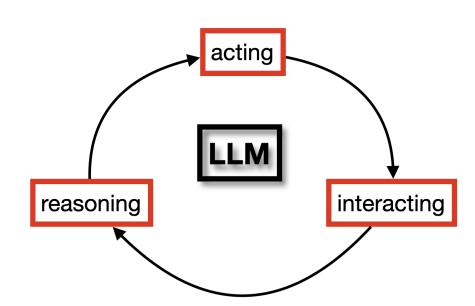

<!-- Source: AgenticLargeLanguageModels.pdf; physical PDF pages 1–14; contents links rebuilt from the printed table of contents and verified Markdown headings. -->

{0}------------------------------------------------

## 智能体大语言模型

Max van Duijn · Michiel van der Meer · Aske Plaat · Niki van Stein

{1}------------------------------------------------

{2}------------------------------------------------

## 目录

- [引言](../01-introduction/01-introduction-zh.md) (p. 15)
  - [1.1 为什么要读这本书？](../01-introduction/01-introduction-zh.md#11-为什么要读这本书) (p. 15)
  - [1.2 概念与定义](../01-introduction/01-introduction-zh.md#12-概念与定义) (p. 15)
    - [1.2.1 提供协助的智能体与进行互动的智能体](../01-introduction/01-introduction-zh.md#121-提供协助的智能体与进行互动的智能体) (p. 16)
    - [1.2.2 智能体执行框架（harness）](../01-introduction/01-introduction-zh.md#122-智能体执行框架harness) (p. 16)
    - [1.2.3 多模态模型](../01-introduction/01-introduction-zh.md#123-多模态模型) (p. 16)
    - [1.2.4 训练数据](../01-introduction/01-introduction-zh.md#124-训练数据) (p. 17)
  - [1.3 读者对象与写作目标](../01-introduction/01-introduction-zh.md#13-读者对象与写作目标) (p. 18)
  - [1.4 前提条件](../01-introduction/01-introduction-zh.md#14-前提条件) (p. 18)
  - [1.5 课程安排](../01-introduction/01-introduction-zh.md#15-课程安排) (p. 19)
  - [1.6 方法、范围与概述](../01-introduction/01-introduction-zh.md#16-方法范围与概述) (p. 20)
  - [1.7 致谢](../01-introduction/01-introduction-zh.md#17-致谢) (p. 22)
- [I 语言建模](../part-i-language-modeling/part-i-language-modeling-zh.md) (p. 25)
- [语言建模基础](../02-foundations-of-language-modeling/02-foundations-of-language-modeling-zh.md) (p. 29)
  - [2.1 自然语言处理](../02-foundations-of-language-modeling/02-foundations-of-language-modeling-zh.md#21-自然语言处理) (p. 29)
    - [2.1.1 语言理解与语言生成](../02-foundations-of-language-modeling/02-foundations-of-language-modeling-zh.md#211-语言理解与语言生成) (p. 31)
    - [2.1.2 自然语言的复杂性](../02-foundations-of-language-modeling/02-foundations-of-language-modeling-zh.md#212-自然语言的复杂性) (p. 32)
    - [2.1.3 分布式表示](../02-foundations-of-language-modeling/02-foundations-of-language-modeling-zh.md#213-分布式表示) (p. 34)
    - [2.1.4 分词](../02-foundations-of-language-modeling/02-foundations-of-language-modeling-zh.md#214-分词) (p. 36)
    - [2.1.5 语言表示的早期方法](../02-foundations-of-language-modeling/02-foundations-of-language-modeling-zh.md#215-语言表示的早期方法) (p. 37)
  - [2.2 自然语言处理的机器学习方法](../02-foundations-of-language-modeling/02-foundations-of-language-modeling-zh.md#22-自然语言处理的机器学习方法) (p. 39)
    - [2.2.1 监督学习](../02-foundations-of-language-modeling/02-foundations-of-language-modeling-zh.md#221-监督学习) (p. 39)
    - [2.2.2 自回归学习](../02-foundations-of-language-modeling/02-foundations-of-language-modeling-zh.md#222-自回归学习) (p. 40)
    - [2.2.3 强化学习](../02-foundations-of-language-modeling/02-foundations-of-language-modeling-zh.md#223-强化学习) (p. 41)
  - [2.3 语言建模](../02-foundations-of-language-modeling/02-foundations-of-language-modeling-zh.md#23-语言建模) (p. 42)
    - [2.3.1 嵌入](../02-foundations-of-language-modeling/02-foundations-of-language-modeling-zh.md#231-嵌入) (p. 43)
    - [2.3.2 转向上下文化嵌入](../02-foundations-of-language-modeling/02-foundations-of-language-modeling-zh.md#232-转向上下文化嵌入) (p. 44)
    - [2.3.3 循环神经网络](../02-foundations-of-language-modeling/02-foundations-of-language-modeling-zh.md#233-循环神经网络) (p. 45)
    - [2.3.4 注意力](../02-foundations-of-language-modeling/02-foundations-of-language-modeling-zh.md#234-注意力) (p. 48)
    - [2.3.5 Transformer](../02-foundations-of-language-modeling/02-foundations-of-language-modeling-zh.md#235-transformer) (p. 50)
    - [2.3.6 仅编码器模型（BERT）](../02-foundations-of-language-modeling/02-foundations-of-language-modeling-zh.md#236-仅编码器模型bert) (p. 52)

{3}------------------------------------------------

    - [2.3.7 仅解码器模型（GPT）](../02-foundations-of-language-modeling/02-foundations-of-language-modeling-zh.md#237-仅解码器模型gpt) (p. 53)
  - [2.4 结语](../02-foundations-of-language-modeling/02-foundations-of-language-modeling-zh.md#24-结语) (p. 54)
    - [2.4.1 尚待解决的问题](../02-foundations-of-language-modeling/02-foundations-of-language-modeling-zh.md#241-尚待解决的问题) (p. 54)
    - [2.4.2 后续内容](../02-foundations-of-language-modeling/02-foundations-of-language-modeling-zh.md#242-后续内容) (p. 56)
- [LLM 训练流程](../03-llm-training-pipeline/03-llm-training-pipeline-zh.md) (p. 63)
  - [3.1 训练模型](../03-llm-training-pipeline/03-llm-training-pipeline-zh.md#31-训练模型) (p. 63)
    - [3.1.1 编码器与解码器模型](../03-llm-training-pipeline/03-llm-training-pipeline-zh.md#311-编码器与解码器模型) (p. 64)
    - [3.1.2 预训练/微调范式](../03-llm-training-pipeline/03-llm-training-pipeline-zh.md#312-预训练微调范式) (p. 64)
    - [3.1.3 开放与闭源模型](../03-llm-training-pipeline/03-llm-training-pipeline-zh.md#313-开放与闭源模型) (p. 64)
  - [3.2 训练流程](../03-llm-training-pipeline/03-llm-training-pipeline-zh.md#32-训练流程) (p. 65)
    - [3.2.1 获取数据](../03-llm-training-pipeline/03-llm-training-pipeline-zh.md#321-获取数据) (p. 65)
    - [3.2.2 预训练](../03-llm-training-pipeline/03-llm-training-pipeline-zh.md#322-预训练) (p. 66)
    - [3.2.3 微调](../03-llm-training-pipeline/03-llm-training-pipeline-zh.md#323-微调) (p. 69)
    - [3.2.4 偏好调优](../03-llm-training-pipeline/03-llm-training-pipeline-zh.md#324-偏好调优) (p. 70)
    - [3.2.5 推理](../03-llm-training-pipeline/03-llm-training-pipeline-zh.md#325-推理) (p. 71)
    - [3.2.6 总结](../03-llm-training-pipeline/03-llm-training-pipeline-zh.md#326-总结) (p. 72)
  - [3.3 基准测试与性能](../03-llm-training-pipeline/03-llm-training-pipeline-zh.md#33-基准测试与性能) (p. 72)
    - [3.3.1 常见任务](../03-llm-training-pipeline/03-llm-training-pipeline-zh.md#331-常见任务) (p. 73)
    - [3.3.2 指标](../03-llm-training-pipeline/03-llm-training-pipeline-zh.md#332-指标) (p. 73)
    - [3.3.3 常用基准](../03-llm-training-pipeline/03-llm-training-pipeline-zh.md#333-常用基准) (p. 74)
  - [3.4 结论性意见](../03-llm-training-pipeline/03-llm-training-pipeline-zh.md#34-结论性意见) (p. 74)
- [规模定律与效率](../04-scaling-laws-and-efficiency/04-scaling-laws-and-efficiency-zh.md) (p. 83)
  - [4.1 规模定律：计算、数据、参数](../04-scaling-laws-and-efficiency/04-scaling-laws-and-efficiency-zh.md#41-规模定律计算数据参数) (p. 83)
    - [4.1.1 卡普兰规模定律](../04-scaling-laws-and-efficiency/04-scaling-laws-and-efficiency-zh.md#411-卡普兰规模定律) (p. 84)
    - [4.1.2 Chinchilla 规模定律](../04-scaling-laws-and-efficiency/04-scaling-laws-and-efficiency-zh.md#412-chinchilla-规模定律) (p. 86)
    - [4.1.3 计算最优曲线](../04-scaling-laws-and-efficiency/04-scaling-laws-and-efficiency-zh.md#413-计算最优曲线) (p. 87)
    - [4.1.4 新兴能力](../04-scaling-laws-and-efficiency/04-scaling-laws-and-efficiency-zh.md#414-新兴能力) (p. 89)
    - [4.1.5 反向缩放](../04-scaling-laws-and-efficiency/04-scaling-laws-and-efficiency-zh.md#415-反向缩放) (p. 90)
    - [4.1.6 顿悟（Grokking）](../04-scaling-laws-and-efficiency/04-scaling-laws-and-efficiency-zh.md#416-顿悟grokking) (p. 91)
  - [4.2 小语言模型](../04-scaling-laws-and-efficiency/04-scaling-laws-and-efficiency-zh.md#42-小语言模型) (p. 92)
    - [4.2.1 以模型为中心的优化](../04-scaling-laws-and-efficiency/04-scaling-laws-and-efficiency-zh.md#421-以模型为中心的优化) (p. 92)
      - [4.2.1.1 降低预训练成本](../04-scaling-laws-and-efficiency/04-scaling-laws-and-efficiency-zh.md#4211-降低预训练成本) (p. 92)
      - [4.2.1.2 降低推理成本](../04-scaling-laws-and-efficiency/04-scaling-laws-and-efficiency-zh.md#4212-降低推理成本) (p. 95)
    - [4.2.2 以数据为中心的优化](../04-scaling-laws-and-efficiency/04-scaling-laws-and-efficiency-zh.md#422-以数据为中心的优化) (p. 96)
      - [4.2.2.1 数据选择与整理](../04-scaling-laws-and-efficiency/04-scaling-laws-and-efficiency-zh.md#4221-数据选择与整理) (p. 96)
      - [4.2.2.2 合成数据收集](../04-scaling-laws-and-efficiency/04-scaling-laws-and-efficiency-zh.md#4222-合成数据收集) (p. 96)
      - [4.2.2.3 样本高效学习](../04-scaling-laws-and-efficiency/04-scaling-laws-and-efficiency-zh.md#4223-样本高效学习) (p. 97)
    - [4.2.3 主流模型](../04-scaling-laws-and-efficiency/04-scaling-laws-and-efficiency-zh.md#423-主流模型) (p. 97)
  - [4.3 推理时计算](../04-scaling-laws-and-efficiency/04-scaling-laws-and-efficiency-zh.md#43-推理时计算) (p. 99)
  - [4.4 可持续的语言模型](../04-scaling-laws-and-efficiency/04-scaling-laws-and-efficiency-zh.md#44-可持续的语言模型) (p. 99)
  - [4.5 结论性意见](../04-scaling-laws-and-efficiency/04-scaling-laws-and-efficiency-zh.md#45-结论性意见) (p. 100)

{4}------------------------------------------------

- [案例研究 1：从零开始构建 LLM](../05-case-study-1-building-llms-from-scratch/05-case-study-1-building-llms-from-scratch-zh.md) (p. 111)
  - [5.1 构建聊天机器人](../05-case-study-1-building-llms-from-scratch/05-case-study-1-building-llms-from-scratch-zh.md#51-构建聊天机器人) (p. 111)
  - [5.2 背景：Karpathy 的 nanochat](../05-case-study-1-building-llms-from-scratch/05-case-study-1-building-llms-from-scratch-zh.md#52-背景karpathy-的-nanochat) (p. 112)
  - [5.3 实验准备](../05-case-study-1-building-llms-from-scratch/05-case-study-1-building-llms-from-scratch-zh.md#53-实验准备) (p. 113)
  - [5.4 任务 0：模型仓库热身](../05-case-study-1-building-llms-from-scratch/05-case-study-1-building-llms-from-scratch-zh.md#54-任务-0模型仓库热身) (p. 114)
  - [5.5 任务 1：分词](../05-case-study-1-building-llms-from-scratch/05-case-study-1-building-llms-from-scratch-zh.md#55-任务-1分词) (p. 114)
    - [5.5.1 应做的事项](../05-case-study-1-building-llms-from-scratch/05-case-study-1-building-llms-from-scratch-zh.md#551-应做的事项) (p. 114)
    - [5.5.2 交付物](../05-case-study-1-building-llms-from-scratch/05-case-study-1-building-llms-from-scratch-zh.md#552-交付物) (p. 114)
  - [5.6 任务 2：预训练](../05-case-study-1-building-llms-from-scratch/05-case-study-1-building-llms-from-scratch-zh.md#56-任务-2预训练) (p. 115)
    - [5.6.1 应做的事项](../05-case-study-1-building-llms-from-scratch/05-case-study-1-building-llms-from-scratch-zh.md#561-应做的事项) (p. 115)
    - [5.6.2 交付物](../05-case-study-1-building-llms-from-scratch/05-case-study-1-building-llms-from-scratch-zh.md#562-交付物) (p. 115)
  - [5.7 任务 3：中训练与监督微调](../05-case-study-1-building-llms-from-scratch/05-case-study-1-building-llms-from-scratch-zh.md#57-任务-3中训练与监督微调) (p. 116)
    - [5.7.1 应做的事项](../05-case-study-1-building-llms-from-scratch/05-case-study-1-building-llms-from-scratch-zh.md#571-应做的事项) (p. 116)
    - [5.7.2 交付物](../05-case-study-1-building-llms-from-scratch/05-case-study-1-building-llms-from-scratch-zh.md#572-交付物) (p. 116)
  - [5.8 任务 4：推理、部署与批判性反思](../05-case-study-1-building-llms-from-scratch/05-case-study-1-building-llms-from-scratch-zh.md#58-任务-4推理部署与批判性反思) (p. 117)
    - [5.8.1 A 部分：推理与部署](../05-case-study-1-building-llms-from-scratch/05-case-study-1-building-llms-from-scratch-zh.md#581-a-部分推理与部署) (p. 117)
    - [5.8.2 B 部分：批判性反思](../05-case-study-1-building-llms-from-scratch/05-case-study-1-building-llms-from-scratch-zh.md#582-b-部分批判性反思) (p. 118)
  - [5.9 推荐阅读](../05-case-study-1-building-llms-from-scratch/05-case-study-1-building-llms-from-scratch-zh.md#59-推荐阅读) (p. 118)
  - [5.10 结论](../05-case-study-1-building-llms-from-scratch/05-case-study-1-building-llms-from-scratch-zh.md#510-结论) (p. 119)
- [II 推理](../part-ii-reasoning/part-ii-reasoning-zh.md) (p. 121)
- [LLM 中的多步推理](../06-multi-step-reasoning-in-llms/06-multi-step-reasoning-in-llms-zh.md) (p. 125)
  - [6.1 上下文推理](../06-multi-step-reasoning-in-llms/06-multi-step-reasoning-in-llms-zh.md#61-上下文推理) (p. 125)
    - [6.1.1 上下文学习](../06-multi-step-reasoning-in-llms/06-multi-step-reasoning-in-llms-zh.md#611-上下文学习) (p. 126)
    - [6.1.2 多步推理基准](../06-multi-step-reasoning-in-llms/06-multi-step-reasoning-in-llms-zh.md#612-多步推理基准) (p. 127)
    - [6.1.3 思维链提示](../06-multi-step-reasoning-in-llms/06-multi-step-reasoning-in-llms-zh.md#613-思维链提示) (p. 128)
      - [6.1.3.1 自我评估](../06-multi-step-reasoning-in-llms/06-multi-step-reasoning-in-llms-zh.md#6131-自我评估) (p. 130)
      - [6.1.3.2 用代码验证推理](../06-multi-step-reasoning-in-llms/06-multi-step-reasoning-in-llms-zh.md#6132-用代码验证推理) (p. 132)
      - [6.1.3.3 演进式代码生成提示](../06-multi-step-reasoning-in-llms/06-multi-step-reasoning-in-llms-zh.md#6133-演进式代码生成提示) (p. 132)
  - [6.2 自我反思与状态](../06-multi-step-reasoning-in-llms/06-multi-step-reasoning-in-llms-zh.md#62-自我反思与状态) (p. 133)
    - [6.2.1 LLM 是无状态函数](../06-multi-step-reasoning-in-llms/06-multi-step-reasoning-in-llms-zh.md#621-llm-是无状态函数) (p. 133)
    - [6.2.2 检索增强与长上下文窗口](../06-multi-step-reasoning-in-llms/06-multi-step-reasoning-in-llms-zh.md#622-检索增强与长上下文窗口) (p. 134)
    - [6.2.3 LLM 与有状态问题](../06-multi-step-reasoning-in-llms/06-multi-step-reasoning-in-llms-zh.md#623-llm-与有状态问题) (p. 134)
    - [6.2.4 用代理执行框架改进提示](../06-multi-step-reasoning-in-llms/06-multi-step-reasoning-in-llms-zh.md#624-用代理执行框架改进提示) (p. 135)
      - [6.2.4.1 基于搜索的提示优化](../06-multi-step-reasoning-in-llms/06-multi-step-reasoning-in-llms-zh.md#6241-基于搜索的提示优化) (p. 136)
      - [6.2.4.2 自我反思](../06-multi-step-reasoning-in-llms/06-multi-step-reasoning-in-llms-zh.md#6242-自我反思) (p. 138)
      - [6.2.4.3 基于可验证奖励的强化学习](../06-multi-step-reasoning-in-llms/06-multi-step-reasoning-in-llms-zh.md#6243-基于可验证奖励的强化学习) (p. 141)
  - [6.3 结语](../06-multi-step-reasoning-in-llms/06-multi-step-reasoning-in-llms-zh.md#63-结语) (p. 142)
    - [6.3.1 脆弱性](../06-multi-step-reasoning-in-llms/06-multi-step-reasoning-in-llms-zh.md#631-脆弱性) (p. 143)
    - [6.3.2 快思与慢想](../06-multi-step-reasoning-in-llms/06-multi-step-reasoning-in-llms-zh.md#632-快思与慢想) (p. 143)
    - [6.3.3 结论](../06-multi-step-reasoning-in-llms/06-multi-step-reasoning-in-llms-zh.md#633-结论) (p. 144)

{5}------------------------------------------------

- [视觉、行动与世界模型](../07-vision-action-and-world-models/07-vision-action-and-world-models-zh.md) (p. 151)
  - [7.1 多模态视觉语言模型](../07-vision-action-and-world-models/07-vision-action-and-world-models-zh.md#71-多模态视觉语言模型) (p. 151)
    - [7.1.1 任务](../07-vision-action-and-world-models/07-vision-action-and-world-models-zh.md#711-任务) (p. 152)
    - [7.1.2 架构](../07-vision-action-and-world-models/07-vision-action-and-world-models-zh.md#712-架构) (p. 153)
    - [7.1.3 学习算法](../07-vision-action-and-world-models/07-vision-action-and-world-models-zh.md#713-学习算法) (p. 154)
    - [7.1.4 结果](../07-vision-action-and-world-models/07-vision-action-and-world-models-zh.md#714-结果) (p. 156)
  - [7.2 决策与视觉语言动作模型](../07-vision-action-and-world-models/07-vision-action-and-world-models-zh.md#72-决策与视觉语言动作模型) (p. 158)
    - [7.2.1 任务](../07-vision-action-and-world-models/07-vision-action-and-world-models-zh.md#721-任务) (p. 158)
    - [7.2.2 架构](../07-vision-action-and-world-models/07-vision-action-and-world-models-zh.md#722-架构) (p. 160)
    - [7.2.3 学习算法](../07-vision-action-and-world-models/07-vision-action-and-world-models-zh.md#723-学习算法) (p. 163)
    - [7.2.4 结果](../07-vision-action-and-world-models/07-vision-action-and-world-models-zh.md#724-结果) (p. 163)
  - [7.3 世界模型、物理规律与规划](../07-vision-action-and-world-models/07-vision-action-and-world-models-zh.md#73-世界模型物理规律与规划) (p. 164)
    - [7.3.1 任务](../07-vision-action-and-world-models/07-vision-action-and-world-models-zh.md#731-任务) (p. 165)
    - [7.3.2 架构](../07-vision-action-and-world-models/07-vision-action-and-world-models-zh.md#732-架构) (p. 167)
    - [7.3.3 学习算法](../07-vision-action-and-world-models/07-vision-action-and-world-models-zh.md#733-学习算法) (p. 169)
    - [7.3.4 结果](../07-vision-action-and-world-models/07-vision-action-and-world-models-zh.md#734-结果) (p. 170)
    - [7.3.5 基于模型的强化学习](../07-vision-action-and-world-models/07-vision-action-and-world-models-zh.md#735-基于模型的强化学习) (p. 171)
      - [7.3.5.1 无模型强化学习](../07-vision-action-and-world-models/07-vision-action-and-world-models-zh.md#7351-无模型强化学习) (p. 171)
      - [7.3.5.2 基于模型的强化学习](../07-vision-action-and-world-models/07-vision-action-and-world-models-zh.md#7352-基于模型的强化学习) (p. 172)
      - [7.3.5.3 降维](../07-vision-action-and-world-models/07-vision-action-and-world-models-zh.md#7353-降维) (p. 172)
      - [7.3.5.4 联合嵌入预测架构](../07-vision-action-and-world-models/07-vision-action-and-world-models-zh.md#7354-联合嵌入预测架构) (p. 173)
      - [7.3.5.5 智能体世界模型](../07-vision-action-and-world-models/07-vision-action-and-world-models-zh.md#7355-智能体世界模型) (p. 173)
  - [7.4 结语](../07-vision-action-and-world-models/07-vision-action-and-world-models-zh.md#74-结语) (p. 173)
- [元学习](../08-metalearning/08-metalearning-zh.md) (p. 181)
  - [8.1 为什么要研究元学习？](../08-metalearning/08-metalearning-zh.md#81-为什么要研究元学习) (p. 181)
    - [8.1.1 深度学习速度较慢](../08-metalearning/08-metalearning-zh.md#811-深度学习速度较慢) (p. 182)
    - [8.1.2 实现少样本学习](../08-metalearning/08-metalearning-zh.md#812-实现少样本学习) (p. 182)
  - [8.2 内循环与外循环](../08-metalearning/08-metalearning-zh.md#82-内循环与外循环) (p. 183)
  - [8.3 大语言模型与元学习](../08-metalearning/08-metalearning-zh.md#83-大语言模型与元学习) (p. 184)
    - [8.3.1 静态 LLM 元学习](../08-metalearning/08-metalearning-zh.md#831-静态-llm-元学习) (p. 184)
      - [8.3.1.1 预训练流程](../08-metalearning/08-metalearning-zh.md#8311-预训练流程) (p. 184)
      - [8.3.1.2 上下文学习](../08-metalearning/08-metalearning-zh.md#8312-上下文学习) (p. 184)
      - [8.3.1.3 思维链](../08-metalearning/08-metalearning-zh.md#8313-思维链) (p. 185)
      - [8.3.1.4 静态元学习的稳定性](../08-metalearning/08-metalearning-zh.md#8314-静态元学习的稳定性) (p. 185)
    - [8.3.2 动态 LLM 元学习](../08-metalearning/08-metalearning-zh.md#832-动态-llm-元学习) (p. 185)
      - [8.3.2.1 自我反思](../08-metalearning/08-metalearning-zh.md#8321-自我反思) (p. 185)
      - [8.3.2.2 RLVR](../08-metalearning/08-metalearning-zh.md#8322-rlvr) (p. 186)
  - [8.4 稳定动态元学习](../08-metalearning/08-metalearning-zh.md#84-稳定动态元学习) (p. 186)
  - [8.5 结语](../08-metalearning/08-metalearning-zh.md#85-结语) (p. 186)
- [III 智能体](../part-iii-agents/part-iii-agents-zh.md) (p. 189)
- [智能体 LLM 的交互方式](../09-interaction-styles-for-agentic-llms/09-interaction-styles-for-agentic-llms-zh.md) (p. 193)
  - [9.1 人工智能中的智能体](../09-interaction-styles-for-agentic-llms/09-interaction-styles-for-agentic-llms-zh.md#91-人工智能中的智能体) (p. 193)

{6}------------------------------------------------

    - [9.1.1 智能体在环境中行动并适应环境](../09-interaction-styles-for-agentic-llms/09-interaction-styles-for-agentic-llms-zh.md#911-智能体在环境中行动并适应环境) (p. 193)
      - [9.1.1.1 机器助手](../09-interaction-styles-for-agentic-llms/09-interaction-styles-for-agentic-llms-zh.md#9111-机器助手) (p. 194)
      - [9.1.1.2 具有信念、愿望和意图的智能体](../09-interaction-styles-for-agentic-llms/09-interaction-styles-for-agentic-llms-zh.md#9112-具有信念愿望和意图的智能体) (p. 194)
      - [9.1.1.3 群体智能体](../09-interaction-styles-for-agentic-llms/09-interaction-styles-for-agentic-llms-zh.md#9113-群体智能体) (p. 194)
    - [9.1.2 将智能体 LLM 视为强化学习智能体](../09-interaction-styles-for-agentic-llms/09-interaction-styles-for-agentic-llms-zh.md#912-将智能体-llm-视为强化学习智能体) (p. 195)
  - [9.2 智能体 LLM 中的学习机制](../09-interaction-styles-for-agentic-llms/09-interaction-styles-for-agentic-llms-zh.md#92-智能体-llm-中的学习机制) (p. 197)
    - [9.2.1 智能体交互风格](../09-interaction-styles-for-agentic-llms/09-interaction-styles-for-agentic-llms-zh.md#921-智能体交互风格) (p. 197)
      - [9.2.1.1 A. 查询提示](../09-interaction-styles-for-agentic-llms/09-interaction-styles-for-agentic-llms-zh.md#9211-a-查询提示) (p. 198)
      - [9.2.1.2 B. 上下文学习](../09-interaction-styles-for-agentic-llms/09-interaction-styles-for-agentic-llms-zh.md#9212-b-上下文学习) (p. 198)
      - [9.2.1.3 C. 思维链](../09-interaction-styles-for-agentic-llms/09-interaction-styles-for-agentic-llms-zh.md#9213-c-思维链) (p. 199)
      - [9.2.1.4 D. 自我反思执行框架](../09-interaction-styles-for-agentic-llms/09-interaction-styles-for-agentic-llms-zh.md#9214-d-自我反思执行框架) (p. 199)
      - [9.2.1.5 E. 强化微调执行框架](../09-interaction-styles-for-agentic-llms/09-interaction-styles-for-agentic-llms-zh.md#9215-e-强化微调执行框架) (p. 201)
  - [9.3 智能体 LLM 的记忆架构](../09-interaction-styles-for-agentic-llms/09-interaction-styles-for-agentic-llms-zh.md#93-智能体-llm-的记忆架构) (p. 202)
    - [9.3.1 为什么需要记忆](../09-interaction-styles-for-agentic-llms/09-interaction-styles-for-agentic-llms-zh.md#931-为什么需要记忆) (p. 202)
      - [9.3.1.1 连贯对话](../09-interaction-styles-for-agentic-llms/09-interaction-styles-for-agentic-llms-zh.md#9311-连贯对话) (p. 202)
      - [9.3.1.2 适应](../09-interaction-styles-for-agentic-llms/09-interaction-styles-for-agentic-llms-zh.md#9312-适应) (p. 202)
      - [9.3.1.3 身份](../09-interaction-styles-for-agentic-llms/09-interaction-styles-for-agentic-llms-zh.md#9313-身份) (p. 203)
      - [9.3.1.4 持续学习](../09-interaction-styles-for-agentic-llms/09-interaction-styles-for-agentic-llms-zh.md#9314-持续学习) (p. 203)
    - [9.3.2 记忆架构](../09-interaction-styles-for-agentic-llms/09-interaction-styles-for-agentic-llms-zh.md#932-记忆架构) (p. 203)
      - [9.3.2.1 微调](../09-interaction-styles-for-agentic-llms/09-interaction-styles-for-agentic-llms-zh.md#9321-微调) (p. 203)
      - [9.3.2.2 长上下文窗口与压缩](../09-interaction-styles-for-agentic-llms/09-interaction-styles-for-agentic-llms-zh.md#9322-长上下文窗口与压缩) (p. 204)
      - [9.3.2.3 显式记忆管理](../09-interaction-styles-for-agentic-llms/09-interaction-styles-for-agentic-llms-zh.md#9323-显式记忆管理) (p. 204)
  - [9.4 结语](../09-interaction-styles-for-agentic-llms/09-interaction-styles-for-agentic-llms-zh.md#94-结语) (p. 205)
- [案例研究 2：推理与反思](../10-case-study-2-reasoning-and-reflection/10-case-study-2-reasoning-and-reflection-zh.md) (p. 211)
  - [10.1 BALROG 概述](../10-case-study-2-reasoning-and-reflection/10-case-study-2-reasoning-and-reflection-zh.md#101-balrog-概述) (p. 211)
    - [10.1.1 谜题与游戏](../10-case-study-2-reasoning-and-reflection/10-case-study-2-reasoning-and-reflection-zh.md#1011-谜题与游戏) (p. 212)
    - [10.1.2 BALROG 架构](../10-case-study-2-reasoning-and-reflection/10-case-study-2-reasoning-and-reflection-zh.md#1012-balrog-架构) (p. 213)
    - [10.1.3 代理](../10-case-study-2-reasoning-and-reflection/10-case-study-2-reasoning-and-reflection-zh.md#1013-代理) (p. 214)
      - [10.1.3.1 提示构建器](../10-case-study-2-reasoning-and-reflection/10-case-study-2-reasoning-and-reflection-zh.md#10131-提示构建器) (p. 214)
      - [10.1.3.2 代理](../10-case-study-2-reasoning-and-reflection/10-case-study-2-reasoning-and-reflection-zh.md#10132-代理) (p. 214)
  - [10.2 实施步骤](../10-case-study-2-reasoning-and-reflection/10-case-study-2-reasoning-and-reflection-zh.md#102-实施步骤) (p. 215)
    - [10.2.1 复现论文中的结果](../10-case-study-2-reasoning-and-reflection/10-case-study-2-reasoning-and-reflection-zh.md#1021-复现论文中的结果) (p. 215)
    - [10.2.2 不同的 LLM](../10-case-study-2-reasoning-and-reflection/10-case-study-2-reasoning-and-reflection-zh.md#1022-不同的-llm) (p. 215)
    - [10.2.3 不同的谜题](../10-case-study-2-reasoning-and-reflection/10-case-study-2-reasoning-and-reflection-zh.md#1023-不同的谜题) (p. 215)
    - [10.2.4 计算成本](../10-case-study-2-reasoning-and-reflection/10-case-study-2-reasoning-and-reflection-zh.md#1024-计算成本) (p. 215)
    - [10.2.5 实现自己的推理代理](../10-case-study-2-reasoning-and-reflection/10-case-study-2-reasoning-and-reflection-zh.md#1025-实现自己的推理代理) (p. 216)
  - [10.3 评估](../10-case-study-2-reasoning-and-reflection/10-case-study-2-reasoning-and-reflection-zh.md#103-评估) (p. 216)
  - [10.4 自我反思](../10-case-study-2-reasoning-and-reflection/10-case-study-2-reasoning-and-reflection-zh.md#104-自我反思) (p. 218)
  - [10.5 结语](../10-case-study-2-reasoning-and-reflection/10-case-study-2-reasoning-and-reflection-zh.md#105-结语) (p. 220)
- [IV 工具与助手](../part-iv-tools-and-assistants/part-iv-tools-and-assistants-zh.md) (p. 223)
- [智能体如何使用工具在现实世界中行动](../11-how-agents-use-tools-to-act-in-the-world/11-how-agents-use-tools-to-act-in-the-world-zh.md) (p. 227)
  - [11.1 工具在智能体大语言模型中为何重要](../11-how-agents-use-tools-to-act-in-the-world/11-how-agents-use-tools-to-act-in-the-world-zh.md#111-工具在智能体大语言模型中为何重要) (p. 227)

{7}------------------------------------------------

  - [11.2 工具使用架构](../11-how-agents-use-tools-to-act-in-the-world/11-how-agents-use-tools-to-act-in-the-world-zh.md#112-工具使用架构) (p. 228)
  - [11.3 APIs 和工具链](../11-how-agents-use-tools-to-act-in-the-world/11-how-agents-use-tools-to-act-in-the-world-zh.md#113-apis-和工具链) (p. 228)
    - [11.3.1 LangChain 示例](../11-how-agents-use-tools-to-act-in-the-world/11-how-agents-use-tools-to-act-in-the-world-zh.md#1131-langchain-示例) (p. 229)
    - [11.3.2 计算机和浏览器工具](../11-how-agents-use-tools-to-act-in-the-world/11-how-agents-use-tools-to-act-in-the-world-zh.md#1132-计算机和浏览器工具) (p. 229)
  - [11.4 模型上下文协议与上下文管理](../11-how-agents-use-tools-to-act-in-the-world/11-how-agents-use-tools-to-act-in-the-world-zh.md#114-模型上下文协议与上下文管理) (p. 232)
  - [11.5 稳健性、错误处理与恢复](../11-how-agents-use-tools-to-act-in-the-world/11-how-agents-use-tools-to-act-in-the-world-zh.md#115-稳健性错误处理与恢复) (p. 233)
  - [11.6 安全与防护](../11-how-agents-use-tools-to-act-in-the-world/11-how-agents-use-tools-to-act-in-the-world-zh.md#116-安全与防护) (p. 236)
  - [11.7 结语](../11-how-agents-use-tools-to-act-in-the-world/11-how-agents-use-tools-to-act-in-the-world-zh.md#117-结语) (p. 237)
- [智能体 LLM 中的搜索与检索](../12-search-and-retrieval-in-agentic-llms/12-search-and-retrieval-in-agentic-llms-zh.md) (p. 241)
  - [12.1 一般检索](../12-search-and-retrieval-in-agentic-llms/12-search-and-retrieval-in-agentic-llms-zh.md#121-一般检索) (p. 241)
    - [12.1.1 词袋模型](../12-search-and-retrieval-in-agentic-llms/12-search-and-retrieval-in-agentic-llms-zh.md#1211-词袋模型) (p. 242)
    - [12.1.2 向量空间模型](../12-search-and-retrieval-in-agentic-llms/12-search-and-retrieval-in-agentic-llms-zh.md#1212-向量空间模型) (p. 242)
    - [12.1.3 潜在与稀疏表示](../12-search-and-retrieval-in-agentic-llms/12-search-and-retrieval-in-agentic-llms-zh.md#1213-潜在与稀疏表示) (p. 243)
  - [12.2 检索为何对智能体大语言模型很重要](../12-search-and-retrieval-in-agentic-llms/12-search-and-retrieval-in-agentic-llms-zh.md#122-检索为何对智能体大语言模型很重要) (p. 244)
  - [12.3 检索增强生成管道](../12-search-and-retrieval-in-agentic-llms/12-search-and-retrieval-in-agentic-llms-zh.md#123-检索增强生成管道) (p. 244)
  - [12.4 自适应检索方法](../12-search-and-retrieval-in-agentic-llms/12-search-and-retrieval-in-agentic-llms-zh.md#124-自适应检索方法) (p. 246)
    - [12.4.1 Self-RAG 与 Self-Ask 的自适应检索](../12-search-and-retrieval-in-agentic-llms/12-search-and-retrieval-in-agentic-llms-zh.md#1241-self-rag-与-self-ask-的自适应检索) (p. 247)
    - [12.4.2 Python中的一个简单密集检索示例](../12-search-and-retrieval-in-agentic-llms/12-search-and-retrieval-in-agentic-llms-zh.md#1242-python中的一个简单密集检索示例) (p. 248)
    - [12.4.3 查询重写与扩展](../12-search-and-retrieval-in-agentic-llms/12-search-and-retrieval-in-agentic-llms-zh.md#1243-查询重写与扩展) (p. 248)
  - [12.5 超越文本：图、代码、表格数据与多模态检索](../12-search-and-retrieval-in-agentic-llms/12-search-and-retrieval-in-agentic-llms-zh.md#125-超越文本图代码表格数据与多模态检索) (p. 249)
    - [12.5.1 基于知识图谱的检索示例](../12-search-and-retrieval-in-agentic-llms/12-search-and-retrieval-in-agentic-llms-zh.md#1251-基于知识图谱的检索示例) (p. 250)
    - [12.5.2 使用 AST 和嵌入的代码检索示例](../12-search-and-retrieval-in-agentic-llms/12-search-and-retrieval-in-agentic-llms-zh.md#1252-使用-ast-和嵌入的代码检索示例) (p. 251)
    - [12.5.3 多模态和异构来源](../12-search-and-retrieval-in-agentic-llms/12-search-and-retrieval-in-agentic-llms-zh.md#1253-多模态和异构来源) (p. 251)
    - [12.5.4 多模态检索示例](../12-search-and-retrieval-in-agentic-llms/12-search-and-retrieval-in-agentic-llms-zh.md#1254-多模态检索示例) (p. 253)
  - [12.6 代理式 RAG：超越简单检索](../12-search-and-retrieval-in-agentic-llms/12-search-and-retrieval-in-agentic-llms-zh.md#126-代理式-rag超越简单检索) (p. 254)
    - [12.6.1 代理式 RAG 的关键组成部分](../12-search-and-retrieval-in-agentic-llms/12-search-and-retrieval-in-agentic-llms-zh.md#1261-代理式-rag-的关键组成部分) (p. 254)
    - [12.6.2 实时与流式 RAG](../12-search-and-retrieval-in-agentic-llms/12-search-and-retrieval-in-agentic-llms-zh.md#1262-实时与流式-rag) (p. 255)
  - [12.7 评估](../12-search-and-retrieval-in-agentic-llms/12-search-and-retrieval-in-agentic-llms-zh.md#127-评估) (p. 255)
  - [12.8 结语](../12-search-and-retrieval-in-agentic-llms/12-search-and-retrieval-in-agentic-llms-zh.md#128-结语) (p. 257)
- [从工具到助手](../13-from-tools-to-assistants/13-from-tools-to-assistants-zh.md) (p. 263)
  - [13.1 智能体大语言模型作为助手](../13-from-tools-to-assistants/13-from-tools-to-assistants-zh.md#131-智能体大语言模型作为助手) (p. 263)
  - [13.2 对话助手](../13-from-tools-to-assistants/13-from-tools-to-assistants-zh.md#132-对话助手) (p. 264)
  - [13.3 购物助理](../13-from-tools-to-assistants/13-from-tools-to-assistants-zh.md#133-购物助理) (p. 265)
  - [13.4 飞行操作助理](../13-from-tools-to-assistants/13-from-tools-to-assistants-zh.md#134-飞行操作助理) (p. 266)
  - [13.5 医疗助理](../13-from-tools-to-assistants/13-from-tools-to-assistants-zh.md#135-医疗助理) (p. 268)
  - [13.6 交易助理](../13-from-tools-to-assistants/13-from-tools-to-assistants-zh.md#136-交易助理) (p. 269)
  - [13.7 自动化科学发现](../13-from-tools-to-assistants/13-from-tools-to-assistants-zh.md#137-自动化科学发现) (p. 270)
  - [13.8 编码助手与一般进展](../13-from-tools-to-assistants/13-from-tools-to-assistants-zh.md#138-编码助手与一般进展) (p. 271)
  - [13.9 结语](../13-from-tools-to-assistants/13-from-tools-to-assistants-zh.md#139-结语) (p. 272)

{8}------------------------------------------------

- [案例研究 3：多智能体诊断](../14-case-study-3-multi-agent-diagnosis/14-case-study-3-multi-agent-diagnosis-zh.md) (p. 277)
  - [14.1 场景概述](../14-case-study-3-multi-agent-diagnosis/14-case-study-3-multi-agent-diagnosis-zh.md#141-场景概述) (p. 277)
  - [14.2 环境设置](../14-case-study-3-multi-agent-diagnosis/14-case-study-3-multi-agent-diagnosis-zh.md#142-环境设置) (p. 278)
  - [14.3 实施步骤](../14-case-study-3-multi-agent-diagnosis/14-case-study-3-multi-agent-diagnosis-zh.md#143-实施步骤) (p. 278)
    - [14.3.1 步骤 0：训练诊断模型](../14-case-study-3-multi-agent-diagnosis/14-case-study-3-multi-agent-diagnosis-zh.md#1431-步骤-0训练诊断模型) (p. 278)
    - [14.3.2 第一步：理解和运行基线](../14-case-study-3-multi-agent-diagnosis/14-case-study-3-multi-agent-diagnosis-zh.md#1432-第一步理解和运行基线) (p. 279)
    - [14.3.3 步骤 2：用 LLM 代理替换基于规则的规划器](../14-case-study-3-multi-agent-diagnosis/14-case-study-3-multi-agent-diagnosis-zh.md#1433-步骤-2用-llm-代理替换基于规则的规划器) (p. 279)
  - [14.4 评估](../14-case-study-3-multi-agent-diagnosis/14-case-study-3-multi-agent-diagnosis-zh.md#144-评估) (p. 280)
  - [14.5 反思问题](../14-case-study-3-multi-agent-diagnosis/14-case-study-3-multi-agent-diagnosis-zh.md#145-反思问题) (p. 280)
  - [14.6 结论性意见](../14-case-study-3-multi-agent-diagnosis/14-case-study-3-multi-agent-diagnosis-zh.md#146-结论性意见) (p. 282)
- [V 行为与认知](../part-v-behavior-and-cognition/part-v-behavior-and-cognition-zh.md) (p. 283)
- [智能体 LLM 行为研究](../15-studying-behavior-of-agentic-llms/15-studying-behavior-of-agentic-llms-zh.md) (p. 287)
  - [15.1 LLM 的行为是什么？](../15-studying-behavior-of-agentic-llms/15-studying-behavior-of-agentic-llms-zh.md#151-llm-的行为是什么) (p. 287)
  - [15.2 实验探测 LLM 的行为](../15-studying-behavior-of-agentic-llms/15-studying-behavior-of-agentic-llms-zh.md#152-实验探测-llm-的行为) (p. 288)
  - [15.3 基本社会工具包](../15-studying-behavior-of-agentic-llms/15-studying-behavior-of-agentic-llms-zh.md#153-基本社会工具包) (p. 289)
    - [15.3.1 功能语言能力与语用能力](../15-studying-behavior-of-agentic-llms/15-studying-behavior-of-agentic-llms-zh.md#1531-功能语言能力与语用能力) (p. 289)
    - [15.3.2 礼貌与社交礼仪](../15-studying-behavior-of-agentic-llms/15-studying-behavior-of-agentic-llms-zh.md#1532-礼貌与社交礼仪) (p. 290)
    - [15.3.3 对情绪和情感线索的敏感性](../15-studying-behavior-of-agentic-llms/15-studying-behavior-of-agentic-llms-zh.md#1533-对情绪和情感线索的敏感性) (p. 291)
    - [15.3.4 结论](../15-studying-behavior-of-agentic-llms/15-studying-behavior-of-agentic-llms-zh.md#1534-结论) (p. 294)
  - [15.4 战略行为](../15-studying-behavior-of-agentic-llms/15-studying-behavior-of-agentic-llms-zh.md#154-战略行为) (p. 294)
    - [15.4.1 社会困境中的合作与协调](../15-studying-behavior-of-agentic-llms/15-studying-behavior-of-agentic-llms-zh.md#1541-社会困境中的合作与协调) (p. 294)
    - [15.4.2 跨游戏和模型的基准](../15-studying-behavior-of-agentic-llms/15-studying-behavior-of-agentic-llms-zh.md#1542-跨游戏和模型的基准) (p. 296)
    - [15.4.3 结论](../15-studying-behavior-of-agentic-llms/15-studying-behavior-of-agentic-llms-zh.md#1543-结论) (p. 297)
  - [15.5 心智理论](../15-studying-behavior-of-agentic-llms/15-studying-behavior-of-agentic-llms-zh.md#155-心智理论) (p. 297)
    - [15.5.1 心智的计算理论](../15-studying-behavior-of-agentic-llms/15-studying-behavior-of-agentic-llms-zh.md#1551-心智的计算理论) (p. 298)
    - [15.5.2 提升心智理论：增强策略](../15-studying-behavior-of-agentic-llms/15-studying-behavior-of-agentic-llms-zh.md#1552-提升心智理论增强策略) (p. 301)
    - [15.5.3 结论](../15-studying-behavior-of-agentic-llms/15-studying-behavior-of-agentic-llms-zh.md#1553-结论) (p. 301)
  - [15.6 道德判断与行为](../15-studying-behavior-of-agentic-llms/15-studying-behavior-of-agentic-llms-zh.md#156-道德判断与行为) (p. 302)
    - [15.6.1 背景：道德心理学与哲学](../15-studying-behavior-of-agentic-llms/15-studying-behavior-of-agentic-llms-zh.md#1561-背景道德心理学与哲学) (p. 302)
    - [15.6.2 在 LLM 中探查道德判断](../15-studying-behavior-of-agentic-llms/15-studying-behavior-of-agentic-llms-zh.md#1562-在-llm-中探查道德判断) (p. 303)
    - [15.6.3 从判断到道德行为](../15-studying-behavior-of-agentic-llms/15-studying-behavior-of-agentic-llms-zh.md#1563-从判断到道德行为) (p. 304)
    - [15.6.4 结论](../15-studying-behavior-of-agentic-llms/15-studying-behavior-of-agentic-llms-zh.md#1564-结论) (p. 305)
  - [15.7 结论性意见](../15-studying-behavior-of-agentic-llms/15-studying-behavior-of-agentic-llms-zh.md#157-结论性意见) (p. 305)
- [多 LLM 系统中的角色交互](../16-role-based-interaction-in-multi-llm-systems/16-role-based-interaction-in-multi-llm-systems-zh.md) (p. 317)
  - [16.1 从单一代理到多智能体](../16-role-based-interaction-in-multi-llm-systems/16-role-based-interaction-in-multi-llm-systems-zh.md#161-从单一代理到多智能体) (p. 317)
    - [16.1.1 多智能体仿真：历史与现状](../16-role-based-interaction-in-multi-llm-systems/16-role-based-interaction-in-multi-llm-systems-zh.md#1611-多智能体仿真历史与现状) (p. 318)
    - [16.1.2 基于角色的交互与新兴交互](../16-role-based-interaction-in-multi-llm-systems/16-role-based-interaction-in-multi-llm-systems-zh.md#1612-基于角色的交互与新兴交互) (p. 318)
    - [16.1.3 多智能体协作的五个维度](../16-role-based-interaction-in-multi-llm-systems/16-role-based-interaction-in-multi-llm-systems-zh.md#1613-多智能体协作的五个维度) (p. 318)
    - [16.1.4 方法学说明](../16-role-based-interaction-in-multi-llm-systems/16-role-based-interaction-in-multi-llm-systems-zh.md#1614-方法学说明) (p. 319)
  - [16.2 LLM 代理之间的战略互动](../16-role-based-interaction-in-multi-llm-systems/16-role-based-interaction-in-multi-llm-systems-zh.md#162-llm-代理之间的战略互动) (p. 319)
    - [16.2.1 跨游戏战略能力基准测试](../16-role-based-interaction-in-multi-llm-systems/16-role-based-interaction-in-multi-llm-systems-zh.md#1621-跨游戏战略能力基准测试) (p. 320)
    - [16.2.2 单情景平台中的战略互动](../16-role-based-interaction-in-multi-llm-systems/16-role-based-interaction-in-multi-llm-systems-zh.md#1622-单情景平台中的战略互动) (p. 322)

{9}------------------------------------------------

    - [16.2.3 结论](../16-role-based-interaction-in-multi-llm-systems/16-role-based-interaction-in-multi-llm-systems-zh.md#1623-结论) (p. 322)
  - [16.3 基于角色的任务解决与团队合作](../16-role-based-interaction-in-multi-llm-systems/16-role-based-interaction-in-multi-llm-systems-zh.md#163-基于角色的任务解决与团队合作) (p. 323)
    - [16.3.1 互补对](../16-role-based-interaction-in-multi-llm-systems/16-role-based-interaction-in-multi-llm-systems-zh.md#1631-互补对) (p. 324)
    - [16.3.2 辩论与讨论](../16-role-based-interaction-in-multi-llm-systems/16-role-based-interaction-in-multi-llm-systems-zh.md#1632-辩论与讨论) (p. 325)
    - [16.3.3 基于角色的软件团队](../16-role-based-interaction-in-multi-llm-systems/16-role-based-interaction-in-multi-llm-systems-zh.md#1633-基于角色的软件团队) (p. 326)
    - [16.3.4 社会角色扮演](../16-role-based-interaction-in-multi-llm-systems/16-role-based-interaction-in-multi-llm-systems-zh.md#1634-社会角色扮演) (p. 326)
    - [16.3.5 结论](../16-role-based-interaction-in-multi-llm-systems/16-role-based-interaction-in-multi-llm-systems-zh.md#1635-结论) (p. 329)
  - [16.4 结论性意见](../16-role-based-interaction-in-multi-llm-systems/16-role-based-interaction-in-multi-llm-systems-zh.md#164-结论性意见) (p. 329)
- [多 LLM 系统中的涌现行为](../17-emergent-behavior-in-multi-llm-systems/17-emergent-behavior-in-multi-llm-systems-zh.md) (p. 335)
  - [17.1 什么是多智能体系统中的涌现行为？](../17-emergent-behavior-in-multi-llm-systems/17-emergent-behavior-in-multi-llm-systems-zh.md#171-什么是多智能体系统中的涌现行为) (p. 335)
    - [17.1.1 从基于代理的建模到生成式代理社会](../17-emergent-behavior-in-multi-llm-systems/17-emergent-behavior-in-multi-llm-systems-zh.md#1711-从基于代理的建模到生成式代理社会) (p. 337)
    - [17.1.2 方法论说明](../17-emergent-behavior-in-multi-llm-systems/17-emergent-behavior-in-multi-llm-systems-zh.md#1712-方法论说明) (p. 337)
  - [17.2 仿真基础设施](../17-emergent-behavior-in-multi-llm-systems/17-emergent-behavior-in-multi-llm-systems-zh.md#172-仿真基础设施) (p. 338)
    - [17.2.1 小世界](../17-emergent-behavior-in-multi-llm-systems/17-emergent-behavior-in-multi-llm-systems-zh.md#1721-小世界) (p. 338)
    - [17.2.2 从数千到一百万个代理的社会](../17-emergent-behavior-in-multi-llm-systems/17-emergent-behavior-in-multi-llm-systems-zh.md#1722-从数千到一百万个代理的社会) (p. 340)
    - [17.2.3 将模拟作为科学工具](../17-emergent-behavior-in-multi-llm-systems/17-emergent-behavior-in-multi-llm-systems-zh.md#1723-将模拟作为科学工具) (p. 341)
  - [17.3 涌现的惯例和规范](../17-emergent-behavior-in-multi-llm-systems/17-emergent-behavior-in-multi-llm-systems-zh.md#173-涌现的惯例和规范) (p. 342)
  - [17.4 在开放世界环境中评估代理能力](../17-emergent-behavior-in-multi-llm-systems/17-emergent-behavior-in-multi-llm-systems-zh.md#174-在开放世界环境中评估代理能力) (p. 345)
  - [17.5 涌现行为的风险](../17-emergent-behavior-in-multi-llm-systems/17-emergent-behavior-in-multi-llm-systems-zh.md#175-涌现行为的风险) (p. 346)
  - [17.6 结论性意见](../17-emergent-behavior-in-multi-llm-systems/17-emergent-behavior-in-multi-llm-systems-zh.md#176-结论性意见) (p. 346)
- [案例研究 4：模拟社会](../18-case-study-4-simulating-societies/18-case-study-4-simulating-societies-zh.md) (p. 353)
  - [18.1 社会模拟](../18-case-study-4-simulating-societies/18-case-study-4-simulating-societies-zh.md#181-社会模拟) (p. 353)
  - [18.2 背景](../18-case-study-4-simulating-societies/18-case-study-4-simulating-societies-zh.md#182-背景) (p. 354)
    - [18.2.1 生成式代理](../18-case-study-4-simulating-societies/18-case-study-4-simulating-societies-zh.md#1821-生成式代理) (p. 354)
    - [18.2.2 坏比好更有影响力](../18-case-study-4-simulating-societies/18-case-study-4-simulating-societies-zh.md#1822-坏比好更有影响力) (p. 354)
    - [18.2.3 这对智能体设计为何重要](../18-case-study-4-simulating-societies/18-case-study-4-simulating-societies-zh.md#1823-这对智能体设计为何重要) (p. 355)
  - [18.3 实施](../18-case-study-4-simulating-societies/18-case-study-4-simulating-societies-zh.md#183-实施) (p. 355)
    - [18.3.1 仿真环境](../18-case-study-4-simulating-societies/18-case-study-4-simulating-societies-zh.md#1831-仿真环境) (p. 355)
    - [18.3.2 智能体架构](../18-case-study-4-simulating-societies/18-case-study-4-simulating-societies-zh.md#1832-智能体架构) (p. 356)
    - [18.3.3 认知循环](../18-case-study-4-simulating-societies/18-case-study-4-simulating-societies-zh.md#1833-认知循环) (p. 356)
    - [18.3.4 两种架构变体](../18-case-study-4-simulating-societies/18-case-study-4-simulating-societies-zh.md#1834-两种架构变体) (p. 356)
    - [18.3.5 设置与安装](../18-case-study-4-simulating-societies/18-case-study-4-simulating-societies-zh.md#1835-设置与安装) (p. 357)
  - [18.4 讨论](../18-case-study-4-simulating-societies/18-case-study-4-simulating-societies-zh.md#184-讨论) (p. 357)
  - [18.5 结语](../18-case-study-4-simulating-societies/18-case-study-4-simulating-societies-zh.md#185-结语) (p. 358)
- [VI 高级主题](../part-vi-advanced-topics/part-vi-advanced-topics-zh.md) (p. 359)
- [合成数据生成](../19-synthetic-data-generation/19-synthetic-data-generation-zh.md) (p. 363)
  - [19.1 数据的重要性](../19-synthetic-data-generation/19-synthetic-data-generation-zh.md#191-数据的重要性) (p. 363)
  - [19.2 蒸馏回路](../19-synthetic-data-generation/19-synthetic-data-generation-zh.md#192-蒸馏回路) (p. 365)
    - [19.2.1 信号：蒸馏目标](../19-synthetic-data-generation/19-synthetic-data-generation-zh.md#1921-信号蒸馏目标) (p. 366)
    - [19.2.2 数据来源：教师—学生范式](../19-synthetic-data-generation/19-synthetic-data-generation-zh.md#1922-数据来源教师学生范式) (p. 366)
    - [19.2.3 时间安排：离策略与在策略蒸馏](../19-synthetic-data-generation/19-synthetic-data-generation-zh.md#1923-时间安排离策略与在策略蒸馏) (p. 366)

{10}------------------------------------------------

    - [19.2.4 教师身份：自蒸馏与自我提升](../19-synthetic-data-generation/19-synthetic-data-generation-zh.md#1924-教师身份自蒸馏与自我提升) (p. 367)
  - [19.3 模拟人类生成的内容](../19-synthetic-data-generation/19-synthetic-data-generation-zh.md#193-模拟人类生成的内容) (p. 368)
    - [19.3.1 生成训练数据](../19-synthetic-data-generation/19-synthetic-data-generation-zh.md#1931-生成训练数据) (p. 369)
    - [19.3.2 生成评估数据](../19-synthetic-data-generation/19-synthetic-data-generation-zh.md#1932-生成评估数据) (p. 371)
    - [19.3.3 生成智能体数据](../19-synthetic-data-generation/19-synthetic-data-generation-zh.md#1933-生成智能体数据) (p. 371)
  - [19.4 数据整理](../19-synthetic-data-generation/19-synthetic-data-generation-zh.md#194-数据整理) (p. 372)
    - [19.4.1 外部评估](../19-synthetic-data-generation/19-synthetic-data-generation-zh.md#1941-外部评估) (p. 373)
    - [19.4.2 内部评估](../19-synthetic-data-generation/19-synthetic-data-generation-zh.md#1942-内部评估) (p. 373)
  - [19.5 风险](../19-synthetic-data-generation/19-synthetic-data-generation-zh.md#195-风险) (p. 374)
    - [19.5.1 模型崩溃](../19-synthetic-data-generation/19-synthetic-data-generation-zh.md#1951-模型崩溃) (p. 375)
    - [19.5.2 偏见放大](../19-synthetic-data-generation/19-synthetic-data-generation-zh.md#1952-偏见放大) (p. 375)
    - [19.5.3 安全风险](../19-synthetic-data-generation/19-synthetic-data-generation-zh.md#1953-安全风险) (p. 375)
    - [19.5.4 隐私保护](../19-synthetic-data-generation/19-synthetic-data-generation-zh.md#1954-隐私保护) (p. 376)
    - [19.5.5 版权与使用条款](../19-synthetic-data-generation/19-synthetic-data-generation-zh.md#1955-版权与使用条款) (p. 376)
  - [19.6 结论性意见](../19-synthetic-data-generation/19-synthetic-data-generation-zh.md#196-结论性意见) (p. 376)
- [高级智能体架构](../20-advanced-agentic-architectures/20-advanced-agentic-architectures-zh.md) (p. 391)
  - [20.1 Transformer 架构](../20-advanced-agentic-architectures/20-advanced-agentic-architectures-zh.md#201-transformer-架构) (p. 391)
    - [20.1.1 Transformer 具有图灵完备性](../20-advanced-agentic-architectures/20-advanced-agentic-architectures-zh.md#2011-transformer-具有图灵完备性) (p. 392)
    - [20.1.2 基于决策轨迹的预训练与回溯](../20-advanced-agentic-architectures/20-advanced-agentic-architectures-zh.md#2012-基于决策轨迹的预训练与回溯) (p. 392)
    - [20.1.3 循环式 LLM 与递归多智能体系统](../20-advanced-agentic-architectures/20-advanced-agentic-architectures-zh.md#2013-循环式-llm-与递归多智能体系统) (p. 394)
  - [20.2 智能体架构](../20-advanced-agentic-architectures/20-advanced-agentic-architectures-zh.md#202-智能体架构) (p. 394)
    - [20.2.1 上下文内强化学习](../20-advanced-agentic-architectures/20-advanced-agentic-architectures-zh.md#2021-上下文内强化学习) (p. 394)
    - [20.2.2 自我修改型超智能体](../20-advanced-agentic-architectures/20-advanced-agentic-architectures-zh.md#2022-自我修改型超智能体) (p. 396)
    - [20.2.3 元智能体](../20-advanced-agentic-architectures/20-advanced-agentic-architectures-zh.md#2023-元智能体) (p. 397)
  - [20.3 结语](../20-advanced-agentic-architectures/20-advanced-agentic-architectures-zh.md#203-结语) (p. 399)
- [LLM 智能体的机制可解释性](../21-mechanistic-interpretability-for-llm-agents/21-mechanistic-interpretability-for-llm-agents-zh.md) (p. 403)
  - [21.1 探索 LLM 内部](../21-mechanistic-interpretability-for-llm-agents/21-mechanistic-interpretability-for-llm-agents-zh.md#211-探索-llm-内部) (p. 403)
  - [21.2 模型推理中的幻觉与忠实性](../21-mechanistic-interpretability-for-llm-agents/21-mechanistic-interpretability-for-llm-agents-zh.md#212-模型推理中的幻觉与忠实性) (p. 405)
  - [21.3 残差流与迭代精炼](../21-mechanistic-interpretability-for-llm-agents/21-mechanistic-interpretability-for-llm-agents-zh.md#213-残差流与迭代精炼) (p. 406)
  - [21.4 多义性与叠加](../21-mechanistic-interpretability-for-llm-agents/21-mechanistic-interpretability-for-llm-agents-zh.md#214-多义性与叠加) (p. 406)
  - [21.5 Logit 透镜](../21-mechanistic-interpretability-for-llm-agents/21-mechanistic-interpretability-for-llm-agents-zh.md#215-logit-透镜) (p. 408)
    - [21.5.1 形式化定义](../21-mechanistic-interpretability-for-llm-agents/21-mechanistic-interpretability-for-llm-agents-zh.md#2151-形式化定义) (p. 408)
    - [21.5.2 从 Logit Lens 到 Tuned Lens](../21-mechanistic-interpretability-for-llm-agents/21-mechanistic-interpretability-for-llm-agents-zh.md#2152-从-logit-lens-到-tuned-lens) (p. 409)
    - [21.5.3 应用与解读](../21-mechanistic-interpretability-for-llm-agents/21-mechanistic-interpretability-for-llm-agents-zh.md#2153-应用与解读) (p. 410)
  - [21.6 电路分析](../21-mechanistic-interpretability-for-llm-agents/21-mechanistic-interpretability-for-llm-agents-zh.md#216-电路分析) (p. 410)
    - [21.6.1 典型电路：归纳头](../21-mechanistic-interpretability-for-llm-agents/21-mechanistic-interpretability-for-llm-agents-zh.md#2161-典型电路归纳头) (p. 411)
    - [21.6.2 电路发现的方法学](../21-mechanistic-interpretability-for-llm-agents/21-mechanistic-interpretability-for-llm-agents-zh.md#2162-电路发现的方法学) (p. 411)
  - [21.7 激活修补与因果干预](../21-mechanistic-interpretability-for-llm-agents/21-mechanistic-interpretability-for-llm-agents-zh.md#217-激活修补与因果干预) (p. 412)
  - [21.8 稀疏自编码器：用于特征发现的字典学习](../21-mechanistic-interpretability-for-llm-agents/21-mechanistic-interpretability-for-llm-agents-zh.md#218-稀疏自编码器用于特征发现的字典学习) (p. 414)
    - [21.8.1 单义性与影子模型](../21-mechanistic-interpretability-for-llm-agents/21-mechanistic-interpretability-for-llm-agents-zh.md#2181-单义性与影子模型) (p. 415)
  - [21.9 结论](../21-mechanistic-interpretability-for-llm-agents/21-mechanistic-interpretability-for-llm-agents-zh.md#219-结论) (p. 416)
    - [21.9.1 展望与新兴方向](../21-mechanistic-interpretability-for-llm-agents/21-mechanistic-interpretability-for-llm-agents-zh.md#2191-展望与新兴方向) (p. 416)
    - [21.9.2 延伸阅读](../21-mechanistic-interpretability-for-llm-agents/21-mechanistic-interpretability-for-llm-agents-zh.md#2192-延伸阅读) (p. 416)

{11}------------------------------------------------

- [智能体 LLM 的认知视角](../22-cognitive-perspectives-on-agentic-llms/22-cognitive-perspectives-on-agentic-llms-zh.md) (p. 423)
  - [22.1 从行为到认知](../22-cognitive-perspectives-on-agentic-llms/22-cognitive-perspectives-on-agentic-llms-zh.md#221-从行为到认知) (p. 423)
    - [22.1.1 三个证据等级](../22-cognitive-perspectives-on-agentic-llms/22-cognitive-perspectives-on-agentic-llms-zh.md#2211-三个证据等级) (p. 424)
    - [22.1.2 能力与表现](../22-cognitive-perspectives-on-agentic-llms/22-cognitive-perspectives-on-agentic-llms-zh.md#2212-能力与表现) (p. 427)
    - [22.1.3 分析单元：模型、系统还是环境？](../22-cognitive-perspectives-on-agentic-llms/22-cognitive-perspectives-on-agentic-llms-zh.md#2213-分析单元模型系统还是环境) (p. 427)
  - [22.2 理解语言内容](../22-cognitive-perspectives-on-agentic-llms/22-cognitive-perspectives-on-agentic-llms-zh.md#222-理解语言内容) (p. 428)
    - [22.2.1 怀疑论的情况](../22-cognitive-perspectives-on-agentic-llms/22-cognitive-perspectives-on-agentic-llms-zh.md#2221-怀疑论的情况) (p. 428)
    - [22.2.2 对怀疑论案例的回应](../22-cognitive-perspectives-on-agentic-llms/22-cognitive-perspectives-on-agentic-llms-zh.md#2222-对怀疑论案例的回应) (p. 429)
    - [22.2.3 证据](../22-cognitive-perspectives-on-agentic-llms/22-cognitive-perspectives-on-agentic-llms-zh.md#2223-证据) (p. 429)
    - [22.2.4 能动视角](../22-cognitive-perspectives-on-agentic-llms/22-cognitive-perspectives-on-agentic-llms-zh.md#2224-能动视角) (p. 430)
    - [22.2.5 结论](../22-cognitive-perspectives-on-agentic-llms/22-cognitive-perspectives-on-agentic-llms-zh.md#2225-结论) (p. 430)
  - [22.3 世界模型与空间认知](../22-cognitive-perspectives-on-agentic-llms/22-cognitive-perspectives-on-agentic-llms-zh.md#223-世界模型与空间认知) (p. 431)
    - [22.3.1 证据支持](../22-cognitive-perspectives-on-agentic-llms/22-cognitive-perspectives-on-agentic-llms-zh.md#2231-证据支持) (p. 431)
    - [22.3.2 反对的证据](../22-cognitive-perspectives-on-agentic-llms/22-cognitive-perspectives-on-agentic-llms-zh.md#2232-反对的证据) (p. 432)
    - [22.3.3 能动视角](../22-cognitive-perspectives-on-agentic-llms/22-cognitive-perspectives-on-agentic-llms-zh.md#2233-能动视角) (p. 433)
    - [22.3.4 结论](../22-cognitive-perspectives-on-agentic-llms/22-cognitive-perspectives-on-agentic-llms-zh.md#2234-结论) (p. 433)
  - [22.4 社会认知与心智理论](../22-cognitive-perspectives-on-agentic-llms/22-cognitive-perspectives-on-agentic-llms-zh.md#224-社会认知与心智理论) (p. 433)
    - [22.4.1 表征层面和机制层面的信念](../22-cognitive-perspectives-on-agentic-llms/22-cognitive-perspectives-on-agentic-llms-zh.md#2241-表征层面和机制层面的信念) (p. 434)
    - [22.4.2 人类与机器达到相似行为的途径](../22-cognitive-perspectives-on-agentic-llms/22-cognitive-perspectives-on-agentic-llms-zh.md#2242-人类与机器达到相似行为的途径) (p. 434)
    - [22.4.3 字面——功能差距再探](../22-cognitive-perspectives-on-agentic-llms/22-cognitive-perspectives-on-agentic-llms-zh.md#2243-字面功能差距再探) (p. 435)
    - [22.4.4 读心术 LLM](../22-cognitive-perspectives-on-agentic-llms/22-cognitive-perspectives-on-agentic-llms-zh.md#2244-读心术-llm) (p. 436)
    - [22.4.5 结论](../22-cognitive-perspectives-on-agentic-llms/22-cognitive-perspectives-on-agentic-llms-zh.md#2245-结论) (p. 436)
  - [22.5 元认知、内省与自我认知](../22-cognitive-perspectives-on-agentic-llms/22-cognitive-perspectives-on-agentic-llms-zh.md#225-元认知内省与自我认知) (p. 436)
    - [22.5.1 监控：了解你所知道的](../22-cognitive-perspectives-on-agentic-llms/22-cognitive-perspectives-on-agentic-llms-zh.md#2251-监控了解你所知道的) (p. 437)
    - [22.5.2 内省](../22-cognitive-perspectives-on-agentic-llms/22-cognitive-perspectives-on-agentic-llms-zh.md#2252-内省) (p. 438)
    - [22.5.3 能动视角](../22-cognitive-perspectives-on-agentic-llms/22-cognitive-perspectives-on-agentic-llms-zh.md#2253-能动视角) (p. 438)
    - [22.5.4 结论](../22-cognitive-perspectives-on-agentic-llms/22-cognitive-perspectives-on-agentic-llms-zh.md#2254-结论) (p. 439)
  - [22.6 意识](../22-cognitive-perspectives-on-agentic-llms/22-cognitive-perspectives-on-agentic-llms-zh.md#226-意识) (p. 439)
    - [22.6.1 定义](../22-cognitive-perspectives-on-agentic-llms/22-cognitive-perspectives-on-agentic-llms-zh.md#2261-定义) (p. 439)
    - [22.6.2 功能主义与理论驱动评估](../22-cognitive-perspectives-on-agentic-llms/22-cognitive-perspectives-on-agentic-llms-zh.md#2262-功能主义与理论驱动评估) (p. 440)
    - [22.6.3 功能主义的拒绝](../22-cognitive-perspectives-on-agentic-llms/22-cognitive-perspectives-on-agentic-llms-zh.md#2263-功能主义的拒绝) (p. 442)
    - [22.6.4 自我报告与内心生活](../22-cognitive-perspectives-on-agentic-llms/22-cognitive-perspectives-on-agentic-llms-zh.md#2264-自我报告与内心生活) (p. 443)
    - [22.6.5 能动视角](../22-cognitive-perspectives-on-agentic-llms/22-cognitive-perspectives-on-agentic-llms-zh.md#2265-能动视角) (p. 443)
    - [22.6.6 结论](../22-cognitive-perspectives-on-agentic-llms/22-cognitive-perspectives-on-agentic-llms-zh.md#2266-结论) (p. 444)
  - [22.7 结论性意见](../22-cognitive-perspectives-on-agentic-llms/22-cognitive-perspectives-on-agentic-llms-zh.md#227-结论性意见) (p. 444)
- [VII 结论](../part-vii-conclusion/part-vii-conclusion-zh.md) (p. 457)
- [智能体 LLM 的未来方向](../23-future-directions-for-agentic-llms/23-future-directions-for-agentic-llms-zh.md) (p. 461)
  - [23.1 智能体大语言模型的状态](../23-future-directions-for-agentic-llms/23-future-directions-for-agentic-llms-zh.md#231-智能体大语言模型的状态) (p. 461)
    - [23.1.1 技术](../23-future-directions-for-agentic-llms/23-future-directions-for-agentic-llms-zh.md#2311-技术) (p. 461)
    - [23.1.2 应用](../23-future-directions-for-agentic-llms/23-future-directions-for-agentic-llms-zh.md#2312-应用) (p. 462)
    - [23.1.3 行为](../23-future-directions-for-agentic-llms/23-future-directions-for-agentic-llms-zh.md#2313-行为) (p. 462)
  - [23.2 限制与未来工作](../23-future-directions-for-agentic-llms/23-future-directions-for-agentic-llms-zh.md#232-限制与未来工作) (p. 462)
    - [23.2.1 记忆与自我反思](../23-future-directions-for-agentic-llms/23-future-directions-for-agentic-llms-zh.md#2321-记忆与自我反思) (p. 463)

{12}------------------------------------------------

    - [23.2.2 规模](../23-future-directions-for-agentic-llms/23-future-directions-for-agentic-llms-zh.md#2322-规模) (p. 463)
    - [23.2.3 幻觉与可解释性](../23-future-directions-for-agentic-llms/23-future-directions-for-agentic-llms-zh.md#2323-幻觉与可解释性) (p. 464)
    - [23.2.4 情绪行为与意识](../23-future-directions-for-agentic-llms/23-future-directions-for-agentic-llms-zh.md#2324-情绪行为与意识) (p. 464)
    - [23.2.5 社会行为](../23-future-directions-for-agentic-llms/23-future-directions-for-agentic-llms-zh.md#2325-社会行为) (p. 465)
    - [23.2.6 法律与伦理方面](../23-future-directions-for-agentic-llms/23-future-directions-for-agentic-llms-zh.md#2326-法律与伦理方面) (p. 465)
    - [23.2.7 犯罪](../23-future-directions-for-agentic-llms/23-future-directions-for-agentic-llms-zh.md#2327-犯罪) (p. 466)
    - [23.2.8 应用的局限性](../23-future-directions-for-agentic-llms/23-future-directions-for-agentic-llms-zh.md#2328-应用的局限性) (p. 466)
      - [23.2.8.1 人工智能科学](../23-future-directions-for-agentic-llms/23-future-directions-for-agentic-llms-zh.md#23281-人工智能科学) (p. 466)
      - [23.2.8.2 电子商务](../23-future-directions-for-agentic-llms/23-future-directions-for-agentic-llms-zh.md#23282-电子商务) (p. 467)
      - [23.2.8.3 金融交易](../23-future-directions-for-agentic-llms/23-future-directions-for-agentic-llms-zh.md#23283-金融交易) (p. 467)
      - [23.2.8.4 医学](../23-future-directions-for-agentic-llms/23-future-directions-for-agentic-llms-zh.md#23284-医学) (p. 468)
  - [23.3 结语](../23-future-directions-for-agentic-llms/23-future-directions-for-agentic-llms-zh.md#233-结语) (p. 468)

{13}------------------------------------------------

