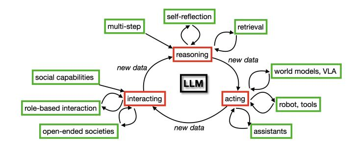

<!-- Source: AgenticLargeLanguageModels.pdf; physical PDF pages 15-24; Marker split PDF pages 1-10. -->

{0}------------------------------------------------

## Chapter 1

# Introduction

Large language models (LLMs) have taken the world by storm. Their ability to communicate with us in our own language, and to reason about our world, has made them a favorite tool for writing, answering questions, and much more.

Their answers already influence our decisions and our actions. What would happen if LLMs themselves could act in the world directly? What would happen if LLMs could interact with each other? Agentic LLMs combine the power of large language models with the ability to act in the real world. In this book we will discuss how agentic LLMs work, how they act, how they interact, and what this means for us, as users.

## 1.1 Why this book?

Artificial intelligence (AI) is changing the world. Large language models that *act* change the world in a new way. In order to understand the extent of these changes it is important for students and researchers of AI to understand both the technology itself and the applications that are now emerging. This understanding can help us influence the direction of these developments, perhaps build in safeguards, and, specifically, it will help us to develop the field further.

This book has been written for the graduate course on agentic LLMs that we teach at our university. In agentic LLMs two fields of AI research come together: the study of agents, and the study of large language models. Agents are changing the field of LLMs, and, conversely, LLMs are changing the field of agents. Although there are excellent books about LLMs and how they work (such as [Jurafsky and Martin](#page-8-0) [\[2025\]](#page-8-0)), the ability to act puts agentic LLMs in a class of their own. We think that there is a need for a course and for a book that explain how agentic LLMs work, and how they enable things that were not possible before.

## 1.2 Concepts and Definitions

The strength of the language abilities of LLMs is impressive, they talk just like we do. Now that LLMs have become agentic, their horizon extends far beyond talking: LLMs 

{1}------------------------------------------------

have capabilities for *reasoning*, for *using tools* such as writing and running code, for browsing the web to retrieve information, and for *interacting* with other agents or with the outside world.

This brings us to two definitions that we use in this book.

*Agents* perform actions, observe the effect of these actions and use the feedback they receive from the world to adapt their action policy.

*Agentic LLMs* are agents that integrate the power of LLMs, such as to communicate using natural language, write code, or process information.

#### 1.2.1 Agents that Assist, Agents that Interact

The ability to act has increased the relevance and applicability of LLMs in many domains of society. How are agentic LLMs used? In this book, we distinguish two major classes of use cases for Agentic LLMs:

(1) Agentic LLMs are used to *assist* their human users in application domains such as medicine, logistics, and finance (Part IV).

(2) Agentic LLMs are used to *interact* with each other to perform tasks or function in simulations of human behavior (Part V).

Many research papers have been published in recent years in both domains. We will provide overviews of key studies and trends throughout the book.

#### 1.2.2 Agentic Harness

From an engineering perspective, how do we construct agentic LLMs? Agentic LLMs consist of two elements: (1) the LLM, and (2) a piece of code that is called the *harness*.

#### Agentic LLM = LLM + Harness

The harness is a piece of computer code that wraps around the model and controls how it is called (a horse's harness helps us guide the power of the noble animal in a productive direction). The harness performs tasks such as prompt construction, answer processing, calling external tools, state management, system prompt management, and skill management. The harness loops through the reasoning, acting, and observing that are necessary for task completion, without the need for human intervention to guide the process manually. The agentic harness can thus be seen as a versatile automatic prompt engineer (Part II, Chapter 6). Importantly, the harness may *adapt* the behavior policy of the agent based on feedback on its actions, using reinforcement learning (Part III, Chapter 9).

#### 1.2.3 Multi-Modal Models

Understanding natural language is crucial for agents that interact with users and the world around them. However, for many tasks agents must also process other modalities, such as visual information, or other text formats, such as spreadsheets or computer code. As such, the domain of agentic LLMs extends beyond natural language,

{2}------------------------------------------------

Figure 1.1: Recursive self-improvement cycle connecting three categories of agentic LLM: reasoning, acting, and interacting (in red, corresponding to Parts II, III/IV and V). Concepts that influence a category are in green.

and includes multi-modal, code, and world models. Therefore, please note that in this book we use the term *LLM* pragmatically—depending on the context it can refer to language-only systems, or it can have a broader scope: *large transformer-based model that processes natural language, computer code, images, tool-commands, or other relevant modalities* (Part II, Chapter 7). In cases where the distinction is important, we flag which variant of the definition applies.

#### 1.2.4 Training Data

Agentic LLMs mark another paradigm shift in LLM engineering, that is related to machine learning. For a long time, the learning-emphasis in the field of LLMs has been on learning during model training, but now there is an increasing role for learning at inference time, when the model is queried.

This has two advantages. First, it creates flexibility and space for dynamic agentic behavior, as we will see in Chapters 8 and 9. Second, in an era where almost the entire internet has been used as data for pretraining models [\[Sutskever,](#page-8-0) [2024\]](#page-8-0), it has become useful to generate additional, relevant, and high-quality data. By interacting with the world, agents can generate such new data themselves. Figure 1.1 illustrates this process. This interaction-data can be used for additional training.

An example of how LLMs are trained on their own agentic actions are vision-language-action models that learn from robotic action sequences (Chapter 7). Another example can be found in Chapter 17, where societies of agents allow models to become more intelligent through interaction, just like humans learn new behaviors and ideas when they interact with one another.

Thus, in addition to enabling useful applications, another driver of agentic LLMs is the opportunity to generate more training data, creating a recursive self-improvement loop. In Figure 1.1 this virtuous cycle of interactive data generation is shown. Shown in red are the main categories: reasoning (Part II), acting (Parts III/IV), and interacting (Part V). In green are concepts that influence a category, either directly, or in a feedback loop.

{3}------------------------------------------------

## 1.3 Audience and Aim

This book is primarily written for graduate students and researchers in artificial intelligence and computer science. It may also be of interest to students and scholars from other fields, such as the cognitive and social sciences or humanities, as long as they have an intrinsic drive to engage with machine learning and technological challenges.

The book's aim is to introduce and review the advancements of techniques and applications in the field of agentic LLMs. We discuss the major concepts of agentic LLM engineering in some depth. We provide references to the scientific literature as well as links to source code and datasets so that you can experiment with building your own agents. Note that the field is new, and still very much in motion. A thorough understanding of the basics is important in order to be able to follow the latest developments. Our aim is to provide you with both.

We use this book for teaching the course Agentic LLMs that is part of the Master programs Computer Science (AI-track) and Creative Intelligence & Technology at Leiden University. A website with support material is available (lecture slides, assignments, news).1

Dear reader, we hope that you will enjoy reading this book as much as we did writing it. Agentic LLM research is a new field, and this book is just as fresh. New developments occur every day. We very much welcome your feedback and suggestions for following editions of this book, via the website!

## 1.4 Prerequisites

This book assumes that you have an undergraduate-level understanding of computer programming, artificial intelligence, machine learning, and natural language processing.

We assume that you know how to use Python and PyTorch. We also assume that you understand principles of machine learning, such as the difference between classification and regression, the difference between a training set and a test set, and the causes of overfitting and underfitting. You should know classical machine learning approaches such as decision trees, ensembles, and random forests. You should also be familiar with concepts of deep learning such as the architectures of artificial neural networks (fully connected multilayer perceptrons, convolutional neural networks, and recurrent neural networks), learning by backpropagation, with loss functions (such as cross-entropy) and activation functions (such as ReLU). We also expect that you are familiar with reinforcement learning: you should know what a sequential decision problem is, understand the difference between agent and environment, and know how to use some policy learning algorithms (such as Q-learning, DQN, PPO, and SAC). Finally, you should have an understanding of natural language processing: what is tokenization, what are word embeddings, what is attention, and what is Hugging Face.

However, we also believe that if you do not have in-depth knowledge about some or all of these topics and concepts, you may still find value in reading this book. We provide brief overviews of essential topics, you will learn about agentic LLMs at a

1<https://agenticllms.liacs.nl>

{4}------------------------------------------------

worthwhile level, and find entry points for further study. For some of the topics, you may find it useful to have a suitable textbook at hand,2 such as:

- for classical machine learning: [Alpaydin](#page-7-0) [\[2021\]](#page-7-0), [Flach](#page-7-0) [\[2012\]](#page-7-0),
- for deep supervised machine learning: [Bishop and Bishop](#page-7-0) [\[2023\]](#page-7-0), [Goodfellow](#page-7-0) [et al.](#page-7-0) [\[2016\]](#page-7-0), [Chollet and Chollet](#page-7-0) [\[2021\]](#page-7-0), [Stevens et al.](#page-8-0) [\[2020\]](#page-8-0),
- for reinforcement learning: [Sutton and Barto](#page-8-0) [\[2018\]](#page-8-0), [Graesser and Keng](#page-8-0) [\[2019\]](#page-8-0), [Plaat](#page-8-0) [\[2022\]](#page-8-0), [Franc¸ois-Lavet et al.](#page-7-0) [\[2018\]](#page-7-0),
- for natural language processing and transformers: [Jurafsky and Martin](#page-8-0) [\[2025\]](#page-8-0).

## 1.5 Course Structures

We use this book for the graduate course Agentic LLMs at our university. The book has been written to be both concise and comprehensive: we cover the full breadth of the field at a level suitable for a graduate course. To allow you to go deeper, we provide many pointers to the scientific literature, and some advanced topics are covered in the chapters and sections that are marked with a \*.

Different university programs may cover different material (see Table [1.1\)](#page-5-0). The course that we teach is comprehensive, and consists of 14 lectures: an introductory lecture, then 3 lectures on part I (language modeling), 3 lectures on parts II (reasoning) and III (agents), 3 lectures on part IV (tools and assistants), and 3 lectures on part V (social simulation). The course ends with a final evaluation lecture. Our course includes as assignments the four case studies, which we grade in an in-person meeting with the student. We do not have a separate theory exam at the end, the course grade is the average of the assignment grades.

Although you are of course free to use the book in any way that makes sense in your situation, we cover two main use cases for agentic LLMs: (1) assistants and (2) social simulation.

When your program includes a separate in-depth course on LLMs, then a core program to focus on (1) agentic assistants can include just parts II, III and IV. For the assignments, we suggest case study 2 and 3.

Alternatively, a core program to focus on (2) social simulation should cover parts II and III, and part V, using case study 2 and 4 for the assignments.

Both the assistants and the social simulation approach can be augmented with part I (language modeling), as necessary, depending on how the education program at your University is structured.

Part VI contains advanced topics. Chapter 19, on synthetic data generation, is suitable for the assistants use case, Part IV. Chapter 21, on mechanistic interpretability, is suitable to go more in depth for Parts I and II, the language and reasoning models. Chapter 20, on advanced architectures, is also suitable for Part II. Chapter 22, on cognitive architectures, is suitable for the social simulation use case, Part V.

Table [1.1](#page-5-0) summarizes the different options for use of the material in this book for three different course goals.

2See [Gunasekar et al.](#page-8-0) [\[2023\]](#page-8-0)

{5}------------------------------------------------

| Course Goal            | Parts             | Case Study | Chapters        | Optional |
|------------------------|-------------------|------------|-----------------|----------|
| Comprehensive          | I, II, III, IV, V | 1, 2, 3, 4 | 1-18            | 19-22    |
| Core Assistants        | II, III, IV       | 2, 3       | 6-14            | 2-5, 19  |
| Core Social Simulation | II, III, V        | 2, 4       | 6-10, 11, 15-18 | 2-5, 22  |

Table 1.1: Mapping different Course Goals to Parts and Chapters in this Book

## 1.6 Approach, Scope and Overview

Our approach is hands-on. For all new concepts we provide the theoretical background and we give examples of how to use them in practice. We discuss datasets, training algorithms, benchmarks, training environments, we provide pseudo-code of important agent algorithms, and we provide practical case studies to help you learn.

This book is organized in chapters that each cover a comprehensive topic. The chapters are organized in seven parts.

Part I provides a basic introduction to large language models. Chapter 2 discusses important natural language processing concepts such as tokenization, embeddings, recurrent neural networks, the attention mechanism, the transformer architecture, and autoregressive training (the machine learning method that is central to how LLMs are trained). We also discuss further machine learning methods: supervised learning and reinforcement learning. Next, in Chapter 3 we discuss in some detail the training pipeline that is used to train LLMs. We discuss dataset acquisition, pretraining, finetuning, instruction tuning, value alignment, and inference. We also discuss benchmarks that are commonly used to test the performance of LLMs. In Chapter 4 we discuss scaling laws and small language models, and we discuss energy consumption. To be able to use agentic LLMs, you must understand the basics of pretraining and finetuning a transformer model. In the final chapter of Part I, we help you acquire this experience with a practical case study where we will guide you to train a transformer model from scratch.

Part II provides an introduction into the concepts of reasoning, reflection, and world models, three concepts that are essential elements of (advanced) agentic LLMs. In Chapter 6 we start with in-context learning, and discuss how the chain of thought method has enabled LLMs to perform multi-step reasoning in simple math word problems. We will discuss how LLMs are used to self-reflect on their own in-context learning, to enhance their reasoning power, using a harness. So far, we have focused on models that use language. To act in the real world, our agents will also have to understand image data, and other modalities. In Chapter 7 we go beyond language and discuss models that understand vision and language, and also models that learn from decision sequences and know how to perform robotic actions. To act in the world without walking into walls, agents need some understanding of physics. In Chapter 7 we discuss world models, including their relation to model-based reinforcement learning. At that point, we will have discussed a multitude of different ways in which the agents learn and interact with their environment. In Chapter 8 we discuss in more depth how they learn, and how this learning is a form of metalearning.

Next, in Part III, Chapter 9 provides a historic review of agents in the perspective

{6}------------------------------------------------

of artificial intelligence, and we discuss different agentic interaction styles of agentic LLMs. Furthermore, in order to act in the world, agents need a form of memory. We discuss different agentic memory architectures in this chapter. We conclude Part III with a practical case study, where you can build a self-reflecting agent for challenging puzzles and games from the BALROG benchmarking suite.

In Part IV we switch gears, from theoretical concepts to practical implementations. We provide a discussion of the frameworks that have been developed in the community to implement agentic LLMs, and for them to use tools to act in the world. Some are proprietary, but many are open, and can be downloaded from Github. In this part, we discuss agents that act and perform practical tasks for their users. In Chapter 11 we discuss toolchains, frameworks and APIs that have been developed to implement agentic LLMs. In Chapter 12 we discuss retrieval augmentation methods and other methods to search for up to date information that was not available when the LLM was trained. Chapter 13 provides an overview of practical applications of agentic LLMs. We discuss applications of LLMs such as shopping assistants, medical assistants, trading assistants, and assistants that help perform scientific research. In the final chapter of Part IV we conclude with a practical case study of how to build a medical diagnosis agent (also to help you understand its shortcomings, so that you will never blindly follow an agent's medical advice).

Part V takes a different point of view: we look at agentic LLMs through a behavioral and cognitive lens, rather than a technical one. After defining and introducing machine-behavioral research in general, Chapter 15 discusses single LLMs and agentic LLMs in controlled, experimental settings to test their social behavior. Chapter 16 shifts to multi-agent systems, first discussing role-based interactions, where agentic LLMs are built or prompted to perform a certain role and interact in goal-directed ways. Next, in Chapter 17 we move to systems comprising multiple agents that interact in open-ended ways and study *emergent behaviors*, such as cooperation and norm-enforcement. The case study allows you to experience social agentic behavior in-depth.

The next part, Part VI, contains more advanced material. Chapter 19 discusses synthetic data generation. Like all forms of deep learning, LLMs remain to a large extent a black box, and we discuss techniques that can lift a corner of the veil. Chapter 20 discusses advanced architectures. We discuss transformers that are trained on decision traces, and looped and recursive LLMs. We also discuss advanced agentic architectures: in-context reinforcement learning, self-modifying agents and meta agents. Chapter 21 focuses on tools from mechanistic interpretability to map patterns of neuronal activity in transformer architectures, allowing to better understand the reasoning processes of LLMs. In Chapter 22 we review recent literature on behavior and cognition in Agentic LLMs, including advanced questions on Theory of Mind and consciousness.

Finally, in Part VII we draw together the elements of agentic LLMs that are provided in this book. In Chapter 23 we discuss what agentic LLMs currently can do, what they still can not do, and we conclude with a vision on what the future of agentic LLMs might bring.

Note that some of the Chapters and Sections are marked with a \*. These contain more advanced material, that might be better suited for a thesis than for a course.

{7}------------------------------------------------

## 1.7 Acknowledgments

This book grew out of our fascination with agentic LLMs, a fascination that caused many discussions with students and colleagues, as well as exciting research. At some point we felt that we had to write this book and to develop a graduate course. We believe that agentic LLM is a topic of great importance, that many students in AI will want to learn about.

Some of the material in this book is based on and inspired by earlier work (see, for example, [van Duijn et al.](#page-9-0) [\[2023\]](#page-9-0), [Van Der Meer et al.](#page-8-0) [\[2024\]](#page-8-0), [Huisman et al.](#page-8-0) [\[2021\]](#page-8-0), [Moerland et al.](#page-8-0) [\[2023\]](#page-8-0), [Plaat](#page-8-0) [\[2022\]](#page-8-0), [Plaat et al.](#page-8-0) [\[2025b,a\]](#page-8-0), [van Stein and Bäck](#page-9-0) [\[2024\]](#page-9-0), Chen et al. [2026], [van Wetten et al.](#page-9-0) [\[2025\]](#page-9-0), [Xing et al.](#page-9-0) [\[2025\]](#page-9-0)). We thank all co-authors of these works—this book could not have been written without you!

The case study on a society of generative agents in Chapter 18 was written and developed by Dorota Moravčíková and Friso van der Veen (based on [\[Park et al.,](#page-8-0) [2023\]](#page-8-0)), who adapted their existing work on this topic to fit this book. We are also grateful for their generous efforts and sharp comments on earlier chapters.

We thank our students and colleagues at our research institute. In particular, we thank Thomas Bäck, Joost Batenburg, Joost Broekens, Xi Chen, Lennard Froma, Bas Haring, Anna Kononova, Tom van Kouwenhoven, Thomas Moerland, Rob van Nieuwpoort, Mike Preuss, Peter van der Putten, Zhaochun Ren, Derya Soydaner, Suzan Verberne, Fien van Wetten, Annie Wong, and Tarik Zaciragić for many fruitful discussions.

## Bibliography

Ethem Alpaydin. *Machine learning*. MIT press, 2021. [19](#page-4-0)

C.M. Bishop and H. Bishop. *Deep Learning: Foundations and Concepts*. Computer Science. Springer International Publishing, 2023. ISBN 9783031454684. URL <https://books.google.nl/books?id=0uTgEAAAQBAJ>. [19](#page-4-0) Xi Chen, Aske Plaat, and Niki van Stein. How does chain of thought think? mechanistic interpretability of chain-of-thought reasoning with sparse autoencoding. In *AAAI2026, arXiv preprint arXiv:2507.22928*, 2026. 22 Francois Chollet and Franc¸ois Chollet. *Deep learning with Python*. simon and schuster, 2021. [19](#page-4-0) Peter Flach. *Machine learning: the art and science of algorithms that make sense of data*. Cambridge university press, 2012. [19](#page-4-0) Vincent Franc¸ois-Lavet, Peter Henderson, Riashat Islam, Marc G Bellemare, and Joelle Pineau. An introduction to deep reinforcement learning. *arXiv preprint arXiv:1811.12560*, 2018. [19](#page-4-0) Ian Goodfellow, Yoshua Bengio, and Aaron Courville. *Deep learning*. MIT press, 2016. [19](#page-4-0)

{8}------------------------------------------------

Laura Graesser and Wah Loon Keng. *Foundations of deep reinforcement learning: theory and practice in Python*. Addison-Wesley Professional, 2019. [19](#page-4-0) Suriya Gunasekar, Yi Zhang, Jyoti Aneja, Caio Cesar Teodoro Mendes, Allie Del ´ Giorno, Sivakanth Gopi, Mojan Javaheripi, Piero Kauffmann, Gustavo de Rosa, Olli Saarikivi, Adil Salim, Shital Shah, Harkirat Singh Behl, Xin Wang, Sebastien ´ Bubeck, Ronen Eldan, Adam Tauman Kalai, Yin Tat Lee, and Yuanzhi Li. Textbooks are all you need, 2023. URL <https://arxiv.org/abs/2306.11644>. [19](#page-4-0) Mike Huisman, Jan N Van Rijn, and Aske Plaat. A survey of deep meta-learning. *Artificial Intelligence Review*, 54(6):4483–4541, 2021. [22](#page-7-0) Daniel Jurafsky and James H. Martin. *Speech and Language Processing: An Introduction to Natural Language Processing, Computational Linguistics, and Speech Recognition, with Language Models*. Stanford, 3rd edition, 2025. URL [https:](https://web.stanford.edu/~jurafsky/slp3/) [//web.stanford.edu/˜jurafsky/slp3/](https://web.stanford.edu/~jurafsky/slp3/). Online manuscript released August 24, 2025. [15,](#page-0-0) [19](#page-4-0) Thomas M Moerland, Joost Broekens, Aske Plaat, Catholijn M Jonker, et al. Modelbased reinforcement learning: A survey. *Foundations and Trends® in Machine Learning*, 16(1):1–118, 2023. [22](#page-7-0) Joon Sung Park, Joseph O'Brien, Carrie Jun Cai, Meredith Ringel Morris, Percy Liang, and Michael S Bernstein. Generative agents: Interactive simulacra of human behavior. In *Proceedings of the 36th annual acm symposium on user interface software and technology*, pages 1–22, 2023. [22](#page-7-0) Aske Plaat. *Deep reinforcement learning*. Springer, 2022. [19,](#page-4-0) [22](#page-7-0) Aske Plaat, Max van Duijn, Niki van Stein, Mike Preuss, Peter van der Putten, and Kees Joost Batenburg. Agentic large language models, a survey. *Journal of Artificial Intelligence Research, arXiv preprint arXiv:2503.23037*, 84:29:1–29:74, 2025a. [22](#page-7-0) Aske Plaat, Annie Wong, Suzan Verberne, Joost Broekens, Niki van Stein, and Thomas Back. Multi-step reasoning with large language models, a survey. ¨ *ACM Computing Surveys, arXiv preprint arXiv:2407.11511*, 58(6):160:1–160:35, 2025b. [22](#page-7-0) Eli Stevens, Luca Antiga, and Thomas Viehmann. *Deep Learning with PyTorch: Build, train, and tune neural networks using Python tools*. Manning, 2020. [19](#page-4-0) Ilya Sutskever. Acceptance speech for test of time award. In *Advances in Neural Information Processing Systems*, Vancouver, British Columbia, Canada, 2024. [17](#page-2-0) Richard S Sutton and Andrew G Barto. *Reinforcement Learning*. Adaptive Computation and Machine Learning series. Bradford Books, Cambridge, MA, 2 edition, November 2018. [19](#page-4-0) Michiel Van Der Meer, Enrico Liscio, Catholijn Jonker, Aske Plaat, Piek Vossen, and Pradeep Murukannaiah. A hybrid intelligence method for argument mining. *Journal of Artificial Intelligence Research*, 80:1187–1222, 2024. [22](#page-7-0)

{9}------------------------------------------------

Max J van Duijn, Bram van Dijk, Tom Kouwenhoven, Werner de Valk, Marco R Spruit, and Peter van der Putten. Theory of mind in large language models: Examining performance of 11 state-of-the-art models vs. children aged 7-10 on advanced tests. *arXiv preprint arXiv:2310.20320*, 2023. [22](#page-7-0) Niki van Stein and Thomas Back. Llamea: A large language model evolutionary algo- ¨ rithm for automatically generating metaheuristics. *arXiv preprint arXiv:2405.20132*, 2024. [22](#page-7-0) Fien van Wetten, Aske Plaat, and Max van Duijn. Baba is llm: Reasoning in a game with dynamic rules. *arXiv preprint arXiv:2506.19095*, 2025. [22](#page-7-0) Peiwen Xing, Aske Plaat, and Niki van Stein. Cocomposer: Llm multi-agent collaborative music composition. *arXiv preprint arXiv:2509.00132*, 2025. [22](#page-7-0)