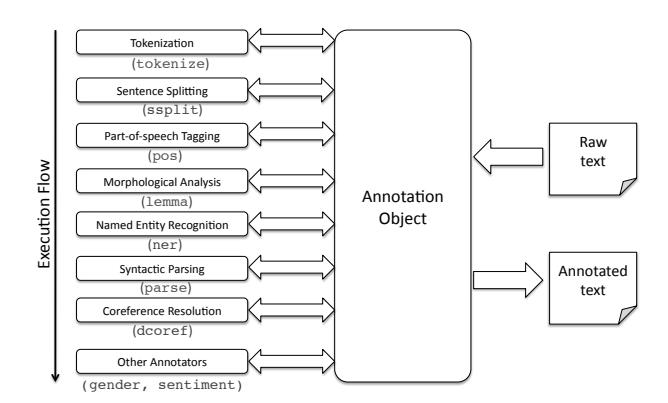
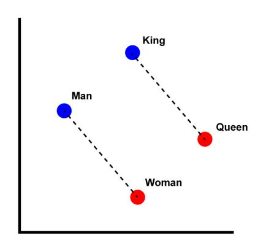
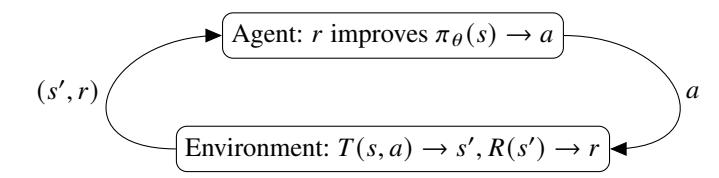
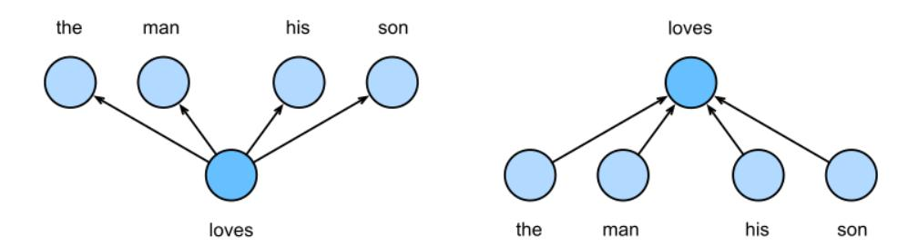
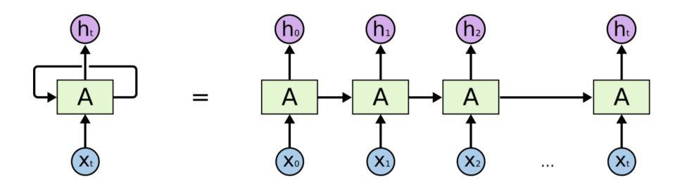
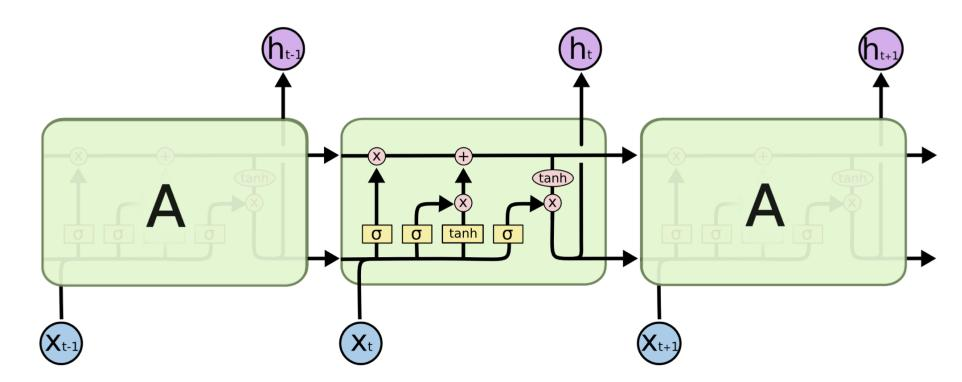
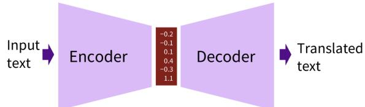
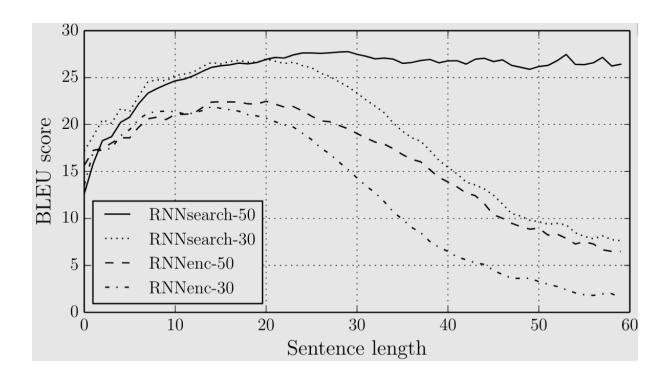
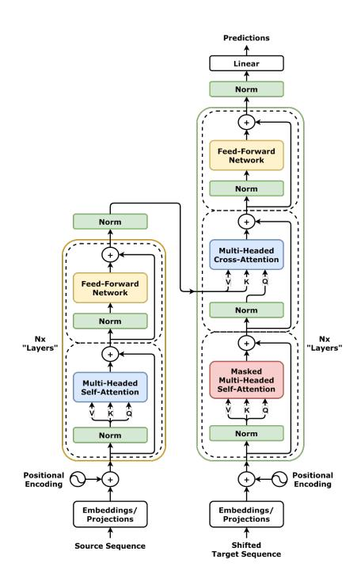

<!-- Source: AgenticLargeLanguageModels.pdf; physical PDF pages 29-62; Marker split PDF pages 1-34. -->

{0}------------------------------------------------

# Chapter 2

# Foundations of Language Modeling with LLMs

#### What You Will Learn

In this chapter you will learn how natural language can be processed in machine learning models. Specifically, you will be able to:

- Describe the core concepts of *language modeling*, including tokenization and early word-representation methods, and explain what problem each was designed to solve.
- Distinguish the learning regimes used to build a language model—*supervised, autoregressive, and reinforcement*—and state what each contributes to the final model.
- Explain how *embeddings* represent word meaning as vectors, and predict how semantically related words are positioned relative to one another.
- Explain how the *attention mechanism* forms flexible, context-dependent connections between tokens, and trace how a query, key, and value interact for a given input.
- Describe how the *transformer architecture* is built from attention, and identify its main components.
- Contrast *encoder* (classification) and *decoder* (generation) models, and select the appropriate one for a given NLP task.

# 2.1 Processing Natural Language

Language is the primary medium through which humans communicate. It takes many forms, from printed books and digital media to spoken discourse. Language research has long been a focus of multidisciplinary study. In artificial intelligence and computer science, language is especially significant: we use it to express complex ideas and write algorithms in programming languages.

{1}------------------------------------------------

Figure 2.1: A typical conversation with ELIZA

Language also enables interaction between software and its users.

For decades, AI has aimed to enable machines to understand human language. Research on this goal spans natural language processing (NLP) and its close counterpart, computational linguistics, as discussed in the field’s major textbook [\[Jurafsky and Martin,](#page-29-0) [2025\]](#page-29-0).1 This chapter surveys the challenges of representing *natural* (human) language computationally and traces the development of foundational techniques for doing so.

One early goal in NLP was practical machine translation. Since machine-translation research began in the 1950s [\[Hutchins,](#page-29-0) [1999\]](#page-29-0), language-processing technology has advanced substantially. Research has had a profound impact across industries, and industrial adoption has in turn driven application-oriented development. In NLP, foundational research and practical utility go hand in hand, so applications now extend beyond machine translation.

Language technology has recently had a profound social impact. We interact daily with chatbots such as ChatGPT and Claude, communicate in multiple languages, and use products that incorporate enhanced search engines. These capabilities build on earlier research. One famous early example is ELIZA, the psychotherapist chatbot that Joseph Weizenbaum developed in 1966 [\[Weizenbaum,](#page-32-0) [1966\]](#page-32-0). ELIZA was a rudimentary chatbot based on simple rule-based word substitutions (see Figure 2.1), yet people already attributed human-like qualities to it. Text-processing systems once relied on simple rules to identify words using delimiters such as whitespace; language technology has advanced far beyond those early methods.

1Originally further apart, the two fields have been growing closer in recent years, one starting from the linguistic side, the other from the computational side.

{2}------------------------------------------------

Figure 2.2: The standard NLP pipeline, as visualized by [Manning et al.](#page-30-0) [\[2014\]](#page-30-0)

#### 2.1.1 Language Understanding and Language Generation

Before considering how computers process language, we will consider how humans understand language.

Communication unfolds over time, and language is processed sequentially. People speak words one at a time and receive them in sequence. Computers likewise process language as sequences: characters in written text, syllables in speech, or whole words in early language models.

We will now look deeper into the technology developed for working with natural language sequences. This technology is categorized as either natural language *understanding* or natural language *generation*. We will briefly describe both categories.

**Natural Language Understanding** Natural language understanding (NLU) focuses on developing methods for capturing meaning and intent. Approaches and techniques for NLU map unstructured human language elements onto a structured format such that a computer can interpret and act upon them. Such techniques can involve several layers of processing, inspired by linguistic analysis (as visualized in Figure 2.2), as follows:

- Tokenization: determine boundaries between meaningful linguistic elements (such as words) to be used for further processing.
- Syntactic parsing: determine the grammatical structure (such as subjects, verbs, and objects).
- Named entity recognition (NER): identify and categorize key entities such as names, dates, and locations.
- Sentiment analysis: detect the emotional tone of a text.
- Coreference resolution: identify which entities referring expressions denote—for example, whether *it* refers to *the computer* in “The computer was new, but it was already slow.”

{3}------------------------------------------------

- Discourse analysis: understand how the meaning of a sentence is influenced by preceding sentences.

One of the primary challenges in NLU is dealing with ambiguity [\[Roth,](#page-31-0) [1998,](#page-31-0) [Liu](#page-29-0) [et al.,](#page-29-0) [2023\]](#page-29-0). Human language is rife with ambiguity. Examples are polysemy (words with multiple meanings, such as *bank*) and context-dependent nuances that require world knowledge to decode correctly. Many more challenges exist; naturally occurring human language is as rich and complex as humans are.

**Natural Language Generation** Natural language generation (NLG) focuses on developing methods for producing readable, natural-sounding human language. Tasks range from free-form language generation to the transformation of structured data or model representations into realistic utterances.

An important NLG task is *language modeling* (LM). In language modeling, the task is to predict the next element in a sequence, given the previous context. Mathematically, this involves assigning a probability distribution over sequences of words. Traditionally, this distribution was estimated using simple count-based models, often with simplifying assumptions that predict a word from a fixed window of preceding words.

Modern approaches use neural networks to generate fluent sentences from long contexts. These sentences can appear meaningful to a human observer.2 Effective language generation requires more than grammatical correctness; it also requires coherence (logical flow) and cohesion (linguistic links). Current NLG systems use sampling methods, ensembles, and other mechanisms to balance creativity and predictability, so that their output feels natural rather than robotic [\[Li and Jurafsky,](#page-29-0) [2017,](#page-29-0) [Dong et al.,](#page-28-0) [2022,](#page-28-0) [Gatt and Krahmer,](#page-28-0) [2018\]](#page-28-0). NLG techniques are commonly categorized into two approaches:

- **Extractive generation:** selecting and rearranging existing segments of text (often used in early summarization tools).
- **Abstractive generation:** generating entirely new sentences from scratch, as modern models such as ChatGPT do.

Most LLMs use the abstractive approach.

We will now discuss early, fundamental approaches to language modeling. We will start with the complexity of language, then discuss distributional representations, tokenization methods, and early language-model representations.

### 2.1.2 Complexity of Natural Language

Natural language can be difficult for machines to interpret for many reasons. Subtle features can carry or change meaning, so understanding language requires more than analyzing its structure.

2As the ELIZA example shows, making a sentence appear meaningful to a human observer is not always difficult.

{4}------------------------------------------------

The context in which something is said also shapes communication. Understanding goes beyond the literal words to capture intentions, implications, and other subtleties [\[Wittgenstein,](#page-32-0) [1953,](#page-32-0) [Grice,](#page-28-0) [1975,](#page-28-0) [Krause and Vossen,](#page-29-0) [2024\]](#page-29-0). Below, we introduce topics studied in linguistics, each offering a different perspective on what language can express.

**Syntax.** Syntax governs how words combine into well-formed sentences. In linguistics, it refers to the rules, principles, and processes that determine sentence structure in a particular language. In English, a common word order is subject–verb–object. In *The cat bites the dog*, for example, the verb *bites* follows the subject *cat*, so the cat is doing the biting.

**Morphology.** Morphology studies how words change form according to their grammatical function. These changes are related to syntax, and morphological rules and exceptions vary across languages and language families. In the preceding example, *bite* becomes *bites*; the suffix *-s* marks the third-person singular in the simple present tense.

**Semantics.** Lexical semantics studies the meanings of words. In natural languages, word meanings are related to one another. Words with similar meanings are *synonyms*, such as *car* and *automobile* or *vanish* and *disappear*. Words with opposite meanings are *antonyms*, such as *hot* and *cold* or *buy* and *sell*. Many other semantic relationships exist.

In NLP, computational semantics studies how to represent meaning in a computer. A simple sentence representation is a sequence of indices into a vocabulary. This records which words occur, but not the relationships among them, so it does not preserve their semantics.

Because word meanings depend on relationships among words, we need efficient ways to encode those relationships. Later in this chapter, we will see solutions including the Transformer architecture and attention mechanism.

**Pragmatics.** In addition to literal meaning, people consider a speaker’s intent and the context of an utterance. How language is used in particular social contexts affects its meaning (*meaning is use* [\[Baker and Hacker,](#page-27-0) [2008\]](#page-27-0)). Pragmatics studies the implicit, everyday rules people follow to communicate effectively.

A foundational set of principles is the Gricean maxims [\[Grice,](#page-28-0) [1975\]](#page-28-0): the unspoken cooperative principles people use to infer meaning. For example, the maxim of quantity says that speakers provide just as much information as the conversation requires.

{5}------------------------------------------------

These maxims help make communication understandable and cooperative. For a machine, interpreting sarcasm, subtext, or placeholders such as “thingy” requires knowledge of these rules; a static dictionary alone is not enough.

**Discourse.** Language rarely occurs in isolated sentences. It is organized into larger units, such as paragraphs, conversations, and full documents. Discourse studies how sentences connect to form a coherent whole. To interpret a text, a machine must track entities across sentences, a task called coreference resolution. For example, it may need to determine whether *it* refers to *the cat* or *the dog* mentioned earlier. Discourse understanding is important for complex NLP tasks such as document summarization, machine translation, and long-form dialogue.

In addition to these topics, other fields of study exist, such as phonetics (the sounds of a language that carry additional meaning in human communication), sociolinguistics (how language varies according to social factors like class or region), lexicography (the science of compiling dictionaries), and many more.

As this overview may have highlighted, the generation and understanding of natural languages are large and challenging fields. It is important to realize that language is not static. Language varies over time, across geographical locations, between different cultures, and depending on the medium through which it is communicated :-). This variation makes the creation of language technology a difficult and never-ending quest.

Before we introduce the recent technologies that provide at least a partial answer to these challenges, we discuss the fundamental assumptions that inspired the modern turn in NLP.

Representing natural language in a computer is difficult because natural language is rich and complex. In the remainder of this section, we discuss the principle of distributional representation, which states that the semantic meaning of a word is driven by the context that surrounds that word. Next, we will look at tokenization methods: methods for splitting sentences into words. Finally we will discuss how we can work with vectors of tokens to arrive at a representation that encodes meaning.

#### 2.1.3 Distributional Representations

How can we teach a machine to understand complex semantic relationships and grammatical structures without manually encoding them all? The answer lies in the distributional hypothesis, a foundational concept in modern NLP. The core idea was articulated in the late 1950s:

*You shall know a word by the company it keeps. (Firth, 1957)*

This suggests that a word’s meaning can be inferred from the words that typically appear around it. Words that occur in similar contexts are likely to have similar meanings. For example, if the words *coffee* and *tea* both frequently appear near verbs like *drink*, *sip*, or *brew*, then a machine may infer that there is a semantic relationship between them, without explicit definitions or other human-provided information.

{6}------------------------------------------------

Figure 2.3: Illustration of vector arithmetic with word2vec embeddings [\[Singerep,](#page-32-0) [2022\]](#page-32-0).

To apply the distributional hypothesis computationally, we use linear algebra and a framework called *vector semantics*. Each word is represented as a point in a high-dimensional continuous space. Words with similar meanings lie close together, and geometric measures such as cosine similarity can quantify their semantic similarity (see Figure 2.3 and Section [2.3.1\)](#page-14-0). Vector arithmetic can also express semantic relationships between words. Early methods built semantic vectors from sparse co-occurrence matrices by counting how often words appeared in one another’s contexts, as in the methods described in Section [2.1.5.](#page-8-0) Modern methods more often use dense, low-dimensional vectors called *word embeddings*. A neural model learns these representations by predicting a word from its context or the context from a word; the *word2vec* architecture helped popularize this approach [\[Mikolov et al.,](#page-30-0) [2013\]](#page-30-0).

Vector-based representations can capture word meaning, but assigning a separate vector to every word can require an impractically large vocabulary.

Word-level methods also struggle with rare and unseen words because the vocabulary contains no vector for them. Before assigning vectors, a model therefore needs manageable linguistic units. Modern systems address these issues by splitting text into smaller units, a process called tokenization, which we discuss next.

{7}------------------------------------------------

#### 2.1.4 Tokenization

Before a computer can process language, the text must be divided into manageable units. Whether the input is raw text collected from the web or text transcribed from speech, tokenization splits a continuous character sequence into meaningful units. A robust strategy must do more than split on spaces: it must handle differences among languages and dialects, complex punctuation, and newer forms such as emojis, while mapping the resulting tokens to a fixed-size vocabulary.

Text segmentation is a key step in many NLP pipelines. Although it may seem straightforward, punctuation can complicate the task—for example, an abbreviation may be written as N.L.P. or NLP. Simple rule-based tokenizers often fail on the irregularities of natural language. Example 1 shows several ways to construct tokens.

Example 1 (Tokenization Strategies). Consider the following sentence: "Leiden is beautiful in summer."

#### Word Tokenization

This approach typically splits text by spaces and punctuation. ["Leiden", "is", "beautiful", "in", "summer", "."]

#### Character Tokenization

This approach breaks the text down into individual characters.

["L", "e", "i", "d", "e", "n", " ", "i", "s", " ", "b", "e", "a", "u", "t", "i", "f", "u", "l", " ", "i", "n", " ", "s", "u", "m", "m", "e", "r", "."]

#### Subword Tokenization (e.g., WordPiece)

This approach preserves common words as whole tokens but breaks down complex or rare words into foundational subwords.

["Lei", "##den", "is", "beautiful", "in", "summer", "."]

**Word-Level Tokenization.** This approach treats each space-separated string as a unique token. While it preserves syntactic structure, it results in impractically large vocabularies and suffers from the out-of-vocabulary (OOV) problem: models cannot process words they did not see during training.

Large vocabularies are problematic due to the mechanics of *one-hot encoding*. If every word $w$ in a vocabulary $V$ is represented as a vector **x** $\in \{0,1\}^{|V|}$, where only the index corresponding to $w$ is 1, the dimensionality $|V|$ scales linearly with the size of the vocabulary.

{8}------------------------------------------------

vocabulary. As these one-hot vectors will later form the input to our neural networks, for texts that do not contain all words in a certain vocabulary, we end up creating sparse, computationally inefficient representations that fail to capture semantic relationships between words.

**Character-Level Tokenization.** Pure character-level modeling seems like a clear solution to the problem of growing vocabularies and has been explored over the years [\[Mielke et al.,](#page-30-0) [2021\]](#page-30-0). It restricts the vocabulary to the alphabet and nearly eliminates OOV issues. However, it greatly lengthens sequences and increases computational cost. Because individual characters carry little meaning, the model must learn word morphology before broader linguistic patterns, which increases training time.

**Subword Tokenization.** Current LLMs balance the previous two approaches: they preserve common words as whole tokens while decomposing rare words into smaller, meaningful components. Notable implementations include:

- Byte Pair Encoding (BPE): An iterative algorithm that begins with individual characters and merges the most frequent adjacent pairs into single tokens until a target vocabulary size is reached [\[Sennrich et al.,](#page-31-0) [2016\]](#page-31-0) (e.g., *highest* → [*high*, *est*]). BPE was originally proposed as a data compression algorithm [\[Gage,](#page-28-0) [1994\]](#page-28-0).
- WordPiece: An iterative algorithm, similar to BPE, that merges pairs based on a likelihood criterion rather than on raw frequency, aiming to maximize the probability of the training data [\[Wu et al.,](#page-32-0) [2016\]](#page-32-0).

#### 2.1.5 Early Methods for Language Representation

After tokenization, the next question is how to combine linguistic units (tokens) into coherent, meaningful sentences. In human language, the order of these units follows strict syntactic and semantic rules. If computational methods could accurately produce sensible text sequences, we might say that they capture—or at least reproduce—those rules.

How can we build mathematical representations that achieve this goal? A core task is *language modeling*. Mathematically, a language model computes the joint probability of a sequence of words in a given context. This probability helps distinguish a logical, fluent sentence from a random sequence of tokens. For example, in English, *the cat sat* is significantly more probable than *sat cat the* because the first sequence follows established syntactic rules.

Because written language is sequential, estimating a sentence’s joint probability is inherently a sequence-estimation problem.

{9}------------------------------------------------

The overarching goal of language modeling is to quantify the statistical likelihood that a sentence $S$ occurs in a particular language, based on its sequence of constituent words $w_1,\ldots,w_k$:

$P(S)=P(w_1,\ldots,w_k)$ (2.1)

For a vocabulary of size $|V|$ and a sentence of length $k$, there are $|V|^k$ possible word sequences. Directly calculating the exact joint probability therefore quickly becomes intractable as sentence length grows. The chain rule of probability lets us decompose the joint probability. With appropriate assumptions about conditional independence, the computation becomes tractable for real-world applications [Jurafsky and Martin, 2025](#page-29-0):

$P(w_1,\ldots,w_k)=P(w_1)\prod_{i=2}^{k}P(w_i\mid w_1,\ldots,w_{i-1})$ (2.2)

By maximizing this joint probability, probabilistic language models learn to favor grammatical and logically sound sequences. The learned probability distributions effectively reverse-engineer the unwritten rules of human language [Manning and Schütze, 1999](#page-29-0). To estimate probabilities from a segmented text corpus, early methods relied on maximum likelihood estimation (MLE). The simplest approach computes a word's marginal probability from its relative frequency in the corpus:

$P(w)=\frac{\operatorname{count}(w\text{ in corpus})}{\text{total number of words}}$ (2.3)

To make conditional probabilities manageable to compute, researchers use *n-gram models*. An $n$-gram is a contiguous sequence of $n$ items from a text sample. Instead of calculating a word's probability from its entire preceding history—which quickly becomes intractable—n-gram models apply the Markov assumption: a word's probability depends only on the preceding $n-1$ words, effectively truncating the context. A bigram model ($n=2$), for example, approximates the history using only the immediately preceding word. Its conditional probability is estimated from the frequency of the two words occurring together, divided by the frequency of the first word:

$P(w_i\mid w_1,\ldots,w_{i-1})\approx P(w_i\mid w_{i-1})=\frac{\operatorname{count}(w_{i-1},w_i)}{\operatorname{count}(w_{i-1})}$ (2.4)

A trigram model ($n=3$) conditions on the two preceding words. This simplification reduces computational cost and makes it feasible to estimate probabilities directly from a corpus.

Choosing $n$ involves a trade-off. A larger $n$ captures richer context and longer syntactic dependencies, which can produce more natural language. But it also worsens sparsity exponentially: specific word sequences occur less often, so the model increasingly encounters zero probabilities. A smaller $n$ gives more robust frequency counts but limits the model's understanding of broader semantic meaning and long-distance dependencies.

{10}------------------------------------------------

In a standard language model computation, observing an unseen $n$-gram results in a probability of zero, as it nullifies the joint probability of the entire sentence via multiplication. To mitigate this counterintuitive behavior, total counts are often smoothed. A common technique is *Laplace (or add-one) smoothing*, which adds a fictitious count of 1 to every possible vocabulary item. To maintain a valid probability distribution, the denominator is adjusted by adding the vocabulary size, $|V|$:

$P_{\mathrm{Laplace}}(w) = \frac{\operatorname{count}(w\text{ in corpus})+1}{\text{total number of words}+|V|}$ (2.5)

These probabilistic and count-based methods ultimately yield a numerical representation of language. A strong representation encodes the properties we intuitively grasp about a word: its meaning, its grammatical function, and its relationship with other words. In early NLP, these relative frequencies and co-occurrence counts were structured into vectors, representing words based on their distribution in the text.

While count-based representations are tractable, they result in vectors that are high-dimensional and sparse, leading to computational inefficiencies and poor generalization on unseen data. Consequently, modern NLP has transitioned toward learning dense, low-dimensional vector representations, known as *embeddings*, using neural networks. Instead of relying on explicit counting, these models learn continuous representations as a byproduct of predicting a word from its surrounding context, capturing deeper semantic relationships in a more efficient format. These modern approaches will be discussed in Section [2.3.](#page-13-0) First, we will briefly review three important machine learning approaches.

# 2.2 Machine Learning Methods For Natural Language Processing

Having established a primer on language representation, we will now turn to the learning algorithms that allow us to create the large models powering modern AI systems. LLMs are trained using methods from the broader field of machine learning. While machine learning is an extensive field of research, understanding LLMs requires familiarity with three core paradigms, and how they are used in language modeling: *supervised learning*, *autoregressive learning*, and *reinforcement learning*. We briefly touch upon these essential methods and refer to standard works for deeper exploration.

### 2.2.1 Supervised Learning

Supervised learning is a foundational machine-learning approach. It uses labels supplied in advance to guide the training process. A model is trained on paired inputs and labels, $D=\{(x_i,y_i)\}$, to learn the parameters $\theta$ of a predictive function $f_\theta$. For each input $x$, the model produces an estimate $\hat{y}$, written as $f_\theta(x)\rightarrow\hat{y}$. Computing this estimate is called *inference* or the *forward pass*.

{11}------------------------------------------------

After the forward pass, a loss function $L$ measures the difference between the estimate $\hat{y}$ and the true label $y$. Common examples are the sum of squared errors for regression, $L=\sum_i(\hat{y}_i-y_i)^2$, and cross-entropy for classification, $L=-\sum_c y_c\log(\hat{y}_c)$.

A supervised training algorithm adjusts the model parameters to minimize the total loss across the training examples. During the backward pass, gradients of the loss are propagated through the model and used to update its parameters, so the next forward pass yields a lower loss. Minimizing the loss on the training examples is called *training*. One complete pass of forward and backward computation over the training data is an *epoch*; for efficiency, each epoch may be divided into *batches*.

After training, we test the model $f_\theta$ on new examples that were not part of the training set to assess how well it generalizes.

If a model performs well on the training set, it has fit those examples; if it also performs well on the test set, it generalizes well. Strong training performance combined with weak test performance indicates *overfitting*: the model may have trained too long or have too many parameters, causing it to fit noise as well as signal. Weak performance on both sets indicates *underfitting*, which may result from too little training or a model too simple to capture the data’s complexity.

Generally speaking, problems with few variables (low-dimensional problems, such as simple regression) require smaller models (fewer parameters) and less training data to perform well. Problems with many variables (high-dimensional problems, such as image classification) require larger models with many millions of parameters (often deep neural networks) and large training datasets to perform well. Indeed, breakthrough performance in image classification [\[Krizhevsky et al.,](#page-29-0) [2012\]](#page-29-0) was only achieved after the construction of a large dataset with millions of hand-labeled images, ImageNet [\[Deng et al.,](#page-28-0) [2009\]](#page-28-0).

Supervised learning remains a core machine-learning method and is covered in many textbooks [\[Bishop and Bishop,](#page-27-0) [2023,](#page-27-0) [Goodfellow et al.,](#page-28-0) [2016\]](#page-28-0). It is also central to LLM training, for example in supervised fine-tuning, which we discuss in the next chapter.

#### 2.2.2 Autoregressive Learning

Many generative LLMs, especially decoder-only models, are trained autoregressively. Unlike supervised learning, this approach does not require a manually labeled input–output dataset; it uses large text corpora. The model predicts the next token in a sequence, using the text itself to provide the target. Autoregressive training is therefore a form of self-supervised learning.

During autoregressive pretraining, the model uses the preceding tokens $x_1,\ldots,x_{t-1}$ as context to predict the target token $x_t$ at position $t$. This next-token prediction objective is central to many modern NLP training pipelines [\[Radford et al.,](#page-31-0) [2018\]](#page-31-0).

{12}------------------------------------------------

Figure 2.4: Reinforcement Learning, after [Sutton and Barto](#page-32-0) [\[2018\]](#page-32-0)

Autoregressive learning is also covered in NLP textbooks [\[Jurafsky and Martin,](#page-29-0) [2025\]](#page-29-0). We will provide more details of these methods in Section [2.3](#page-13-0) and Chapter 3.

#### 2.2.3 Reinforcement Learning

Supervised and autoregressive learning usually rely on pre-collected datasets, so this chapter treats them as *offline* methods. In online reinforcement learning (RL), an agent can learn without a fixed labeled dataset when a function can evaluate state quality. The agent takes an action $a$, moving the environment from state $s$ to $s'$, and receives a reward $r(s')$; it generates experience through interaction during training, which is why RL is called an online method. The agent uses the reward to update a parameterized policy $\pi_\theta(s)\rightarrow a$, which selects an action for each state. In sequential decision problems, rewards may depend on a sequence of earlier actions. This creates the *credit-assignment problem*: which actions should receive credit for a reward? By repeatedly observing states, taking actions, and receiving rewards, the agent can explore the state space and learn an optimal policy $\pi^*(s)$ that selects an action in each state.

Because reinforcement learning is online, it forms a feedback loop. Early in training, the agent has little experience, so its policy is informed by feedback from only a few states. If it greedily exploits that limited information, it may visit only a small part of the environment and settle on a locally optimal policy. To find better policies, it must also explore—for example, by trying random actions and, ideally, covering the state space.

Reinforcement learning trains an agent through environmental feedback. It is often easier to evaluate whether an output is good using a reward function than to create a complete labeled dataset. Many RL algorithms therefore focus on effective exploration. A reinforcement-learning problem is commonly modeled as a Markov decision process (MDP), consisting of a state representation $S$, an action function $A(s)$, a transition function $T(s,a)\rightarrow s'$, and a reward function $R(s)$. The environment provides numeric rewards to indicate state quality; rewards may be positive or negative. The agent’s goal is to find a policy $\pi$ that chooses an optimal action $a^*$ for each state $s$. Figure 2.4 illustrates how an agent learns a policy through online interaction with an environment that can compute

{13}------------------------------------------------

functions $T$ and $R$ (the environment will answer the agent\'s question as to what the next state is that resulted from its action, and how good that state is).

When the state space is small enough to fit in memory, exact tabular methods such as Q-learning can be used [\[Watkins and Dayan,](#page-32-0) [1992\]](#page-32-0). For larger problems, function-approximation methods use models such as deep neural networks; examples include deep Q-learning (DQN) [\[Mnih et al.,](#page-30-0) [2015\]](#page-30-0) and proximal policy optimization (PPO) [\[Schulman et al.,](#page-31-0) [2017\]](#page-31-0). In deep reinforcement learning, a parameterized neural network represents the policy and is trained by backpropagation, as in supervised deep learning.

Reinforcement learning is one foundation of modern reasoning language models. Many textbooks cover the subject, including the seminal work by [Sutton and Barto](#page-32-0) [\[2018\]](#page-32-0) and more introductory texts [\[Graesser and Keng,](#page-28-0) [2019,](#page-28-0) [Plaat,](#page-31-0) [2020,](#page-31-0) [2022\]](#page-31-0). In LLM training, RL is used for reinforcement fine-tuning and multi-step reasoning, as discussed in Chapter 6. It also models learning through agent–environment interaction, which fits the agentic LLM setting. Agentic LLMs can use RL for in-context policy learning, prompt optimization, world models, and modeling interactions among agents and with their environments, as discussed later in this book.

Reinforcement learning is useful when an agent can generate experience by interacting with an environment, even when no pre-collected dataset is available. Before applying it, ask two questions: (1) Is the problem a sequential decision problem? If so, (2) how large is the state space—can exact tabular methods be used, or is function approximation needed?

With these language and machine-learning principles in place, we now return to language modeling.

# 2.3 Modeling Language

With the foundations of language representation and machine learning in place, we can examine three broad paradigms in NLP: symbolic, statistical, and neural approaches [\[Kautz,](#page-29-0) [2020,](#page-29-0) [Deng and Liu,](#page-28-0) [2018\]](#page-28-0). Each reflects a different way to represent language and manage its complexity. Over time, the field has drawn on increasingly powerful machine-learning methods and computing resources to process more data and train larger models.

**Symbolic methods.** Early rule-based systems, including ELIZA-like approaches, rely on explicit, human-defined instructions. By treating language as a formal system, they attempt to derive meaning from rules. They are transparent and interpretable by design, but

{14}------------------------------------------------

they are brittle: rigid rules (*if-then-else*) struggle to handle natural variation, idioms, and ambiguity in real-world language. Scaling these systems to larger tasks requires people to enumerate many edge cases, a labor-intensive approach that is impractical outside small problem domains.

**Statistical methods.** During the 1980s, NLP shifted toward empirical, probabilistic modeling. Instead of relying on explicit syntactic rules, methods such as hidden Markov models and $n$-gram language models use large text corpora to estimate the probabilities of word sequences. This data-driven approach scales more readily and handles linguistic ambiguity and noise better than symbolic systems. However, models that rely on the Markov assumption are limited to local word patterns, making it difficult for them to capture long-distance dependencies and broader context.

**Neural methods.** From around 2010 onward, neural networks and deep learning became dominant. Rather than representing language with explicit rules or discrete counts, neural methods learn dense, low-dimensional vectors in a continuous space. Modern architectures, especially Transformers, use attention to model context across an entire sequence. This approach supports strong generalization, fluent text generation, and cross-lingual applications. However, neural models are often difficult to interpret and require substantial data and computing resources.

Contemporary NLP pipelines draw on ideas from all three paradigms. Before examining an example training pipeline in the next chapter, we will introduce the core components used to build agentic LLM systems: word embeddings, contextualized embeddings, sequence modeling, attention, Transformers, encoders such as BERT, and decoders such as GPT.

### 2.3.1 Embeddings

One common way to represent lexical semantics is to count how often words occur near a target word. Define a context window that spans $n$ words to the left and right of the target. For example, with $n=2$ in *There are two cookies left on the table*, the context for *cookies* consists of *are*, *two*, *left*, and *on*. Sliding this window across a large corpus yields a co-occurrence matrix: each row represents a target word, each column a context word, and each cell counts how often that context word occurs near the target. For example, the vector for *cherry* may have a high value in the *pie* column (e.g., 442) and a low value in the

{15}------------------------------------------------

*computer* column (e.g., 2). The vector for *strawberry* would show a similar pattern, reflecting the semantic similarity between the two words.

By representing words as vectors, we place them in a high-dimensional vector space where each dimension corresponds to a context word. In this space, words with similar meanings, which share similar contexts, will point in similar directions. This geometric relationship allows us to measure semantic similarity numerically. The most common method for this is *cosine similarity*, which measures the cosine of the angle $\theta$ between two vectors **a** and **b**, as in Equation 2.6.

similarity $=\cos(\theta)=\frac{\mathbf{a}\cdot\mathbf{b}}{\lVert\mathbf{a}\rVert\,\lVert\mathbf{b}\rVert}=\frac{\sum_{i=1}^{n}a_i b_i}{\sqrt{\sum_{i=1}^{n}a_i^2}\sqrt{\sum_{i=1}^{n}b_i^2}}$ (2.6)

Earlier, we argued that count-based vectors result in high-dimensional spaces that scale linearly with vocabulary size. Since the number of dimensions dictates the computational complexity of downstream models, we wish to keep the dimensionality in check and instead create dense embeddings. For this, we use the classical word2vec algorithm [\[Mikolov et al.,](#page-30-0) [2013\]](#page-30-0). In this approach, a random embedding matrix $W$ is initialized and iteratively updated to match the intuition that similar words occur in similar contexts. This general framework uses two distinct techniques to achieve this: skip-gram and continuous bag-of-words, as shown in Figure [2.5.](#page-16-0)

The first, *skip-gram*, predicts which context words are likely to surround a given target word. It updates the matrix to ensure that the cosine similarity between positive samples, which are actual target and context pairs, is high, while driving down the similarity for negative samples, which are random word pairings. Because skipgram treats every target-context pairing as a distinct training observation, it heavily penalizes incorrect predictions even for infrequent terms. Hence, skip-gram excels at capturing fine-grained semantic details and produces accurate representations even for rare words.

The second, *continuous bag-of-words* (CBOW), performs the reverse operation. It predicts a single target word based on a combined set of surrounding context words. By averaging the context vectors before predicting the target, CBOW inherently smooths over the specific details of individual context words. This distributional smoothing is the reason for its distinct performance profile: CBOW trains significantly faster than skip-gram and is highly effective at capturing general syntactic relationships among frequent words, though it is less sensitive to rare words.

#### 2.3.2 Shifting to Contextualized Embeddings

Word2vec marked a major advance in learning high-quality word embeddings. However, it produces *static embeddings*: each word maps to a single vector regardless of context. This creates a problem for polysemous words. Consider the two uses of *bank* in the following sentences:

- 1. I need to go to the *bank* to withdraw some money.
- 2. The swimmer sat on the river *bank*.

{16}------------------------------------------------

Figure 2.5: Visualizations of the skipgram (left) and continuous bag-of-words (right) approaches to constructing word embeddings [\[Zhang et al.,](#page-32-0) [2023\]](#page-32-0).

In a static model, both uses of *bank* share one representation, which cannot reliably distinguish the financial sense from the geographic one. Modern architectures such as BERT and GPT (discussed later in this chapter) address this limitation with *contextualized embeddings*. Rather than retrieving a fixed vector from a lookup table, the model processes the full sequence and computes the representation of *bank* from its surrounding tokens (*money* and *withdraw* versus *river* and *swimmer*). The resulting vector reflects the word’s meaning in that context.

## 2.3.3 Recurrent Neural Networks

Although embeddings capture the complex semantics of individual words, we still need an efficient way to process language as a sequence. For classification tasks, simplifying independence assumptions can make computation more manageable. One option is to concatenate embeddings from a sliding window into a single vector representing the sentence. However, this quickly increases the classifier’s input size and does not scale well to long texts.

In humans, expectations about what comes next depend on what we have seen or heard so far. Earlier models approximated this sequential dependence using independence assumptions, as in Equation [2.2.](#page-9-0) Let the input sequence be $x_1,x_2,\ldots,x_t$, spanning time steps 1 through $t$. The next token can then be predicted according to $P(x_{t+1}\mid x_1,\ldots,x_t)$; equivalently, $x_{t+1}$ is the target $y_t$ at time step $t$.

To model sequential inputs and make predictions, a network must retain information from earlier steps. A *recurrent neural network* (RNN) does this by combining the current input with the network’s previous hidden state. In addition to producing a prediction $y_t$ (such as a word or token), it maintains a hidden state $h_t$. Equations [2.7](#page-17-0) and [2.8](#page-17-0) formalize these computations. Figure [2.6](#page-17-0) shows the RNN architecture and its unrolled representation across time steps.

{17}------------------------------------------------

Figure 2.6: Unrolled RNN (illustration from Chris Olah's blog [\[Olah et al.,](#page-30-0) [2015\]](#page-30-0))

Figure 2.7: Repeating module of an LSTM (illustration from Chris Olah's blog [\[Olah](#page-30-0) [et al.,](#page-30-0) [2015\]](#page-30-0))

$h_t=f(Uh_{t-1}+Wx_t+b_h)$ (2.7)

$y_t=g(Vh_t+b_y)$ (2.8)

These equations introduce trainable parameter matrices **U**, **V**, and **W**, along with bias terms **b**. Together, they determine how the network updates its hidden state and computes its output logits. In principle, RNNs can process sequences of arbitrary length, so they are not restricted to an n-gram-style Markov assumption when representing context.

RNNs are trained with *backpropagation through time* (BPTT): the network is unrolled across time, and gradients are propagated from step $t$ back to earlier steps $t-1,t-2,\ldots$. The repeated matrix multiplications involved in this process can cause gradients to *vanish or explode* [\[Bengio et al.,](#page-27-0) [1994,](#page-27-0) [Pascanu et al.,](#page-31-0) [2013\]](#page-31-0). As a result, information from early time steps often has less influence on the gradients than more recent information, making it difficult for RNNs to learn long-range dependencies.

{18}------------------------------------------------

**LSTMs** The long short-term memory (LSTM) architecture was introduced to address the gradient problem [Hochreiter, 1997](#page-29-0). An LSTM controls the flow of information by adding gates that determine what information to retain, update, or expose (see Figure [2.7](#page-17-0)). At each time step $t$, it maintains two states: a cell state $c_t$ and a hidden state $h_t$:

$f_t=\sigma(U_fh_{t-1}+W_fx_t)$

$k_t=c_{t-1}\odot f_t$

$g_t=\tanh(U_gh_{t-1}+W_gx_t)$

$i_t=\sigma(U_ih_{t-1}+W_ix_t)$

$j_t=g_t\odot i_t$

$c_t=j_t+k_t$

$o_t=\sigma(U_oh_{t-1}+W_ox_t)$

$h_t=o_t\odot\tanh(c_t)$

Here, $\odot$ denotes element-wise multiplication of two vectors, also known as the Hadamard product. Besides LSTMs, other variants include the gated recurrent unit (GRU), which balances computational complexity and the number of trainable parameters [Cho et al., 2014](#page-28-0).

Recurrent neural networks played an important role in language modeling. For further explanations of RNNs, LSTMs, and GRUs, see [Olah et al., 2015](#page-30-0), [Bishop and Bishop, 2023](#page-27-0), and [Goodfellow et al., 2014](#page-28-0).

**Encoder–Decoder** So far, we have formulated our task as language modeling: predicting the next word from the preceding context. An alternative formulation is useful for tasks such as machine translation.

Machine translation may look like predicting token $x_{t+1}$ from inputs $x_1,\ldots,x_t$, but it is a *sequence-to-sequence* (seq2seq) problem: the input is a sentence $x_1,\ldots,x_n$ in one language, and the output is a translated sentence $y_1,\ldots,y_m$ in another. The lengths $n$ and $m$ can differ, and translation may change word order. For example:

*We will celebrate the relief of Leiden* (7 words)

*Wij gaan Leids Ontzet vieren* (5 words)

The encoder–decoder architecture is designed for seq2seq tasks, where input and output lengths may differ. The encoder and decoder are two distinct RNNs that map a variable-length input to a variable-length output. The encoder processes the input one step at a time and compresses its information into a fixed-length vector, often called the context vector.3

{19}------------------------------------------------

Figure 2.8: Illustration of the Encoder-Decoder architecture

This forces the information into a *bottleneck*: compressing information of an input sequence $x_1,\ldots,x_t$ into a single hidden vector. However, this process is difficult to model and there is a loss of information. See Figure 2.8 for an illustration of the architecture.

The context vector acts as the bridge between the encoder and the decoder. It is the final hidden state of the encoder that is passed to the decoder as its initial hidden state. This vector encodes the semantic meaning of the entire source sentence, so the decoder can begin generating the target sequence accurately. The decoder is a second RNN that produces output tokens, conditioned on the context vector. Its goal is to generate the output sequence one token at a time. This continues until a special end-of-sequence token is generated. This approach works well, in principle. However, forcing a long input sentence into a single, fixed-length context vector causes information loss (the bottleneck problem). Moreover, RNNs struggle to remember the beginning of long sequences by the time they reach the end. These two problems combined prompted the development of a more dynamic approach for passing information between the encoder and decoder, which we will discuss next.

#### 2.3.4 Attention

To address the bottleneck problem, researchers developed ways to pass information from the full input sequence to the decoder. During generation, the decoder can then select the input positions that matter for predicting the next token.

This line of research led to attention mechanisms [\[Bahdanau et al.,](#page-27-0) [2015,](#page-27-0) [Kim et al.,](#page-29-0) [2017\]](#page-29-0). Figure [2.9](#page-20-0) compares translation quality, measured by BLEU score [\[Papineni et al.,](#page-31-0) [2002\]](#page-31-0), for models with and without attention; higher scores indicate better translations. The attention-based RNNsearch model maintains translation quality as sentences get longer, while the standard RNN encoder–decoder model (RNNenc) degrades sharply.

Attention forms a context vector from a weighted combination of encoder hidden states rather than relying on only the final hidden state. This lets the decoder focus on the input positions relevant to the current output.

3Not to be confused with the LSTM's context vector. NLP research has repurposed terminology in relatively little time. Language in research papers is also a moving target.

{20}------------------------------------------------

Figure 2.9: The bilingual evaluation understudy (BLEU) scores of generated translations with respect to the lengths of the sentences [\[Bahdanau et al.,](#page-27-0) [2015\]](#page-27-0)

We control how much each input token $x_i$ contributes by assigning it a weight $\alpha_{ji}$ in the linear combination. Here, $\mathbf{c}_j$ is the context vector for output step $j$, and $\mathbf{h}_i$ is the hidden state for input token $i$:

$\mathbf{c}_j=\sum_{i=1}^{n}\alpha_{ji}\mathbf{h}_i$ (2.9)

The weights $\alpha_{ji}$ (often called attention weights) are not fixed; they are computed dynamically. A key observation is that we can make use of the hidden states $h_i$, which are a representation of the semantics of a token or word. We can find out how relevant one hidden state is to another, by comparing them, for example by computing their cosine similarity. The *softmax-normalized dot product* is a common approach:

- 1. Compare the current decoder state with each encoder hidden state by applying a similarity function (such as a dot product) to see how well they match.
- 2. Pass these scores through a softmax function so they sum to 1, effectively creating a probability distribution over the input tokens.

Attention can improve translation quality, but RNNs still process tokens sequentially and cannot fully exploit GPU parallelism. To scale to large datasets, researchers removed recurrence and adopted parallel architectures with a fixed context window. *Self-attention* allows tokens to incorporate information from one another while being processed in parallel. Equation 2.10 illustrates this computation of contextualized representations.

$\mathbf{a}_3=\sum_{j=1}^{5}\alpha_{3j}\mathbf{x}_j=\sum_{j=1}^{5}\operatorname{softmax}(\mathbf{x}_3\cdot\mathbf{x}_j)\mathbf{x}_j$ (2.10)

{21}------------------------------------------------

$\operatorname{Attention}(Q,K,V)=\operatorname{softmax}\left(\frac{QK^{\mathsf T}}{\sqrt{d_k}}\right)V$ (2.11)

Here, $Q$ contains query vectors, $K$ contains the key vectors they are compared with, and $V$ contains the values to be combined. The dimension $d_k$ is the size of each key vector and is used to scale the scores. As $d_k$ increases, the dot products $QK^{\mathsf T}$ can become large, pushing softmax into regions with small gradients. Dividing by $\sqrt{d_k}$ counteracts this effect and helps stabilize training.

In multi-head attention, each head applies its own linear projections to the queries, keys, and values, allowing different heads to learn different token-interaction patterns. Language contains many kinds of relationships, including syntactic (which verb is linked to a noun?), semantic (is a word being used metaphorically?), and referential (whom does “he” refer to?). Multiple heads operate in parallel so the model can represent several relationships at once. For example, heads may focus on grammatical structure, pronouns, or entities. Their outputs are concatenated into a richer representation, as shown in Equation 2.12.

$\operatorname{MultiHead}(Q,K,V)=\operatorname{Concat}(\operatorname{head}_1,\ldots,\operatorname{head}_h)W^O$ (2.12), where $\operatorname{head}_i=\operatorname{Attention}(QW_i^Q,KW_i^K,VW_i^V)$

#### 2.3.5 Transformers

How can attention be used to build a language-modeling architecture? One answer is the Transformer, introduced in the seminal work by [Vaswani et al.](#page-32-0) [\[2017\]](#page-32-0).

Attention is the core of the Transformer architecture. The original Transformer, shown in Figure [2.10](#page-22-0), has both an encoder stack and a decoder stack. Most LLMs use decoder-only Transformer architectures.

The figure shows *Transformer blocks*, each consisting of a self-attention module, a feed-forward network, a normalization layer, and residual connections. LLMs typically stack many such blocks. For example, GPT-2 has 12 or more layers, depending on the model version.

The Transformer architecture has three main components: embeddings, Transformer blocks, and output probabilities:

- 1. Embedding: First, the input text is tokenized and mapped to low-dimensional embedding vectors. Positional encodings are added to preserve word order.

{22}------------------------------------------------

Figure 2.10: Visualization of the Transformer architecture [\[Godoy,](#page-28-0) [2020,](#page-28-0) [Vaswani](#page-32-0) [et al.,](#page-32-0) [2017\]](#page-32-0)

- 2. Transformer Blocks: The transformer blocks are the main feature of the architecture. Most models consist of multiple layers of transformer blocks. Within each layer, each block consists of three elements:
  - Self-attention Mechanism: The attention mechanism allows long range connections between tokens, capturing contextual information and relationships between tokens. Multiple attention heads allow the model to consider these relationships from different perspectives, for example, for short-range syntactic links, and for broader semantic context. For an encoder stack, transformers use self-attention. For a decoder stack, they use masked self-attention, to prevent looking at the future.
  - Multi-layer Perceptron: A fully-connected feed-forward network operates on each token independently. The attention layer makes connections between tokens, whereas the MLP can refine each token's representation.
  - Normalization: Transformer blocks typically use normalization, dropout regularization, and residual connections to reduce vanishing or exploding gradients and improve training stability.

{23}------------------------------------------------

- 3. Output Probabilities: linear and softmax layers transform the processed embeddings into probabilities, to make the next-token predictions.

Compared with earlier methods such as RNNs and LSTMs, Transformers offer two main advantages: (1) large-scale parallel processing and (2) fine-grained, long-range semantic connections. These bring both speed and semantic accuracy.

Transformers have dominated language modeling since their introduction. As large, high-quality training corpora became available, Transformer-based LLMs achieved strong results in question answering, data-to-text generation, and other application-driven tasks. Researchers continue to scale up these models in pursuit of greater capabilities [\[Brown et al.,](#page-27-0) [2020\]](#page-27-0). [Chapter 4](../04-scaling-laws-and-efficiency/04-scaling-laws-and-efficiency-en.md) discusses how to improve performance further.

The Transformer architecture is complex. For a more detailed walkthrough, see the interactive tutorial in footnote 4 and the case study in [Chapter 5](../05-case-study-1-building-llms-from-scratch/05-case-study-1-building-llms-from-scratch-en.md).

### 2.3.6 Encoder-only (BERT)

The original Transformer combines an encoder and a decoder, but modern architectures often use only one of the two because they have different empirical strengths.

Encoders are trained to produce meaningful representations (embeddings) of input data, often using masked language modeling (MLM). They are well suited to natural language understanding (NLU) tasks such as text classification and sentiment analysis. Decoders are better suited to natural language generation (NLG) tasks such as text generation, paraphrasing, and summarization.

Encoder-only models produce high-quality vector representations of input text. Unlike causal decoders, which can attend only to preceding tokens, encoders are bidirectional: each token can attend to every other token in the sequence. This global context helps the model build a rich semantic representation of the input. A common training method is masked language modeling. In the original BERT setup, roughly 15% of token positions are selected as prediction targets: 80% of the selected tokens are replaced by `[MASK]`, 10% by a random token, and 10% are left unchanged [\[Devlin et al.,](#page-28-0) [2018\]](#page-28-0). The model learns to predict the original token from its surrounding context, using the usual cross-entropy loss. This objective encourages the model to learn grammar, semantics, and some world knowledge.

To improve learning, in addition to the [MASK] token, encoder training typically includes several special tokens:

- `[CLS]` (classification token): Placed at the start of the sequence. After all layers process it, its final state serves as an aggregate representation of the sequence.

4See, for example, <https://poloclub.github.io/transformer-explainer/>

{24}------------------------------------------------

- `[SEP]` (separator token): Marks sentence or segment boundaries, which is useful for tasks such as question answering.
- `[PAD]` (padding token): Pads sequences in a batch to the same length.

The best-known encoder-only model is BERT, short for *Bidirectional Encoder Representations from Transformers* [\[Devlin et al.,](#page-28-0) [2018\]](#page-28-0). Other popular encoder-only models include its successors RoBERTa [\[Liu et al.,](#page-30-0) [2019\]](#page-30-0) and ALBERT [\[Lan et al.,](#page-29-0) [2019\]](#page-29-0).

Encoder-only models are well suited to transfer learning: their representations can be fine-tuned for downstream tasks, such as domain-specific classification. This process has two stages:

1. **Pretraining:** Train the model on a large corpus, often containing billions of words. It may learn, for example, associations between *King* and *Man*, and between *Queen* and *Woman*. At this stage, the model learns general language patterns rather than a specific task. Pretraining is computationally expensive and may take weeks or months.
2. **Fine-tuning:** Add a small task-specific layer, often called a *classification head*, and train the model on labeled examples for a task such as spam detection or sentiment analysis. Since the model already has general language representations, it may adapt with far fewer examples than training from scratch. Fine-tuning is usually much cheaper and may take hours or minutes.

Having covered encoder-only models, we now turn to decoder-only models.

#### 2.3.7 Decoder-only (GPT)

Decoder-only models are commonly used for language generation. They are trained autoregressively to predict the next token and often generate text one token at a time. Because each prediction depends on the tokens generated so far, the model uses *causal attention*: it cannot use future tokens when predicting the current one. A look-ahead mask, often represented as a triangular matrix, sets future-token attention scores to $-\infty$. For example, when predicting *apple* in *The boy ate the...*, the model must not attend to *apple* in the training sequence; it must rely only on preceding context. Thus, encoders use masked language modeling, while decoders use *causal language modeling*, as shown in [Equation 3.1 in Chapter 3](../03-llm-training-pipeline/03-llm-training-pipeline-en.md#page-4-0).

Pretraining and fine-tuning therefore play different roles for decoders.

{25}------------------------------------------------

During pretraining, decoders learn to predict the next token. They are then fine-tuned with the same loss function on a different type of data. This training also enables *in-context learning* (ICL), or prompt-based learning: because decoders are trained to continue a sequence, they can generate an answer from a prompt without any weight updates. In effect, the model learns from examples in the prompt [\[Brown et al.,](#page-27-0) [2020\]](#page-27-0). The ability to use large decoders through ICL, without expensive task-specific training or fine-tuning, has attracted considerable interest.

Decoder-only models include the *Generative Pre-trained Transformer* (GPT) family [\[Radford et al.,](#page-31-0) [2018,](#page-31-0) [2019,](#page-31-0) [Brown et al.,](#page-27-0) [2020,](#page-27-0) [Ouyang et al.,](#page-30-0) [2022,](#page-30-0) [Achiam et al.,](#page-27-0) [2023\]](#page-27-0). These models are widely used, and many other open and closed models have also been developed. Together, the training methods discussed in this chapter form the basis of the modern LLM pipeline, which [Chapter 3](../03-llm-training-pipeline/03-llm-training-pipeline-en.md) examines in more detail.

# 2.4 Concluding Remarks

This chapter traced NLP’s evolution from its linguistic foundations to the neural architectures behind today’s large language models. Human language is complex, shaped by syntax, morphology, and subtle semantic and pragmatic features. NLP has progressed through symbolic, statistical, and neural paradigms. These shifts produced core components of modern language models, including dense embeddings and attention, alongside increases in data, model size, and compute. Encoder models are generally suited to NLU, while decoder models are suited to NLG. Both rely on pretraining and fine-tuning; decoder models also support prompt-based in-context learning.

#### 2.4.1 Open challenges

Although modern LLMs perform impressively and support many useful applications, important challenges remain. Understanding them can help researchers identify open questions and build more robust systems, including agentic LLMs.

**Performance scaling.** Current language-modeling approaches often follow *scaling laws*: generalization can improve as the number of parameters, the amount of data, and the compute budget increase. Scaling also brings substantial costs. State-of-the-art systems may require billions of parameters and millions of dollars in training compute, with significant environmental impact. An open question is how efficient architectures can improve generalization to tasks not seen during training. Current research explores pruning and quantization ([Chapter 4](../04-scaling-laws-and-efficiency/04-scaling-laws-and-efficiency-en.md)). Synthetic data generation ([Chapter 19](../19-synthetic-data-generation/19-synthetic-data-generation-en.md)) may improve generalization without requiring additional training data.

{26}------------------------------------------------

However, the ideal balance between model size and generalization remains unclear.

**Data scarcity.** Most NLP training datasets and benchmarks are built for English, including GLUE (General Language Understanding Evaluation) [\[Wang et al.,](#page-32-0) [2018\]](#page-32-0) and SQuAD, a question-answering dataset [\[Rajpurkar et al.,](#page-31-0) [2016\]](#page-31-0)]. These datasets often draw on large web crawls. High-resource languages such as Chinese and Hindi can also benefit from this data, while lower-resource languages such as Dutch and Flemish have fewer digital resources for training modern Transformers from scratch. Because models reflect the cultural context of their training data, speakers of languages other than English may experience weaker performance or bias toward Western perspectives and linguistic norms.

**Multilinguality.** Because language resources vary, NLP rarely offers a single solution that works equally well for every language. Adapting an English-trained model to other languages introduces linguistic challenges. Turkish, Finnish, and Arabic, for example, have richer morphology and can encode substantial information in prefixes and suffixes. A single Turkish word may convey what takes an entire English sentence to express. Models not trained on these languages may fail to capture this linguistic richness.

Languages also use different writing systems. Handling non-Latin scripts—such as Chinese characters and the abjads used for Hebrew and Arabic—requires tokenization and embedding methods that produce useful subword units.

**Language evolution.** Languages change faster than models can be retrained, which can lead to out-of-vocabulary (OOV) problems. Even with subword methods such as byte-pair encoding (BPE) [\[Gage,](#page-28-0) [1994\]](#page-28-0) and WordPiece [\[Song et al.,](#page-32-0) [2021\]](#page-32-0), models may struggle with new words, slang, technical terms, and names that appeared after the training cutoff. A model trained in 2022, for example, may not understand global events or cultural shifts that emerged in 2026, including new cultural references such as the “Gen Z stare.” An open challenge is to update models continually without causing them to forget previously learned information, a problem known as catastrophic forgetting [\[Wu et al.,](#page-32-0) [2024\]](#page-32-0).

**Tokenization beyond text.** Multimodal modeling aims to represent images, audio, and video in the same latent space as text. Text consists of discrete words or characters, whereas audio and video are continuous signals that must be sampled and quantized. Processing a video frame or an audio segment alongside text may require specialized approaches such as Vision Transformers (ViT) [\[Han et al.,](#page-29-0) [2022\]](#page-29-0) and Contrastive Language–Image Pre-training (CLIP) [\[Radford et al.,](#page-31-0) [2021\]](#page-31-0). [Chapter 7](../07-vision-action-and-world-models/07-vision-action-and-world-models-en.md) discusses multimodal models.

{27}------------------------------------------------

**Interpretability.** An important open question is how these models work internally. We can measure their performance, but often cannot explain why a model gave a particular answer. Models can also fail or hallucinate, producing convincing but incorrect responses. In high-stakes areas such as military, legal, and medical applications, this lack of transparency may hinder the adoption of language models. [Chapter 21](../21-mechanistic-interpretability-for-llm-agents/21-mechanistic-interpretability-for-llm-agents-en.md) discusses techniques such as mechanistic interpretability.

Language modeling also faces broader sociotechnical challenges, including ethical alignment and long-form reasoning. As NLP evolves, addressing one problem often reveals deeper questions for future students, researchers, and engineers.

### 2.4.2 Looking Ahead

This chapter introduced the foundations of language modeling, from early approaches to modern decoder models. [Chapter 3](../03-llm-training-pipeline/03-llm-training-pipeline-en.md) turns to agentic LLMs and examines the training pipeline of a large language model in greater detail.

# Bibliography

Josh Achiam, Steven Adler, Sandhini Agarwal, Lama Ahmad, Ilge Akkaya, Florencia Leoni Aleman, Diogo Almeida, Janko Altenschmidt, Sam Altman, Shyamal Anadkat, et al. Gpt-4 technical report. *arXiv preprint arXiv:2303.08774*, 2023. [54](#page-25-0) Dzmitry Bahdanau, Kyunghyun Cho, and Yoshua Bengio. Neural machine translation by jointly learning to align and translate. In Yoshua Bengio and Yann LeCun, editors, *3rd International Conference on Learning Representations, ICLR 2015, San Diego, CA, USA, May 7-9, 2015, Conference Track Proceedings*, 2015. URL [http://](http://arxiv.org/abs/1409.0473) [arxiv.org/abs/1409.0473](http://arxiv.org/abs/1409.0473). [48,](#page-19-0) [49](#page-20-0) Gordon P Baker and Peter Michael Stephan Hacker. *Wittgenstein: Understanding and meaning: Volume 1 of an analytical commentary on the philosophical investigations, part I: Essays*, volume 1. John Wiley & Sons, 2008. [33](#page-4-0) Yoshua Bengio, Patrice Simard, and Paolo Frasconi. Learning long-term dependencies with gradient descent is difficult. *IEEE transactions on neural networks*, 5(2):157– 166, 1994. [46](#page-17-0) C.M. Bishop and H. Bishop. *Deep Learning: Foundations and Concepts*. Computer Science. Springer International Publishing, 2023. ISBN 9783031454684. URL <https://books.google.nl/books?id=0uTgEAAAQBAJ>. [40,](#page-11-0) [47](#page-18-0) Tom Brown, Benjamin Mann, Nick Ryder, Melanie Subbiah, Jared D Kaplan, Prafulla Dhariwal, Arvind Neelakantan, Pranav Shyam, Girish Sastry, Amanda Askell, et al. 

{28}------------------------------------------------

Language models are few-shot learners. *Advances in neural information processing*

- *systems*, 33:1877–1901, 2020. [52,](#page-23-0) [54](#page-25-0) KyungHyun Cho, Bart van Merrienboer, Dzmitry Bahdanau, and Yoshua Bengio. On the properties of neural machine translation: Encoder-decoder approaches. *CoRR*, abs/1409.1259, 2014. URL <http://arxiv.org/abs/1409.1259>. [47](#page-18-0) Jia Deng, Wei Dong, Richard Socher, Li-Jia Li, Kai Li, and Li Fei-Fei. ImageNet: A large-scale hierarchical image database. In *2009 IEEE conference on computer vision and pattern recognition*, pages 248–255. Ieee, 2009. [40](#page-11-0) Li Deng and Yang Liu. *Deep learning in natural language processing*. Springer, 2018. [42](#page-13-0) Jacob Devlin, Ming-Wei Chang, Kenton Lee, and Kristina Toutanova. Bert: Pretraining of deep bidirectional transformers for language understanding. *arXiv preprint arXiv:1810.04805*, 2018. [53](#page-24-0) Chenhe Dong, Yinghui Li, Haifan Gong, Miaoxin Chen, Junxin Li, Ying Shen, and Min Yang. A survey of natural language generation. *ACM Comput. Surv.*, 55(8), December 2022. ISSN 0360-0300. doi: 10.1145/3554727. URL [https://doi.](https://doi.org/10.1145/3554727) [org/10.1145/3554727](https://doi.org/10.1145/3554727). [32](#page-3-0) Philip Gage. A new algorithm for data compression. *The C Users Journal*, 12(2): 23–38, 1994. [37,](#page-8-0) [55](#page-26-0) Albert Gatt and Emiel Krahmer. Survey of the state of the art in natural language generation: Core tasks, applications and evaluation. *Journal of Artificial Intelligence Research*, 61:65–170, 2018. [32](#page-3-0) Daniel Voigt Godoy. dl-visuals. [https://github.com/dvgodoy/](https://github.com/dvgodoy/dl-visuals/?tab=readme-ov-file) [dl-visuals/?tab=readme-ov-file](https://github.com/dvgodoy/dl-visuals/?tab=readme-ov-file), 2020. URL [https://github.](https://github.com/dvgodoy/dl-visuals/?tab=readme-ov-file) [com/dvgodoy/dl-visuals/?tab=readme-ov-file](https://github.com/dvgodoy/dl-visuals/?tab=readme-ov-file). [51](#page-22-0) Ian Goodfellow, Jean Pouget-Abadie, Mehdi Mirza, Bing Xu, David Warde-Farley, Sherjil Ozair, Aaron Courville, and Yoshua Bengio. Generative adversarial nets. In *Advances in Neural Information Processing Systems*, pages 2672–2680, 2014. [47](#page-18-0) Ian Goodfellow, Yoshua Bengio, and Aaron Courville. *Deep learning*. MIT press, 2016. [40](#page-11-0) Laura Graesser and Wah Loon Keng. *Foundations of deep reinforcement learning: theory and practice in Python*. Addison-Wesley Professional, 2019. [42](#page-13-0)
- H. P. Grice. *Logic and Conversation*, page 41–58. BRILL, December 1975. ISBN 9789004368576. doi: 10.1163/9789004368811 003. URL [http://dx.doi.](http://dx.doi.org/10.1163/9789004368811_003) [org/10.1163/9789004368811\\_003](http://dx.doi.org/10.1163/9789004368811_003). [33](#page-4-0)

{29}------------------------------------------------

Kai Han, Yunhe Wang, Hanting Chen, Xinghao Chen, Jianyuan Guo, Zhenhua Liu, Yehui Tang, An Xiao, Chunjing Xu, Yixing Xu, et al. A survey on vision transformer. *IEEE transactions on pattern analysis and machine intelligence*, 45(1):87– 110, 2022. [55](#page-26-0) S Hochreiter. Long short-term memory. *Neural Computation MIT-Press*, 1997. [47](#page-18-0) John Hutchins. Retrospect and prospect in computer-based translation. In *Proceedings of Machine Translation Summit VII*, pages 30–36, Singapore, Singapore, September 13-17 1999. URL <https://aclanthology.org/1999.mtsummit-1.5/>. [30](#page-1-0) Daniel Jurafsky and James H. Martin. *Speech and Language Processing: An Introduction to Natural Language Processing, Computational Linguistics, and Speech Recognition, with Language Models*. Stanford, 3rd edition, 2025. URL [https:](https://web.stanford.edu/~jurafsky/slp3/) [//web.stanford.edu/˜jurafsky/slp3/](https://web.stanford.edu/~jurafsky/slp3/). Online manuscript released August 24, 2025. [30,](#page-1-0) [38,](#page-9-0) [41](#page-12-0) Henry Kautz. The third ai summer, henry kautz,. AAAI 2020 Robert S Engelmore Memorial Award Lecture, 02 2020. [42](#page-13-0) Yoon Kim, Carl Denton, Luong Hoang, and Alexander M Rush. Structured attention networks. *arXiv preprint arXiv:1702.00887*, 2017. [48](#page-19-0) Lea Krause and Piek T.J.M. Vossen. The Gricean maxims in NLP—a survey. In Saad Mahamood, Nguyen Le Minh, and Daphne Ippolito, editors, *Proceedings of the 17th International Natural Language Generation Conference*, pages 470–485, Tokyo, Japan, September 2024. Association for Computational Linguistics. doi: 10.18653/v1/2024.inlg-main.39. URL [https://aclanthology.org/2024.](https://aclanthology.org/2024.inlg-main.39/) [inlg-main.39/](https://aclanthology.org/2024.inlg-main.39/). [33](#page-4-0) Alex Krizhevsky, Ilya Sutskever, and Geoffrey E Hinton. ImageNet classification with deep convolutional neural networks. *Advances in neural information processing systems*, 25, 2012. [40](#page-11-0) Zhenzhong Lan, Mingda Chen, Sebastian Goodman, Kevin Gimpel, Piyush Sharma, and Radu Soricut. ALBERT: A lite BERT for self-supervised learning of language representations. *CoRR*, abs/1909.11942, 2019. URL [http://arxiv.org/abs/](http://arxiv.org/abs/1909.11942) [1909.11942](http://arxiv.org/abs/1909.11942). [53](#page-24-0) Jiwei Li and Dan Jurafsky. Neural net models of open-domain discourse coherence. In Martha Palmer, Rebecca Hwa, and Sebastian Riedel, editors, *Proceedings of the 2017 Conference on Empirical Methods in Natural Language Processing*, pages 198–209, Copenhagen, Denmark, September 2017. Association for Computational Linguistics. doi: 10.18653/v1/D17-1019. URL [https://aclanthology.](https://aclanthology.org/D17-1019/) [org/D17-1019/](https://aclanthology.org/D17-1019/). [32](#page-3-0) Alisa Liu, Zhaofeng Wu, Julian Michael, Alane Suhr, Peter West, Alexander Koller, Swabha Swayamdipta, Noah Smith, and Yejin Choi. We're afraid language models aren't modeling ambiguity. In Houda Bouamor, Juan Pino, and Kalika Bali,

{30}------------------------------------------------

- editors, *Proceedings of the 2023 Conference on Empirical Methods in Natural Language Processing*, pages 790–807, Singapore, December 2023. Association for Computational Linguistics. doi: 10.18653/v1/2023.emnlp-main.51. URL [https:](https://aclanthology.org/2023.emnlp-main.51/) [//aclanthology.org/2023.emnlp-main.51/](https://aclanthology.org/2023.emnlp-main.51/). [32](#page-3-0) Yinhan Liu, Myle Ott, Naman Goyal, Jingfei Du, Mandar Joshi, Danqi Chen, Omer Levy, Mike Lewis, Luke Zettlemoyer, and Veselin Stoyanov. Roberta: A robustly optimized BERT pretraining approach. *CoRR*, abs/1907.11692, 2019. URL [http:](http://arxiv.org/abs/1907.11692) [//arxiv.org/abs/1907.11692](http://arxiv.org/abs/1907.11692). [53](#page-24-0)
- C. Manning and H. Schutze. *Foundations of Statistical Natural Language Processing*. Foundations of Statistical Natural Language Processing. MIT Press, 1999. ISBN 9780262133609. URL [https://books.google.nl/books?](https://books.google.nl/books?id=ZL34DwAAQBAJ) [id=ZL34DwAAQBAJ](https://books.google.nl/books?id=ZL34DwAAQBAJ). [38](#page-9-0) Christopher Manning, Mihai Surdeanu, John Bauer, Jenny Finkel, Steven Bethard, and David McClosky. The Stanford CoreNLP natural language processing toolkit. In Kalina Bontcheva and Jingbo Zhu, editors, *Proceedings of 52nd Annual Meeting of the Association for Computational Linguistics: System Demonstrations*, pages 55–60, Baltimore, Maryland, June 2014. Association for Computational Linguistics. doi: 10.3115/v1/P14-5010. URL [https://aclanthology.org/](https://aclanthology.org/P14-5010/) [P14-5010/](https://aclanthology.org/P14-5010/). [31](#page-2-0) Sabrina J. Mielke, Zaid Alyafeai, Elizabeth Salesky, Colin Raffel, Manan Dey, Matthias Galle, Arun Raja, Chenglei Si, Wilson Y. Lee, Beno ´ ˆıt Sagot, and Samson Tan. Between words and characters: A brief history of open-vocabulary modeling and tokenization in nlp, 2021. URL [https://arxiv.org/abs/2112.](https://arxiv.org/abs/2112.10508) [10508](https://arxiv.org/abs/2112.10508). [37](#page-8-0) Tomas Mikolov, Kai Chen, Greg Corrado, and Jeffrey Dean. Efficient estimation of ´ word representations in vector space. In Yoshua Bengio and Yann LeCun, editors, *1st International Conference on Learning Representations, ICLR 2013, Scottsdale, Arizona, USA, May 2-4, 2013, Workshop Track Proceedings*, 2013. URL [http:](http://arxiv.org/abs/1301.3781) [//arxiv.org/abs/1301.3781](http://arxiv.org/abs/1301.3781). [35,](#page-6-0) [44](#page-15-0) Volodymyr Mnih, Koray Kavukcuoglu, David Silver, Andrei A Rusu, Joel Veness, Marc G Bellemare, Alex Graves, Martin Riedmiller, Andreas K Fidjeland, Georg Ostrovski, et al. Human-level control through deep reinforcement learning. *nature*, 518(7540):529–533, 2015. [42](#page-13-0) Christopher Olah et al. Understanding lstm networks, 2015. URL [http://colah.](http://colah.github.io/posts/2015-08-Understanding-LSTMs/) [github.io/posts/2015-08-Understanding-LSTMs/](http://colah.github.io/posts/2015-08-Understanding-LSTMs/). [46,](#page-17-0) [47](#page-18-0) Long Ouyang, Jeffrey Wu, Xu Jiang, Diogo Almeida, Carroll Wainwright, Pamela Mishkin, Chong Zhang, Sandhini Agarwal, Katarina Slama, Alex Ray, et al. Training language models to follow instructions with human feedback. *Advances in Neural Information Processing Systems*, 35:27730–27744, 2022. [54](#page-25-0)

{31}------------------------------------------------

Kishore Papineni, Salim Roukos, Todd Ward, and Wei-Jing Zhu. Bleu: a method for automatic evaluation of machine translation. In *Proceedings of the 40th annual meeting of the Association for Computational Linguistics*, pages 311–318, 2002. [48](#page-19-0) Razvan Pascanu, Tomas Mikolov, and Yoshua Bengio. On the difficulty of training recurrent neural networks. In Sanjoy Dasgupta and David McAllester, editors, *Proceedings of the 30th International Conference on Machine Learning*, volume 28 of *Proceedings of Machine Learning Research*, pages 1310–1318, Atlanta, Georgia, USA, 17–19 Jun 2013. PMLR. URL [https://proceedings.mlr.press/](https://proceedings.mlr.press/v28/pascanu13.html) [v28/pascanu13.html](https://proceedings.mlr.press/v28/pascanu13.html). [46](#page-17-0) Aske Plaat. *Learning to play: reinforcement learning and games*. Springer, 2020. [42](#page-13-0) Aske Plaat. *Deep reinforcement learning*. Springer, 2022. [42](#page-13-0) Alec Radford, Karthik Narasimhan, Tim Salimans, and Ilya Sutskever. Improving language understanding by generative pre-training. *OpenAI Blog*, 2018. [40,](#page-11-0) [54](#page-25-0) Alec Radford, Jeffrey Wu, Rewon Child, David Luan, Dario Amodei, Ilya Sutskever, et al. Language models are unsupervised multitask learners. *OpenAI blog*, 1(8):9, 2019. [54](#page-25-0) Alec Radford, Jong Wook Kim, Chris Hallacy, Aditya Ramesh, Gabriel Goh, Sandhini Agarwal, Girish Sastry, Amanda Askell, Pamela Mishkin, Jack Clark, et al. Learning transferable visual models from natural language supervision. In *International conference on machine learning*, pages 8748–8763. PMLR, 2021. [55](#page-26-0) Pranav Rajpurkar, Jian Zhang, Konstantin Lopyrev, and Percy Liang. Squad: 100,000+ questions for machine comprehension of text. *arXiv preprint arXiv:1606.05250*, 2016. [55](#page-26-0) Dan Roth. Learning to resolve natural language ambiguities: A unified approach. In Jack Mostow and Chuck Rich, editors, *Proceedings of the Fifteenth National Conference on Artificial Intelligence and Tenth Innovative Applications of Artificial Intelligence Conference, AAAI 98, IAAI 98, July 26-30, 1998, Madison, Wisconsin, USA*, pages 806–813. AAAI Press / The MIT Press, 1998. URL [http://www.](http://www.aaai.org/Library/AAAI/1998/aaai98-114.php) [aaai.org/Library/AAAI/1998/aaai98-114.php](http://www.aaai.org/Library/AAAI/1998/aaai98-114.php). [32](#page-3-0) John Schulman, Filip Wolski, Prafulla Dhariwal, Alec Radford, and Oleg Klimov. Proximal policy optimization algorithms. *arXiv preprint arXiv:1707.06347*, 2017. [42](#page-13-0) Rico Sennrich, Barry Haddow, and Alexandra Birch. Neural machine translation of rare words with subword units. In Katrin Erk and Noah A. Smith, editors, *Proceedings of the 54th Annual Meeting of the Association for Computational Linguistics (Volume 1: Long Papers)*, pages 1715–1725, Berlin, Germany, August 2016. Association for Computational Linguistics. doi: 10.18653/v1/P16-1162. URL <https://aclanthology.org/P16-1162/>. [37](#page-8-0)

{32}------------------------------------------------

Singerep. File:word vector illustration.jpg. Wikimedia Commons, 2022. URL [https://commons.wikimedia.org/wiki/File:Word\\_vector\\_](https://commons.wikimedia.org/wiki/File:Word_vector_illustration.jpg) [illustration.jpg](https://commons.wikimedia.org/wiki/File:Word_vector_illustration.jpg). Accessed: 2026-01-08. Licensed under CC BY-SA 4.0. [35](#page-6-0) Xinying Song, Alex Salcianu, Yang Song, Dave Dopson, and Denny Zhou. Fast wordpiece tokenization. In *Proceedings of the 2021 conference on empirical methods in natural language processing*, pages 2089–2103, 2021. [55](#page-26-0) Richard S Sutton and Andrew G Barto. *Reinforcement Learning*. Adaptive Computation and Machine Learning series. Bradford Books, Cambridge, MA, 2 edition, November 2018. [41,](#page-12-0) [42](#page-13-0) Ashish Vaswani, Noam Shazeer, Niki Parmar, Jakob Uszkoreit, Llion Jones, Aidan N Gomez, Łukasz Kaiser, and Illia Polosukhin. Attention is all you need. *Advances in neural information processing systems*, 30, 2017. [50,](#page-21-0) [51](#page-22-0) Alex Wang, Amanpreet Singh, Julian Michael, Felix Hill, Omer Levy, and Samuel Bowman. Glue: A multi-task benchmark and analysis platform for natural language understanding. In *Proceedings of the 2018 EMNLP workshop BlackboxNLP: Analyzing and interpreting neural networks for NLP*, pages 353–355, 2018. [55](#page-26-0) Christopher JCH Watkins and Peter Dayan. Q-learning. *Machine learning*, 8(3):279– 292, 1992. [42](#page-13-0) Joseph Weizenbaum. Eliza—a computer program for the study of natural language communication between man and machine. *Commun. ACM*, 9(1):36–45, January 1966. ISSN 0001-0782. doi: 10.1145/365153.365168. URL [https://doi.](https://doi.org/10.1145/365153.365168) [org/10.1145/365153.365168](https://doi.org/10.1145/365153.365168). [30](#page-1-0) Ludwig Wittgenstein. *Philosophical Investigations*. Basil Blackwell, Oxford, 1953. [33](#page-4-0) Tongtong Wu, Linhao Luo, Yuan-Fang Li, Shirui Pan, Thuy-Trang Vu, and Gholamreza Haffari. Continual learning for large language models: A survey. *arXiv preprint arXiv:2402.01364*, 2024. [55](#page-26-0) Yonghui Wu, Mike Schuster, Zhifeng Chen, Quoc V. Le, Mohammad Norouzi, Wolfgang Macherey, Maxim Krikun, Yuan Cao, Qin Gao, Klaus Macherey, Jeff Klingner, Apurva Shah, Melvin Johnson, Xiaobing Liu, Łukasz Kaiser, Stephan Gouws, Yoshikiyo Kato, Taku Kudo, Hideto Kazawa, Keith Stevens, George Kurian, Nishant Patil, Wei Wang, Cliff Young, Jason Smith, Jason Riesa, Alex Rudnick, Oriol Vinyals, Greg Corrado, Macduff Hughes, and Jeffrey Dean. Google's neural machine translation system: Bridging the gap between human and machine translation, 2016. URL <https://arxiv.org/abs/1609.08144>. [37](#page-8-0) Aston Zhang, Zachary C. Lipton, Mu Li, and Alexander J. Smola. File:Continuous Bag of Words model (CBOW).svg. Wikimedia Commons, 2023. URL [https://en.wikipedia.org/wiki/File:Continuous\\_Bag\\_of\\_](https://en.wikipedia.org/wiki/File:Continuous_Bag_of_Words_model_(CBOW).svg) [Words\\_model\\_\(CBOW\).svg](https://en.wikipedia.org/wiki/File:Continuous_Bag_of_Words_model_(CBOW).svg). Accessed: 2026-01-09. Original source: d2l-ai/d2l-en. Licensed under CC BY-SA 4.0. [45](#page-16-0)

{33}------------------------------------------------

