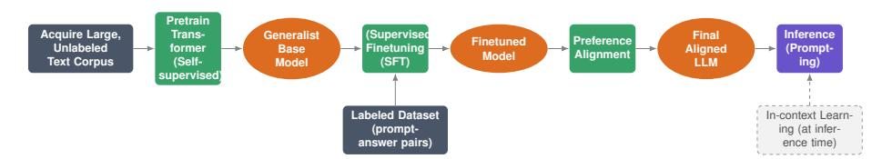
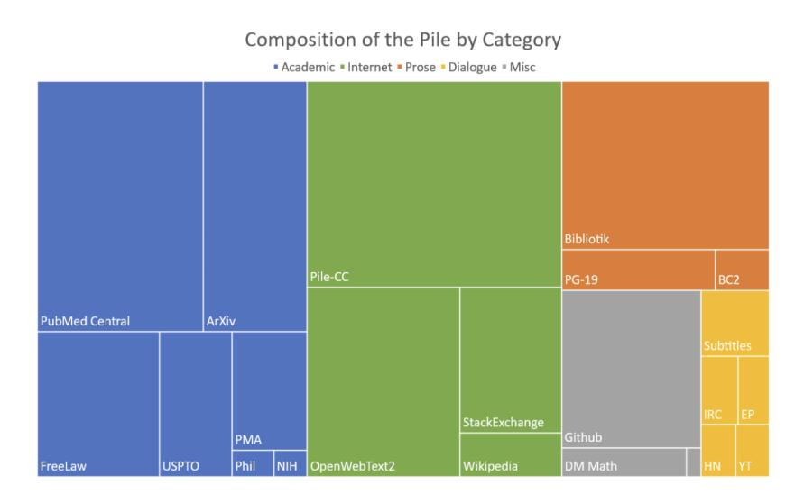
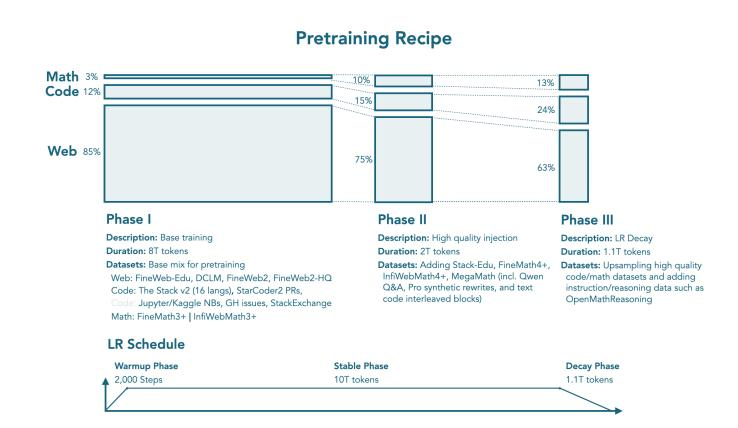
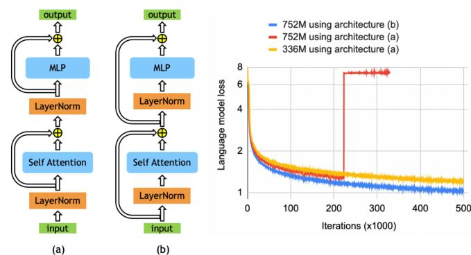
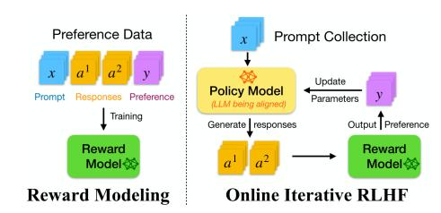
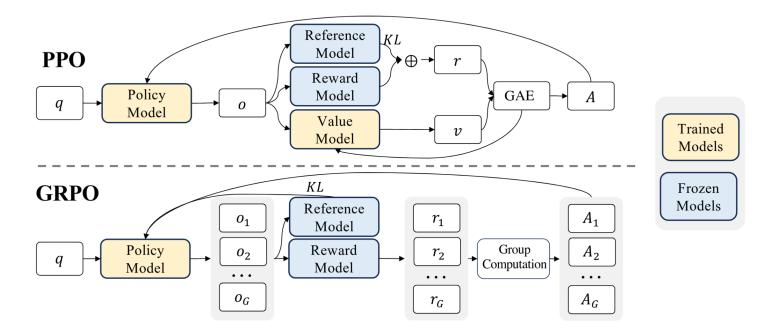

<!-- Source: AgenticLargeLanguageModels.pdf; physical PDF pages 63-82; Marker split PDF pages 1-20. -->

{0}------------------------------------------------

## Chapter 3

# The Large Language Model Training Pipeline

#### What You Will Learn

In this chapter you will learn how language models are trained. Specifically, you will be able to:

- Describe the main stages of a basic language-model training pipeline and explain the purpose of each: *data acquisition, pretraining, fine-tuning, preference tuning, and inference*.
- Distinguish *pretraining from fine-tuning* and explain why preference tuning follows them.
- Explain how the *encoder/decoder* distinction shapes a model's training objective.
- Identify common *benchmarks* used to evaluate language models, and state what capability each is meant to measure.

## 3.1 Training Models

Large language models are generally trained through a sequence of stages. First, a model architecture is initialized with random parameters. During *pretraining*, the model learns language capabilities from large text corpora, often using an autoregressive objective. Pretraining produces a base model, which is not necessarily suited to a particular practical application. The model is then adapted to downstream tasks during *post-training*, using additional, task-specific data to elicit behaviors such as instruction following or classification.

{1}------------------------------------------------

#### 3.1.1 Encoder versus Decoder Models

As discussed in Chapter 2, two broad model architectures are common: encoders and decoders. Encoders can build rich contextualized representations of input data. Many recent high-performing models, however, use decoder architectures. Encoders are well suited to understanding tasks such as classification and sentiment analysis, whereas decoders excel at generation. Decoder models have grown in both parameter count and training-data volume, enabling surprisingly strong generalization to contexts they have not seen.

Next, we examine the main stages of a decoder-only training pipeline.

#### 3.1.2 Pretraining/Finetuning Paradigm

A key to modern training pipelines is transfer learning. A common practice is to take a model trained on a large, general-purpose dataset and continue training it on a new task. The model is first *pretrained* on a large, general corpus and then *fine-tuned* on a smaller dataset for a specific task. Fine-tuning is faster because the task-specific dataset is small and training starts from the pretrained weights rather than from scratch.

The pretraining/fine-tuning distinction lies at the heart of LLM training pipelines. Instead of starting from scratch, a model can reuse linguistic knowledge learned during pretraining, which speeds up adaptation. Pretraining a large commercial model may take months. A downstream task is usually specific, such as answering questions in a particular domain or performing sentiment analysis, and uses a dedicated dataset for fine-tuning. During fine-tuning, some of the model's weights are updated to teach it the new task while preserving its general language capabilities. Adapting a model to a new task typically takes minutes to hours.

#### 3.1.3 Open and Closed Models

Popular LLMs are OpenAI's ChatGPT series [\[Achiam et al.,](#page-13-0) [2023,](#page-13-0) [Ouyang et al.,](#page-16-0) [2022\]](#page-16-0), Meta's LLaMa family [\[Touvron et al.,](#page-18-0) [2023\]](#page-18-0), Google's Gemma [\[Chowdhery](#page-14-0) [et al.,](#page-14-0) [2023\]](#page-14-0) and Gemini [\[Anil et al.,](#page-13-0) [2023\]](#page-13-0), Anthropic's Claude family, Moonshot AI's Kimi, DeepSeek [\[Guo et al.,](#page-15-0) [2025\]](#page-15-0), and Qwen [\[Bai et al.,](#page-13-0) [2025\]](#page-13-0), among others.

These models vary in how much information their developers release. They may publish the training data, disclose the model architecture, or release the trained weights. Commercial developers, however, seldom publish every aspect of a model and its training process, in part to preserve a competitive advantage.

In response, the research community has developed fully open-source models, including BLOOM [\[Le Scao et al.,](#page-16-0) [2023\]](#page-16-0), Pythia [\[Biderman et al.,](#page-14-0) [2023\]](#page-14-0), and OLMo [\[Groeneveld et al.,](#page-15-0) [2024\]](#page-15-0), to advance collective understanding of how large language models work. These models make the full training pipeline public, which is why they are the focus of this chapter. We also highlight selected aspects of commercial models.

{2}------------------------------------------------

Figure 3.1: Overview of the LLM training pipeline [\[Radford et al.,](#page-16-0) [2019,](#page-16-0) [Minaee et al.,](#page-16-0) [2024\]](#page-16-0).

Although all these models are based on the Transformer architecture, their components and overall designs vary. Some differences reflect hardware constraints or optimizations made by their developers. For example, Google optimized Gemini for its TPU-based computing infrastructure [\[Jouppi et al.,](#page-15-0) [2023\]](#page-15-0). Chapter 4 discusses further architectural improvements.

## 3.2 Training Pipeline

We now examine the stages of a standard LLM training pipeline [\[Radford et al.,](#page-16-0) [2019,](#page-16-0) [Minaee et al.,](#page-16-0) [2024\]](#page-16-0). The order in which these stages are combined is known as a training *recipe*. Each stage may use a different dataset and loss function and is designed to teach the model a particular capability. Figure 3.1 shows one example.

#### 3.2.1 Acquire Data

The first step is to acquire data. Pretraining typically uses massive, general-purpose text corpora [\[Brown et al.,](#page-14-0) [2020\]](#page-14-0). These corpora contain raw text and do not require manual labeling. They are assembled from curated and uncurated online sources, then processed with cleaning heuristics to reduce harmful content and remove private or copyrighted material. Pretraining corpora are enormous: modern LLMs may be trained on trillions of tokens. Examples include:

- Common Crawl is a large, nonprofit web crawl containing billions of pages; the Internet Archive (<https://archive.org>) is another source. Despite its unparalleled scale, the quality of Common Crawl data remains debated [\[Baack,](#page-13-0) [2024\]](#page-13-0). Derived datasets such as C4 (Colossal Clean Crawled Corpus) provide filtered subsets of English web text [\[Raffel et al.,](#page-17-0) [2020\]](#page-17-0) to improve data quality.

{3}------------------------------------------------

- • Dolma 3 is a data mixture designed to perform well across a diverse set of tasks. It is used in the OLMo open-source, open-data project [\[Ettinger et al.,](#page-15-0) [2025,](#page-15-0) [Soldaini et al.,](#page-17-0) [2024\]](#page-17-0).
- SmolLM3 uses a three-stage training strategy with 11.2 trillion tokens, dynamically mixing web, mathematics, and code data to improve reasoning and knowledge acquisition [\[Bakouch et al.,](#page-13-0) [2025\]](#page-13-0).

Recent research emphasizes that data diversity can matter as much as data volume for cross-domain knowledge and downstream generalization [\[Gao et al.,](#page-15-0) [2020\]](#page-15-0). *The Pile* was created as a heterogeneous corpus. Models trained on it show substantial gains in Bits Per Byte (BPB)1 scores across domains such as GitHub repositories, medical papers, and philosophy texts (Figure [3.2\)](#page-4-0). BPB on The Pile is therefore often used as a benchmark and as an indicator of a model's knowledge across domains and its ability to reason about complex material.

Pretraining data curation requires a pipeline that turns raw material from many sources into a clean collection of plain-text documents. It focuses on quality and safety. Curators first prioritize sources and assign greater weight to high-quality material such as Wikipedia and books. They then use noise-reduction heuristics to remove boilerplate, navigation menus, and potentially inappropriate content. They also deduplicate at the URL and document levels to reduce repetition that could lead the model to memorize duplicate material and overfit.

The pipeline must also select data that meets safety and ethical requirements, often using heuristic filters. Toxicity-detection systems may remove hate speech, although their results can be mixed. Bias mitigation is another challenge: automated filters can mistakenly flag legitimate content written in particular dialects, such as African American English, and exclude diverse voices from the training set.

#### 3.2.2 Pretraining

The second stage is pretraining on a curated corpus to produce a general-purpose language model. This stage commonly uses a self-supervised Transformer approach [\[Vaswani et al.,](#page-18-0) [2017\]](#page-18-0). In self-supervised learning, training targets are derived from the text itself, so human-labeled examples are not required. Encoder models can predict masked tokens from surrounding context, whereas decoder-only language models typically predict the next token from preceding tokens. Equation 3.1 presents the autoregressive objective used by the latter. These objectives help models learn representations of language, semantic relationships, and world knowledge.

Formally, the autoregressive language-modeling objective maximizes the log probability of the tokens in a sequence $\mathcal{U} = \{u_0, \ldots, u_n\}$, conditioned on a context window of the preceding $k$ tokens (Equation 3.1). Here, $\mathcal{L}(\mathcal{U})$ denotes the log-likelihood objective.

1Bits per byte (BPB) is a tokenizer-agnostic information-theoretic metric that measures the average number of bits needed to encode each byte. It reflects coding efficiency; see also Section [3.3.2](#page-10-0).

{4}------------------------------------------------

Figure 3.2: Overview of the data sources inside The Pile dataset [\[Gao et al.,](#page-15-0) [2020\]](#page-15-0).

$\mathcal{L}(\mathcal{U}) = \sum_i \log P(u_i \mid u_{i-k}, \ldots, u_{i-1}; \Theta)$ (3.1)

Language models estimate these probabilities with trainable parameters $\Theta$, which are optimized through gradient-based updates. Models range in size from millions to more than a trillion parameters, so training typically requires large datasets. During pretraining, *teacher forcing* supplies the ground-truth token, rather than the model's own prediction, as the input for the next step. At inference time, autoregressive generation uses the model's predictions as inputs for subsequent tokens. A *tokenizer* converts text into tokens, as explained in [Section 2.1.4](../02-foundations-of-language-modeling/02-foundations-of-language-modeling-en.md#214-tokenization).

Pretraining must remain efficient and stable across trillions of gradient updates. Researchers use strategies such as curriculum learning to manage the process. Just as people often learn simpler concepts (such as addition) before more difficult ones (such as multiplication and logarithms), language models can be trained on staged data mixtures instead of all data types at once. Figure [3.3](#page-5-0) shows an example. A curriculum orders data by difficulty: training may start with general web data and later shift toward more challenging, higher-quality reasoning data, such as mathematics and code. The idea is to help the model learn complex reasoning more quickly [\[Bengio et al.,](#page-14-0) [2009\]](#page-14-0).

{5}------------------------------------------------

Figure 3.3: Example data mixtures for training SmolLM3 [\[Bakouch et al.,](#page-13-0) [2025\]](#page-13-0).

Figure 3.4: Training loss for the BERT model using the original architecture (a) and a rearranged architecture (b) [\[Shoeybi et al.,](#page-17-0) [2020\]](#page-17-0).

Other techniques are also needed because training at this scale can be unstable and prone to loss spikes [\[Takase et al.,](#page-17-0) [2025\]](#page-17-0). Weight decay, layer normalization, and learning-rate schedules help stabilize training. Specialized optimizers and gradient-norm monitoring can also help prevent parameters from diverging. Figure 3.4 illustrates how rearranging embedding layers can improve stability. It compares training loss for 336M- and 752M-parameter BERT models: the original architecture trains well at 336M, while the modification in (b) also enables stable training at 752M with lower loss [\[Shoeybi et al.,](#page-17-0) [2020\]](#page-17-0).

{6}------------------------------------------------

#### 3.2.3 Fine-tuning

After pretraining, the model enters post-training, which begins with fine-tuning. In practice, people use LLMs to answer questions, offer advice, and retrieve information rather than simply autocomplete text by predicting the next word. Fine-tuning continues training a pretrained model on a smaller, task-specific dataset. In supervised fine-tuning, labeled examples adapt a general-purpose model to a particular task. A parameter-efficient method is Low-Rank Adaptation (LoRA): it freezes the pretrained weights and adds trainable low-rank matrices, reducing the number of trainable parameters [\[Hu et al.,](#page-15-0) [2021,](#page-15-0) [Wei et al.,](#page-18-0) [2022,](#page-18-0) [Minaee et al.,](#page-16-0) [2024\]](#page-16-0).

**Supervised fine-tuning (SFT).** Fine-tuning supports many specialized tasks. General-purpose models use SFT to learn to follow instructions and carry out reasoning steps [\[Ettinger et al.,](#page-15-0) [2025\]](#page-15-0). SFT can be especially valuable for smaller models, improving general chat, reasoning, and function-calling capabilities efficiently.

SFT is also used for specialized tasks, such as reducing toxic outputs. WildChat [\[Zhao et al.,](#page-18-0) [2024\]](#page-18-0) contains more than one million real-world interactions between users and ChatGPT, capturing prompts that vary in complexity and toxicity.

For reasoning, OpenThoughts [\[Guha et al.,](#page-15-0) [2025\]](#page-15-0) contains step-by-step reasoning traces distilled from advanced models to improve problem-solving in mathematics, science, and coding. Human-collected data can be supplemented with synthetic examples: larger teacher models, such as GPT-5, generate instructions and responses to fill data gaps and expand the training set [\[Zhang et al.,](#page-18-0) [2026\]](#page-18-0).

Fine-tuning is useful beyond general instruction following and reasoning. It can also support translation and domain-specific question answering in areas such as healthcare and customer service. It is particularly useful in industrial settings, where tasks are narrow and models are smaller.

[Chapter 11](../11-how-agents-use-tools-to-act-in-the-world/11-how-agents-use-tools-to-act-in-the-world-en.md) discusses how LLMs use tools, a central capability of agentic systems. Models can also learn tool use during the supervised fine-tuning stage [\[Wei et al.,](#page-18-0) [2022,](#page-18-0) [Minaee et al.,](#page-16-0) [2024\]](#page-16-0).

Fine-tuning can also shape a model's persona and deepen its expertise. Organizations may train a model to use a particular tone of voice so that, for example, a customer-service bot maintains a consistent brand identity, whether empathetic and formal or witty and casual. Adding domain knowledge can also help a model learn the terminology and logic of specialized fields, such as industry-specific patents or proprietary legacy code.

Fine-tuning can turn a general-purpose model into a task specialist and enable smaller, more efficient models to outperform larger foundation models on specific tasks.

{7}------------------------------------------------

Figure 3.5: High-level overview of RLHF: training a reward model (left) and optimizing a language model (the policy) against its reward [Dong et al.](#page-14-0) [\[2024\]](#page-14-0).

#### 3.2.4 Preference Tuning

A pretrained model can reproduce or amplify undesirable patterns in its training data, including extreme or harmful content. Preference tuning adds a post-training stage that uses preference feedback to steer the model toward desired behaviors.

In this phase, preference data is used to align a fine-tuned model with user expectations. The goal is to encourage helpful and safe responses, reduce harmful outputs and hallucinations, and improve instruction following; these methods do not eliminate such problems entirely.

Common approaches include reinforcement learning from human feedback (RLHF) [\[Ouyang et al.,](#page-16-0) [2022\]](#page-16-0), which learns a reward model from human preferences and then optimizes the language model against that reward, and direct preference optimization (DPO) [\[Rafailov et al.,](#page-16-0) [2024\]](#page-16-0), which learns directly from preference data without a separate reward-model training and reinforcement-learning stage. Figure 3.5 illustrates the RLHF process. Reinforcement learning from AI feedback (RLAIF) [\[Bai](#page-13-0) [et al.,](#page-13-0) [2022\]](#page-13-0) uses an AI model to generate preference judgments, reducing reliance on human annotation.

Alignment is difficult, and this chapter distinguishes among preference, value, and safety alignment. Preferences can be subjective—for example, people may prefer different writing styles—and vary from person to person.

**Value alignment.** Value alignment concerns high-level principles, such as fairness, helpfulness, and honesty, rather than individual preferences. One approach is to guide a model with a written set of principles, or a *constitution*, that describes the developer's intended policies.

Optimizing for safety and helpfulness can involve trade-offs with other capabilities, such as factual recall or creativity [\[Lin et al.,](#page-16-0) [2024\]](#page-16-0). This potential cost is known as the *alignment tax*.

{8}------------------------------------------------

Figure 3.6: Comparison of RLHF (specifically, PPO) to RLVR (specifically, GRPO) method [\[Shao et al.,](#page-17-0) [2024\]](#page-17-0)

**Safety alignment.** Safety alignment sets boundaries intended to prevent harmful outputs. While preference alignment may shape tone and value alignment may shape guiding principles, safety alignment also focuses on robustness to adversarial prompts and appropriate refusals. Methods include red teaming, which probes models with jailbreak attempts to find vulnerabilities, and guardrails that block or redirect high-risk responses.

**Objective alignment.** For tasks with verifiable answers, such as mathematics and coding, reinforcement learning with verifiable rewards (RLVR) [\[Lambert et al.,](#page-16-0) [2024\]](#page-16-0) uses outcome checks or other ground-truth signals to reward correct results. Examples include code that passes tests and correct mathematical solutions. Group Relative Policy Optimization (GRPO) [\[Guo et al.,](#page-15-0) [2025\]](#page-15-0) is a PPO-style method used for mathematical reasoning. It samples several answers for the same prompt and compares their verifier-assigned rewards; unlike PPO, it does not require a separate value model, which reduces memory use. In some setups, a deterministic verifier provides binary rewards, such as +1 for a correct answer and −1 for an incorrect one [\[Guo et al.,](#page-15-0) [2025,](#page-15-0) [Shao et al.,](#page-17-0) [2024\]](#page-17-0). Figure 3.6 compares PPO-based RLHF with GRPO.

#### 3.2.5 Inference

Once training is complete, the model is used at inference time, when users interact with it.

Users commonly provide natural-language prompts—instructions or questions—to elicit responses from the model. The wording and order of a prompt can affect the response.

{9}------------------------------------------------

This sensitivity has made prompt and context engineering important skills for LLM users [\[Sahoo](#page-17-0) [et al.,](#page-17-0) [2024\]](#page-17-0).

As discussed in the previous chapter, large decoder-only models can perform *in-context learning* (ICL) [\[Brown et al.,](#page-14-0) [2020,](#page-14-0) [Wei et al.,](#page-18-0) [2022\]](#page-18-0). In ICL, a prompt includes an instruction and a small number of examples. The model uses these demonstrations to infer the task and produce a response. ICL is a form of few-shot learning that does not update the model's parameters [\[Dong et al.,](#page-14-0) [2022\]](#page-14-0).

Later chapters show how in-context learning is used in agentic systems. At inference time, prompts and examples are one way to guide the behavior of agentic LLMs.

#### 3.2.6 Conclusion

This section has outlined one common LLM training pipeline. Actual training recipes vary across models, and modern pipelines are complex and costly. Improving them remains an active area of research; see, for example, [Guo et al.](#page-15-0) [\[2025\]](#page-15-0) and [Du et al.](#page-14-0) [\[2025\]](#page-14-0).

Fast inference matters, so researchers have developed methods to accelerate generation. One trade-off is between inference-time reasoning effort and response quality, a topic studied under *test-time scaling*. More effort requires additional computation and time but may improve the answer. [Chapter 4](../04-scaling-laws-and-efficiency/04-scaling-laws-and-efficiency-en.md) discusses this and other efficiency techniques.

### 3.3 Benchmarks and Performance

After training, benchmarks help evaluate model performance across tasks and datasets. Language understanding is measured with benchmarks such as GLUE and SuperGLUE [\[Wang et al.,](#page-18-0) [2018,](#page-18-0) [2019\]](#page-18-0); reading comprehension and question answering with datasets such as SQuAD [\[Rajpurkar et al.,](#page-17-0) [2016\]](#page-17-0); and summarization with datasets such as XSum [\[Narayan et al.,](#page-16-0) [2018\]](#page-16-0). Other evaluated tasks include translation [\[Kocmi et al.,](#page-15-0) [2022,](#page-15-0) [Papineni et al.,](#page-16-0) [2002,](#page-16-0) [Sennrich et al.,](#page-17-0) [2015\]](#page-17-0) and poetry generation [\[Zhang and Eger,](#page-18-0) [2024\]](#page-18-0). These tasks illustrate the range of capabilities studied, while the field's rapid development continues to raise questions about what LLMs can do across domains and contexts.

The next sections introduce commonly used benchmarks and metrics for evaluating LLMs.

{10}------------------------------------------------

#### 3.3.1 Common tasks

LLM tasks can be grouped broadly into the two language-processing categories introduced earlier: natural language understanding (NLU) and natural language generation (NLG). The appropriate metric depends on the category, task formulation, and dataset; we discuss these in turn.

The term *performance* can refer either to task performance, such as accuracy, or to computational performance, such as speed. Evaluation usually focuses on task performance, but inference cost and latency can also matter, as later chapters discuss.

#### 3.3.2 Metrics

The metrics used to monitor or report LLM task performance depend on the evaluation objective and the model's stage of development.

**Pretraining metrics.** During pretraining, one key question is how well the model predicts the next token. A standard metric is *perplexity*, shown in Equation 3.2. Perplexity measures uncertainty in next-token predictions and is directly related to cross-entropy loss. Lower perplexity means the model assigns higher probability to the observed tokens; lower is better.

$\operatorname{PPL}(X) = \exp\left(-\frac{1}{N}\sum_{i=1}^{N} \log P(x_i \mid x_{<i})\right)$ (3.2)

$\operatorname{BPB} = -\frac{1}{B}\sum_{i=1}^{N} \log_2 P(x_i \mid x_{<i})$ (3.3)

Perplexity is computed over tokens. Converting it to a word-level measure requires careful normalization [\[Pimentel and Meister,](#page-16-0) [2024\]](#page-16-0). Even then, perplexity remains tokenizer-specific because different tokenizers produce different subword sequences and probability distributions.

As an alternative, *bits per byte* (BPB), shown in Equation 3.3, normalizes the loss at the byte level and enables comparisons between models that use different tokenizers [\[Borgeaud et al.,](#page-14-0) [2022\]](#page-14-0). It measures the average number of bits required to encode one byte of data.

**Post-training metrics.** For tasks with objectively scorable answers, such as problem solving and multiple-choice questions, performance is often measured against ground truth. When each question has a single correct answer, we commonly report *accuracy*: the percentage of questions answered correctly.

{11}------------------------------------------------

Higher accuracy is better. In a standard single-sample setup, the model gives one answer per question. When multiple samples are allowed, *Pass@K* measures the percentage of problems for which at least one of $K$ attempts is correct; higher is better. Common values of $K$ include 1, 5, 10, and 100.

#### 3.3.3 Common Benchmarks

Measuring LLM performance remains an active area of research, but many datasets have become common tools for reporting a model’s general capabilities. These datasets are intended solely for *evaluation*, not as additional training data, and therefore serve as semi-standardized benchmarks. Ongoing efforts to establish field-wide standards, such as MLCommons [\[Thiyagalingam et al.,](#page-18-0) [2022\]](#page-18-0), reflect the growing need for objective, well-founded evaluation methods.

**Data contamination.** Modern benchmarks are at risk of data contamination [\[Balloccu et al.,](#page-13-0) [2024\]](#page-13-0). As pretraining datasets grow—sometimes to a substantial fraction of the material available on the internet—the boundary between in-domain and out-of-domain data becomes harder to define. This is especially challenging because commercial developers often do not disclose their training-data sources. To measure generalization to unseen data, we therefore need to establish that the model has not previously encountered the evaluation examples; this is the goal of preventing *data contamination*.

Benchmarks often provide a public dataset for developers to use in experiments while keeping a separate, restricted dataset for evaluating commercial systems, which helps reduce contamination. Benchmark creators may also refresh the evaluation examples over time to preserve the benchmark’s usefulness.

Table [3.1](#page-12-0) lists some of the general-purpose benchmarks that were popular when this book was written; it is not an exhaustive list.

## 3.4 Concluding Remarks

In LLM development, commercial developers such as Anthropic, OpenAI, Google, DeepSeek, and Mistral commonly publish technical reports describing how their models perform on popular benchmarks. These reports are often released as preprints without academic peer review, and may omit details needed for full scientific reproducibility—such as the data recipe or model architecture—for commercial reasons. Even so, they offer useful evidence about what LLMs can and cannot do.

Modern LLMs show a clear performance hierarchy across benchmarks. They have largely mastered broad knowledge tasks, yet still struggle with complex reasoning and autonomous agentic tasks.

{12}------------------------------------------------

| Benchmark | Capability tested | Task format | Metric |
|---|---|---|---|
| Humanity’s Last Exam (HLE) | General intelligence; multimodal reasoning | Short answer; multiple choice | Pass@1 |
| Abstract Reasoning Challenge (ARC) | General intelligence | Visual grid-pattern completion | Pass@1 (private set) |
| GPQA Diamond | Expert-level STEM reasoning | Multiple choice | Pass@1 |
| AIME 2025 | Advanced mathematical reasoning | Integer answer (0–999) | Pass@1 |
| SWE-Bench | Agentic coding; real-world software engineering | Code-patch generation | Pass@1 |
| Fortress | AI safety; national-security risk assessment | Varies (proprietary) | Average Risk Score (ARS) and Over-Refusal Score (ORS) |
| MMLU | Broad general knowledge | Multiple choice | Pass@1 |
| GSM8K | Grade-school mathematical reasoning | Multi-step arithmetic | Pass@1 |
| TruthfulQA | Factual correctness; hallucination detection | Question answering | Pass@1 |

*Table 3.1: Overview of common LLM benchmarks and their reported metrics.*

On static-knowledge and professional-exam benchmarks such as MMLU and TruthfulQA, frontier models such as GPT-5.2, Gemini 3 Pro, and Claude 4.5 Opus had, at the time of writing, reached near-saturation, consistently scoring above 85–90% and surpassing human-expert baselines.

Recent reasoning models such as OpenAI’s o1, DeepSeek-R1, and Qwen-3.5 have made substantial progress, raising mathematics and science pass rates from low levels to those of experts. Despite this progress, SWE-Bench remains a demanding test of software-engineering reliability. Top coding agents’ scores on verified subsets have risen from negligible levels (&lt;2%) to 40–50%, but autonomously fixing a real repository issue remains much harder than answering a coding question.

**Open questions.** The origins of LLM capabilities remain unclear. As training and inference pipelines grow more complex, it becomes harder to draw firm conclusions. During training, for example, we still ask *What data matters?* 

{13}------------------------------------------------

*Which training steps matter most?* During inference, another open question is *How can we elicit high-quality reasoning traces?* It also remains unclear whether pretraining or post-training contributes more, and whether most knowledge comes from pretraining while post-training mainly provides an effective task interface [\[Zhou et al.,](#page-18-0) [2023\]](#page-18-0).

The remaining parts of this book will discuss posttraining and inference-time reasoning methods and agent training methods. But first, we will look at scaling laws, in the next chapter.

## Bibliography

Josh Achiam, Steven Adler, Sandhini Agarwal, Lama Ahmad, Ilge Akkaya, Florencia Leoni Aleman, Diogo Almeida, Janko Altenschmidt, Sam Altman, Shyamal Anadkat, et al. Gpt-4 technical report. *arXiv preprint arXiv:2303.08774*, 2023. [64](#page-1-0) Rohan Anil, Sebastian Borgeaud, Jean-Baptiste Alayrac, Jiahui Yu, Radu Soricut, Johan Schalkwyk, Andrew M Dai, Anja Hauth, Katie Millican, et al. Gemini: a family of highly capable multimodal models. *arXiv preprint arXiv:2312.11805*, 2023. [64](#page-1-0) Stefan Baack. A critical analysis of the largest source for generative ai training data: Common crawl. In *Proceedings of the 2024 ACM Conference on Fairness, Accountability, and Transparency*, pages 2199–2208, 2024. [65](#page-2-0) Shuai Bai, Keqin Chen, Xuejing Liu, Jialin Wang, Wenbin Ge, Sibo Song, Kai Dang, Peng Wang, Shijie Wang, Jun Tang, et al. Qwen2. 5-vl technical report. *arXiv preprint arXiv:2502.13923*, 2025. [64](#page-1-0) Yuntao Bai, Saurav Kadavath, Sandipan Kundu, Amanda Askell, Jackson Kernion, Andy Jones, Anna Chen, Anna Goldie, Azalia Mirhoseini, Cameron McKinnon, et al. Constitutional ai: Harmlessness from ai feedback. *arXiv preprint arXiv:2212.08073*, 2022. [70](#page-7-0) Elie Bakouch, Loubna Ben Allal, Anton Lozhkov, Nouamane Tazi, Lewis Tunstall, Carlos Miguel Patino, Edward Beeching, Aymeric Roucher, Aksel Joonas Reedi, ˜ Quentin Gallouedec, Kashif Rasul, Nathan Habib, Cl ´ ementine Fourrier, Hynek ´ Kydlicek, Guilherme Penedo, Hugo Larcher, Mathieu Morlon, Vaibhav Srivastav, Joshua Lochner, Xuan-Son Nguyen, Colin Raffel, Leandro von Werra, and Thomas Wolf. SmolLM3: smol, multilingual, long-context reasoner. [https:](https://huggingface.co/blog/smollm3) [//huggingface.co/blog/smollm3](https://huggingface.co/blog/smollm3), 2025. [66,](#page-3-0) [68](#page-5-0) Simone Balloccu, Patr´ıcia Schmidtova, Mateusz Lango, and Ondrej Dusek. Leak, ´ cheat, repeat: Data contamination and evaluation malpractices in closed-source LLMs. In Yvette Graham and Matthew Purver, editors, *Proceedings of the 18th Conference of the European Chapter of the Association for Computational Linguistics (Volume 1: Long Papers)*, pages 67–93, St. Julian's, Malta, March 2024. Association for Computational Linguistics. doi: 10.18653/v1/2024.eacl-long.5. URL <https://aclanthology.org/2024.eacl-long.5/>. [74](#page-11-0)

{14}------------------------------------------------

Yoshua Bengio, Jer´ ome Louradour, Ronan Collobert, and Jason Weston. Curriculum ˆ learning. In *Proceedings of the 26th annual international conference on machine learning*, pages 41–48, 2009. [68](#page-5-0) Stella Biderman, Hailey Schoelkopf, Quentin Gregory Anthony, Herbie Bradley, Kyle O'Brien, Eric Hallahan, Mohammad Aflah Khan, Shivanshu Purohit, USVSN Sai Prashanth, Edward Raff, et al. Pythia: A suite for analyzing large language models across training and scaling. In *International Conference on Machine Learning*, pages 2397–2430. PMLR, 2023. [64](#page-1-0) Sebastian Borgeaud, Arthur Mensch, Jordan Hoffmann, Trevor Cai, Eliza Rutherford, Katie Millican, George Bm Van Den Driessche, Jean-Baptiste Lespiau, Bogdan Damoc, Aidan Clark, Diego De Las Casas, Aurelia Guy, Jacob Menick, Roman Ring, Tom Hennigan, Saffron Huang, Loren Maggiore, Chris Jones, Albin Cassirer, Andy Brock, Michela Paganini, Geoffrey Irving, Oriol Vinyals, Simon Osindero, Karen Simonyan, Jack Rae, Erich Elsen, and Laurent Sifre. Improving language models by retrieving from trillions of tokens. In Kamalika Chaudhuri, Stefanie Jegelka, Le Song, Csaba Szepesvari, Gang Niu, and Sivan Sabato, editors, *Proceedings of the 39th International Conference on Machine Learning*, volume 162 of *Proceedings of Machine Learning Research*, pages 2206–2240. PMLR, 17–23 Jul 2022. URL [https://proceedings.mlr.press/v162/borgeaud22a.](https://proceedings.mlr.press/v162/borgeaud22a.html) [html](https://proceedings.mlr.press/v162/borgeaud22a.html). [73](#page-10-0) Tom Brown, Benjamin Mann, Nick Ryder, Melanie Subbiah, Jared D Kaplan, Prafulla Dhariwal, Arvind Neelakantan, Pranav Shyam, Girish Sastry, Amanda Askell, et al. Language models are few-shot learners. *Advances in neural information processing systems*, 33:1877–1901, 2020. [65,](#page-2-0) [72](#page-9-0) Aakanksha Chowdhery, Sharan Narang, Jacob Devlin, Maarten Bosma, Gaurav Mishra, Adam Roberts, Paul Barham, Hyung Won Chung, Charles Sutton, Sebastian Gehrmann, et al. Palm: Scaling language modeling with pathways. *Journal of Machine Learning Research*, 24(240):1–113, 2023. [64](#page-1-0) Hanze Dong, Wei Xiong, Bo Pang, Haoxiang Wang, Han Zhao, Yingbo Zhou, Nan Jiang, Doyen Sahoo, Caiming Xiong, and Tong Zhang. RLHF workflow: From reward modeling to online RLHF. *Transactions on Machine Learning Research*, 2024. ISSN 2835-8856. URL [https://openreview.net/forum?id=](https://openreview.net/forum?id=a13aYUU9eU) [a13aYUU9eU](https://openreview.net/forum?id=a13aYUU9eU). [70](#page-7-0) Qingxiu Dong, Lei Li, Damai Dai, Ce Zheng, Zhiyong Wu, Baobao Chang, Xu Sun, Jingjing Xu, and Zhifang Sui. A survey on in-context learning. *arXiv preprint arXiv:2301.00234*, 2022. [72](#page-9-0) Angang Du, Bofei Gao, Bowei Xing, Changjiu Jiang, Cheng Chen, Cheng Li, Chenjun Xiao, Chenzhuang Du, Chonghua Liao, et al. Kimi k1.5: Scaling reinforcement learning with llms. *arXiv preprint arXiv:2501.12599*, 2025. [72](#page-9-0)

{15}------------------------------------------------

Allyson Ettinger, Amanda Bertsch, Bailey Kuehl, David Graham, David Heineman, Dirk Groeneveld, Faeze Brahman, Finbarr Timbers, Hamish Ivison, Jacob Morrison, Jake Poznanski, Kyle Lo, Luca Soldaini, Matt Jordan, Mayee Chen, Michael Noukhovitch, Nathan Lambert, et al. Olmo 3, 2025. URL [https://arxiv.](https://arxiv.org/abs/2512.13961) [org/abs/2512.13961](https://arxiv.org/abs/2512.13961). [66,](#page-3-0) [69](#page-6-0) Leo Gao, Stella Biderman, Sid Black, Laurence Golding, Travis Hoppe, Charles Foster, Jason Phang, Horace He, Anish Thite, Noa Nabeshima, Shawn Presser, and Connor Leahy. The pile: An 800gb dataset of diverse text for language modeling, 2020. URL <https://arxiv.org/abs/2101.00027>. [66,](#page-3-0) [67](#page-4-0) Dirk Groeneveld, Iz Beltagy, Pete Walsh, Akshita Bhagia, Rodney Kinney, Oyvind Tafjord, Ananya Harsh Jha, Hamish Ivison, Ian Magnusson, Yizhong Wang, Shane Arora, David Atkinson, Russell Authur, Khyathi Raghavi Chandu, Arman Cohan, Jennifer Dumas, Yanai Elazar, Yuling Gu, Jack Hessel, Tushar Khot, William Merrill, Jacob Morrison, Niklas Muennighoff, Aakanksha Naik, Crystal Nam, Matthew E. Peters, Valentina Pyatkin, Abhilasha Ravichander, Dustin Schwenk, Saurabh Shah, Will Smith, Emma Strubell, Nishant Subramani, Mitchell Wortsman, Pradeep Dasigi, Nathan Lambert, Kyle Richardson, Luke Zettlemoyer, Jesse Dodge, Kyle Lo, Luca Soldaini, Noah A. Smith, and Hannaneh Hajishirzi. Olmo: Accelerating the science of language models, 2024. URL [https://arxiv.org/abs/](https://arxiv.org/abs/2402.00838) [2402.00838](https://arxiv.org/abs/2402.00838). [64](#page-1-0) Etash Guha, Ryan Marten, Sedrick Keh, Negin Raoof, Georgios Smyrnis, Hritik Bansal, Marianna Nezhurina, Jean Mercat, Trung Vu, Zayne Sprague, et al. Openthoughts: Data recipes for reasoning models. *arXiv preprint arXiv:2506.04178*, 2025. [69](#page-6-0) Daya Guo, Dejian Yang, Haowei Zhang, Junxiao Song, Ruoyu Zhang, Runxin Xu, Qihao Zhu, Shirong Ma, Peiyi Wang, Xiao Bi, et al. Deepseek-r1: Incentivizing reasoning capability in llms via reinforcement learning. *arXiv preprint arXiv:2501.12948*, 2025. [64,](#page-1-0) [71,](#page-8-0) [72](#page-9-0) Edward J Hu, Yelong Shen, Phillip Wallis, Zeyuan Allen-Zhu, Yuanzhi Li, Shean Wang, Lu Wang, and Weizhu Chen. Lora: Low-rank adaptation of large language models. *arXiv preprint arXiv:2106.09685*, 2021. [69](#page-6-0) Norm Jouppi, George Kurian, Sheng Li, Peter Ma, Rahul Nagarajan, Lifeng Nai, Nishant Patil, Suvinay Subramanian, Andy Swing, Brian Towles, et al. Tpu v4: An optically reconfigurable supercomputer for machine learning with hardware support for embeddings. In *Proceedings of the 50th annual international symposium on computer architecture*, pages 1–14, 2023. [65](#page-2-0) Tom Kocmi, Rachel Bawden, Ondˇrej Bojar, Anton Dvorkovich, Christian Federmann, Mark Fishel, Thamme Gowda, Yvette Graham, Roman Grundkiewicz, Barry Haddow, et al. Findings of the 2022 conference on machine translation (wmt22). In *Proceedings of the Seventh Conference on Machine Translation (WMT)*, pages 1– 45, 2022. [72](#page-9-0)

{16}------------------------------------------------

Nathan Lambert, Jacob Morrison, Valentina Pyatkin, Shengyi Huang, Hamish Ivison, Faeze Brahman, Lester James V Miranda, Alisa Liu, Nouha Dziri, Shane Lyu, et al. Tulu 3: Pushing frontiers in open language model post-training. *arXiv preprint arXiv:2411.15124*, 2024. [71](#page-8-0) Teven Le Scao, Angela Fan, Christopher Akiki, Ellie Pavlick, Suzana Ilic, Daniel Hess- ´ low, Roman Castagne, Alexandra Sasha Luccioni, Franc¸ois Yvon, Matthias Gall ´ e,´ et al. Bloom: A 176b-parameter open-access multilingual language model, 2023. [64](#page-1-0) Yong Lin, Hangyu Lin, Wei Xiong, Shizhe Diao, Jianmeng Liu, Jipeng Zhang, Rui Pan, Haoxiang Wang, Wenbin Hu, Hanning Zhang, et al. Mitigating the alignment tax of rlhf. In *Proceedings of the 2024 Conference on Empirical Methods in Natural Language Processing*, pages 580–606, 2024. [70](#page-7-0) Shervin Minaee, Tomas Mikolov, Narjes Nikzad, Meysam Chenaghlu, Richard Socher, Xavier Amatriain, and Jianfeng Gao. Large language models: A survey. *arXiv preprint arXiv:2402.06196*, 2024. [65,](#page-2-0) [69](#page-6-0) Shashi Narayan, Shay B Cohen, and Mirella Lapata. Don't give me the details, just the summary! topic-aware convolutional neural networks for extreme summarization. *arXiv preprint arXiv:1808.08745*, 2018. [72](#page-9-0) Long Ouyang, Jeffrey Wu, Xu Jiang, Diogo Almeida, Carroll Wainwright, Pamela Mishkin, Chong Zhang, Sandhini Agarwal, Katarina Slama, Alex Ray, et al. Training language models to follow instructions with human feedback. *Advances in Neural Information Processing Systems*, 35:27730–27744, 2022. [64,](#page-1-0) [70](#page-7-0) Kishore Papineni, Salim Roukos, Todd Ward, and Wei-Jing Zhu. Bleu: a method for automatic evaluation of machine translation. In *Proceedings of the 40th annual meeting of the Association for Computational Linguistics*, pages 311–318, 2002. [72](#page-9-0) Tiago Pimentel and Clara Meister. How to compute the probability of a word. In Yaser Al-Onaizan, Mohit Bansal, and Yun-Nung Chen, editors, *Proceedings of the 2024 Conference on Empirical Methods in Natural Language Processing*, pages 18358–18375, Miami, Florida, USA, November 2024. Association for Computational Linguistics. doi: 10.18653/v1/2024.emnlp-main.1020. URL [https:](https://aclanthology.org/2024.emnlp-main.1020/) [//aclanthology.org/2024.emnlp-main.1020/](https://aclanthology.org/2024.emnlp-main.1020/). [73](#page-10-0) Alec Radford, Jeffrey Wu, Rewon Child, David Luan, Dario Amodei, Ilya Sutskever, et al. Language models are unsupervised multitask learners. *OpenAI blog*, 1(8):9, 2019. [65](#page-2-0) Rafael Rafailov, Archit Sharma, Eric Mitchell, Christopher D Manning, Stefano Ermon, and Chelsea Finn. Direct preference optimization: Your language model is secretly a reward model. *Advances in Neural Information Processing Systems*, 36, 2024. [70](#page-7-0)

{17}------------------------------------------------

Colin Raffel, Noam Shazeer, Adam Roberts, Katherine Lee, Sharan Narang, Michael Matena, Yanqi Zhou, Wei Li, and Peter J. Liu. Exploring the limits of transfer learning with a unified text-to-text transformer. *Journal of Machine Learning Research*, 21(140):1–67, 2020. URL [http://jmlr.org/papers/v21/](http://jmlr.org/papers/v21/20-074.html) [20-074.html](http://jmlr.org/papers/v21/20-074.html). [65](#page-2-0) Pranav Rajpurkar, Jian Zhang, Konstantin Lopyrev, and Percy Liang. Squad: 100,000+ questions for machine comprehension of text. *arXiv preprint arXiv:1606.05250*, 2016. [72](#page-9-0) Adam Roberts, Colin Raffel, and Noam Shazeer. How much knowledge can you pack into the parameters of a language model? *arXiv preprint arXiv:2002.08910*, 2020. [72](#page-9-0) Pranab Sahoo, Ayush Kumar Singh, Sriparna Saha, Vinija Jain, Samrat Mondal, and Aman Chadha. A systematic survey of prompt engineering in large language models: Techniques and applications. *arXiv preprint arXiv:2402.07927*, 2024. [72](#page-9-0) Rico Sennrich, Barry Haddow, and Alexandra Birch. Improving neural machine translation models with monolingual data. *arXiv preprint arXiv:1511.06709*, 2015. [72](#page-9-0) Zhihong Shao, Peiyi Wang, Qihao Zhu, Runxin Xu, Junxiao Song, Xiao Bi, Haowei Zhang, Mingchuan Zhang, YK Li, Y Wu, et al. Deepseekmath: Pushing the limits of mathematical reasoning in open language models. *arXiv preprint arXiv:2402.03300*, 2024. [71](#page-8-0) Mohammad Shoeybi, Mostofa Patwary, Raul Puri, Patrick LeGresley, Jared Casper, and Bryan Catanzaro. Megatron-lm: Training multi-billion parameter language models using model parallelism, 2020. URL [https://arxiv.org/abs/](https://arxiv.org/abs/1909.08053) [1909.08053](https://arxiv.org/abs/1909.08053). [68](#page-5-0) Luca Soldaini, Rodney Kinney, Akshita Bhagia, Dustin Schwenk, David Atkinson, Russell Authur, Ben Bogin, Khyathi Chandu, Jennifer Dumas, Yanai Elazar, Valentin Hofmann, Ananya Jha, Sachin Kumar, Li Lucy, Xinxi Lyu, Nathan Lambert, Ian Magnusson, Jacob Morrison, Niklas Muennighoff, Aakanksha Naik, Crystal Nam, Matthew Peters, Abhilasha Ravichander, Kyle Richardson, Zejiang Shen, Emma Strubell, Nishant Subramani, Oyvind Tafjord, Evan Walsh, Luke Zettlemoyer, Noah Smith, Hannaneh Hajishirzi, Iz Beltagy, Dirk Groeneveld, Jesse Dodge, and Kyle Lo. Dolma: an open corpus of three trillion tokens for language model pretraining research. In Lun-Wei Ku, Andre Martins, and Vivek Srikumar, editors, *Proceedings of the 62nd Annual Meeting of the Association for Computational Linguistics (Volume 1: Long Papers)*, pages 15725–15788, Bangkok, Thailand, August 2024. Association for Computational Linguistics. doi: 10.18653/v1/2024.acl-long.840. URL [https://aclanthology.org/2024.](https://aclanthology.org/2024.acl-long.840/) [acl-long.840/](https://aclanthology.org/2024.acl-long.840/). [66](#page-3-0) Sho Takase, Shun Kiyono, Sosuke Kobayashi, and Jun Suzuki. Spike no more: Stabilizing the pre-training of large language models, 2025. URL [https://arxiv.](https://arxiv.org/abs/2312.16903) [org/abs/2312.16903](https://arxiv.org/abs/2312.16903). [68](#page-5-0)

{18}------------------------------------------------

Jeyan Thiyagalingam, Gregor von Laszewski, Junqi Yin, Murali Emani, Juri Papay, Gregg Barrett, Piotr Luszczek, Aristeidis Tsaris, Christine Kirkpatrick, Feiyi Wang, et al. Ai benchmarking for science: Efforts from the mlcommons science working group. In *International Conference on High Performance Computing*, pages 47–64. Springer, 2022. [74](#page-11-0) Hugo Touvron, Louis Martin, Kevin Stone, Peter Albert, Amjad Almahairi, Yasmine Babaei, Nikolay Bashlykov, Soumya Batra, Prajjwal Bhargava, Shruti Bhosale, et al. Llama 2: Open foundation and fine-tuned chat models. *arXiv preprint arXiv:2307.09288*, 2023. [64](#page-1-0) Ashish Vaswani, Noam Shazeer, Niki Parmar, Jakob Uszkoreit, Llion Jones, Aidan N Gomez, Łukasz Kaiser, and Illia Polosukhin. Attention is all you need. *Advances in neural information processing systems*, 30, 2017. [66](#page-3-0) Alex Wang, Amanpreet Singh, Julian Michael, Felix Hill, Omer Levy, and Samuel Bowman. Glue: A multi-task benchmark and analysis platform for natural language understanding. In *Proceedings of the 2018 EMNLP workshop BlackboxNLP: Analyzing and interpreting neural networks for NLP*, pages 353–355, 2018. [72](#page-9-0) Alex Wang, Yada Pruksachatkun, Nikita Nangia, Amanpreet Singh, Julian Michael, Felix Hill, Omer Levy, and Samuel Bowman. Superglue: A stickier benchmark for general-purpose language understanding systems. *Advances in neural information processing systems*, 32, 2019. [72](#page-9-0) Jason Wei, Yi Tay, Rishi Bommasani, Colin Raffel, Barret Zoph, Sebastian Borgeaud, Dani Yogatama, Maarten Bosma, Denny Zhou, Donald Metzler, et al. Emergent abilities of large language models. *arXiv preprint arXiv:2206.07682*, 2022. [69,](#page-6-0) [72](#page-9-0) Ran Zhang and Steffen Eger. Llm-based multi-agent poetry generation in noncooperative environments. *arXiv preprint arXiv:2409.03659*, 2024. [72](#page-9-0) Shengyu Zhang, Linfeng Dong, Xiaoya Li, Sen Zhang, Xiaofei Sun, Shuhe Wang, Jiwei Li, Runyi Hu, Tianwei Zhang, Guoyin Wang, and Fei Wu. Instruction tuning for large language models: A survey. *ACM Comput. Surv.*, 58(7), January 2026. ISSN 0360-0300. doi: 10.1145/3777411. URL [https://doi.org/10.1145/](https://doi.org/10.1145/3777411) [3777411](https://doi.org/10.1145/3777411). [69](#page-6-0) Wenting Zhao, Xiang Ren, Jack Hessel, Claire Cardie, Yejin Choi, and Yuntian Deng. Wildchat: 1m chatGPT interaction logs in the wild. In *The Twelfth International Conference on Learning Representations*, 2024. URL [https://openreview.](https://openreview.net/forum?id=Bl8u7ZRlbM) [net/forum?id=Bl8u7ZRlbM](https://openreview.net/forum?id=Bl8u7ZRlbM). [69](#page-6-0) Chunting Zhou, Pengfei Liu, Puxin Xu, Srinivasan Iyer, Jiao Sun, Yuning Mao, Xuezhe Ma, Avia Efrat, Ping Yu, Lili Yu, et al. Lima: Less is more for alignment. *Advances in Neural Information Processing Systems*, 36:55006–55021, 2023. [76](#page-13-0)

{19}------------------------------------------------

