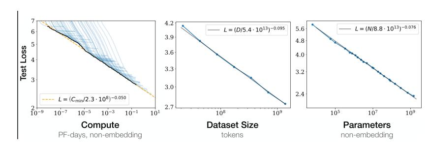
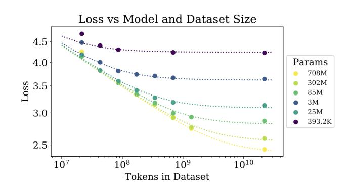
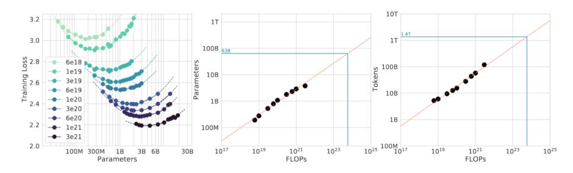
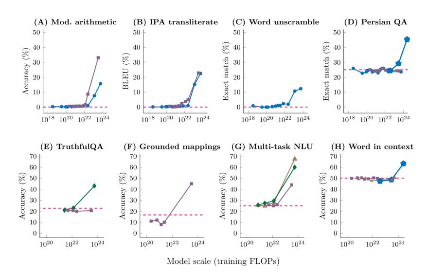
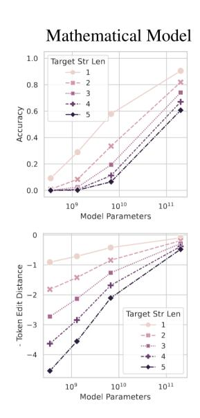
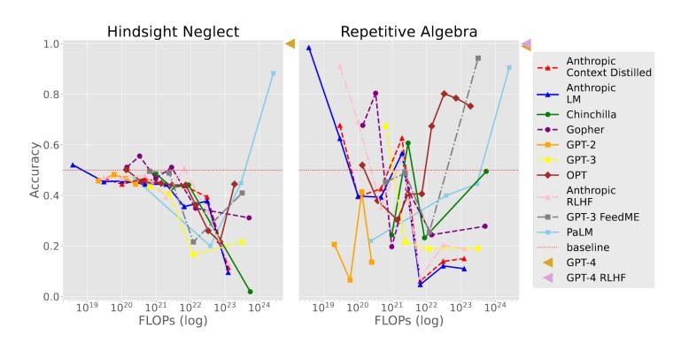
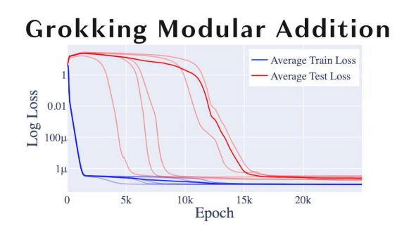
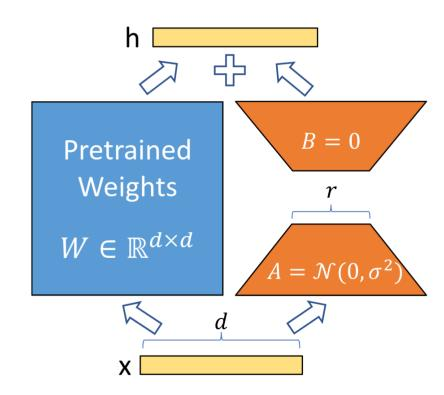
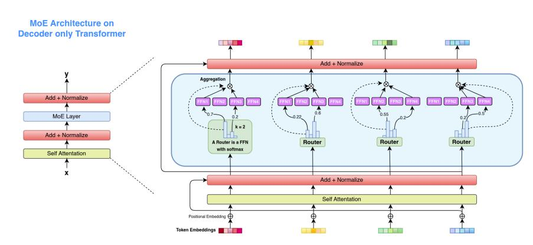

<!-- Source: AgenticLargeLanguageModels.pdf; physical PDF pages 83-110; Marker split PDF pages 1-28. -->

{0}------------------------------------------------

# 第4章

# 规模定律与高效大语言模型

#### 你将学到的内容

在本章中，你将学习语言模型的性能如何随数据量和训练计算量变化。具体来说，你将能够：
- 运用*规模定律*解释模型性能与计算量、数据量和模型规模之间的关系，并预测固定其他因素、增加某一因素会产生什么影响。
- 描述可以用来开发*更小的语言模型*的技术，并分析使用更小模型在计算需求和性能方面的权衡。
- 识别 *推理时计算* 与训练时计算之间的区别。
- 思考如何构建*可持续的语言模型*，以及大规模部署对环境和隐私的影响。

# 4.1 规模定律：计算、数据、参数

LLM 的训练涉及三个主要因素：（1）计算量，（2）数据集大小，以及（3）模型大小。研究表明，这三者与模型的最终性能有关，性能通常以模型在留出测试集上的损失 $L$ 衡量。这种关系平滑且可预测，呈现*幂律*形式：任一资源增加时，损失会按该资源的负幂次下降。例如，对于某个正指数 $\alpha$，模型规模加倍可能使损失乘以 $2^{-\alpha}$。利用这种可预测性，我们可以在投入昂贵的训练之前，估算增加某项资源（例如将训练数据集加倍）可能带来的改进。

{1}------------------------------------------------

图 4.1：语言建模目标上的损失是训练计算量、数据集大小和模型大小的函数 [\[Kaplan et al.,](#page-21-0) [2020\]](#page-21-0)。这三个量（$C$、$D$、$N$）定义如下：
- 计算量（$C$）：整个训练过程中执行的算术运算总量，以浮点运算次数（FLOPs）计。这是运算总数，而不是每秒的运算速率。一个常用近似关系是 $C\approx6ND$：处理每个词元时，前向传播约需两次、反向传播约需四次运算，因此每个参数大约会参与六次运算。
- 数据集大小（$D$）：模型训练所用的词元总数。词元是由分词器定义的子词单元，因此同一语料在不同分词器下会对应不同的 $D$。这里的 $D$ 按训练期间实际处理的词元数计算；数据重复多个轮次时，重复处理的词元仍计入 $D$，但其收益可能低于新数据。
- 模型大小（$N$）：模型架构中可训练参数（权重）的数量。这个数量通常仅指在增加模型深度时会增加的参数，因此不包括嵌入矩阵。

训练大型模型的成本很高，通常可达数千万美元，计算也可能持续数月。规模定律可以帮助我们预测模型的训练效果。
#### 4.1.1 卡普兰规模定律

规模定律通常通过将函数拟合到实测数据来估计。例如，图 4.1 中的每个点代表一个在固定数据集上训练的模型；实验设置相近，只改变三个主要变量 $C$、$D$ 和 $N$。2020 年初，[Kaplan 等人](#page-21-0)研究了模型性能与这三个变量的关系。根据实测结果，他们估计损失分别遵循关于计算量、模型规模和数据集大小的幂律，其中 $L(N)\propto N^{-\alpha_N}$、$L(D)\propto D^{-\alpha_D}$，且 $\alpha_N\approx0.076$、$\alpha_D\approx0.095$。

Kaplan 等人将这些幂律组合成一个可优化的方程（方程 [4.1](#page-2-0)）。他们假设这种关系也适用于其他生成式建模任务 [\[Kaplan et al.,](#page-21-0) [2020\]](#page-21-0)。在计算预算约束下，他们据此推导出最优模型规模 $N$ 和数据集大小 $D$，并用最优步数 $S$ 与批次大小 $B$ 表示。
{2}------------------------------------------------

图 4.2：模型越大，达到给定损失所需的训练词元越少，体现出更高的样本效率 [\[Kaplan et al.,](#page-21-0) [2020\]](#page-21-0)。

由此得到的损失函数为：

$L(N,D)=\left[\left(\frac{N_c}{N}\right)^{\alpha_N/\alpha_D}+\frac{D_c}{D}\right]^{\alpha_D}$（4.1）

Kaplan 等人据此认为，随着计算预算 $C$ 增加，模型规模 $N$ 应比数据集大小 $D$ 增长得更快（$N\propto C^{0.73}$，$D\propto C^{0.27}$），这一结论倾向于支持 GPT-3 这类大模型。负指数体现了收益递减：模型规模或数据集大小加倍，损失都只会降低几个百分点。

乍看之下，这一建议似乎与指数本身矛盾：因为 $\alpha_D>\alpha_N$，在相同的相对增幅下，增加数据比增加参数能更快降低损失。原因在于受限的是计算预算，而非某一种资源本身。由于 $C\approx6ND$，增加 $D$ 与增加 $N$ 一样会消耗计算量。因此，随着计算量增加，模型规模 $N$ 越来越可能成为瓶颈。把数据的计算成本纳入考虑后，将额外计算量分配给 $N$ 比分配给 $D$ 带来的收益更高，所以最优分配倾向于更大的模型。

**样本效率。** Kaplan 等人还观察到，大模型具有更高的样本效率：训练词元数相同时，大模型的损失更低；若要达到相同的目标损失，大模型所需的词元和优化步数更少。图 4.2 展示了这一现象。

1 $B\propto C^{0.24},\ S\propto C^{0.03},\ D=B\cdot S\propto C^{0.27}$。

{3}------------------------------------------------

#### 4.1.2 Chinchilla 规模定律

2022 年，Hoffmann 等人 [\[2022\]](#page-21-0) 使用名为 Chinchilla 的模型重新评估了 Kaplan 等人的结论，发现当时大多数大型模型都严重训练不足。差异源于 Kaplan 等人的方法：他们根据许多模型早期、尚未收敛的训练动态外推最优资源分配，而不是依据训练至收敛的实验结果，因此系统性地偏向了参数更多、训练步数更少的模型。

Chinchilla 研究的关键结论是，计算预算每次翻倍时，模型规模 $N$ 与训练词元数 $D$ 应大致同比例增长（$N\propto C^{0.5}$，$D\propto C^{0.5}$）。由此得到一条经验法则：为达到计算最优，每个可训练参数大约应使用 20 个词元训练。Besiroglu 等人（2024）此后复现了这一结果；Schaeffer 等人 [\[2025\]](#page-24-0) 还表明，该结论对相当大的扰动仍然稳健。

Chinchilla 将损失表示为参数数量 $N$ 和训练词元数 $D$ 的函数：

$L(N,D)=E+\frac{A}{N^{\alpha}}+\frac{B}{D^{\beta}}$（4.2）

其中，$E$ 是不可约损失，对应自然文本的熵；$\frac{A}{N^{\alpha}}$ 表示参数数量有限导致的次优性；$\frac{B}{D^{\beta}}$ 表示训练词元数有限导致的次优性。$\alpha$ 和 $\beta$ 的作用类似于 Kaplan 模型中的 $\alpha_N$ 和 $\alpha_D$，但在这里它们由这个包含两项的参数化模型联合拟合，因此取值不同。对 400 多个模型拟合 Chinchilla 缩放函数后，得到以下参数估计：

$E\approx1.69,\quad A\approx406.4,\quad B\approx410.7,\quad \alpha\approx0.34,\quad \beta\approx0.28$（4.3）

在固定计算预算 $C$（仍取 $C\approx6ND$）下优化该损失函数，可以得到任意预算对应的计算最优模型规模 $N_{\mathrm{opt}}$ 和数据集大小 $D_{\mathrm{opt}}$：

$N_{\mathrm{opt}}(C)=G\left(\frac{C}{6}\right)^a,\qquad D_{\mathrm{opt}}(C)=\frac{1}{G}\left(\frac{C}{6}\right)^b$（4.4）

其中，$G=\left(\frac{\alpha A}{\beta B}\right)^{1/(\alpha+\beta)}$ 为常数，$a=\frac{\beta}{\alpha+\beta}\approx0.45$，$b=\frac{\alpha}{\alpha+\beta}\approx0.55$。

指数 $a$ 和 $b$ 并非彼此独立：按定义，$a+b=1$。对 $C\approx6ND$ 取对数可得 $\log C=\log6+\log N+\log D$。代入 $N_{\mathrm{opt}}\propto C^a$ 和 $D_{\mathrm{opt}}\propto C^b$ 后，只有当 $a+b=1$ 时，这个关系才能对所有 $C$ 成立。Kaplan 的指数也满足同一约束，因为 $0.73+0.27=1$；两者的差异在于计算预算如何分配给 $N$ 和 $D$。

这条经验法则近似呈线性关系，因为随着计算预算增加，$N_{\mathrm{opt}}$ 和 $D_{\mathrm{opt}}$ 的增长速率相近：指数 $a\approx0.45$ 与 $b\approx0.55$ 很接近，

{4}------------------------------------------------

| 模型 | 参数量（$N$） | 训练词元数（$D$） | $D/N$ | 训练状态 |
|---|---:|---:|---:|---|
| Gopher（Rae 等人，2021） | 280B | 300B | ≈1 | 训练不足 |
| GPT-3（Brown 等人，2020） | 175B | 300B | ≈1.7 | 训练不足 |
| Chinchilla（Hoffmann 等人，2022） | 70B | 1.4T | 20 | 计算最优 |
| LLaMA-1 7B（Touvron 等人，2023a） | 7B | 1.0T | ≈143 | 过度训练 |
| LLaMA-2 7B（Touvron 等人，2023b） | 7B | 2.0T | ≈286 | 过度训练 |
| LLaMA-3 8B（Grattafiori 等人，2024） | 8B | 15T | ≈1875 | 过度训练 |

*表 4.1：几个知名模型的词元与参数比率，以及它们相对于 Chinchilla 经验法则 $D\approx20N$ 的训练状态。*
因此，比例 $D_{\mathrm{opt}}/N_{\mathrm{opt}}$ 在计算量的多个数量级上保持在大约 20 的恒定值附近。这个值最好理解为一种经验校准，基于实际的计算优化运行，而不是从拟合系数中直接得出的数字。Chinchilla 模型本身（70B 参数，训练于 1.4T 词元）恰好处于 $D/N=20$。表 4.1 显示了相对于该规则的几个知名模型。比例低于该值的模型是*训练不足*的（相对于其词元预算过大），而远高于该值的模型则是刻意*过度训练*的，以获得在推理时运行成本低的小型模型。早期的旗舰模型，如 GPT-3 和 Gopher，明显低于该线（$D/N\approx1$–$2$）：它们被做得非常大，但训练的词元相对太少。值得强调的是，$D\approx20N$ 仅在固定训练预算下最适合最小化*训练*损失。当一个模型将在之后处理大量推理请求时，通常会刻意在远超过每个参数 20 个词元的数据上进行*过度训练*，以通过增加训练成本换取在推理时运行成本更低的小模型。例如，LLaMA-3 8B 的训练数据大约是每个参数 1900 个词元。选择这种刻意的极端过度训练，是为了让小模型仍能达到较低的损失，并且在推理时运行便宜。

到目前为止，图景相当清晰：测试损失会随着计算量、数据量和参数数量的增加而平稳、单调且可预测地下降。然而，实际结果还会受到多种因素影响。接下来讨论四种现象，它们分别揭示了这一图景的不同边界：（1）计算最优曲线；（2）涌现能力；（3）反向缩放；（4）顿悟（grokking）。
#### 4.1.3 计算最优曲线

计算机硬件和能源是有限资源。一个实际问题是如何在模型大小 $N$ 和数据集大小 $D$ 之间分配固定的计算预算 $C$，以获得尽可能最好的模型。规模定律通过*计算最优前沿*来回答这个问题：即最小化损失的 $C$ 分配。
这一前沿通过 *IsoFLOP* 方法 [\[Hoffmann et al.,](#page-21-0) [2022\]](#page-21-0) 进行实证定位，如图 [4.3](#page-5-0) 所示。针对不同的模型规模，研究者调整训练词元数，使最终计算量保持不变；学习率采用余弦退火调度，周期长度与目标 FLOP 数相匹配。损失曲线呈现明显的低谷，这表明对于给定的 FLOP 预算，
{5}------------------------------------------------

图 4.3：IsoFLOP 曲线 [\[Hoffmann et al.,](#page-21-0) [2022\]](#page-21-0)
是训练的最佳模型大小（左）。利用这些谷的位置，我们预测了更大模型的最佳模型大小和词元数量（中和右）。用绿色表示，我们展示了在Gopher算力预算下训练的最佳模型的参数数量和词元数量估计值。对于固定的FLOP预算，我们训练几个不同大小的模型：模型过小会欠拟合，而模型过大会被迫在过少的词元上进行训练，因此损失与模型大小的曲线呈U形。其最小值确定了算力最优的模型大小$N_{\mathrm{opt}}$，从中通过$C\approx6ND$得出匹配的词元数量$D_{\mathrm{opt}}=C/(6N_{\mathrm{opt}})$。将抛物线拟合到每条这样的曲线上可以找到该最小值，并在不同预算下重复此过程，可以找出 $N_{\mathrm{opt}}$ 和 $D_{\mathrm{opt}}$ 随算力的增长情况。

这种抛物线拟合必须小心进行，而这种简化会在估计的最优 [\[Czech et al.,](#page-19-0) [2026\]](#page-19-0) 中引入系统性偏差。即使在无噪声的合成数据上，这些偏差仍然存在，其来源有三：(1) 所采样的模型规模间隔过粗，(2) 采样未能对称地找到真实最小值，(3) 损失面的真实不对称性，而对称抛物线无法表示。在 Llama-3 的规模下，他们估计这种偏差会浪费大约 140 万美元的计算资源。作为补救，他们建议直接拟合参数化损失模型 $L(N,D)=E+A/N^\alpha+B/D^\beta$——Chinchilla 方法 3，与我们上面用来推导 $D\approx20N$ 规则的形式相同——使用数值稳健的优化器，而不是从拟合的抛物线上读取最优值。

Paquette 等人 [\[2024\]](#page-23-0) 从另一个角度研究规模定律：他们分析可解析求解的模型（通过单遍随机梯度下降训练的幂律随机特征），而不是拟合已训练模型的曲线。他们发现，计算最优指数并非一个普适常数；数据复杂度与目标复杂度构成的平面会划分为四个主要阶段（以及三个子阶段），每个阶段都有自己的指数，决定 $N_{\mathrm{opt}}$ 如何随计算量增长。因此，应该采用哪种资源分配规则，以及“每个参数使用 20 个词元”是否适合该问题，都取决于问题所处的阶段。

**微调的规模定律。** 前面的研究考察了预训练如何随规模变化。这些规模定律是否也适用于微调？[Zhang 等人](#page-26-0) [\[2024\]](#page-26-0) 同时研究了全模型微调（更新模型的全部权重）和参数高效微调（PEFT；冻结预训练权重，只训练少量新增参数）。
{6}------------------------------------------------

图 4.4：少样本提示任务中呈现涌现能力的八个示例；每个点代表一个独立模型 [\[Wei et al.,](#page-25-0) [2022\]](#page-25-0)。
其中一类方法会训练少量新增参数，例如 LoRA [\[Hu et al.,](#page-21-0) [2021\]](#page-21-0)。从计算预算角度看，扩大*基础模型*通常比增加微调数据更能提升微调效果；增加更多可训练的 PEFT 参数则帮助有限。实践中，对于表现不佳的任务，改用更大的预训练模型通常比扩大适配器或收集更多微调示例更有效。
#### 4.1.4 新兴能力

LLM 扩展中一些最有趣的现象是*涌现能力*：在较小模型中不存在，但当模型规模或计算量超过某个阈值时突然出现的能力 [\[Wei et al.,](#page-25-0) [2022\]](#page-25-0)。例子包括多步推理、少量示例翻译以及专业编码任务，如图 4.4 所示。当语言模型在达到某一规模之前表现为随机水平，而之后性能显著提升到远高于随机水平时，通过少量示例提示执行任务的能力就是涌现能力。
不过，能力是否会突然出现仍有争议。[Schaeffer 等人](#page-24-0) [\[2023\]](#page-24-0) 认为，所谓的涌现能力可能是评估指标选择造成的假象。例如，图 [4.5](#page-7-0) 表明，准确率或完全匹配率等离散、非平滑指标会出现明显跃升；而交叉熵损失或词元级概率等底层指标，则会随模型规模遵循平滑、可预测的幂律。
{7}------------------------------------------------

图4.5：当将度量从非线性（上）变为平滑（下）度量时，声称的突现能力消失 [\[Schaeffer et al.,](#page-24-0) [2023\]](#page-24-0)
#### 4.1.5 反向缩放

虽然大多数任务随着规模的增大而改善，但有些任务表现出*反向缩放*，即更大的模型表现更差或产生更强的偏差。这可能发生在某些任务中，其中根据语言建模目标，干扰答案比正确答案更可能，从而导致更大（且更自信）的模型始终选择错误的选项 [\[McKenzie et al.,](#page-23-0) [2023,](#page-23-0) [Michaelov and Bergen,](#page-23-0) [2023\]](#page-23-0)。
逆向缩放的一个例子是*后见之明忽视*，这是一个测试赌注是否值得基于其期望值进行的任务。如果期望值为正，模型应该回答*是*，如果期望值为负，模型应该回答*否*。情况如下。模型只展示了少量示例，其中实际结果总是与期望值相符（也就是说，当期望值为正时，下注者赢钱，当期望值为负时，下注者输钱）。然后，模型被问及在期望值和实际结果不匹配的情况下是否正确下注的问题。后见之明忽视测试模型是否能够正确地从指令中进行泛化，即使少量示例标注正确但具有误导性。重复代数测试模型在给定特定模式的正确标注少量示例时，如何响应简单的代数问题。图 [4.6](#page-8-0) 显示，模型通常从随机表现开始，但在大约 1022 训练 FLOPs 时会低于随机表现。

{8}------------------------------------------------

图 4.6：对事后忽视（左）和重复代数（右）任务的缩放行为 [\[McKenzie et al.,](#page-23-0) [2023\]](#page-23-0)

图 4.7：模加法任务中对训练集的早期记忆（蓝色）与后期泛化（红色：顿悟） [\[Nanda et al.,](#page-23-0) [2023\]](#page-23-0)
#### 4.1.6 顿悟（Grokking）

Grokking（顿悟）是统计学习中一个反直觉的现象。通常，大型模型面对小数据集时会因记住训练样本而过拟合；但如果继续训练这个过大的模型，经过更多训练后，它可能突然找到一个能够泛化的解法 [\[Power et al.,](#page-24-0) [2022\]](#page-24-0)。
Grokking 最初是在模加法等小型算法任务中观察到的。它表明，即使不增加数据集大小 $D$，增加训练步数（也就是过度训练）也可能使模型从记忆训练样本转向泛化，见图 4.7。[Villalobos 等人](#page-25-0) [\[2024\]](#page-25-0) 将数据即将耗尽、从而限制模型扩展的情况称为“数据墙”；但在继续训练后，模型仍可能突然找到可泛化的解法。
顿悟现象与语言建模有关：互联网上高质量的人类文本正迅速耗尽，难以满足 Chinchilla 对数据量 $D$ 的需求
{9}------------------------------------------------

以训练下一代模型。受这些固有限制的影响，研究人员正在探索如何突破单纯扩大数据量 $D$ 的做法，例如：（1）提高架构效率，如采用专家混合；（2）推理时扩展，即在推理过程中为模型分配更多计算量来“思考”，例如 OpenAI 的 o 系列；（3）生成合成数据（第 19 章）。
# 4.2 小语言模型

随着计算和数据需求持续增长，人们对*小型语言模型*（SLM）的兴趣也日益增加。这类模型足够小，可以在消费级硬件、移动设备或边缘设备上运行，同时保持较高性能；开发时通常会采用提升效率、尽量减少性能损失的技术。为了了解它们的部署环境，可以将常见的计算基础设施分为以下几类：

- **数据中心：** 配备 NVIDIA H100 等高性能 GPU 和 TPU，主要用于大型模型的*预训练*，并提供高吞吐量推理 API。
- **消费级硬件：** 标准台式机 GPU 和高端 CPU，个人用户可用其以较低成本微调 SLM，或在本地运行 SLM。
- **边缘设备：** 手机、物联网设备和笔记本电脑，正越来越多地配备专为低功耗、高效端侧*推理*设计的神经处理单元（NPU）。

为适应这些资源受限的环境，优化技术主要着眼于提高吞吐量、降低延迟和内存占用，以及提升样本效率。相关方法分为两类：（1）以模型为中心的优化，针对模型架构和优化方法；（2）以数据为中心的优化，针对模型的训练数据。下面分别介绍这两类方法。
### 4.2.1 以模型为中心的优化

首先介绍以模型为中心的优化技术。这些方法旨在提升小模型的训练效率，同时保持较高的任务性能，可用于预训练、微调或推理。
#### 4.2.1.1 降低预训练成本

参数高效微调（PEFT）方法，例如*低秩适配*（LoRA）[\[Hu et al.,](#page-21-0) [2021\]](#page-21-0)，只需训练模型中很小一部分参数（通常不到 1%）即可将大模型适配到新任务 [\[Lialin et al.,](#page-22-0) [2023\]](#page-22-0)。其关键观察是，微调产生的权重更新具有较低的*内在秩*：尽管
{10}------------------------------------------------

图 4.8：低秩适配的重参数化示意图 [\[Hu et al.,](#page-21-0) [2021\]](#page-21-0)。微调时只训练 $A$ 和 $B$。

预训练权重矩阵 $W_0\in\mathbb{R}^{d\times k}$ 虽然是满秩的，但适配新任务所需的权重变化 $\Delta W$ 可以很好地用低秩矩阵近似。LoRA 不直接更新 $W_0$，而是将其冻结，并把权重更新表示为两个小矩阵的乘积：

$W=W_0+\Delta W=W_0+BA,\qquad B\in\mathbb{R}^{d\times r},\quad A\in\mathbb{R}^{r\times k}$（4.5）

其中，秩 $r\ll\min(d,k)$。对于输入 $x$，修改后的前向计算为：

$h=W_0x+\frac{\alpha}{r}BAx$（4.6）

这里的 $\alpha$ 是控制权重更新幅度的缩放因子，作用大致类似于标准训练中的学习率。如图 4.8 所示，只更新 $A$ 和 $B$，可将可训练参数量从 $d\times k$ 降至 $r(d+k)$。初始化时，$A$ 从随机高斯分布中采样，$B$ 设为零，因此 $\Delta W=0$，训练从预训练模型原有的参数开始。训练完成后，$\Delta W$ 可以直接合并回 $W_0$，所以 LoRA 不会增加推理延迟；同一个基础模型还可以搭配多个体积小、可灵活切换的任务适配器。

**架构创新。** 另一类方法直接改变模型架构，使其运行成本更低，而不是在事后压缩固定架构。两个重要例子是分组查询注意力和专家混合。

**分组查询注意力（GQA）** [\[Ainslie 等人](#page-18-0) [2023\]](#page-18-0) 针对自回归解码中的内存带宽瓶颈。标准多头注意力（MHA）为每个查询头分别设置键头和值头，计算注意力分数时都要用到它们。另一极端是多查询注意力（MQA）：所有查询头共享一个键/值头，这能缩小缓存，但可能损害表达能力并降低训练稳定性。GQA 介于两者之间：将查询头分成 $g$ 组，每组中的头共享一个键/值头。当 $g=1$ 时，GQA 等同于 MQA；当 $g$ 等于查询头的数量时，

{11}------------------------------------------------

图 4.9：仅解码器变换器顶部的稀疏门控专家混合（MoE）架构示意图 [\[Zhang et al.,](#page-26-0) [2025\]](#page-26-0)

GQA 等同于 MHA。因此，$g$ 决定模型质量与内存占用之间的权衡。GQA 常与第 [4.2](#page-9-0) 节讨论的 KV 缓存优化配合使用，如今已成为许多开放权重模型默认采用的注意力变体。
**专家混合（MoE）** [\[Shazeer et al.,](#page-24-0) [2017\]](#page-24-0) 将模型的总参数量与每个词元的计算量解耦。MoE 层不再使用单个稠密前馈块，而是包含多个并行的“专家”子网络，以及负责路由的轻量级*门控网络*。门控网络会为每个词元激活少数几个专家（通常是得分最高的一个或两个）。由于只有选中的专家参与计算，即使总参数量和模型容量增长一个数量级或更多，每个词元的计算成本仍接近单个稠密块 [\[Fedus et al.,](#page-20-0) [2022\]](#page-20-0)。

这种*稀疏激活*使 Mixtral 等模型能够拥有数千亿个总参数，同时每个词元只激活其中一小部分。其代价包括：所有专家仍须驻留在内存中；需要在专家之间平衡工作负载（通常借助辅助损失）；路由也会增加工程复杂度。图 4.9 展示了一个 $k=2$ 的 top-$k$ 路由机制：门控网络根据路由器的评分，为每个词元选出得分最高的两个前馈网络（FFN）专家。选中的专家并行计算，输出再通过加权求和合并 [\[Zhang et al.,](#page-26-0) [2025\]](#page-26-0)。

**知识蒸馏。** 教师模型通过让学生模型匹配自己的输出分布，帮助学生学习 [\[Gu et al.,](#page-21-0) [2023,](#page-21-0) [Xu et al.,](#page-26-0) [2024\]](#page-26-0)。学生学习的是教师完整的*软概率分布*（通常通过温度参数平滑），而不只是单个正确答案。软目标包含更丰富的信息，例如教师认为哪些错误答案仍有一定合理性。这样，规模小得多的学生模型也能接近教师模型的表现。前文讨论的合成数据生成也运用了类似思路。

{12}------------------------------------------------

如下，其中前沿模型实际上充当教师，为较小的学生模型生成高质量的训练数据。
#### 4.2.1.2 降低推理成本

模型训练完成后，还可以针对推理部署进一步优化。训练阶段的技术旨在降低模型训练成本；推理阶段的技术则针对模型的使用成本，包括吞吐量（每秒生成的词元数）、延迟（生成首个词元及后续词元所需的时间）和服务请求所需的内存。以下方法既适用于大模型，也适用于小模型。

**键值缓存（KV cache）。** 自回归生成时，模型每次生成一个词元，每个新词元都会关注此前的词元。如果每一步都为整个上下文重新计算注意力键和值，计算成本会随序列长度呈平方级增长。但预测下一个词元时，已有上下文并未变化，因此可以把先前词元的键和值向量存入 *KV cache* 并重复使用。这样，每一步的注意力计算可转为线性成本的查找。这项优化让解码变得可行，但缓存会随序列长度和批量大小线性增长，在长上下文下可能占用大量内存。GQA 和 MQA 通过让多个查询头共享键/值头来缩小缓存；*PagedAttention* 则将缓存存放在非连续内存块中，以减少碎片并提高服务吞吐量 [\[Kwon et al.,](#page-21-0) [2023\]](#page-21-0)。

**剪枝。** 另一种直接压缩模型的方法，是移除神经网络中冗余或不重要的连接 [\[Ma et al.,](#page-22-0) [2023\]](#page-22-0)。剪枝分为*非结构化剪枝*（将单个权重置零）和*结构化剪枝*（移除整个神经元、注意力头或层）。结构化剪枝可在标准硬件上直接带来加速；非结构化剪枝则需要稀疏感知内核才能发挥优势。
**量化。** 推理时还可以降低权重精度，减少载入内存的矩阵占用，而不改变矩阵维度，例如把 16 位权重改为 8 位或 4 位。量化可以显著降低内存使用并加快推理，但精度降低也可能损害模型表现。同样的方法也可用于 KV cache，以便在内存中保留更长的上下文。量化已被广泛研究 [\[Dettmers et al.,](#page-20-0) [2022,](#page-20-0) [Dettmers and](#page-19-0) [Zettlemoyer,](#page-19-0) [2023,](#page-19-0) [Xiao et al.,](#page-25-0) [2023\]](#page-25-0)。

另一种方法是采用*混合精度*：对计算的不同部分使用不同数值精度，以兼顾速度和稳定性 [\[Micikevicius et al.,](#page-23-0) [2017\]](#page-23-0)。数值不稳定可能导致结果不确定 [\[Yuan et al.,](#page-26-0) [2025\]](#page-26-0)。
{13}------------------------------------------------

**推测解码。** 小型草稿模型先快速生成多个候选词元，再由较大的目标模型并行验证 [\[Leviathan et al.,](#page-22-0) [2023\]](#page-22-0)。这种方法可以在不牺牲大模型输出质量的情况下加快推理，最高可达两到三倍，并利用缩放曲线上不同规模模型的互补优势。
#### 4.2.2 以数据为中心的优化

除模型架构外，研究也强调：训练高效模型时，数据质量与整理往往比数据集规模更重要 [\[Luo et al.,](#page-22-0) [2025\]](#page-22-0)。经过精心整理的高质量数据可以帮助小模型取得良好表现。因此，除了设计高效架构，还要制定合理的数据方案。以数据为中心的方法大致有两类：从更大的数据池中*筛选*最有价值的内容，以及在数据匮乏时*生成*合成数据。
#### 4.2.2.1 数据选择与整理

与其使用全部可用文本，不如仔细选择*训练哪些数据*以及各类数据的比例；越来越多的研究表明，在相同计算预算下，这样能训练出更好的模型。预训练方面，NVIDIA 的 *CLIMB* 框架 [\[Diao et al.,](#page-20-0) [2026\]](#page-20-0) 将大型语料映射到语义空间并进行聚类，再迭代搜索能够降低代理模型损失的数据混合方案。由此得到的 *ClimbMix* 数据集包含 4000 亿个词元，使一个参数不足十亿的模型胜过在规模更大但未经筛选的语料上训练的同类模型。相同思路也适用于微调：*LIMA* [\[Zhou et al.,](#page-26-0) [2023\]](#page-26-0) 表明，只用 1,000 组精心筛选的提示与回答进行监督微调，也能训练出强大的指令遵循模型。这支持一种观点：大多数知识是在预训练阶段获得的，而对齐主要教会模型期望的回答*风格*。

#### 4.2.2.2 合成数据收集

如果缺少合适的数据，也可以自行生成。微软 Phi 系列等模型采用的 *Textbooks Are All You Need* 方法 [\[Gunasekar et al.,](#page-21-0) [2023\]](#page-21-0) 表明，使用干净、合成且接近教科书质量的数据训练，参数量仅 1.3B 的小模型也可能胜过规模大十倍的模型。
这类流程通常由前沿模型生成数据，再用 *LLM-as-a-judge* 评分筛选准确且有教育价值的示例，并严格进行*去污染*，避免合成数据泄漏到基准测试集、夸大评测结果。合成数据尤其适用于推理训练：让小模型学习较大模型生成的逐步推理轨迹，可以将复杂的问题求解能力蒸馏到较小的架构中（另见第 6 章） [\[Muennighoff et al.,](#page-23-0) [2025,](#page-23-0) [Arora and Zanette,](#page-19-0) [2026\]](#page-19-0)。

{14}------------------------------------------------

#### 4.2.2.3 样本高效学习

除了合成数据，研究者也越来越关注如何让模型从有限、贴近自然语言使用情境的数据中更高效地学习。*BabyLM Challenge* 等项目 [\[Warstadt et al.,](#page-25-0) [2023\]](#page-25-0) 要求在严格的数据限制下训练模型（例如使用 1,000 万至 1 亿个词元）。这一数据量接近人类儿童早期发展阶段接触的语言输入，也推动了样本高效架构的研究，并帮助探讨认知上合理的语言习得方式。
### 4.2.3 主流模型

回顾完模型改进方法后，我们再看一些主流大、小模型如何在实践中应用这些技术。模型常按开放程度分类：闭源专有模型只提供 API；开放权重模型发布训练好的参数；开源模型还会公开训练数据和代码。开放程度实际上是一个连续谱，而非泾渭分明的类别；后文会介绍如何用开放度指数衡量其透明程度 [\[Artificial Analysis,](#page-19-0) [2026\]](#page-19-0)。许多开放模型可在 Hugging Face 等模型仓库中找到。

下面简要介绍若干适合在消费级硬件运行的开放权重模型，以及它们采用的效率技术。此处并非穷尽列举，而是选取一些有影响力的代表，展示撰写本书时高效模型及其规模的发展趋势。

**Phi 系列** [\[Abdin et al.,](#page-18-0) [2024\]](#page-18-0) 是一组能力较强、可在移动设备本地运行的小型语言模型。其核心创新在于以数据为中心的训练方法：微软筛选高质量网络数据，并结合更大模型生成的合成数据。因此，Phi-3-mini 等小模型（38 亿参数）也能有良好表现，其推理能力可与 GPT-3.5、Mixtral 等大得多的模型相媲美。

**Gemma 系列** [\[Mesnard et al.,](#page-23-0) [2024\]](#page-23-0) 据 Google 介绍，继承了 Gemini 的通用能力，尤其擅长文本、推理和编码任务，并在各自的规模档位达到先进水平；但其训练方法和数据细节公开不多。

**OLMo 系列** [\[Ettinger et al.,](#page-20-0) [2025\]](#page-20-0) 由艾伦人工智能研究所开发，目标是构建真正开放的语言模型。项目公开了完整训练流程及其代码和数据，包括 Dolma 预训练语料、训练与评估代码、训练日志和中间检查点。这样的透明度有助于研究训练动态、数据影响和算法偏差。

**Qwen 系列** [\[Bai et al.,](#page-19-0) [2023\]](#page-19-0) 涵盖基础模型与指令微调模型，既有参数量不足十亿的稠密模型，也有大型专家混合（MoE）模型；在数学、编码和逻辑推理基准测试中表现突出。

{15}------------------------------------------------

该系列也具备较强的多语言能力。

**OpenELM** [\[Mehta et al.,](#page-23-0) [2024\]](#page-23-0) 是 Apple 面向端侧部署的高效语言模型系列。它采用分层缩放策略：靠近输入的层使用较小的潜在维度，靠近输出的层逐步增大维度，以较少的参数实现较高精度。

**gpt-oss** [\[Agarwal et al.,](#page-18-0) [2025\]](#page-18-0) 是 OpenAI 发布的两款开放权重推理模型，采用高效的专家混合架构，重点优化智能体能力。

**Mixtral 系列** [\[Jiang et al.,](#page-21-0) [2024\]](#page-21-0) 推广了稀疏专家混合架构在开放权重模型中的应用。例如，Mixtral 8×7B 每次推理只激活部分参数，从而在保持较大总参数规模的同时控制计算量；该系列以负责任人工智能许可证发布。

**Llama 系列** [\[Grattafiori et al.,](#page-20-0) [2024\]](#page-20-0) 已得到广泛应用。Llama 3 的训练数据规模最高达到 15 万亿个词元，模型则覆盖从适合端侧运行的小型版本到 405B 参数的大型模型。该系列推动了开放模型的规模化发展，也带动了微调模型及其衍生版本的生态。

**DeepSeek** [\[Liu et al.,](#page-22-0) [2025\]](#page-22-0) 的 V3 是大型 MoE 模型，总参数量为 671B，每个词元激活 37B。它采用多头潜在注意力（MLA）压缩键值缓存，使用无辅助损失的专家负载均衡策略，并以 FP8 混合精度训练，以较低计算成本达到前沿性能。该系列还包括推理模型 DeepSeek-R1。

**GLM** [\[Zeng et al.,](#page-26-0) [2026\]](#page-26-0) 由智谱 AI 开发。GLM（通用语言模型）系列在训练早期形成推理能力，并在后续训练中加以保留。近期版本侧重智能体工作流与软件工程，目标包括提升工具调用和代码生成能力。

**Pythia** [\[Biderman et al.,](#page-19-0) [2023\]](#page-19-0) 是 EleutherAI 发布的一组研究模型，参数规模从 70M 到 12B，旨在支持对训练动态和模型规模效应的研究。各模型使用相同的数据及其顺序进行训练，并提供中间检查点，便于研究能力、记忆和偏差如何随训练逐步出现。

**BLOOM** [\[Scao et al.,](#page-24-0) [2023\]](#page-24-0) 是 BigScience 协作研究项目开发的 176B 参数开放访问模型。它使用 ROOTS 语料库训练，覆盖 46 种自然语言和 13 种编程语言，是较早重视多语言覆盖与开放性的超大规模模型之一，并以负责任人工智能许可证发布。

{16}------------------------------------------------

**SmolLM** [\[Allal et al.,](#page-18-0) [2025\]](#page-18-0) 是 Hugging Face 推出的紧凑模型系列，包含 135M、360M 和 1.7B 参数版本，面向高效端侧部署。与 Phi 系列类似，其性能很大程度上得益于数据整理：SmolLM-Corpus 汇集了高质量网络文本、Python 代码，以及借助 Mixtral 合成生成的教材和故事。
## 4.3 推理时计算

传统规模定律关注训练计算量与模型性能之间的关系。近期研究则把部分计算转移到推理阶段，称为*推理时扩展*（或测试时计算）[\[Muennighoff et al.,](#page-23-0) [2025\]](#page-23-0)。模型可以在推理时进行更长时间的计算，而不是把全部计算预算都用于训练。通常可通过生成的词元数量或探索的推理路径衡量这部分预算，以期获得更高质量的答案。因此，吞吐量（词元/秒）尤为重要：生成越快，模型在相同时间内可用于推理的计算就越多。

增加推理时的词元预算可以提升模型能力 [\[Du et al.,](#page-20-0) [2024\]](#page-20-0)。近期研究还表明，合理分配测试时计算资源后，小模型在某些复杂推理任务上可以超过大模型 [\[Snell et al.,](#page-24-0) [2024\]](#page-24-0)。不过，这种收益并非必然，取决于任务类型以及具体采用的搜索或验证策略 [\[Stechly et al.,](#page-24-0) [2023\]](#page-24-0)。除性能之外，这种转变也引出了关于系统型 LLM 的更广泛问题，第 6 章将进一步讨论。

## 4.4 可持续的语言模型

大规模训练和部署 LLM 会带来显著的环境与经济影响。训练和推理消耗大量能源，冷却所需的用水也会给供水系统带来压力 [\[Li et al.,](#page-22-0) [2025,](#page-22-0) [Jegham et al.,](#page-21-0) [2025\]](#page-21-0)。直到近年，训练能耗和碳足迹才开始纳入标准化报告 [\[Ding and Shi,](#page-20-0) [2024\]](#page-20-0)。据报道，训练一个大型模型的能耗相当于数百户家庭一年的用电量。以 BLOOM 为例，若计入动态功耗和硬件制造所隐含的碳排放，其排放量超过 50 吨二氧化碳当量 [\[Luccioni et al.,](#page-22-0) [2023\]](#page-22-0)。

随着 LLM 在科学和社会应用中的普及，对于每天被数百万人使用的模型，总碳足迹越来越多地来自*推理*而非训练 [\[Özcan et al.,](#page-23-0) [2025,](#page-23-0) [Wu et al.,](#page-25-0) [2022,](#page-25-0) [Samsi et al.,](#page-24-0) [2023\]](#page-24-0)。因此，在训练阶段投入更多计算，以开发更小、更高效的模型（见第 [4.1](#page-0-0) 节），可能显著降低长期部署的环境成本。

随着全球推理需求增至每天数十亿次查询，累计能耗及相关财务成本可能超过最初的训练投入 [\[Faiz et al.,](#page-20-0) [2024\]](#page-20-0)。在这种规模下部署大型模型需要庞大的数据
{17}------------------------------------------------

中心基础设施，也会消耗大量电力和水。因此，为了支持可持续的大规模应用，业界正转向部署小型语言模型（SLM）。通过减少模型参数量并采用量化，SLM 可以降低每个生成词元所需的内存带宽和计算量，从而提供更环保、成本更可控的方案。

**隐私与数据泄露。** 除环境影响外，通过云 API 集中提供 LLM 服务也会带来隐私风险。用户调用云端模型时，敏感个人信息、企业知识产权或受保护的健康信息都必须传送至第三方服务器，因而可能遭到未授权拦截、对抗式提取，或被模型意外记忆并在之后的回答中复现 [\[Aiyappa et al.,](#page-18-0) [2023,](#page-18-0) [Li et al.,](#page-22-0) [2024,](#page-22-0) [Chen et al.,](#page-19-0) [2024,](#page-19-0) [Maini et al.,](#page-22-0) [2024,](#page-22-0) [Liu et al.,](#page-22-0) [2022\]](#page-22-0)。

为降低隐私风险并减少对云基础设施的依赖，开发者可以从 API 推理转向*本地设备推理* [\[Qu et al.,](#page-24-0) [2025\]](#page-24-0)：

- **基于 API 的推理：** 依赖强大的远程服务器，因此可以调用拥有数千亿参数的前沿模型；但它会产生网络延迟，需要持续联网，也意味着用户数据会传送给云服务提供商。
- **本地推理：** 模型直接运行在用户自己的设备上，例如手机、笔记本电脑或边缘服务器。提示内容不离开设备，有助于保护隐私；同时，这种方式无需网络连接即可使用，也没有网络往返延迟。

本地推理仍受消费级和边缘硬件的物理条件限制，尤其是内存和带宽。LLM 推理通常受内存约束：存储模型权重需要大量 RAM，生成词元则需要较高的内存带宽。此外，许多移动设备依靠电池供电，持续执行密集矩阵运算会迅速耗电，并可能触发热降频。

为了让本地部署切实可行，开发者需要采用推理优化方法，例如 4 位量化和推测解码；面向低功耗边缘 AI 的专用神经处理单元（NPU）也在逐渐普及。
# 4.5 结论性意见

随着 LLM 的使用变得更加普及，对快速响应的需求增加，LLM 开发的重点正转向更高效的解决方案。因此，单纯为原始性能而扩展数据、计算和模型规模的关注，正在转向关注*效率*的扩展。
{18}------------------------------------------------

虽然基本的幂律依然适用，但关注点已经从单纯训练尽可能大的模型转向计算优化训练、推理时的扩展以及开发能够在消费级和边缘硬件上运行的高性能小模型的计划。本章讨论的方向是互补的，而非竞争的：以模型为中心的技术（LoRA、GQA、MoE、量化、蒸馏）和以数据为中心的技术（精心的数据选择和合成生成）正日益在单一训练方案中结合使用。
随着我们越来越接近数据壁垒，合成数据和架构效率的作用可能会越来越重要，而以更少实现更多的能力正成为研究的焦点。
# 参考文献

- Marah Abdin, Jyoti Aneja, Hany Awadalla, Ahmed Awadallah, Ammar Ahmad Awan, Nguyen Bach, Amit Bahree, Arash Bakhtiari, Jianmin Bao, Harkirat Behl, Alon Benhaim, Misha Bilenko, Johan Bjorck, Sebastien Bubeck, Martin Cai, Qin Cai, ´ Vishrav Chaudhary, et al. Phi-3 technical report: A highly capable language model locally on your phone, 2024. URL <https://arxiv.org/abs/2404.14219>. [97](#page-14-0) Sandhini Agarwal, Lama Ahmad, Jason Ai, Sam Altman, Andy Applebaum, Edwin Arbus, Rahul K. Arora, Yu Bai, Bowen Baker, Haiming Bao, Boaz Barak, Ally Bennett, Tyler Bertao, Nivedita Brett, Eugene Brevdo, Greg Brockman, et al. gptoss-120b & gpt-oss-20b model card, 2025. URL [https://arxiv.org/abs/](https://arxiv.org/abs/2508.10925) [2508.10925](https://arxiv.org/abs/2508.10925). [98](#page-15-0) Joshua Ainslie, James Lee-Thorp, Michiel de Jong, Yury Zemlyanskiy, Federico Lebron, and Sumit Sanghai. GQA: Training generalized multi-query transformer models from multi-head checkpoints. In Houda Bouamor, Juan Pino, and Kalika Bali, editors, *Proceedings of the 2023 Conference on Empirical Methods in Natural Language Processing*, pages 4895–4901, Singapore, December 2023. Association for Computational Linguistics. doi: 10.18653/v1/2023.emnlp-main.298. URL <https://aclanthology.org/2023.emnlp-main.298/>. [93](#page-10-0) Rachith Aiyappa, Jisun An, Haewoon Kwak, and Yong-yeol Ahn. Can we trust the evaluation on ChatGPT? In Anaelia Ovalle, Kai-Wei Chang, Ninareh Mehrabi, Yada Pruksachatkun, Aram Galystan, Jwala Dhamala, Apurv Verma, Trista Cao, Anoop Kumar, and Rahul Gupta, editors, *Proceedings of the 3rd Workshop on Trustworthy Natural Language Processing (TrustNLP 2023)*, pages 47–54, Toronto, Canada, July 2023. Association for Computational Linguistics. doi: 10.18653/v1/2023.trustnlp-1.
- 5. URL <https://aclanthology.org/2023.trustnlp-1.5/>. [100](#page-17-0) Loubna Ben Allal, Anton Lozhkov, Elie Bakouch, Gabriel Martin Blazquez, Guilherme Penedo, Lewis Tunstall, Andres Marafioti, Agust ´ ´ın Piqueres Lajar´ın, Hynek Kydl´ıcek, Vaibhav Srivastav, Joshua Lochner, Caleb Fahlgren, Xuan Son NGUYEN, ˇ

{19}------------------------------------------------

Ben Burtenshaw, Clementine Fourrier, Haojun Zhao, Hugo Larcher, Mathieu Mor- ´ lon, Cyril Zakka, Colin Raffel, Leandro Von Werra, and Thomas Wolf. SmolLM2: When smol goes big — data-centric training of a fully open small language model. In *Second Conference on Language Modeling*, 2025. URL [https:](https://openreview.net/forum?id=3JiCl2A14H) [//openreview.net/forum?id=3JiCl2A14H](https://openreview.net/forum?id=3JiCl2A14H). [99](#page-16-0) Daman Arora and Andrea Zanette. Training language models to reason efficiently. *Advances in Neural Information Processing Systems*, 38:60770–60808, 2026. [96](#page-13-0) Artificial Analysis. Artificial analysis openness index, 2026. URL [https://artificialanalysis.ai/evaluations/](https://artificialanalysis.ai/evaluations/artificial-analysis-openness-index) [artificial-analysis-openness-index](https://artificialanalysis.ai/evaluations/artificial-analysis-openness-index). Accessed: 2026-03-16. [97](#page-14-0) Jinze Bai, Shuai Bai, Yunfei Chu, Zeyu Cui, Kai Dang, Xiaodong Deng, Yang Fan, Wenbin Ge, Yu Han, Fei Huang, Binyuan Hui, Luo Ji, Mei Li, Junyang Lin, Runji Lin, Dayiheng Liu, Gao Liu, et al. Qwen technical report, 2023. URL [https:](https://arxiv.org/abs/2309.16609) [//arxiv.org/abs/2309.16609](https://arxiv.org/abs/2309.16609). [97](#page-14-0) Tamay Besiroglu, Ege Erdil, Matthew Barnett, and Josh You. Chinchilla scaling: A replication attempt. *arXiv preprint arXiv:2404.10102*, 2024. [86](#page-3-0) Stella Biderman, Hailey Schoelkopf, Quentin Gregory Anthony, Herbie Bradley, Kyle O'Brien, Eric Hallahan, Mohammad Aflah Khan, Shivanshu Purohit, USVSN Sai Prashanth, Edward Raff, et al. Pythia: A suite for analyzing large language models across training and scaling. In *International Conference on Machine Learning*, pages 2397–2430. PMLR, 2023. [98](#page-15-0) Tom Brown, Benjamin Mann, Nick Ryder, Melanie Subbiah, Jared D Kaplan, Prafulla Dhariwal, Arvind Neelakantan, Pranav Shyam, Girish Sastry, Amanda Askell, et al. Language models are few-shot learners. *Advances in neural information processing systems*, 33:1877–1901, 2020. [87](#page-4-0) Xiaoyi Chen, Siyuan Tang, Rui Zhu, Shijun Yan, Lei Jin, Zihao Wang, Liya Su, Zhikun Zhang, XiaoFeng Wang, and Haixu Tang. The janus interface: How fine-tuning in large language models amplifies the privacy risks. In *Proceedings of the 2024 on ACM SIGSAC Conference on Computer and Communications Security*, pages 1285– 1299, 2024. [100](#page-17-0) Eric Czech, Zhiwei Xu, Yael Elmatad, Yixin Wang, and William Held. Problems with chinchilla approach 2: Systematic biases in isoflop parabola fits, 2026. URL <https://arxiv.org/abs/2603.22339>. [88](#page-5-0) Tim Dettmers and Luke Zettlemoyer. The case for 4-bit precision: k-bit inference scaling laws. In Andreas Krause, Emma Brunskill, Kyunghyun Cho, Barbara Engelhardt, Sivan Sabato, and Jonathan Scarlett, editors, *Proceedings of the 40th International Conference on Machine Learning*, volume 202 of *Proceedings of Machine Learning Research*, pages 7750–7774. PMLR, 23–29 Jul 2023. URL

<https://proceedings.mlr.press/v202/dettmers23a.html>. [95](#page-12-0)

{20}------------------------------------------------

- Tim Dettmers, Mike Lewis, Younes Belkada, and Luke Zettlemoyer. Gpt3.int8(): 8-bit matrix multiplication for transformers at scale. In
- S. Koyejo, S. Mohamed, A. Agarwal, D. Belgrave, K. Cho, and A. Oh, editors, *Advances in Neural Information Processing Systems*, volume 35, pages 30318–30332. Curran Associates, Inc., 2022. URL [https:](https://proceedings.neurips.cc/paper_files/paper/2022/file/c3ba4962c05c49636d4c6206a97e9c8a-Paper-Conference.pdf) [//proceedings.neurips.cc/paper\\_files/paper/2022/file/](https://proceedings.neurips.cc/paper_files/paper/2022/file/c3ba4962c05c49636d4c6206a97e9c8a-Paper-Conference.pdf) [c3ba4962c05c49636d4c6206a97e9c8a-Paper-Conference.pdf](https://proceedings.neurips.cc/paper_files/paper/2022/file/c3ba4962c05c49636d4c6206a97e9c8a-Paper-Conference.pdf). [95](#page-12-0) Shizhe Diao, Yu Yang, Yonggan Fu, Xin Dong, Dan Su, Markus Kliegl, Zijia Chen, Peter Belcak, Yoshi Suhara, Hongxu Yin, et al. Nemotron-climb: Clustering-based iterative data mixture bootstrapping for language model pre-training. *Advances in Neural Information Processing Systems*, 38, 2026. [96](#page-13-0) Yi Ding and Tianyao Shi. Sustainable llm serving: Environmental implications, challenges, and opportunities. In *2024 IEEE 15th International Green and Sustainable Computing Conference (IGSC)*, pages 37–38. IEEE, 2024. [99](#page-16-0) Yilun Du, Shuang Li, Antonio Torralba, Joshua B. Tenenbaum, and Igor Mordatch. Improving factuality and reasoning in language models through multiagent debate. In *Proceedings of the 41st International Conference on Machine Learning*, ICML'24. JMLR.org, 2024. [99](#page-16-0) Allyson Ettinger, Amanda Bertsch, Bailey Kuehl, David Graham, David Heineman, Dirk Groeneveld, Faeze Brahman, Finbarr Timbers, Hamish Ivison, Jacob Morrison, Jake Poznanski, Kyle Lo, Luca Soldaini, Matt Jordan, Mayee Chen, Michael Noukhovitch, Nathan Lambert, et al. Olmo 3, 2025. URL [https://arxiv.](https://arxiv.org/abs/2512.13961) [org/abs/2512.13961](https://arxiv.org/abs/2512.13961). [97](#page-14-0) Ahmad Faiz, Sotaro Kaneda, Ruhan Wang, Rita Osi, Prateek Sharma, Fan Chen, and Lei Jiang. Llmcarbon: Modeling the end-to-end carbon footprint of large language models. In B. Kim, Y. Yue, S. Chaudhuri, K. Fragkiadaki, M. Khan, and Y. Sun, editors, *International Conference on Learning Representations*, volume 2024, pages 24727–24741, 2024. URL [https:](https://proceedings.iclr.cc/paper_files/paper/2024/file/6b4ac044095525631df38e20919b45d2-Paper-Conference.pdf) [//proceedings.iclr.cc/paper\\_files/paper/2024/file/](https://proceedings.iclr.cc/paper_files/paper/2024/file/6b4ac044095525631df38e20919b45d2-Paper-Conference.pdf) [6b4ac044095525631df38e20919b45d2-Paper-Conference.pdf](https://proceedings.iclr.cc/paper_files/paper/2024/file/6b4ac044095525631df38e20919b45d2-Paper-Conference.pdf). [99](#page-16-0) William Fedus, Barret Zoph, and Noam Shazeer. Switch transformers: Scaling to trillion parameter models with simple and efficient sparsity. *Journal of Machine Learning Research*, 23(120):1–39, 2022. URL [http://jmlr.org/papers/](http://jmlr.org/papers/v23/21-0998.html) [v23/21-0998.html](http://jmlr.org/papers/v23/21-0998.html). [94](#page-11-0) Aaron Grattafiori, Abhimanyu Dubey, Abhinav Jauhri, Abhinav Pandey, Abhishek Kadian, Ahmad Al-Dahle, Aiesha Letman, Akhil Mathur, Alan Schelten, Alex Vaughan, Amy Yang, Angela Fan, Anirudh Goyal, Anthony Hartshorn, Aobo Yang, Archi Mitra, Archie Sravankumar, Artem Korenev, Arthur Hinsvark, et al. The llama 3 herd of models, 2024. URL <https://arxiv.org/abs/2407.21783>. [87,](#page-4-0) [98](#page-15-0)

{21}------------------------------------------------

Yuxian Gu, Li Dong, Furu Wei, and Minlie Huang. Minillm: Knowledge distillation of large language models. In *The Twelfth International Conference on Learning Representations*, 2023. [94](#page-11-0) Suriya Gunasekar, Yi Zhang, Jyoti Aneja, Caio Cesar Teodoro Mendes, Allie Del ´ Giorno, Sivakanth Gopi, Mojan Javaheripi, Piero Kauffmann, Gustavo de Rosa, Olli Saarikivi, Adil Salim, Shital Shah, Harkirat Singh Behl, Xin Wang, Sebastien ´ Bubeck, Ronen Eldan, Adam Tauman Kalai, Yin Tat Lee, and Yuanzhi Li. Textbooks are all you need, 2023. URL <https://arxiv.org/abs/2306.11644>. [96](#page-13-0) Jordan Hoffmann, Sebastian Borgeaud, Arthur Mensch, Elena Buchatskaya, Trevor Cai, Eliza Rutherford, Diego de Las Casas, Lisa Anne Hendricks, Johannes Welbl, Aidan Clark, Tom Hennigan, Eric Noland, Katie Millican, George van den Driessche, Bogdan Damoc, Aurelia Guy, Simon Osindero, Karen Simonyan, Erich Elsen, Oriol Vinyals, Jack W. Rae, and Laurent Sifre. Training compute-optimal large language models. In *Proceedings of the 36th International Conference on Neural Information Processing Systems*, NIPS '22, Red Hook, NY, USA, 2022. Curran Associates Inc. ISBN 9781713871088. [86,](#page-3-0) [87,](#page-4-0) [88](#page-5-0) Edward J Hu, Yelong Shen, Phillip Wallis, Zeyuan Allen-Zhu, Yuanzhi Li, Shean Wang, Lu Wang, and Weizhu Chen. Lora: Low-rank adaptation of large language models. *arXiv preprint arXiv:2106.09685*, 2021. [89,](#page-6-0) [92,](#page-9-0) [93](#page-10-0) Nidhal Jegham, Marwan Abdelatti, Chan Young Koh, Lassad Elmoubarki, and Abdeltawab Hendawi. How hungry is ai? benchmarking energy, water, and carbon footprint of llm inference, 2025. URL <https://arxiv.org/abs/2505.09598>. [99](#page-16-0) Albert Q. Jiang, Alexandre Sablayrolles, Antoine Roux, Arthur Mensch, Blanche Savary, Chris Bamford, Devendra Singh Chaplot, Diego de las Casas, Emma Bou Hanna, Florian Bressand, Gianna Lengyel, Guillaume Bour, Guillaume Lample, Lelio Renard Lavaud, Lucile Saulnier, Marie-Anne Lachaux, Pierre Stock, Sandeep ´ Subramanian, Sophia Yang, Szymon Antoniak, Teven Le Scao, Theophile Gervet, ´ Thibaut Lavril, Thomas Wang, Timothee Lacroix, and William El Sayed. Mixtral of ´ experts, 2024. URL <https://arxiv.org/abs/2401.04088>. [98](#page-15-0) Jared Kaplan, Sam McCandlish, Tom Henighan, Tom B. Brown, Benjamin Chess, Rewon Child, Scott Gray, Alec Radford, Jeffrey Wu, and Dario Amodei. Scaling laws for neural language models, 2020. URL [https://arxiv.org/abs/2001.](https://arxiv.org/abs/2001.08361) [08361](https://arxiv.org/abs/2001.08361). [84,](#page-1-0) [85,](#page-2-0) [86](#page-3-0) Woosuk Kwon, Zhuohan Li, Siyuan Zhuang, Ying Sheng, Lianmin Zheng, Cody Hao Yu, Joseph Gonzalez, Hao Zhang, and Ion Stoica. Efficient memory management for large language model serving with pagedattention. In *Proceedings of the 29th Symposium on Operating Systems Principles*, SOSP '23, page 611–626, New York, NY, USA, 2023. Association for Computing Machinery. ISBN 9798400702297. doi: 10.1145/3600006.3613165. URL [https://doi.org/10.1145/3600006.](https://doi.org/10.1145/3600006.3613165) [3613165](https://doi.org/10.1145/3600006.3613165). [95](#page-12-0)

{22}------------------------------------------------

Yaniv Leviathan, Matan Kalman, and Yossi Matias. Fast inference from transformers via speculative decoding. In *International Conference on Machine Learning*, pages 19274–19286. PMLR, 2023. [96](#page-13-0) Pengfei Li, Jianyi Yang, Mohammad A. Islam, and Shaolei Ren. Making ai less 'thirsty'. *Commun. ACM*, 68(7):54–61, June 2025. ISSN 0001-0782. doi: 10.1145/3724499. URL <https://doi.org/10.1145/3724499>. [99](#page-16-0) Yucheng Li, Frank Guerin, and Chenghua Lin. An open source data contamination report for large language models, 2024. URL [https://arxiv.org/abs/2310.](https://arxiv.org/abs/2310.17589) [17589](https://arxiv.org/abs/2310.17589). [100](#page-17-0) Vladislav Lialin, Vijeta Deshpande, and Anna Rumshisky. Scaling down to scale up: A guide to parameter-efficient fine-tuning. *arXiv preprint arXiv:2303.15647*, 2023. [92](#page-9-0) Aixin Liu, Bei Feng, Bing Xue, Bingxuan Wang, Bochao Wu, Chengda Lu, Chenggang Zhao, Chengqi Deng, Chenyu Zhang, Chong Ruan, Damai Dai, Daya Guo, Dejian Yang, Deli Chen, Dongjie Ji, Erhang Li, Fangyun Lin, Fucong Dai, Fuli Luo, Guangbo Hao, et al. Deepseek-v3 technical report, 2025. URL [https:](https://arxiv.org/abs/2412.19437) [//arxiv.org/abs/2412.19437](https://arxiv.org/abs/2412.19437). [98](#page-15-0) Lan Liu, Yi Wang, Gaoyang Liu, Kai Peng, and Chen Wang. Membership inference attacks against machine learning models via prediction sensitivity. *IEEE Transactions on Dependable and Secure Computing*, 20(3):2341–2347, 2022. [100](#page-17-0) Alexandra Sasha Luccioni, Sylvain Viguier, and Anne-Laure Ligozat. Estimating the carbon footprint of bloom, a 176b parameter language model. *Journal of Machine Learning Research*, 24(253):1–15, 2023. URL [http://jmlr.org/papers/](http://jmlr.org/papers/v24/23-0069.html) [v24/23-0069.html](http://jmlr.org/papers/v24/23-0069.html). [99](#page-16-0) Junyu Luo, Bohan Wu, Xiao Luo, Zhiping Xiao, Yiqiao Jin, Rong-Cheng Tu, Nan Yin, Yifan Wang, Jingyang Yuan, Wei Ju, and Ming Zhang. A survey on efficient large language model training: From data-centric perspectives. In Wanxiang Che, Joyce Nabende, Ekaterina Shutova, and Mohammad Taher Pilehvar, editors, *Proceedings of the 63rd Annual Meeting of the Association for Computational Linguistics (Volume 1: Long Papers)*, pages 30904–30920, Vienna, Austria, July 2025. Association for Computational Linguistics. ISBN 979-8-89176-251-0. doi: 10.18653/v1/2025.acl-long.1493. URL [https://aclanthology.org/](https://aclanthology.org/2025.acl-long.1493/) [2025.acl-long.1493/](https://aclanthology.org/2025.acl-long.1493/). [96](#page-13-0) Xinyin Ma, Gongfan Fang, and Xinchao Wang. Llm-pruner: On the structural pruning of large language models. *Advances in neural information processing systems*, 36: 21702–21720, 2023. [95](#page-12-0) Pratyush Maini, Hengrui Jia, Nicolas Papernot, and Adam Dziedzic. Llm dataset inference: Did you train on my dataset? *Advances in Neural Information Processing Systems*, 37:124069–124092, 2024. [100](#page-17-0)

{23}------------------------------------------------

Ian R. McKenzie, Alexander Lyzhov, Michael Martin Pieler, Alicia Parrish, Aaron Mueller, Ameya Prabhu, Euan McLean, Xudong Shen, Joe Cavanagh, Andrew George Gritsevskiy, Derik Kauffman, Aaron T. Kirtland, Zhengping Zhou, Yuhui Zhang, Sicong Huang, Daniel Wurgaft, Max Weiss, Alexis Ross, Gabriel Recchia, Alisa Liu, Jiacheng Liu, Tom Tseng, Tomasz Korbak, Najoung Kim, Samuel R. Bowman, and Ethan Perez. Inverse scaling: When bigger isn't better. *Transactions on Machine Learning Research*, 2023. ISSN 2835-8856. URL <https://openreview.net/forum?id=DwgRm72GQF>. Featured Certification. [90,](#page-7-0) [91](#page-8-0) Sachin Mehta, Mohammad Hossein Sekhavat, Qingqing Cao, Maxwell Horton, Yanzi Jin, Chenfan Sun, Iman Mirzadeh, Mahyar Najibi, Dmitry Belenko, Peter Zatloukal, and Mohammad Rastegari. Openelm: An efficient language model family with open training and inference framework, 2024. URL [https://arxiv.org/abs/](https://arxiv.org/abs/2404.14619) [2404.14619](https://arxiv.org/abs/2404.14619). [98](#page-15-0) Thomas Mesnard, Cassidy Hardin, Robert Dadashi, Surya Bhupatiraju, Shreya Pathak, Laurent Sifre, Morgane Riviere, Mihir Sanjay Kale, Juliette Love, Pouya Tafti, ` Leonard Hussenot, Pier Giuseppe Sessa, Aakanksha Chowdhery, Adam Roberts, ´ et al. Gemma: Open models based on gemini research and technology, 2024. URL <https://arxiv.org/abs/2403.08295>. [97](#page-14-0) James A. Michaelov and Benjamin K. Bergen. Emergent inabilities? inverse scaling over the course of pretraining. In Houda Bouamor, Juan Pino, and Kalika Bali, editors, *Findings of the Association for Computational Linguistics: EMNLP 2023*, pages 14607–14615, Singapore, December 2023. Association for Computational Linguistics. doi: 10.18653/v1/2023.findings-emnlp.973. URL [https:](https://aclanthology.org/2023.findings-emnlp.973/) [//aclanthology.org/2023.findings-emnlp.973/](https://aclanthology.org/2023.findings-emnlp.973/). [90](#page-7-0) Paulius Micikevicius, Sharan Narang, Jonah Alben, Gregory Diamos, Erich Elsen, David Garcia, Boris Ginsburg, Michael Houston, Oleksii Kuchaiev, Ganesh Venkatesh, et al. Mixed precision training. *arXiv preprint arXiv:1710.03740*, 2017. [95](#page-12-0) Niklas Muennighoff, Zitong Yang, Weijia Shi, Xiang Lisa Li, Li Fei-Fei, Hannaneh Hajishirzi, Luke Zettlemoyer, Percy Liang, Emmanuel Candes, and Tatsunori ` Hashimoto. s1: Simple test-time scaling. *arXiv preprint arXiv:2501.19393*, 2025. [96,](#page-13-0) [99](#page-16-0) Neel Nanda, Lawrence Chan, Tom Lieberum, Jess Smith, and Jacob Steinhardt. Progress measures for grokking via mechanistic interpretability. *arXiv preprint arXiv:2301.05217*, 2023. [91](#page-8-0) Miray Ozcan, Philipp Wiesner, Philipp Weiß, and Odej Kao. Quantifying the energy ¨ consumption and carbon emissions of llm inference via simulations. *arXiv preprint arXiv:2507.11417*, 2025. [99](#page-16-0) Elliot Paquette, Courtney Paquette, Lechao Xiao, and Jeffrey Pennington. 4+3 phases of compute-optimal neural scaling laws. In *The Thirty-eighth Annual Conference on* 

{24}------------------------------------------------

*Neural Information Processing Systems*, 2024. URL [https://openreview.](https://openreview.net/forum?id=aVSxwicpAk)

[net/forum?id=aVSxwicpAk](https://openreview.net/forum?id=aVSxwicpAk). [88](#page-5-0) Alethea Power, Yuri Burda, Harri Edwards, Igor Babuschkin, and Vedant Misra. Grokking: Generalization beyond overfitting on small algorithmic datasets, 2022. URL <https://arxiv.org/abs/2201.02177>. [91](#page-8-0) Guanqiao Qu, Qiyuan Chen, Wei Wei, Zheng Lin, Xianhao Chen, and Kaibin Huang. Mobile edge intelligence for large language models: A contemporary survey. *IEEE Communications Surveys & Tutorials*, 27(6):3820–3860, 2025. [100](#page-17-0) Jack W Rae, Sebastian Borgeaud, Trevor Cai, Katie Millican, Jordan Hoffmann, Francis Song, John Aslanides, Sarah Henderson, Roman Ring, Susannah Young, et al. Scaling language models: Methods, analysis & insights from training gopher. *arXiv preprint arXiv:2112.11446*, 2021. [87](#page-4-0) Siddharth Samsi, Dan Zhao, Joseph McDonald, Baolin Li, Adam Michaleas, Michael Jones, William Bergeron, Jeremy Kepner, Devesh Tiwari, and Vijay Gadepally. From words to watts: Benchmarking the energy costs of large language model inference. In *2023 IEEE high performance extreme computing conference (HPEC)*, pages 1–9. IEEE, 2023. [99](#page-16-0) Teven Le Scao, Angela Fan, Christopher Akiki, Ellie Pavlick, Suzana Ilic, Daniel ´ Hesslow, Roman Castagne, Alexandra Sasha Luccioni, Franc¸ois Yvon, Matthias ´ Galle, Jonathan Tow, Alexander M. Rush, Stella Biderman, Albert Webson, et al. ´ Bloom: A 176b-parameter open-access multilingual language model, 2023. URL <https://arxiv.org/abs/2211.05100>. [98](#page-15-0) Rylan Schaeffer, Brando Miranda, and Sanmi Koyejo. Are emergent abilities of large language models a mirage? *Advances in neural information processing systems*, 36: 55565–55581, 2023. [89,](#page-6-0) [90](#page-7-0) Rylan Schaeffer, Noam Levi, Andreas Kirsch, Theo Guenais, Brando Miranda, Elyas Obbad, and Sanmi Koyejo. Evaluating the robustness of chinchilla compute-optimal scaling. *arXiv preprint arXiv:2509.23963*, 2025. [86](#page-3-0) Noam Shazeer, Azalia Mirhoseini, Krzysztof Maziarz, Andy Davis, Quoc Le, Geoffrey Hinton, and Jeff Dean. Outrageously large neural networks: The sparselygated mixture-of-experts layer, 2017. URL [https://arxiv.org/abs/1701.](https://arxiv.org/abs/1701.06538) [06538](https://arxiv.org/abs/1701.06538). [94](#page-11-0) Charlie Snell, Jaehoon Lee, Kelvin Xu, and Aviral Kumar. Scaling llm test-time compute optimally can be more effective than scaling model parameters. *arXiv preprint arXiv:2408.03314*, 2024. [99](#page-16-0) Kaya Stechly, Matthew Marquez, and Subbarao Kambhampati. GPT-4 doesn't know it's wrong: An analysis of iterative prompting for reasoning problems. In *NeurIPS 2023 Foundation Models for Decision Making Workshop*, 2023. URL [https://](https://openreview.net/forum?id=PMtZjDYB68) [openreview.net/forum?id=PMtZjDYB68](https://openreview.net/forum?id=PMtZjDYB68). [99](#page-16-0)

{25}------------------------------------------------

Hugo Touvron, Thibaut Lavril, Gautier Izacard, Xavier Martinet, Marie-Anne Lachaux, Timothee Lacroix, Baptiste Rozi ´ ere, Naman Goyal, Eric Hambro, Faisal ` Azhar, Aurelien Rodriguez, Armand Joulin, Edouard Grave, and Guillaume Lample. Llama: Open and efficient foundation language models, 2023a. URL [https:](https://arxiv.org/abs/2302.13971) [//arxiv.org/abs/2302.13971](https://arxiv.org/abs/2302.13971). [87](#page-4-0) Hugo Touvron, Louis Martin, Kevin Stone, Peter Albert, Amjad Almahairi, Yasmine Babaei, Nikolay Bashlykov, Soumya Batra, Prajjwal Bhargava, Shruti Bhosale, et al. Llama 2: Open foundation and fine-tuned chat models. *arXiv preprint arXiv:2307.09288*, 2023b. [87](#page-4-0) Pablo Villalobos, Anson Ho, Jaime Sevilla, Tamay Besiroglu, Lennart Heim, and Marius Hobbhahn. Position: Will we run out of data? limits of LLM scaling based on human-generated data. In *Forty-first International Conference on Machine Learning*, 2024. URL <https://openreview.net/forum?id=ViZcgDQjyG>. [91](#page-8-0) Alex Warstadt, Aaron Mueller, Leshem Choshen, Ethan Wilcox, Chengxu Zhuang, Juan Ciro, Rafael Mosquera, Bhargavi Paranjabe, Adina Williams, Tal Linzen, and Ryan Cotterell. Findings of the BabyLM challenge: Sample-efficient pretraining on developmentally plausible corpora. In Alex Warstadt, Aaron Mueller, Leshem Choshen, Ethan Wilcox, Chengxu Zhuang, Juan Ciro, Rafael Mosquera, Bhargavi Paranjabe, Adina Williams, Tal Linzen, and Ryan Cotterell, editors, *Proceedings of the BabyLM Challenge at the 27th Conference on Computational Natural Language Learning*, pages 1–34, Singapore, December 2023. Association for Computational Linguistics. doi: 10.18653/v1/2023.conll-babylm.1. URL [https:](https://aclanthology.org/2023.conll-babylm.1/) [//aclanthology.org/2023.conll-babylm.1/](https://aclanthology.org/2023.conll-babylm.1/). [97](#page-14-0) Jason Wei, Yi Tay, Rishi Bommasani, Colin Raffel, Barret Zoph, Sebastian Borgeaud, Dani Yogatama, Maarten Bosma, Denny Zhou, Donald Metzler, et al. Emergent abilities of large language models. *arXiv preprint arXiv:2206.07682*, 2022. [89](#page-6-0) Carole-Jean Wu, Ramya Raghavendra, Udit Gupta, Bilge Acun, Newsha Ardalani, Kiwan Maeng, Gloria Chang, Fiona Aga, Jinshi Huang, Charles Bai, Michael Gschwind, Anurag Gupta, Myle Ott, Anastasia Melnikov, Salvatore Candido, David Brooks, Geeta Chauhan, Benjamin Lee, Hsien-Hsin Lee, Bugra Akyildiz, Maximilian Balandat, Joe Spisak, Ravi Jain, Mike Rabbat, and Kim Hazelwood. Sustainable ai: Environmental implications, challenges and opportunities. In D. Marculescu, Y. Chi, and C. Wu, editors, *Proceedings of Machine Learning and Systems*, volume 4, pages 795–813, 2022. URL [https://proceedings.mlsys.org/paper\\_files/paper/](https://proceedings.mlsys.org/paper_files/paper/2022/file/462211f67c7d858f663355eff93b745e-Paper.pdf) [2022/file/462211f67c7d858f663355eff93b745e-Paper.pdf](https://proceedings.mlsys.org/paper_files/paper/2022/file/462211f67c7d858f663355eff93b745e-Paper.pdf). [99](#page-16-0) Guangxuan Xiao, Ji Lin, Mickael Seznec, Hao Wu, Julien Demouth, and Song Han. SmoothQuant: Accurate and efficient post-training quantization for large language models. In Andreas Krause, Emma Brunskill, Kyunghyun Cho, Barbara Engelhardt, Sivan Sabato, and Jonathan Scarlett, editors, *Proceedings of the 40th International Conference on Machine Learning*, volume 202 of *Proceedings of Machine Learning Research*, pages 38087–38099. PMLR, 23–29 Jul 2023. URL <https://proceedings.mlr.press/v202/xiao23c.html>. [95](#page-12-0)

{26}------------------------------------------------

Xiaohan Xu, Ming Li, Chongyang Tao, Tao Shen, Reynold Cheng, Jinyang Li, Can Xu, Dacheng Tao, and Tianyi Zhou. A survey on knowledge distillation of large language models. *arXiv preprint arXiv:2402.13116*, 2024. [94](#page-11-0) Jiayi Yuan, Hao Li, Xinheng Ding, Wenya Xie, Yu-Jhe Li, Wentian Zhao, Kun Wan, Jing Shi, Xia Hu, and Zirui Liu. Understanding and mitigating numerical sources of nondeterminism in LLM inference. In *The Thirty-ninth Annual Conference on Neural Information Processing Systems*, 2025. URL [https://openreview.](https://openreview.net/forum?id=Q3qAsZAEZw) [net/forum?id=Q3qAsZAEZw](https://openreview.net/forum?id=Q3qAsZAEZw). [95](#page-12-0) Aohan Zeng, Xin Lv, Zhenyu Hou, Zhengxiao Du, Qinkai Zheng, Bin Chen, Da Yin, Chendi Ge, Chenghua Huang, Chengxing Xie, Chenzheng Zhu, Congfeng Yin, Cunxiang Wang, Gengzheng Pan, Hao Zeng, Haoke Zhang, Haoran Wang, Huilong Chen, et al. Glm-5: from vibe coding to agentic engineering, 2026. URL <https://arxiv.org/abs/2602.15763>. [98](#page-15-0) Biao Zhang, Zhongtao Liu, Colin Cherry, and Orhan Firat. When scaling meets LLM finetuning: The effect of data, model and finetuning method. In *The Twelfth International Conference on Learning Representations*, 2024. URL [https://](https://openreview.net/forum?id=5HCnKDeTws) [openreview.net/forum?id=5HCnKDeTws](https://openreview.net/forum?id=5HCnKDeTws). [88](#page-5-0) Danyang Zhang, Junhao Song, Ziqian Bi, Xinyuan Song, Yingfang Yuan, Tianyang Wang, Joe Yeong, and Junfeng Hao. Mixture of experts in large language models, 2025. URL <https://arxiv.org/abs/2507.11181>. [94](#page-11-0) Chunting Zhou, Pengfei Liu, Puxin Xu, Srinivasan Iyer, Jiao Sun, Yuning Mao, Xuezhe Ma, Avia Efrat, Ping Yu, Lili Yu, et al. Lima: Less is more for alignment. *Advances in Neural Information Processing Systems*, 36:55006–55021, 2023. [96](#page-13-0)

{27}------------------------------------------------

