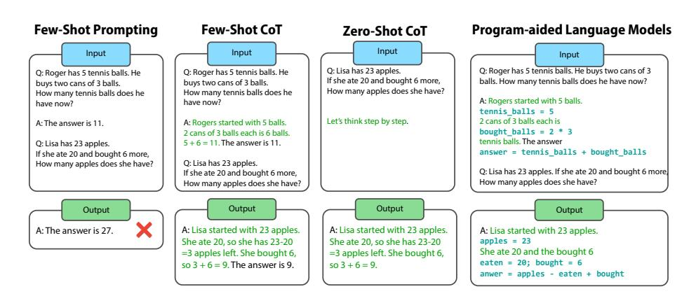
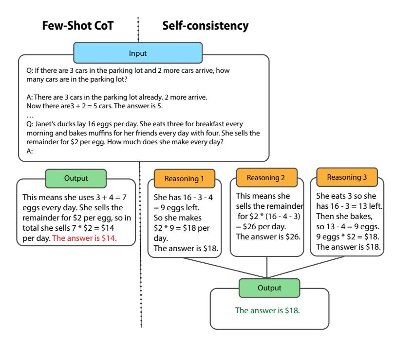
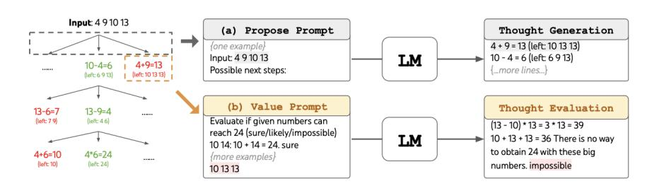
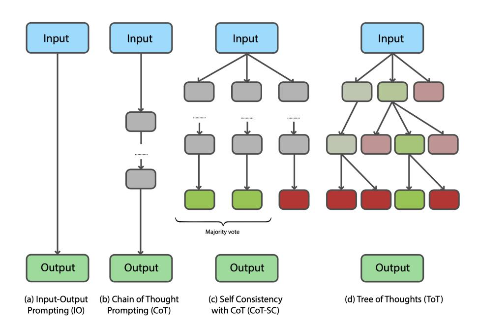
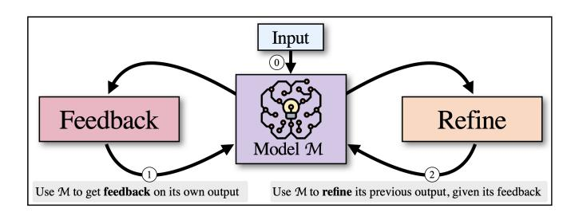
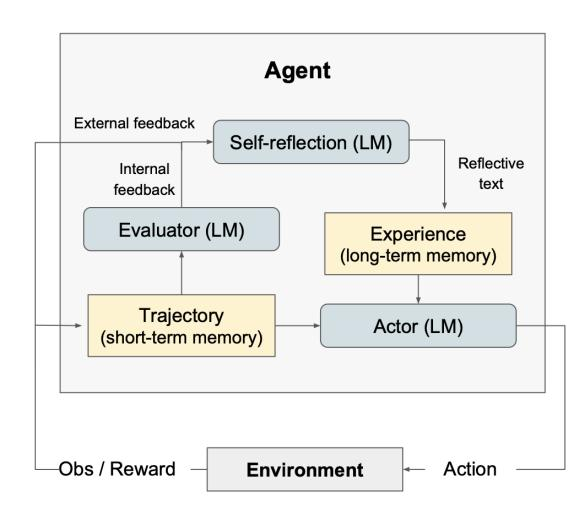
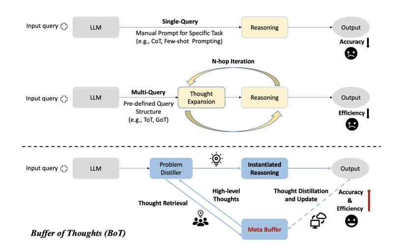

<!-- Source: AgenticLargeLanguageModels.pdf; physical PDF pages 125-150; Marker split PDF pages 1-26. -->

{0}------------------------------------------------

## 第6章

# LLM中的多步推理

#### 你将学到的内容

本章将介绍语言模型如何借助*多步推理*解决更复杂的问题。完成本章后，你将能够：

- 解释*思维链*的概念：如何通过上下文学习引导 LLM 展开中间推理步骤，从而更好地回答复杂问题。
- 说明推理方法如何拓展 LLM 的能力，以及为什么推理能力对智能体在现实场景中采取合理行动很重要。
- 编写第一个*智能体执行框架*：一个通过不同提示调用 LLM，并管理提示和模型回复的小程序。
- 解释*自我反思*：执行框架如何让 LLM 扮演不同角色，例如评估答案或生成子问题，以改进模型输出。
- 说明*记忆*的作用：执行框架如何跟踪智能体状态，并利用状态管理提示。
- 介绍*基于可验证奖励的强化学习*：如何将推理阶段任务的结果用于微调模型。
## 6.1 上下文推理

正如第 3 章所述，大语言模型可以从提示中提供的示例进行学习，这种能力称为*上下文学习*（in-context learning，ICL），也称为*提示学习* [\[Brown et al.,](#page-19-0) [2020\]](#page-19-0)。本节将介绍 ICL、常见推理基准，以及用于多步推理的思维链方法。

{1}------------------------------------------------

#### 6.1.1 上下文学习

上下文学习发生在推理阶段，而非训练阶段 [\[Dong et al.,](#page-20-0) [2022\]](#page-20-0)：模型在提示中接收示例，并据此回答问题。这些示例有助于解码器调用预训练期间学到的相关知识。模型有时只需参考少量示例就能准确完成任务，因此 ICL 常被称为*少样本学习*。这依赖模型在训练期间获得了广泛的知识。

**学习，而非训练。** 与预训练或微调不同，ICL 不会改变 Transformer 的参数。因此它不是参数训练，不过模型确实会从提示中的示例中学习。这也意味着，一次 LLM 调用获得的信息不会保留在参数中供下一次调用使用。若要在多次调用间传递信息，必须将先前结果作为示例或其他上下文加入后续提示。

**上下文窗口。** LLM 接收提示的部分称为*上下文窗口*。提示以及所有用于引导回答的示例都必须放入这个窗口。由于上下文窗口容量有限，能提供的信息量也有限。因此，ICL 适合从少量示例中学习，却不适合长期保留信息或在不同调用之间记忆内容。

**示例。** ICL 提示会把少量示范与待回答的问题组合起来 [\[Liu et al.,](#page-22-0) [2023\]](#page-22-0)，模型随后通过一次前向计算生成答案。例如，情绪识别任务可以把 *I missed the bus today* 和 *I felt so [ ]* 配对，让模型补出 *bad*。翻译任务则可以在同一句后面加上 *French: [ ]*，要求模型给出法语译文。示例提供了背景信息，帮助模型判断要执行的任务。

**少样本学习与机器学习的理想。** 当语言模型掌握了足够的先验知识时，就能从提示中的少量示例进行泛化。用户提供相关示例，帮助模型选择回答指令所需的背景知识

{2}------------------------------------------------

。包含少量示例的提示可实现少样本学习；只包含指令、不含示例的提示则属于零样本学习。

ICL 作为一种少样本学习形式，引起了研究人员的极大兴趣。在传统机器学习中，模型 $f$ 需要通过数据集训练；复杂任务通常需要大量样本和昂贵的训练过程。ICL 则可以利用少量示例，通过解码器进行一次前向计算来完成任务，依赖的是预训练阶段已经完成的计算。以较低成本从少量示例中实现泛化，长期以来一直是机器学习追求的理想。

**实际应用与提示工程。** ICL 的一项优势是使用方便：用户可以在智能手机上调用云端商业 LLM，无需自行寻找设备训练大型模型。不过，ICL 的效果可能对提示的写法和所选示例十分敏感。由于这种脆弱性，研究者发展出*提示工程*，探索如何编写提示以帮助 LLM 完成预期任务 [\[Radford et al.,](#page-22-0) [2019,](#page-22-0) [Wei et al.,](#page-24-0) [2022a,](#page-24-0) [Giray,](#page-21-0) [2023,](#page-21-0) [Sahoo et al.,](#page-23-0) [2024\]](#page-23-0)。

多数 LLM 应用还会使用隐藏的系统提示，为模型指定角色或行为约束。聊天机器人也可能在上下文中加入简短的对话历史或先前的搜索结果，以便更连贯地回应用户。

ICL 推动了后续研究，其中包括本章主题——多步推理。过去，LLM 在简单算术等推理任务上表现不佳。下文将介绍这类任务的基准，并讨论一种显著提升推理表现的 ICL 方法。

#### 6.1.2 多步推理基准

人工智能研究的进展常通过基准测试衡量。LLM 多步推理的早期研究从小学数学应用题开始。GSM8K 基准就是为研究这类推理能力而构建的 [\[Cobbe et al.,](#page-20-0) [2021\]](#page-20-0)。它包含 8,500 道由人工编写的数学题及其解答，旨在兼顾质量、多样性和适中的难度。在思维链提示出现之前，语言模型在该数据集上的表现并不理想。下面是一个典型例子：

*问题：* 罗密欧一周烤 4 盘饼干，每盘 2 打（24 块）。如果把饼干平均分给 16 个人，每人能分到几块？

{3}------------------------------------------------

*答案：* $4 \times 2 \times 12 / 16 = 6$。

GSM8K 对人来说或许很简单，但对 LLM 却颇具挑战。基准发布时，最先进的 GPT-3（175B）准确率也只有约 15% [\[Wei et al.,](#page-24-0) [2022b\]](#page-24-0)。其他数学应用题基准包括 SVAMP [\[Patel et al.,](#page-22-0) [2021\]](#page-22-0)、ASDiv [\[Miao et al.,](#page-22-0) [2021\]](#page-22-0)、AQuA [\[Ling et al.,](#page-21-0) [2017\]](#page-21-0) 和 MAWPS [\[Koncel-Kedziorski et al.,](#page-21-0) [2016\]](#page-21-0)。

后来，研究者又提出了评估其他领域推理能力的基准，涵盖高等数学（AIME [\[Codeforces,](#page-20-0) [2024\]](#page-20-0)）、代码理解与跨编程语言转换（Spider [\[Yu et al.,](#page-25-0) [2018\]](#page-25-0)，Rozière et al. [\[2020\]](#page-23-0)）、具身任务（如家居环境中的机器人任务和厨房任务 [\[Shridhar et al.,](#page-23-0) [2020,](#page-23-0) [Ahn et al.,](#page-19-0) [2022\]](#page-19-0)）、解谜（Game24 [\[Yao et al.,](#page-25-0) [2024\]](#page-25-0)）、创意写作 [\[Yao et al.,](#page-25-0) [2024\]](#page-25-0)、棋类游戏（将死问题 [\[Yang et al.,](#page-25-0) [2024\]](#page-25-0)）和 Minecraft [\[Fan et al.,](#page-20-0) [2022\]](#page-20-0)，以及网页导航（WebShop [\[Yao et al.,](#page-25-0) [2022a\]](#page-25-0)）。其他研究还关注游戏和规划问题 [\[Ruoss et al.,](#page-23-0) [2024,](#page-23-0) [Paglieri et al.,](#page-22-0) [2025,](#page-22-0) [Wen et al.,](#page-24-0) [2025a\]](#page-24-0)。

基准测试旨在清晰比较不同方法的表现，但如果实验条件不同，结果就难以直接比较。关于 LLM 推理评测难点的批判性讨论，可参见 [Kamoi et al.](#page-21-0) [\[2024\]](#page-21-0) 和 [Shojaee et al.](#page-23-0) [\[2025\]](#page-23-0)。

#### 6.1.3 思维链提示

大约在 2022 年，常规 LLM 在简单数学应用题上的表现仍然很差。第 4 章介绍的常见方法——扩大模型规模——并没有解决这个问题 [\[Rae et al.,](#page-22-0) [2021\]](#page-22-0)，于是研究者开始探索其他方法。

基于 Transformer 的 LLM 解码器每次生成一个词元，本质上是下一个词元预测器。提示模型回答问题时，它可能会立即给出一个答案；但人类解决数学问题时，通常会把问题拆解成一系列步骤。例如，饼干问题需要计算 $4 \times 2 \times 12 / 16 = 6$。因此，与其只要求模型给出最终答案，不如提示它依次完成精心设计的中间步骤，再得出结果。这类似于学校里教学生拆解复杂问题并解释推理过程：*不要只告诉我答案，也要说明你是如何得出答案的。*我们也应引导模型
{4}------------------------------------------------

图 6.1：不同的思维链（CoT）提示方法 [\[Wei et al.,](#page-24-0) [2022b,](#page-24-0) [Kojima et al.,](#page-21-0) [2022,](#page-21-0) [Gao et al.,](#page-20-0) [2023,](#page-20-0) [Plaat et al.,](#page-22-0) [2025\]](#page-22-0)。图上方是提示，下方是对应的回答。

我们应引导语言模型明确生成中间推理步骤，再将这些步骤的结果整合起来。最终回答应包含推理过程，并得出正确结论。

因此，少样本提示应提供中间推理步骤的示例，而不只是最终答案的示例。[Wei et al.](#page-24-0) [\[2022b\]](#page-24-0) 等人研究了这种方法，并提出了*思维链*。图 6.1 展示了思维链及其相关方法。

一种引导模型生成中间步骤的方法，是在提示中示范完成任务所需的具体推理过程，例如计算容器中的球数，或计算一张饼被切成多少块。[Wei et al.](#page-24-0) [\[2022b\]](#page-24-0) 等人发现，提示 LLM 将问题信息改写为回答中的中间推理步骤，效果显著好于只要求模型给出最终答案。原论文中的示例见图 6.1。提供较长的少样本思维链示例时，模型往往会遵循示例中的推理模式。在 GSM8K 上，思维链方法将准确率从 16% 提高到了 47%。

提示可以引导 LLM 按步骤推理，这一想法引发了对多步推理的大量研究。此后，思维链（CoT）已成为 LLM 的标准提示方法之一。

原始研究由研究者针对不同问题手工编写提示。[Kojima et al.](#page-21-0) [\[2022\]](#page-21-0) 进一步发现，只需添加一句与任务无关的话——*让我们一步一步地思考*——就能提升模型在许多问题上的表现。由于这句话不包含任务特定信息，这属于零样本学习。图 6.1 对比了

{5}------------------------------------------------

这些方法，其中第二列和第三列展示了相应提示。实验还发现，这一方法能提升模型在算术、符号和逻辑推理基准上的表现。使用较新的 PaLM 模型并结合自洽性（下一节介绍）时，GSM8K 准确率达到 70% [\[Wang et al.,](#page-24-0) [2022\]](#page-24-0)。

思维链的构想还受到 Scratchpad [\[Nye et al.,](#page-22-0) [2021\]](#page-22-0)、使用自然语言步骤进行算术推理的早期研究 [\[Ling et al.,](#page-21-0) [2017,](#page-21-0) [Cobbe et al.,](#page-20-0) [2021\]](#page-20-0)，以及使用形式语言进行推理的研究启发 [\[Roy and Roth,](#page-23-0) [2016,](#page-23-0) [Chiang and Chen,](#page-20-0) [2018,](#page-20-0) [Amini et al.,](#page-19-0) [2019,](#page-19-0) [Chen et al.,](#page-20-0) [2019\]](#page-20-0)。

#### 6.1.3.1 自我评估

LLM 并非总能给出正确结果；一连串推理步骤中的错误还可能逐步累积。评估模型及其中间步骤，有助于控制错误的传播。

一种方法是让 LLM 评估自己的推理过程。多步思维链会增加模型对错误的敏感性，也容易造成错误累积 [\[Weng et al.,](#page-24-0) [2022,](#page-24-0) [Xiao et al.,](#page-24-0) [2023\]](#page-24-0)。[Weng et al.](#page-24-0) [\[2022\]](#page-24-0) 提出*自我验证*：让模型以思维链得出的结论为条件，重新求解原问题，再比较新答案与原结论。模型还可以生成候选结论的不同变体，并选择与原问题最一致的结论。

另一个相关方法是*自洽性*，即对多条采样得到的推理路径进行集成 [\[Wang et al.,](#page-24-0) [2022\]](#page-24-0)。集成方法通过组合多个预测来获得更可靠的结果 [\[Sagi and Rokach,](#page-23-0) [2018,](#page-23-0) [Breiman,](#page-19-0) [2001\]](#page-19-0)。标准贪心解码每一步都选择 logit 最高的词元，因此只沿一条路径生成。自洽性则采样多条不同的推理路径，并选择最终答案中出现次数最多的答案。这种方法有效，是因为复杂推理问题往往存在多条通向正确答案的路径。图 [6.2](#page-6-0) 展示了这一方法。

自洽性已在算术、常识和符号推理任务上接受评估，测试模型包括 GPT-3。它通常能在思维链的基础上再提升 10–20 个百分点，因此现代 LLM 常将自洽性与思维链结合使用。

{6}------------------------------------------------

图 6.2：自洽性示意图，改编自 [\[Wang et al.,](#page-24-0) [2022\]](#page-24-0)，展示了多数投票。
{7}------------------------------------------------

#### 6.1.3.2 用代码验证推理

提高多步推理可靠性的另一种方法，是使用形式语言代替自然语言。Python 等编程语言和数学逻辑都属于形式语言，表达歧义通常较少。

LLM 已能根据自然语言提示生成代码。[Chen et al.](#page-19-0) [\[2021\]](#page-19-0) 提出的 Codex 在 GitHub 上公开的代码上训练，能够根据自然语言描述（包括代码注释）生成程序。因此，形式语言逐渐成为推理工具：LLM 可以用 Python 表达推理步骤，再交由编译器、调试器或解释器检查。

这与程序员的工作流程相似：编写代码、运行代码、检查错误，并依据反馈修改。*自我调试*采用了代码生成、执行和解释这一循环 [\[Chen et al.,](#page-20-0) [2023\]](#page-20-0)。模型可以检查运行结果，发现代码中的错误，并用自然语言解释生成的代码。

另一种方法是*程序辅助语言模型*（Program-Aided Language Models，PAL）：LLM 生成 Python 代码，再由解释器执行 [\[Gao et al.,](#page-20-0) [2023\]](#page-20-0)。模型将问题拆分成较小的代码片段，供解释器运行。图 [6.1](#page-4-0) 第四列展示了 PAL。计算过程由解释器验证，LLM 则负责把自然语言问题转化为可执行步骤。针对 13 项数学、符号和算法推理任务的实验显示，PAL 的表现超过了当时许多规模更大的模型；其 GSM8K 得分为 72%，Penguins 得分为 93% [\[Gao et al.](#page-20-0) [2023\]](#page-20-0)。
#### 6.1.3.3 演进式代码生成提示

形式语言验证催生了一些无需人工反馈、能够自动生成针对特定问题优化的可执行代码的方法。[Romera-Paredes et al.（2024）](#page-23-0)提出了 FunSearch。它结合形式化方法与 LLM，用于辅助数学发现和代码生成。FunSearch 维护多个候选程序群体，并依据由问题规范定义的函数评估这些程序。对初始提示生成的程序评分后，FunSearch 会从中挑选候选程序组成新提示，再让 LLM 生成更多程序。

另一种方法利用进化计算生成并优化进化算法。[van Stein 和 Back（2024）](#page-23-0)提出了 LLaMEA（Large Language Model Evolutionary Algorithm，大语言模型进化算法），用 LLM 设计和优化算法。

{8}------------------------------------------------

LLaMEA 先生成初始算法结构，再通过变异和选择不断改进。作者报告称，该方法在黑盒优化基准（BBOB）上将准确率提高了 11 个百分点 [Hansen 和 Ros（2010）](#page-21-0)。

## 6.2 自我反思与状态

上下文学习是一种有效的小样本学习方法。如果示例中包含推理步骤，还可以进一步提升 LLM 解决问题的能力。

本节将讨论上下文学习的局限，以及扩展这些能力的方法。我们先考察状态与记忆：状态如何在多次 LLM 调用之间传递，长上下文窗口能带来什么，以及 LLM 是否擅长解决需要跟踪和更新状态的问题。

#### 6.2.1 LLM 是无状态函数

上下文少样本学习通过提示词引导 LLM 调用已学到的知识。模型根据提示中的指令和示例生成下一个词元，其参数通常记作 $(K,V)$。思维链提示还会把示例中的推理步骤作为条件提供给模型。

在这种用法中，传给 LLM 的全部信息都包含在提示词里。可以把模型看作函数 $f$，将提示词 $x$ 映射为答案 $y$：

$f(x) \rightarrow y$。

原则上，LLM 不会在两次独立调用之间保留信息：模型参数不会改变，也没有用于保存交互历史的持久全局变量。如果后续请求依赖先前调用中的状态，就必须把该状态写入新的提示词 $x'$。模型本身并不记得上一条回答。

如果每次提问都要重复整个对话，会非常繁琐。聊天机器人通常会把先前的对话轮次加入提示词，有时由系统在后台自动处理。但底层模型每次仍是把这些历史内容作为输入；它本身不会跨调用保留对话状态。LLM 可以根据给定提示生成关联的后续词元，却不是能够可靠记住数值并跨调用更新变量的通用有状态程序。

{9}------------------------------------------------

图 6.3：井字棋是一种简单的棋盘游戏，但要正确下棋就必须跟踪棋盘状态。

#### 6.2.2 检索增强与长上下文窗口

记忆限制不只存在于多次调用之间。回答查询所需的信息都必须放进上下文窗口，而窗口长度有限，因此一次能够提供给模型的信息量也有限。总结一本书这样的长文本时，这会成为问题。第 20.2.1 节还会讨论上下文强化学习方法：它们把完整的回合历史保存在上下文窗口中。这些场景都需要新的方法，向 LLM 提供更多相关信息。

扩展推理阶段可用信息的一种早期方法是检索增强生成（RAG）。RAG 允许 LLM 检索外部信息，例如企业数据库或维基百科 [Lewis et al.（2020）](#page-21-0)。它也有助于减少事实性错误，并提供金融、物流等时效性信息。第 12 章会进一步介绍 RAG。

更长的上下文窗口使模型能够接收更长文本。采用标准 Transformer 架构时，计算量会随上下文长度呈二次方增长，因此研究者也在开发计算复杂度与长度呈线性关系的架构 [Ren et al.（2024）](#page-22-0)。其他方法会压缩上下文信息，例如语义压缩 [Fei et al.（2024）](#page-20-0)、信息分块 [Wang et al.（2023）；Zhou et al.（2025）](#page-25-0)，或递归处理 [Zhang et al.（2025）](#page-25-0)。为 LLM 设计新的记忆架构仍是活跃的研究方向 [Yan et al.（2025）](#page-24-0)。

#### 6.2.3 LLM 与有状态问题

LLM 往往难以解决需要准确跟踪状态的问题 [Wong et al.（2025）](#page-24-0)。例如，规划任务要求模型准确记住当前状态；即使是图 6.3 中那样简单的棋盘游戏也不例外。模型可能混淆棋盘状态，给出听起来合理、在熟悉的对局中也许成立，却不适用于当前局面的走法 [Paglieri et al.（2025）；Ruoss et al.（2024）](#page-23-0)。

研究者尝试借鉴强化学习和规划算法，提升模型对状态的推理能力 [Wong et al.（2026）](#page-24-0)。LLM 的无状态特性还会造成一种称为*知行差距*的问题。第 20 章将讨论其他有状态问题及其解决方法。

{10}------------------------------------------------

**知行差距。** 除了不同调用之间缺少状态外，LLM 即使能够说清正确步骤，也可能无法正确执行任务。

所谓知行差距，是指 LLM 能够用文字给出正确解法，甚至写出正确算法，却无法可靠地执行它 [Paglieri et al.（2025）](#page-22-0)。询问模型如何解决某个问题时，它可能给出可执行且正确的 Python 代码；但随后让它实际求解时，模型却未必能按代码中的算法一步步执行。错误常出现在变量逐步变化的过程中 [Paglieri et al.（2025）；Ruoss et al.（2024）](#page-23-0)。忠实执行算法、跟踪寄存器中的数值，并非基于注意力的 Transformer 原本擅长的工作；它们的设计目标是利用关联模式处理语言 [La Malfa et al.（2024）](#page-21-0)。1

类似的状态管理问题也会出现在模型与自己对弈时：棋子可能在两步之间凭空出现或消失。模型可能下出在其他局面中合理、却不符合当前棋盘的棋步，还会为错误走法给出听似可信的解释。变量状态变化时，LLM 可能遗忘或混淆具体数值。要求模型仔细跟踪每个数值或许有所帮助，但这种做法繁琐且容易出错 [La Malfa et al.（2024）](#page-21-0)。

使用外部解释器执行 LLM 生成的算法，可以避免知行差距和棋子消失的问题。一些商业聊天机器人采用了这种方法。Python 解释器既能准确执行代码，也比让 LLM 模拟每一步运算更高效。

第 20 章将介绍 Transformer 系统中处理状态与记忆的其他方法。

#### 6.2.4 用代理执行框架改进提示

除了调用外部代码执行环境，另一种管理状态的方法是添加小型外部算法，明确跟踪状态并管理提示。这类控制算法称为*执行框架*（harness）。

1人也会犯类似错误：我们可能会正确描述长除法步骤，却仍算错 $12345 / 42$。计算机擅长精确运算；人和 LLM 都可能出错。

{11}------------------------------------------------

执行框架可以让同一个 LLM 扮演不同角色，并为生成、状态评估等任务使用不同提示。本节先介绍基于搜索的提示管理。

让 LLM 批评或评估自己刚刚生成的结果，通常称为*自我反思*。这个说法带有一定拟人色彩；究竟是 LLM 还是外围执行框架在进行反思，仍有争论。

#### 6.2.4.1 基于搜索的提示优化

基于搜索的推理时方法超越了思维链提示。思维链沿着一条推理路径前进，每一步通常只接续一个后续步骤；基于搜索的方法则会在每一步探索多个备选方案，形成一棵可能性树。

探索这类搜索树，需要记录已经访问过哪些步骤、目前哪个答案更好，以及还有哪些分支待探索。与 LLM 相比，传统算法（例如小型 Python 程序）更适合可靠地维护这些状态。外部算法可以把问题组织成一棵包含多个备选步骤的搜索树，并向前探索若干步（见第[138 页的图 6.6](#page-13-0)）。它把 LLM 当作子程序，调用模型提出行动或评估结果；随后由算法回溯并尝试其他分支。这个外部控制器负责跟踪状态和管理提示，构成包围 LLM 的执行框架。

我们先介绍深度优先搜索和广度优先搜索 [Cormen et al.（2022）](#page-20-0)。思维树（ToT）利用这些策略动态探索不同的推理路径 [Yao et al.（2024）](#page-25-0)。在 ToT 中，LLM 分别通过不同提示提出候选思路并对其进行评估；外部搜索过程将这些步骤组织起来，以探索可能路径、向前推演并进行回溯（见图 [6.4](#page-12-0) 和图 [6.5](#page-12-0)）。

ToT 已用于 24 点等规划谜题。给出四个数字后，任务是使用加、减、乘、除将它们组合成 24。例如，给定 4、9、10 和 13，一种解法是 $(10-4) \times (13-9)=24$。ToT 首先使用*提议提示*生成可能的下一步，然后再通过评估提示对候选步骤进行评分；评估提示可以包含思维链示例。图 [6.5](#page-12-0) 展示了原论文中的一组提示示例。

{12}------------------------------------------------

图 6.4：思维树：左侧为广度优先搜索，右侧为深度优先搜索。箭头表示发送给 LLM 的提示。改编自 [Yao et al.（2024）](#page-25-0)。

图 6.5：24 点游戏中的思维树提示示例 [Yao et al.（2024）](#page-25-0)。

{13}------------------------------------------------

图 6.6：不同的推理结构：（b）思维链、（c）自洽性和（d）思维树。

作者将 ToT 与线性思维链、自洽性方法在 24 点、创意写作和迷你填字游戏任务上进行比较。ToT 在 24 点任务上的准确率达到 74%；其他任务则通过定性方式评估。图 6.6 展示了几种方法的推理结构。3

#### 6.2.4.2 自我反思

图 6.7：Self-Refine 架构 [Madaan et al.（2023）](#page-22-0)。

这些方法会让 LLM 扮演不同角色，并借鉴强化学习中的一些思路来迭代改进输出。

**Self-Refine（自我精炼）。** 第一种方法是 Self-Refine [Madaan et al.（2023）](#page-22-0)：LLM 先生成初稿，再对输出提出反馈，最后依据反馈修改答案。整个过程使用三种提示，分别用于生成、反馈和修订，并沿着贪心推理链逐步推进；每个状态只尝试一个后续步骤，不像 ToT 那样探索多条分支。研究报告称，该方法在对话生成、代码优化和受约束生成等任务上优于常规思维链提示。

**ReAct。** 将贪心方法扩展后，可以让 LLM 在每个状态下考察多个选项。ReAct 将推理过程与行动和观察结合起来 [Yao et al.（2022b）](#page-25-0)。它可以调用维基百科等外部知识源，也可以结合微调或手工编写的提示。这些机制有助于为回答提供依据，并减少错误和幻觉。在 ALFWorld 和 WebShop 两个交互式决策基准上，与文中比较的模仿学习和强化学习方法相比，ReAct 的成功率分别提高了 34 和 10 个百分点。

**Reflexion（反思）。** Reflexion 让智能体从失败中反思并改进结果，延续了 ReAct 的研究思路 [Shinn et al.（2024）](#page-23-0)。5它让 LLM 分别担任执行者、评估者和反思者。执行框架会在多次调用之间保存显式记忆：短期记忆用于生成行动轨迹，长期记忆用于存储经验。这种外部记忆有助于弥补普通 LLM 的状态管理局限。具体而言，（1）执行者生成文本和动作；（2）评估者对执行者的输出打分；（3）反思者生成文字反馈，帮助执行者改进。

4<https://github.com/ysymyth/ReAct>

5<https://github.com/noahshinn/reflexion>

{15}------------------------------------------------

图 6.8：Reflexion 架构 [Shinn et al.（2024）](#page-23-0)，与强化学习中的智能体—环境结构相似。

执行者可以采用思维链提示或 ReAct。Reflexion 已在决策、推理和代码任务上进行评估；作者报告的性能提升为 10–20 个百分点 [Shinn et al.（2024）](#page-23-0)。

**Buffer of Thoughts（BoT，思维缓冲区）。** 另一种方法是 Buffer of Thoughts，它进一步探索元推理 [Yang et al.（2024）](#page-25-0)；[Gao et al.（2024）](#page-20-0)。它会把从多种任务中提炼出的高层次*思维模板*保存在元缓冲区中，并根据容量主动管理。问题提炼器负责从具体问题中提取这些模板。图 [6.9](#page-16-0) 将 BoT 与思维链、思维树等方法进行了比较。作者报告称，BoT 在 24 点和将死任务上分别取得了 11% 和 51% 的性能提升。思维模板与元认知（对思维过程的思考）有关 [Didolkar et al.（2024）](#page-20-0)。

**局限与提示敏感性。** 自我反思也有局限。要求模型改进答案会引出一个问题：为什么模型一开始没有给出更好的答案？[Huang et al.（2023）](#page-21-0) 和 [Shojaee et al.（2025）](#page-23-0)指出，部分评测存在方法问题：数据标签可能泄露答案，修订提示可能比初始提示提供更多信息，或者同一个 LLM 可能同时充当智能体和环境。

{16}------------------------------------------------

图 6.9：Buffer of Thoughts [Yang et al.（2024）](#page-25-0)。

一项可重复性研究发现，自我一致性思维链的表现并未被自我反思方法超越 [Huang et al.（2023）](#page-21-0)。结果也会受到提示措辞影响。自我反思仍是一个活跃的研究领域，但还有许多问题有待回答。

这些方法可能需要多次调用 LLM，因而增加时间和费用。要为具体任务找到合适的方法，往往需要大量实验。第 10 章将通过案例介绍自我反思方法的实践；阅读后续内容时，也应留意上述局限。

#### 6.2.4.3 基于可验证奖励的强化学习

本章重点讨论推理阶段发生、且不改变模型参数的上下文学习。微调则在训练阶段进行，并会更新模型参数。本节简要介绍将推理阶段生成的结果用于后续训练的方法。

基于可验证奖励的强化学习（RLVR）用于训练模型完成结果可自动检查的任务，例如数学问题求解或代码执行。在这些任务中，验证器可以判断答案是否正确，无需人工反馈。

对于答案可以客观核验的任务，RLVR 用验证函数取代学习得到的奖励模型。策略模型根据一组提示生成回答，再由确定性验证器检查正确性。回答正确时给予正奖励，错误时奖励为 0；随后可以使用近端策略优化（PPO）等算法更新策略 [Schulman et al.（2017）](#page-23-0)。RLHF 也使用 PPO 进行策略优化。

{17}------------------------------------------------

DeepSeek-R1 的开发是这一方向的重要案例 [Guo et al.（2025）](#page-21-0)。与推理时依赖外部控制器的方法不同，这类方法训练模型生成自己的推理步骤，并将数据生成与强化学习整合到迭代过程中，从而减少对监督示例的依赖。从基础模型出发，强化学习可以强化那些带来可验证结果的推理模式。DeepSeek 使用群体相对策略优化（GRPO），根据同组样本的评分比较来估计优势 [Shao et al.（2024）](#page-23-0)。

作者报告称，微调过程中出现了反思、探索其他解题方法等复杂行为，而这些行为并未被明确编程 [Mercer et al.（2025）](#page-22-0)。例如，DeepSeek-R1-Zero 会重新评估初始解法，并为部分问题分配更多计算。这种“学会推理”的方式可能使模型表现得更灵活。

GRPO 适用于能够验证结果的任务，因此可以在不依赖人工偏好判断的情况下进行强化学习更新。RLVR 方法目前常用于这类任务的 LLM 微调 [Lambert et al.（2024）](#page-21-0)。

GRPO 等方法会针对训练提示生成回答，由验证器评分，再依据奖励更新模型。DeepSeek 公布的结果 [Guo et al.（2025）](#page-21-0)提升了人们对 GRPO [Shao et al.（2024）](#page-23-0)和其他 RLVR 方法的关注 [Lambert et al.（2024）；Guo et al.（2025）；Wen et al.（2025b）；Yue et al.（2025）](#page-25-0)。

## 6.3 结语

本章讨论了提升 LLM 推理能力的方法。思维链提示是一种广为人知的做法：通过展示中间步骤，引导模型逐步解决问题。更复杂的方法会使用搜索、自我反思或推理时强化学习；RLVR 等训练方法则利用验证器反馈微调模型，使其适用于推理任务。

{18}------------------------------------------------

#### 6.3.1 脆弱性

研究者提出了许多用于构建智能体执行框架的算法，因为这一领域仍处于早期阶段，面临不少挑战。

这些方法也可能很脆弱。提示中一个很小的改动，甚至只多一个逗号，都可能影响方法能否奏效。模型温度等超参数、随机种子、执行框架的记忆管理方式以及所用 LLM，也都可能显著影响结果。

这种不稳定性令人沮丧，但在新兴领域并不少见。实验应使用不同随机种子、模型和超参数多次运行，从而了解方法在不同条件下是否可靠。

#### 6.3.2 快思与慢想

最后，我们从更广的视角讨论 LLM 推理。人工智能发展中有两种思想传统：符号主义和连接主义。符号主义把智能理解为依照逻辑规则操作符号；连接主义研究智能行为如何从相互连接的单元（如神经元、细胞、蚂蚁、人或机器人）之间的交互中涌现。符号主义借鉴数学，连接主义借鉴生物学。正如第 2.3 节所述，两种传统都发展出有用的方法，也都取得了重要成果，例如搜索与推理，以及深度学习和 LLM。

丹尼尔·卡尼曼在 2011 年出版的《思考，快与慢》中，用“系统 1”和“系统 2”区分直觉、快速的思考与审慎、缓慢的思考 [Kahneman（2011）](#page-21-0)。在人工智能领域，这两个术语也常被用来类比：快速思考对应基于联想的检索，慢速思考对应多步推理。推理时的零样本回答常被类比为系统 1；逐步提示或智能体执行框架则常被类比为系统 2。

LLM 属于连接主义传统。推理时调用工具，可以为模型补充符号主义传统中的能力，例如检索知识和执行显式计算。

研究者有时会用拟人的方式描述 LLM，但 LLM 的核心机制是预测下一个词元，并不等同于人的思维。生成更多中间词元会延长从提示到最终答案的路径。性能提升的一种可能解释是，模型沿着较小的步骤逐渐推进，使每一步都更可能接近正确答案；这并不意味着它的推理过程与人类相同。

{19}------------------------------------------------

可以把这种推理理解为逐步缩小可能续写的概率范围，使正确答案更有可能生成；这种解释并不要求把模型过程等同于人类认知 [Guo et al.（2025）](#page-21-0)。

#### 6.3.3 结论

本章讨论了 LLM 如何通过预测下一个词元完成语言任务，以及它们如何处理需要多步推理的问题，也介绍了管理复杂推理结构的方法。

多数方法发生在上下文中，且相对容易检查，因为引导推理的提示对用户可见。智能体执行框架可以管理提示和记忆；预训练和微调也能让模型把多步推理纳入决策过程，而不局限于单纯的下一个词元预测。

研究者还在开发更丰富的模型，将视觉推理、决策和行动整合进 LLM。下一章将进一步介绍预训练和微调的多模态模型。

## 参考文献

Michael Ahn, Anthony Brohan, Noah Brown, Yevgen Chebotar, Omar Cortes, Byron David, Chelsea Finn, Chuyuan Fu, Keerthana Gopalakrishnan, Karol Hausman, et al. Do as i can, not as i say: Grounding language in robotic affordances. *arXiv preprint arXiv:2204.01691*, 2022. [128](#page-3-0) Aida Amini, Saadia Gabriel, Peter Lin, Rik Koncel-Kedziorski, Yejin Choi, and Hannaneh Hajishirzi. Mathqa: Towards interpretable math word problem solving with operation-based formalisms. *arXiv preprint arXiv:1905.13319*, 2019. [130](#page-5-0) Maciej Besta, Nils Blach, Ales Kubicek, Robert Gerstenberger, Michal Podstawski, Lukas Gianinazzi, Joanna Gajda, Tomasz Lehmann, Hubert Niewiadomski, Piotr Nyczyk, et al. Graph of thoughts: Solving elaborate problems with large language models. *Proceedings of the AAAI Conference on Artificial Intelligence*, 38(16): 17682–17690, 2024. [138](#page-13-0) Leo Breiman. Random forests. *Machine learning*, 45:5–32, 2001. [130](#page-5-0) Tom Brown, Benjamin Mann, Nick Ryder, Melanie Subbiah, Jared D Kaplan, Prafulla Dhariwal, Arvind Neelakantan, Pranav Shyam, Girish Sastry, Amanda Askell, et al. Language models are few-shot learners. *Advances in neural information processing systems*, 33:1877–1901, 2020. [125](#page-0-0) Mark Chen, Jerry Tworek, Heewoo Jun, Qiming Yuan, Henrique Ponde de Oliveira Pinto, Jared Kaplan, Harri Edwards, Yuri Burda, Nicholas Joseph, Greg Brockman, et al. Evaluating large language models trained on code. *arXiv preprint arXiv:2107.03374*, 2021. [132](#page-7-0)

{20}------------------------------------------------

Xinyun Chen, Chen Liang, Adams Wei Yu, Denny Zhou, Dawn Song, and Quoc V Le. Neural symbolic reader: Scalable integration of distributed and symbolic representations for reading comprehension. In *International Conference on Learning Representations*, 2019. [130](#page-5-0) Xinyun Chen, Maxwell Lin, Nathanael Scharli, and Denny Zhou. Teaching large lan- ¨ guage models to self-debug. *arXiv preprint arXiv:2304.05128*, 2023. [132](#page-7-0) Ting-Rui Chiang and Yun-Nung Chen. Semantically-aligned equation generation for solving and reasoning math word problems. *arXiv preprint arXiv:1811.00720*, 2018. [130](#page-5-0) Karl Cobbe, Vineet Kosaraju, Mohammad Bavarian, Mark Chen, Heewoo Jun, Lukasz Kaiser, Matthias Plappert, Jerry Tworek, Jacob Hilton, Reiichiro Nakano, et al. Training verifiers to solve math word problems. *arXiv preprint arXiv:2110.14168*, 2021. [127,](#page-2-0) [130](#page-5-0) MAA Codeforces. American invitational mathematics examination-aime 2024, 2024, 2024. [128](#page-3-0) Thomas H Cormen, Charles E Leiserson, Ronald L Rivest, and Clifford Stein. *Introduction to algorithms*. MIT press, 2022. [136](#page-11-0) Aniket Didolkar, Anirudh Goyal, Nan Rosemary Ke, Siyuan Guo, Michal Valko, Timothy Lillicrap, Danilo Rezende, Yoshua Bengio, Michael Mozer, and Sanjeev Arora. Metacognitive capabilities of llms: An exploration in mathematical problem solving. *arXiv preprint arXiv:2405.12205*, 2024. [140](#page-15-0) Qingxiu Dong, Lei Li, Damai Dai, Ce Zheng, Zhiyong Wu, Baobao Chang, Xu Sun, Jingjing Xu, and Zhifang Sui. A survey on in-context learning. *arXiv preprint arXiv:2301.00234*, 2022. [126](#page-1-0) Linxi Fan, Guanzhi Wang, Yunfan Jiang, Ajay Mandlekar, Yuncong Yang, Haoyi Zhu, Andrew Tang, De-An Huang, Yuke Zhu, et al. Minedojo: Building open-ended embodied agents with internet-scale knowledge. *Advances in Neural Information Processing Systems*, 35:18343–18362, 2022. [128](#page-3-0) Weizhi Fei, Xueyan Niu, Pingyi Zhou, Lu Hou, Bo Bai, Lei Deng, and Wei Han. Extending context window of large language models via semantic compression. In *Findings of the Association for Computational Linguistics: ACL 2024*, pages 5169– 5181, 2024. [134](#page-9-0) Luyu Gao, Aman Madaan, Shuyan Zhou, Uri Alon, Pengfei Liu, Yiming Yang, Jamie Callan, and Graham Neubig. Pal: Program-aided language models. In *International Conference on Machine Learning*, pages 10764–10799. PMLR, 2023. [129,](#page-4-0) [132](#page-7-0) Peizhong Gao, Ao Xie, Shaoguang Mao, Wenshan Wu, Yan Xia, Haipeng Mi, and Furu Wei. Meta reasoning for large language models. *arXiv preprint arXiv:2406.11698*, 2024. [140](#page-15-0)

{21}------------------------------------------------

Louie Giray. Prompt engineering with chatgpt: a guide for academic writers. *Annals of biomedical engineering*, 51(12):2629–2633, 2023. [127](#page-2-0) Daya Guo, Dejian Yang, Haowei Zhang, Junxiao Song, Ruoyu Zhang, Runxin Xu, Qihao Zhu, Shirong Ma, Peiyi Wang, Xiao Bi, et al. Deepseek-r1: Incentivizing reasoning capability in llms via reinforcement learning. *arXiv preprint arXiv:2501.12948*, 2025. [142,](#page-17-0) [144](#page-19-0) Nikolaus Hansen and Raymond Ros. Black-box optimization benchmarking of newuoa compared to bipop-cma-es: on the bbob noiseless testbed. In *Proceedings of the 12th annual conference companion on Genetic and evolutionary computation*, pages 1519–1526, 2010. [133](#page-8-0) Jie Huang, Xinyun Chen, Swaroop Mishra, Huaixiu Steven Zheng, Adams Wei Yu, Xinying Song, and Denny Zhou. Large language models cannot self-correct reasoning yet. *arXiv preprint arXiv:2310.01798*, 2023. [140,](#page-15-0) [141](#page-16-0) Daniel Kahneman. *Thinking, fast and slow*. macmillan, 2011. [143](#page-18-0) Ryo Kamoi, Yusen Zhang, Nan Zhang, Jiawei Han, and Rui Zhang. When can llms actually correct their own mistakes? a critical survey of self-correction of llms. *Transactions of the Association for Computational Linguistics*, 12:1417–1440, 2024. [128](#page-3-0) Takeshi Kojima, Shixiang Shane Gu, Machel Reid, Yutaka Matsuo, and Yusuke Iwasawa. Large language models are zero-shot reasoners. *Advances in neural information processing systems*, 35:22199–22213, 2022. [129](#page-4-0) Rik Koncel-Kedziorski, Subhro Roy, Aida Amini, Nate Kushman, and Hannaneh Hajishirzi. Mawps: A math word problem repository. In *Proceedings of the 2016 conference of the north american chapter of the association for computational linguistics: human language technologies*, pages 1152–1157, 2016. [128](#page-3-0) Emanuele La Malfa, Christoph Weinhuber, Orazio Torre, Fangru Lin, Samuele Marro, Anthony Cohn, Nigel Shadbolt, and Michael Wooldridge. Code simulation challenges for large language models. *arXiv preprint arXiv:2401.09074*, 2024. [135](#page-10-0) Nathan Lambert, Jacob Morrison, Valentina Pyatkin, Shengyi Huang, Hamish Ivison, Faeze Brahman, Lester James V Miranda, Alisa Liu, Nouha Dziri, Shane Lyu, et al. Tulu 3: Pushing frontiers in open language model post-training. *arXiv preprint arXiv:2411.15124*, 2024. [142](#page-17-0) Patrick Lewis, Ethan Perez, Aleksandra Piktus, Fabio Petroni, Vladimir Karpukhin, Naman Goyal, Heinrich Kuttler, Mike Lewis, Wen-tau Yih, Tim Rockt ¨ aschel, et al. ¨ Retrieval-augmented generation for knowledge-intensive nlp tasks. *Advances in Neural Information Processing Systems*, 33:9459–9474, 2020. [134](#page-9-0) Wang Ling, Dani Yogatama, Chris Dyer, and Phil Blunsom. Program induction by rationale generation: Learning to solve and explain algebraic word problems. *arXiv preprint arXiv:1705.04146*, 2017. [128,](#page-3-0) [130](#page-5-0)

{22}------------------------------------------------

Pengfei Liu, Weizhe Yuan, Jinlan Fu, Zhengbao Jiang, Hiroaki Hayashi, and Graham Neubig. Pre-train, prompt, and predict: A systematic survey of prompting methods in natural language processing. *ACM Computing Surveys*, 55(9):1–35, 2023. [126](#page-1-0) Aman Madaan, Niket Tandon, Prakhar Gupta, Skyler Hallinan, Luyu Gao, Sarah Wiegreffe, Uri Alon, Nouha Dziri, Shrimai Prabhumoye, Yiming Yang, et al. Selfrefine: Iterative refinement with self-feedback. *Advances in Neural Information Processing Systems*, 36, 2023. [139](#page-14-0) Sarah Mercer, Samuel Spillard, and Daniel P Martin. Brief analysis of deepseek r1 and it's implications for generative ai. *arXiv preprint arXiv:2502.02523*, 2025. [142](#page-17-0) Shen-Yun Miao, Chao-Chun Liang, and Keh-Yih Su. A diverse corpus for evaluating and developing english math word problem solvers. *arXiv preprint arXiv:2106.15772*, 2021. [128](#page-3-0) Maxwell Nye, Anders Johan Andreassen, Guy Gur-Ari, Henryk Michalewski, Jacob Austin, David Bieber, David Dohan, Aitor Lewkowycz, Maarten Bosma, David Luan, et al. Show your work: Scratchpads for intermediate computation with language models. *arXiv preprint arXiv:2112.00114*, 2021. [130](#page-5-0) Davide Paglieri, Bartłomiej Cupiał, Samuel Coward, Ulyana Piterbarg, Maciej Wolczyk, Akbir Khan, Eduardo Pignatelli, Łukasz Kucinski, Lerrel Pinto, Rob Fer- ´ gus, Jakob Nicolaus Foerster, Jack Parker-Holder, and Tim Rocktaschel. BAL- ¨ ROG: Benchmarking agentic LLM and VLM reasoning on games. In *The Thirteenth International Conference on Learning Representations*, 2025. URL [https:](https://openreview.net/forum?id=fp6t3F669F) [//openreview.net/forum?id=fp6t3F669F](https://openreview.net/forum?id=fp6t3F669F). [128,](#page-3-0) [134,](#page-9-0) [135](#page-10-0) Arkil Patel, Satwik Bhattamishra, and Navin Goyal. Are nlp models really able to solve simple math word problems? *arXiv preprint arXiv:2103.07191*, 2021. [128](#page-3-0) Aske Plaat, Annie Wong, Suzan Verberne, Joost Broekens, Niki van Stein, and Thomas Back. Multi-step reasoning with large language models, a survey. ¨ *ACM Computing Surveys, arXiv preprint arXiv:2407.11511*, 58(6):160:1–160:35, 2025. [129](#page-4-0) Alec Radford, Jeffrey Wu, Rewon Child, David Luan, Dario Amodei, Ilya Sutskever, et al. Language models are unsupervised multitask learners. *OpenAI blog*, 1(8):9, 2019. [127](#page-2-0) Jack W Rae, Sebastian Borgeaud, Trevor Cai, Katie Millican, Jordan Hoffmann, Francis Song, John Aslanides, Sarah Henderson, Roman Ring, Susannah Young, et al. Scaling language models: Methods, analysis & insights from training gopher. *arXiv preprint arXiv:2112.11446*, 2021. [128](#page-3-0) Liliang Ren, Yang Liu, Yadong Lu, Yelong Shen, Chen Liang, and Weizhu Chen. Samba: Simple hybrid state space models for efficient unlimited context language modeling. *arXiv preprint arXiv:2406.07522*, 2024. [134](#page-9-0)

{23}------------------------------------------------

Bernardino Romera-Paredes, Mohammadamin Barekatain, Alexander Novikov, Matej Balog, M Pawan Kumar, Emilien Dupont, Francisco JR Ruiz, Jordan S Ellenberg, Pengming Wang, Omar Fawzi, et al. Mathematical discoveries from program search with large language models. *Nature*, 625(7995):468–475, 2024. [132](#page-7-0) Subhro Roy and Dan Roth. Solving general arithmetic word problems. *arXiv preprint arXiv:1608.01413*, 2016. [130](#page-5-0) Baptiste Roziere, Marie-Anne Lachaux, Lowik Chanussot, and Guillaume Lample. Unsupervised translation of programming languages. *Advances in neural information processing systems*, 33:20601–20611, 2020. [128](#page-3-0) Anian Ruoss, Fabio Pardo, Harris Chan, Bonnie Li, Volodymyr Mnih, and Tim Genewein. Lmact: A benchmark for in-context imitation learning with long multimodal demonstrations. *arXiv preprint arXiv:2412.01441*, 2024. [128,](#page-3-0) [134,](#page-9-0) [135](#page-10-0) Omer Sagi and Lior Rokach. Ensemble learning: A survey. *Wiley interdisciplinary reviews: data mining and knowledge discovery*, 8(4):e1249, 2018. [130](#page-5-0) Pranab Sahoo, Ayush Kumar Singh, Sriparna Saha, Vinija Jain, Samrat Mondal, and Aman Chadha. A systematic survey of prompt engineering in large language models: Techniques and applications. *arXiv preprint arXiv:2402.07927*, 2024. [127](#page-2-0) John Schulman, Filip Wolski, Prafulla Dhariwal, Alec Radford, and Oleg Klimov. Proximal policy optimization algorithms. *arXiv preprint arXiv:1707.06347*, 2017. [142](#page-17-0) Zhihong Shao, Peiyi Wang, Qihao Zhu, Runxin Xu, Junxiao Song, Xiao Bi, Haowei Zhang, Mingchuan Zhang, YK Li, Y Wu, et al. Deepseekmath: Pushing the limits of mathematical reasoning in open language models. *arXiv preprint arXiv:2402.03300*, 2024. [142](#page-17-0) Noah Shinn, Federico Cassano, Ashwin Gopinath, Karthik Narasimhan, and Shunyu Yao. Reflexion: Language agents with verbal reinforcement learning. *Advances in Neural Information Processing Systems*, 36, 2024. [139,](#page-14-0) [140](#page-15-0) Parshin Shojaee, Iman Mirzadeh, Keivan Alizadeh, Maxwell Horton, Samy Bengio, and Mehrdad Farajtabar. The illusion of thinking: Understanding the strengths and limitations of reasoning models via the lens of problem complexity. *arXiv preprint arXiv:2506.06941*, 2025. [128,](#page-3-0) [140](#page-15-0) Mohit Shridhar, Xingdi Yuan, Marc-Alexandre Cotˆ e, Yonatan Bisk, Adam Trischler, ´ and Matthew Hausknecht. Alfworld: Aligning text and embodied environments for interactive learning. *arXiv preprint arXiv:2010.03768*, 2020. [128](#page-3-0) Niki van Stein and Thomas Back. Llamea: A large language model evolutionary algo- ¨ rithm for automatically generating metaheuristics. *arXiv preprint arXiv:2405.20132*, 2024. [132](#page-7-0)

{24}------------------------------------------------

Weizhi Wang, Li Dong, Hao Cheng, Xiaodong Liu, Xifeng Yan, Jianfeng Gao, and Furu Wei. Augmenting language models with long-term memory. *Advances in Neural Information Processing Systems*, 36:74530–74543, 2023. [134](#page-9-0) Xuezhi Wang, Jason Wei, Dale Schuurmans, Quoc Le, Ed Chi, Sharan Narang, Aakanksha Chowdhery, and Denny Zhou. Self-consistency improves chain of thought reasoning in language models. *arXiv preprint arXiv:2203.11171*, 2022. [130,](#page-5-0) [131](#page-6-0) Jason Wei, Yi Tay, Rishi Bommasani, Colin Raffel, Barret Zoph, Sebastian Borgeaud, Dani Yogatama, Maarten Bosma, Denny Zhou, Donald Metzler, et al. Emergent abilities of large language models. *arXiv preprint arXiv:2206.07682*, 2022a. [127](#page-2-0) Jason Wei, Xuezhi Wang, Dale Schuurmans, Maarten Bosma, Fei Xia, Ed Chi, Quoc V Le, Denny Zhou, et al. Chain-of-thought prompting elicits reasoning in large language models. *Advances in neural information processing systems*, 35:24824– 24837, 2022b. [128,](#page-3-0) [129](#page-4-0) Pengcheng Wen, Jiaming Ji, Chi-Min Chan, Juntao Dai, Donghai Hong, Yaodong Yang, Sirui Han, and Yike Guo. Thinkpatterns-21k: A systematic study on the impact of thinking patterns in llms. *arXiv preprint arXiv:2503.12918*, 2025a. [128](#page-3-0) Xumeng Wen, Zihan Liu, Shun Zheng, Zhijian Xu, Shengyu Ye, Zhirong Wu, Xiao Liang, Yang Wang, Junjie Li, Ziming Miao, et al. Reinforcement learning with verifiable rewards implicitly incentivizes correct reasoning in base llms. *arXiv preprint arXiv:2506.14245*, 2025b. [142](#page-17-0) Yixuan Weng, Minjun Zhu, Fei Xia, Bin Li, Shizhu He, Shengping Liu, Bin Sun, Kang Liu, and Jun Zhao. Large language models are better reasoners with self-verification. *arXiv preprint arXiv:2212.09561*, 2022. [130](#page-5-0) Annie Wong, Thomas Back, Aske Plaat, Niki van Stein, and Anna V Kononova. Rea- ¨ soning capabilities of large language models on dynamic tasks. In *3rd International Conference on Foundation and Large Language Models (FLLM2025), 25-28 November, Vienna, Austria, arXiv preprint arXiv:2505.10543*, 2025. [134](#page-9-0) Annie Wong, Aske Plaat, Thomas Back, Niki van Stein, and Anna V Kononova. State ¨ design matters: How representations shape dynamic reasoning in large language models. *Transactions on Machine Learning Research*, 2026. [134](#page-9-0) Yisheng Xiao, Lijun Wu, Junliang Guo, Juntao Li, Min Zhang, Tao Qin, and Tie-yan Liu. A survey on non-autoregressive generation for neural machine translation and beyond. *IEEE Transactions on Pattern Analysis and Machine Intelligence*, 2023. [130](#page-5-0) BY Yan, Chaofan Li, Hongjin Qian, Shuqi Lu, and Zheng Liu. General agentic memory via deep research. *arXiv preprint arXiv:2511.18423*, 2025. [134](#page-9-0)

{25}------------------------------------------------

Ling Yang, Zhaochen Yu, Tianjun Zhang, Shiyi Cao, Minkai Xu, Wentao Zhang, Joseph E Gonzalez, and Bin Cui. Buffer of thoughts: Thought-augmented reasoning with large language models. *arXiv preprint arXiv:2406.04271*, 2024. [128,](#page-3-0) [140,](#page-15-0) [141](#page-16-0) Shunyu Yao, Howard Chen, John Yang, and Karthik Narasimhan. Webshop: Towards scalable real-world web interaction with grounded language agents. *Advances in Neural Information Processing Systems*, 35:20744–20757, 2022a. [128](#page-3-0) Shunyu Yao, Jeffrey Zhao, Dian Yu, Nan Du, Izhak Shafran, Karthik Narasimhan, and Yuan Cao. React: Synergizing reasoning and acting in language models. *arXiv preprint arXiv:2210.03629*, 2022b. [139](#page-14-0) Shunyu Yao, Dian Yu, Jeffrey Zhao, Izhak Shafran, Tom Griffiths, Yuan Cao, and Karthik Narasimhan. Tree of thoughts: Deliberate problem solving with large language models. *Advances in Neural Information Processing Systems*, 36, 2024. [128,](#page-3-0) [136,](#page-11-0) [137](#page-12-0) Tao Yu, Rui Zhang, Kai Yang, Michihiro Yasunaga, Dongxu Wang, Zifan Li, James Ma, Irene Li, Qingning Yao, et al. Spider: A large-scale human-labeled dataset for complex and cross-domain semantic parsing and text-to-sql task. In *Association for Computational Linguistics*, 2018. [128](#page-3-0) Yang Yue, Zhiqi Chen, Rui Lu, Andrew Zhao, Zhaokai Wang, Shiji Song, and Gao Huang. Does reinforcement learning really incentivize reasoning capacity in llms beyond the base model? *arXiv preprint arXiv:2504.13837*, 2025. [142](#page-17-0) Alex L Zhang, Tim Kraska, and Omar Khattab. Recursive language models. *arXiv preprint arXiv:2512.24601*, 2025. [134](#page-9-0) Zijian Zhou, Ao Qu, Zhaoxuan Wu, Sunghwan Kim, Alok Prakash, Daniela Rus, Jinhua Zhao, Bryan Kian Hsiang Low, and Paul Pu Liang. Mem1: Learning to synergize memory and reasoning for efficient long-horizon agents. *arXiv preprint arXiv:2506.15841*, 2025. [134](#page-9-0)
