<!-- Source: AgenticLargeLanguageModels.pdf; physical PDF pages 151-180; Marker split PDF pages 1-30. -->

{0}------------------------------------------------

# 第 7 章

# 视觉、行动与世界模型

#### 本章学习目标

智能体所处的世界不只有语言。本章介绍基于 Transformer 的模型如何表示文本之外的模态信息。读完本章后，你将能够：

- 说明*视觉语言模型*（VLM）的基本架构，了解这类模型通常如何结合语言与视觉组件，以及它们如何生成逼真的图像和视频片段。
- 解释*视觉语言动作模型*（VLA）的工作方式，以及通过机器人动作数据训练如何帮助机器人形成更通用的行为。
- 说明*世界模型*如何帮助智能体理解周围环境的物理属性，例如识别墙壁不可穿越。

# 7.1 多模态视觉语言模型

许多决策都离不开视觉。本节将介绍 Transformer 如何学习视觉词元中的模式。使用语言和视觉数据共同预训练的模型称为视觉语言模型（VLM）。这类模型通常由语言组件、视觉组件以及融合两者表示的组件构成。

我们将介绍几种 VLM 架构，并分别说明它们解决的任务、模型结构和训练方法。

计算机视觉在人工智能领域有着悠久且成功的历史。早在自然语言处理取得突破之前，深度学习就已在图像识别任务上取得显著成果 [Krizhevsky et al.（2012）](#page-26-0)。这两个领域能否结合起来？

{1}------------------------------------------------

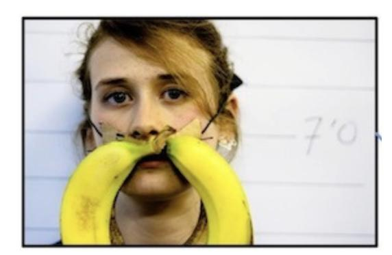

图 7.1：视觉问答任务示例：*胡子是由什么做成的？*

要把这两个领域结合起来并不容易。图像处理传统上使用卷积神经网络，擅长处理二维像素网格；语言处理则使用 Transformer，擅长处理一维词元序列。研究者已经开发出融合两者的架构，如今多数前沿模型都是 VLM。

### 7.1.1 任务

VLM 需要完成多种任务。视觉问答（VQA）要求模型回答有关图像的问题；图像描述要求模型生成图像的文字说明；模型还可以根据提示生成图像。

例如，针对图 7.1，VQA 系统可能会被问到“胡子是由什么做成的？”，答案是“香蕉”。其他问题可能要求模型统计图像某一区域内特定颜色和形状的物体，例如“桌面场景中，左上角有没有红色积木？”视觉问答基准涵盖多种题型，包括 MOSAIC [Burda-Lassen et al.（2025）](#page-24-0)、GLOBAL-RG [Bhatia et al.（2024）](#page-24-0)、CultureVQA [Nayak et al.（2024）](#page-27-0)、FoodieQA [Li et al.（2024）](#page-27-0) 和 MaRVL [Liu et al.（2021）](#page-27-0)。

图像描述任务则要求模型为图 [7.2](#page-2-0) 中的场景写一句说明，例如“一只快乐的狗站在海里”。其他说法也可能同样合理，比如“一只浑身湿透的狗”“一只觉得冷的狗”，或“一只戴着红色项圈、站在海里的狗”。常见基准包括 MS-COCO [Lin et al.（2014）](#page-27-0)、nocaps、1用于视频描述的 MSR-VTT [Xu et al.（2016）](#page-29-0)，以及用于常规短视频描述的 VATEX。

1<https://nocaps.org>

{2}------------------------------------------------

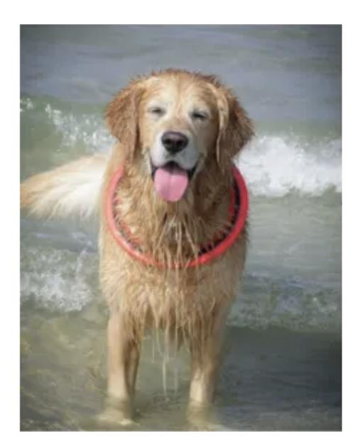

图 7.2：图像描述任务示例，描述为：*一只快乐的狗站在海里。*

MSR-VTT 和 VATEX 曾用于视频描述评测 [Wang et al.（2019）](#page-29-0)。较新的基准更关注细致、多角度的描述，包括 DetailCaps [Dong et al.（2024）](#page-25-0)、VDC [Chai et al.（2024）](#page-24-0) 和 CapArena [Cheng et al.（2025）](#page-25-0)。

VLM 的典型应用包括摘要生成、图像生成、搜索与检索、图像分割和目标检测。MMMU（Massive Multi-discipline Multimodal Understanding and Reasoning Benchmark，多学科多模态理解与推理基准）用于评估 VLM 在专家级任务上的能力 [Yue et al.（2024）](#page-29-0)。

### 7.1.2 架构

VLM 应该采用什么结构来完成上述任务？

将语言表示为词元序列时，它是一维问题；将视觉表示为像素网格时，它是二维问题。因此，两者通常采用不同的深度学习架构：Transformer 用于建模语言中的序列模式，卷积神经网络则用于建模图像中的空间模式。多模态 VLM 应采用怎样的架构并不显然；早期研究甚至不确定这类模型是否可行。

研究者最初关注 Transformer 能否像传统卷积神经网络（CNN）一样用于图像处理。专门的视觉 Transformer 和词元化方案后来证明能够有效处理图像 [Dosovitskiy et al.（2020）](#page-25-0)。

{3}------------------------------------------------

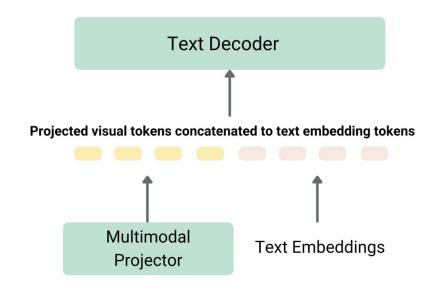

图 7.3：VLM 架构，改编自 LLaVA [Liu et al.（2023）](#page-27-0)；图片来自 Hugging Face。

VLM 还需要融合图像与语言表示，并生成文本。典型架构会先通过图像编码器处理视觉输入；编码器可以是 CNN，也可以是视觉 Transformer。投影器将视觉表示映射到语言模型的嵌入空间，文本解码器随后生成回答。图 7.3 以 LLaVA 为例展示了这种结构 [Liu et al.（2023）](#page-27-0)。投影器通常是多层感知机（MLP），负责对齐视觉和文本表示，使模型能够联合推理。

更复杂的 VLM 可能由多个 Transformer 模块构成。图 [7.4](#page-4-0) 展示了 Stable Diffusion 的生成式架构 [Esser et al.（2024）](#page-25-0)。

#### 7.1.3 学习算法

VLM 的训练需要对齐并融合视觉编码器与语言编码器所学习的信息。连接两种表示后，模型便可关联图像和文本、理解查询，并据此作答。研究者已提出多种训练方法。

OpenAI 的 CLIP 是“对比式语言—图像预训练”（Contrastive Language–Image Pretraining）的缩写，采用对比学习 [Radford et al.（2021）](#page-28-0)。对比学习是一种自监督方法，无需人工标注即可构造训练信号：它在嵌入空间中拉近相关样本、推远不相关样本。例如，模型会提高匹配的图像—文本对之间的相似度，并降低不匹配样本之间的相似度。

{4}------------------------------------------------

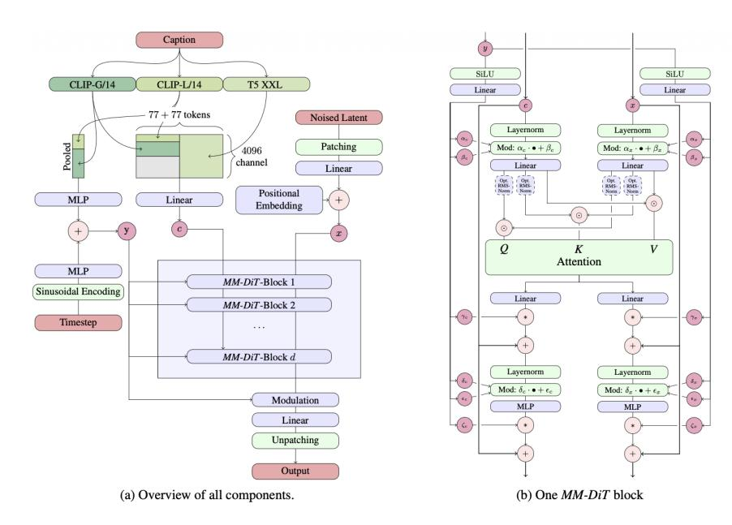

图 7.4：Stable Diffusion 架构 [Esser et al.（2024）](#page-25-0)。

另一种方法是掩码训练：模型学习预测输入文本或图像中随机遮蔽的部分，这与语言模型中的掩码训练类似。在图像任务中，模型根据可见图像和配套说明重建被遮挡的像素。FLAVA（Foundational Language and Vision Alignment，基础语言与视觉对齐）是一个例子，它使用视觉 Transformer 编码图像，并用 Transformer 处理语言表示和多模态投影 [Singh et al.（2022）](#page-28-0)。

VLM 也可以根据文本提示生成图像。许多文生图系统采用扩散模型 [Ho et al.（2022）；Yang et al.（2023）](#page-29-0)。常见例子包括 Google 的 Imagen [Baldridge et al.（2024）](#page-24-0)、Midjourney、OpenAI 的 DALL·E [Betker et al.（2023）](#page-24-0)，以及 Stability AI 的 Stable Diffusion [Esser et al.（2024）](#page-25-0)。DALL·E 2 使用由 CLIP 图像嵌入提供条件的扩散模型。图 [7.5](#page-5-0) 展示了广为人知的超现实图像“鳄梨扶手椅”。

从零开始训练 VLM 的成本很高。一种替代方案是组合已有的预训练模型：LLM、视觉编码器，以及把视觉嵌入映射到语言模型输入空间的网络。例如，LLaVA（Large Language and Vision Assistant，大型语言与视觉助手）将 Vicuna 语言解码器与 CLIP ViT 视觉编码器结合，并通过线性投影器对齐两者的输出 [Liu et al.（2023）](#page-27-0)。

许多 VLM 已投入使用。它们往往在基准测试中表现良好，也常用于智能体决策。当前一些开源和商业模型已具备多模态视觉语言能力，例如 DeepSeek-VL2、Gemini 2.0 Flash、GPT-4o、Llama 3.2、NVLM 和 Qwen 2.5-VL。

{5}------------------------------------------------

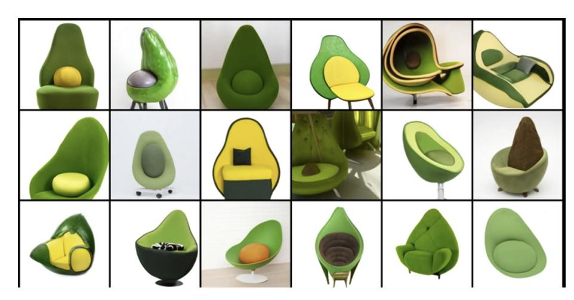

图 7.5：DALL·E 生成的鳄梨扶手椅。

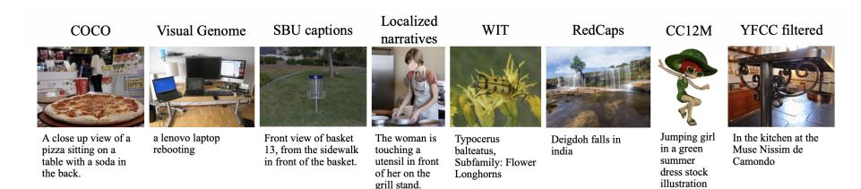

图 7.6：FLAVA 图像—文本预训练数据示例 [Singh et al.（2022）](#page-28-0)。

### 7.1.4 结果

VLM 在图像描述和图像生成方面表现如何？相关研究报告了视觉问答、目标检测、图像描述和文生图等任务的结果。图 7.6 展示了 FLAVA 所用数据集中的样例。DALL·E 3 是 DALL·E 2 的后继模型，重点提升了模型根据详细提示生成图像的能力 [Betker et al.（2023）](#page-24-0)。图 [7.7](#page-6-0) 展示了 DALL·E 3 遵循提示生成图像的例子；图 [7.8](#page-6-0) 展示了基于 rectified flow 扩散模型的 Stable Diffusion 示例。

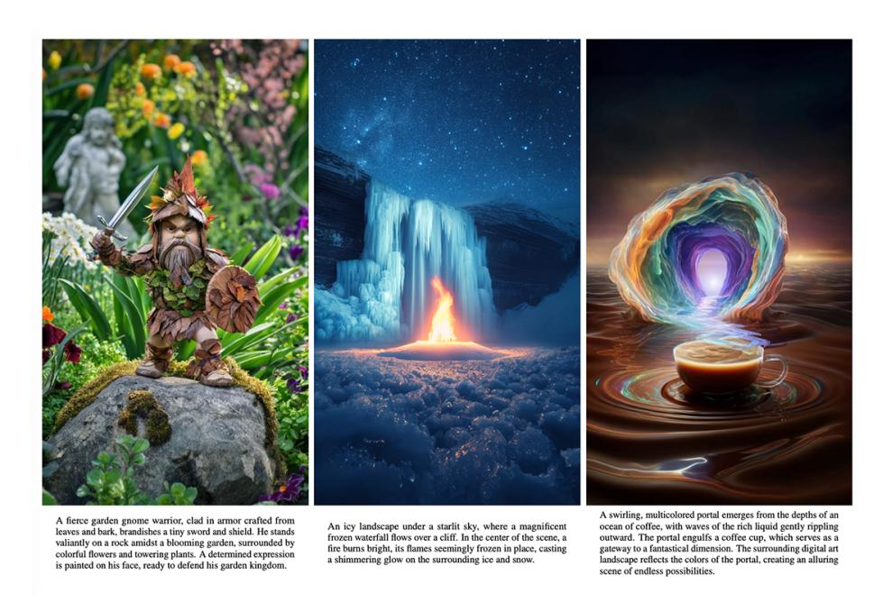

图 7.7：DALL·E 3 根据文本提示生成图像的示例 [Betker et al.（2023）](#page-24-0)。

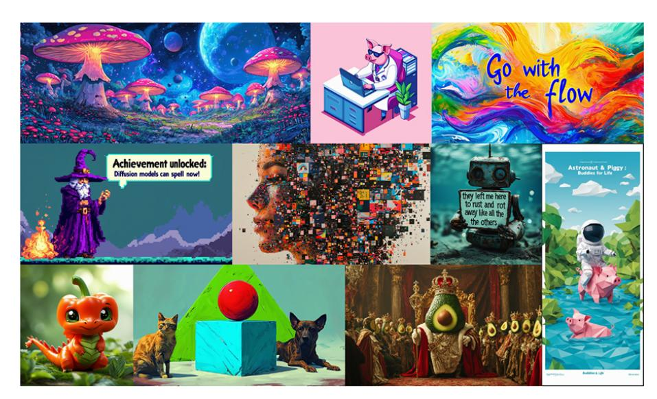

图 7.8：Stable Diffusion 生成的图像示例 [Esser et al.（2024）](#page-25-0)。

{7}------------------------------------------------

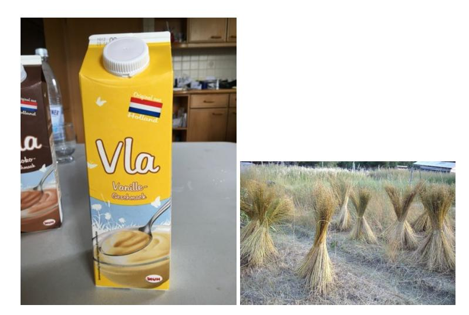

图 7.9：“VLA”和“Vlas”在不同语言中含义不同；其中一张图片提示了所用的语言。

# 7.2 决策与视觉语言动作模型

智能体行动前需要权衡不同选项。一种建模方式是让 Transformer 学习由状态、动作和奖励构成的序列 $(s,a,r)$（另见第 20.1.2 节）。视觉语言动作模型（VLA）在语言、视觉观测和机器人动作组成的序列上训练，并生成用于控制机器人运动的 API 命令。这是一种专门的动作指令语言。

VLA 根据摄像头捕捉的场景理解文字指令，并为机械臂选择合适的动作。这类模型已展现出一定的泛化能力，能让机器人在陌生情境中完成任务。

### 7.2.1 任务

VLA 需要在真实世界中执行指令，并适应不断变化的环境。例如，模型学会抓取红色铅笔后，也应能抓取蓝色铅笔，而无需为蓝色铅笔重新收集数据并从头训练。模型还应能识别物体，并适应物体朝向、位置或光照的变化；同时还要知道如何使用机械臂完成不同操作。图 [7.10](#page-8-0) 展示了 CLIPort 论文中的一个例子 [Shridhar et al.（2022）](#page-28-0)。

最困难的任务，是把场景、物体和动作以训练期间未见过的方式组合起来。VLA 必须能够泛化到这些新组合。

{8}------------------------------------------------

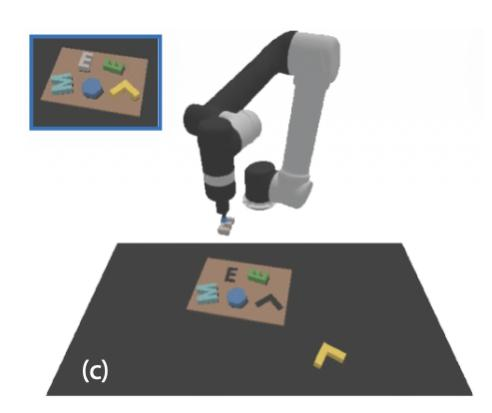

图 7.10：CLIPort 示例：*把灰色 E 形积木放入左侧的 E 形凹槽* [Shridhar et al.（2022）](#page-28-0)。

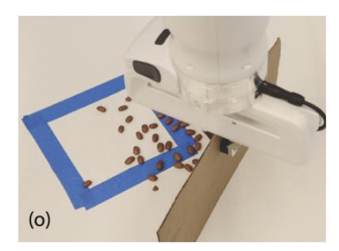

图 7.11：CLIPort 的另一个示例：*把豆子扫进蓝色区域* [Shridhar et al.（2020）](#page-28-0)。

{9}------------------------------------------------

在复杂、多变的环境中进行长时间导航，甚至在户外导航，仍然特别具有挑战性 [Shridhar et al.（2022）](#page-28-0)。

在真实的人机交互场景中，通常很难继续收集演示数据。要完成图 [7.11](#page-8-0) 所示的高层任务，VLA 必须识别物体、物体姿态及各个实例区域。它还必须理解语言，并把语言含义与视觉物体和机器人动作联系起来。

语言为指定目标和跨任务迁移语义概念提供了直观接口。VLM 研究也展示了如何在不同类型的嵌入表示之间建立语义联系。

### 7.2.2 架构

VLA 的架构可能相当复杂。Transformer 擅长建模序列模式，因此也适合表示序列决策问题；这类问题常见于机器人强化学习（见第 2.2.3 节和第 20.2.1 节）。在这类问题中，动作会改变当前状态，而新状态又决定接下来可以采取哪些动作。

早期的决策 Transformer（DT）研究表明，GPT 架构能够在离线强化学习任务中学习策略 [Chen et al.（2021）；Janner et al.（2021）](#page-26-0)。决策预训练 Transformer（DPT）则进一步探索在决策轨迹上预训练或微调 Transformer [Lee et al.（2023）；Wang et al.（2024a）](#page-29-0)。第 20.1.2 节将进一步讨论决策轨迹。

继 CLIPort 的早期工作之后 [Shridhar et al.（2020，2022）](#page-28-0)，许多 VLA 都以 VLM 为基础，并把机器人命令表示为语言词元。下面介绍两种融合语言、视觉与导航的方案：Mobility VLA 将长上下文 VLM 与拓扑地图结合 [Chiang et al.（2024）](#page-25-0)；LM-Nav 则组合多个预训练模型，根据观测和自由形式的指令规划路线 [Shah et al.（2023）](#page-28-0)。

{10}------------------------------------------------

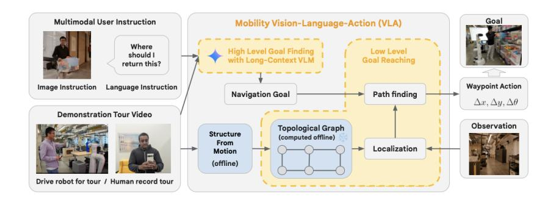

图 7.12：Mobility VLA 架构：结合长上下文 VLM 与拓扑地图 [Chiang et al.（2024）](#page-25-0)。

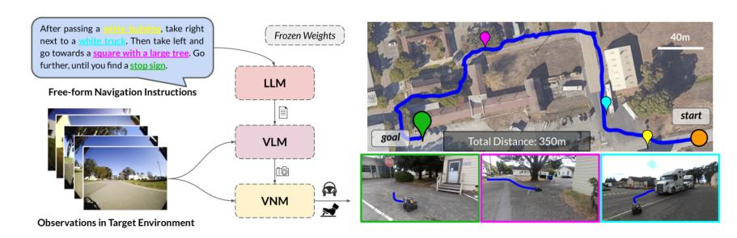

图 7.13：LM-Nav 的三模型架构 [Shah et al.（2023）](#page-28-0)。

Mobility VLA 面向一类称为 *多模态指令导航与示范路线*（MINT）的任务。该任务通过事先录制的示范视频提供环境先验。Mobility VLA 分为两层：长上下文 VLM 从视频中定位目标帧；低层导航策略再遍历拓扑图，并在每个时间步生成动作。

LM-Nav 由三个现成模型组成：LLM 提取地标，VLM 将地标与视觉观测对应起来，视觉导航模型（VNM）负责执行路线。它们协同工作，使 LM-Nav 无需微调也能根据环境观测执行文本指令。

Google 的 RT-2 采用另一种方法 [Brohan et al.（2023）](#page-24-0)：它在机器人轨迹数据和大规模视觉语言任务（如 VQA）上微调 VLM，使网络知识能够用于机器人控制。机器人动作以文本词元表示，并与自然语言一起纳入训练（见图 [7.14](#page-11-0)）。Magma 采用了类似思路 [Yang et al.（2025）](#page-29-0)，在图像、视频和机器人数据等异构数据上进行预训练。它用 Set-of-Mark 词元标记可操作物体，用 Trace-of-Mark 词元标记人手或机械臂等运动轨迹，以支持动作定位和规划（见图 [7.15](#page-11-0)）。

另一种模型 $\pi^0$ 使用预训练的后期融合 VLM，并在多样化的机器人操作任务数据集上训练 [Black et al.（2024）](#page-24-0)。其设计受到 Transfusion 方法启发 [Zhou et al.（2024）](#page-29-0)。

{11}------------------------------------------------

图 7.14：RT-2 架构：使用机器人动作文本词元训练的 VLM [Brohan et al.（2023）](#page-24-0)。

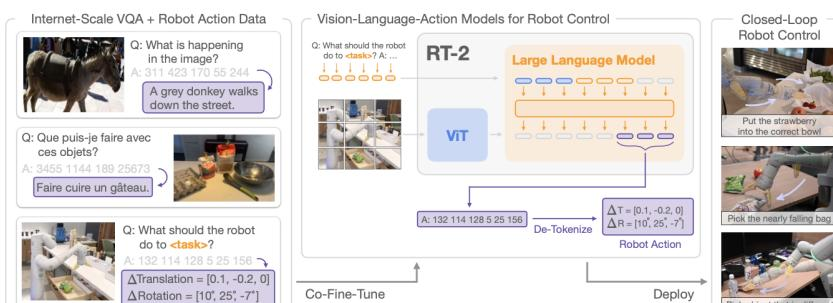

图 7.15：Magma 预训练流程 [Yang et al.（2025）](#page-29-0)。

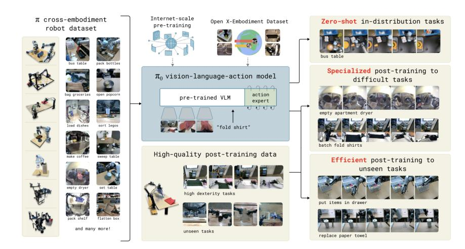

图 7.16：$\pi^0$ 架构：基于 VLM，并使用跨具身机器人数据集训练 [Black et al.（2024）](#page-24-0)。

该数据集涵盖多种机器人操作任务。$\pi^0$ 的设计受到 Transfusion 方法启发 [Zhou et al.（2024）](#page-29-0)，并加入了独立的动作专家，通过流匹配生成机器人动作，使操作更加流畅。模型可以直接根据提示执行任务，也可以在更高质量的数据上继续微调，以完成叠放衣物、组装盒子等多阶段复杂任务（见图 7.16）。

#### 7.2.3 学习算法

多数 VLA 架构以 VLM 为基础，有时会加入导航地图。机器人动作通常表示为普通文本词元。VLA 的预训练和微调常采用与 LLM、VLM 和决策 Transformer 相似的自监督方法；有些系统会复用预训练模型，以降低训练成本。

#### 7.2.4 结果

多种 VLA 已展现出零样本泛化能力，能在训练中未见过的情境下执行任务。Mobility VLA、RT-2 和 Magma 可用于导航与物体操作；$\pi^0$ 还可完成折叠衣物等操作任务 [Chiang et al.（2024）；Brohan et al.（2023）；Yang et al.（2025）；Black et al.（2024）](#page-29-0)。

{13}------------------------------------------------

观看演示视频更容易了解这些模型的实际效果。$\pi^0$2 和 RT-23 均有视频演示。

# 7.3 世界模型、物理规律与规划

对 VLM 来说，图像首先是一组像素，本身并不包含明确的物理含义。但与现实世界交互的智能体需要了解物理规律，知道什么事情在现实中可行，避免像电子游戏中的角色那样试图穿墙而过。

世界模型帮助智能体理解环境，并据此采取合理行动。LLM 主要通过语言训练，可以从文本中获得一些世界知识，但并未专门训练出广泛且扎根于现实的物理理解。一些研究者认为，要发展更可靠的智能体和更通用的人工智能，就需要加强世界模型研究 [Sutton et al.（2022）；Matsuo et al.（2022）；LeCun et al.（2022）；Klindt et al.（2026）](#page-28-0)。

机器人和其他行动主体至少需要具备基本的物理模型，把观测、动作与现实结果联系起来。一种方法是根据动作反馈学习环境模型。

“世界模型”在人工智能中有多种用法。在基于模型的强化学习中，它通常指通过交互数据学得的环境模型 [Ha 和 Schmidhuber（2018）；Moerland et al.（2023）；Sutton（1991）](#page-28-0)。该模型建立环境的局部表示，帮助改进智能体策略。它通常是一种紧凑的学习表示 [Hafner et al.（2019）；Plaat et al.（2020）](#page-27-0)，也称为抽象或*潜在表示*。世界模型可以编码物理规律和空间属性，从而约束智能体可采取的动作。表示的具体内容取决于任务领域。

语言模型学习文本中的统计模式，用于问答、翻译等任务；世界模型则表示因果关系，以预测或模拟环境的未来状态。让语言模型具备扎根现实的行动能力，还需要其他技术。

本节介绍世界模型在智能体大语言模型中的应用。

2<https://www.physicalintelligence.company/blog/pi0>

3<https://robotics-transformer2.github.io>

{14}------------------------------------------------

#### 7.3.1 任务

世界模型应包含足够的环境知识，帮助智能体采取有意义且符合物理规律的行动。例如，机器人控制器要考虑机械臂关节的活动范围；导航智能体需要理解重力、距离，并把墙壁视为障碍物；金融智能体则要理解账户余额为负的后果。人们往往习以为常，因此当智能体不理解这些基本事实时，会感到意外。仅通过像素训练的 VLM 可能无法判断一种纹理代表衣物、烟雾还是墙壁。

标准预训练 LLM 已包含一些有用的世界知识。微调也可强化特定行为：RLHF 使用人类反馈，RLVR 则利用自动可验证的结果训练数学或代码等任务。一些早期方法直接把预训练 LLM 用作世界模型，不再微调。智能体也可以通过与环境交互来学习，并利用奖励信号强化符合物理规律的行为。

在基于模型的强化学习中，世界模型可以让智能体在学得的模型中规划，减少从真实环境收集样本的次数，从而提高样本效率。当真实交互比模拟更昂贵时，这尤其有用。本章讨论的 LLM 世界模型借鉴了基于模型的强化学习方法（见第 [7.3.5 节](#page-20-0)）。这些方法的应用很广，本章将介绍 WorldGPT、WebDreamer 和 WorldCoder 三个例子。

**WorldGPT。** WorldGPT 希望解决视觉问答和具身规划任务，包括音视频问答 [Ge et al.（2024）](#page-25-0)。它从视频中学习世界感知型 VLM，并结合潜在空间表示、外部知识库和长期记忆。

**WebDreamer。** WebDreamer 面向电商等网页交互任务，目标是提升学习效率 [Gu et al.（2024）](#page-25-0)。它允许智能体先在模型中模拟操作，再到真实网站执行，从而减少从真实网页收集经验的需求。这种方法把基于模型的强化学习应用于网页环境，其名称来自 Dreamer 系列潜在动力学模型 [Hafner et al.（2019，2020a，2023）](#page-26-0)。典型任务是在电商网站上寻找商品。WebDreamer 还会从大型模型中蒸馏出小型模型，以便高效模拟。

**WorldCoder。** WorldCoder 同样旨在提高样本效率，但它会生成可解释的动力学模型——转移函数和奖励函数——并将其表示为可执行的 Python 代码 [Tang et al.（2024）](#page-28-0)。这些代码可用于标准的基于模型的强化学习系统。

{15}------------------------------------------------

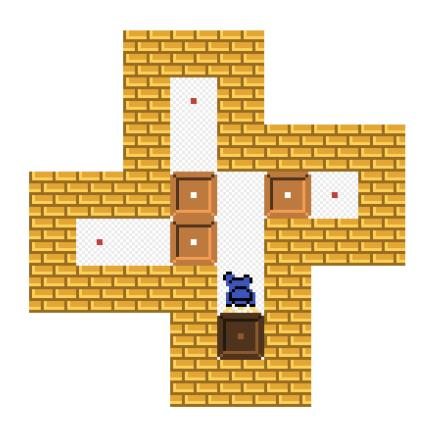

图 7.17：WorldCoder 使用的 Sokoban 推箱子任务 [Tang et al.（2024）](#page-28-0)。

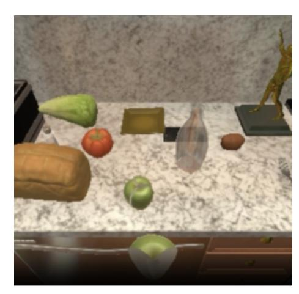

图 7.18：WorldCoder 使用的 ALFWorld 家庭任务 [Tang et al.（2024）](#page-28-0)。

{16}------------------------------------------------

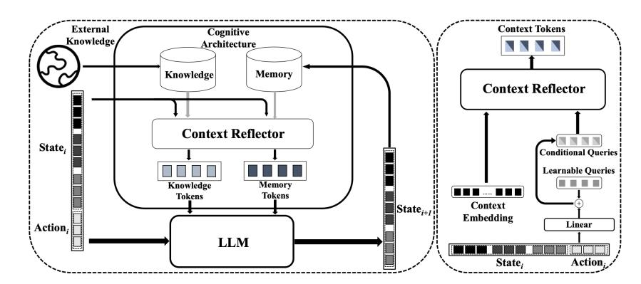

图 7.19：WorldGPT 架构 [Ge et al.（2024）](#page-25-0)。

生成的 Python 代码比反复调用 LLM 推理执行得更快。WorldCoder 已在网格环境任务（如 Sokoban，见图 [7.17](#page-15-0)）和 ALFWorld 家庭任务规划（见图 [7.18](#page-15-0)）中进行评估。

#### 7.3.2 架构

世界模型通过表示“行动会产生什么后果”，为观测赋予语义。这是 LLM 和 VLM 单独使用时可能难以可靠做到的。例如，模型要能区分可行走的地面和阻挡移动的墙壁。奖励函数则提供反馈，指出哪些结果更理想。因此，世界模型系统通常把环境模型与基于奖励学习的策略结合起来。可以把它理解为将 VLM 与策略学习器组合在一起。

WorldGPT、WebDreamer 和 WorldCoder 采用了不同的架构。

**WorldGPT。** WorldGPT 基于 Vicuna-7B-v0 LLM。4它在潜在空间中推理，目标是模拟环境动态，包括状态转移和奖励函数。其架构将 LLM 与多模态编码器和解码器结合，用于合成多模态指令样本。额外的认知模块通过记忆、知识检索和上下文反思支持专业或长时程任务。上下文反思模块使用 Q-former [Li et al.（2023）](#page-26-0)；图 7.19 展示了整体结构。

4<https://huggingface.co/lmsys/vicuna-7b-v1.3>, <https://lmsys.org>

{17}------------------------------------------------

图 7.20：WebDreamer 伪代码：使用 LLM 实现模拟（sim）与评分（score）函数 [Gu et al.（2024）](#page-25-0)。

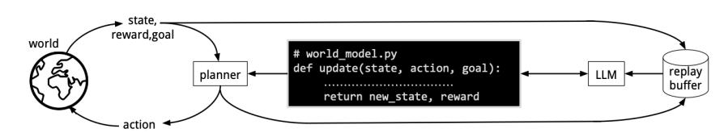

图 7.21：WorldCoder 架构 [Tang et al.（2024）](#page-28-0)。

**WebDreamer。** WebDreamer 面向网页交互。它将大型 Qwen-70B 模型 [Bai et al.（2025）](#page-24-0) 蒸馏为较小的 7B 模型，再用小模型在网页环境模型中模拟操作，然后才到真实网站尝试。它使用模型预测控制（MPC）选择网页操作，并在每次交互后重新规划 [Garcia et al.（1989）；Schwenzer et al.（2021）](#page-28-0)。LLM 同时充当世界模型和值函数：它预测操作结果（sim 函数）并为候选结果评分（score 函数）。LLM 还可生成候选动作 [Koh et al.（2024）](#page-26-0)。作者采用两阶段流程：先采样得分最高的 $k$ 个动作，再用 LLM 精炼候选动作，以便模拟。

**WorldCoder。** WorldCoder 是一种基于模型的智能体，它通过可执行 Python 程序表示对环境的知识（见图 7.21）。它使用程序合成生成状态表示，以及特定任务的动作、转移和奖励函数。在强化学习中，这些要素构成马尔可夫决策过程（MDP）：状态表示 $S$、动作函数 $A$、转移函数 $T$ 和奖励函数 $R$（见第 [7.3.5 节](#page-20-0)）。LLM 生成这些 Python 代码，再通过迭代式自我调试过程检查和改进 [Chen et al.（2023）](#page-25-0)，具体方法见第 6.1.3.2 节。

{18}------------------------------------------------

直到程序能够产生预期输出，这一过程才会结束。WorldCoder 学到的是符号模型：转移函数由可执行代码表示；而常规深度强化学习模型通常使用神经网络。推理时，WorldCoder 只需解释执行 Python 转移函数和奖励函数，无需反复调用大型 LLM，因此效率较高。

许多基于模型的 LLM 方法会在推理时让 LLM 模拟环境；WorldCoder 则让 LLM 先构建模拟器，再供后续执行。Python 解释器负责应用状态转移函数；相比之下，ReAct 由 LLM 直接推理环境状态。由于 LLM 在推理阶段可能难以可靠规划，符号方法有时更适合规划任务（见第 6.2.3 节）。

#### 7.3.3 学习算法

本节介绍这三种方法采用的预训练和微调方式。

**WorldGPT。** WorldGPT 使用来自不同领域的数百万段视频进行预训练和微调，以学习世界动态，并以 Vicuna-7B-v0 为基础模型。以语言为中心的编码器将多模态状态映射为统一表示；特殊词元用于多模态解码。训练先从单模态数据开始，再扩展到跨模态数据。微调阶段使用认知架构，以及包含超过 1,000 万段视频、标注细粒度状态转移的数据集。记忆、知识检索和上下文反思等组件支持模型通过合成多模态指令数据获得特定领域能力。

**WebDreamer。** WebDreamer 旨在学习适用于基于模型的强化学习的环境动态。它先用预训练的 Qwen2-VL [Wang et al.（2024b）](#page-29-0) 初始化 Dreamer-7B，再用 310 万条交互样本进行微调。数据合成流程包括：（1）在网页中随机游走，模型通过搜索、点击等动作与页面交互；（2）Qwen2-VL-72B 根据操作前后的图像快照描述状态变化。WebDreamer 会在有限时间范围内模拟每个动作可能产生的未来状态，并使用 MPC 重新规划。

**WorldCoder。** WorldCoder 使用程序合成学习转移函数，也就是计算环境下一状态的函数。它先随机探索环境并收集交互数据，再通过程序合成更新世界模型、生成代码，最后根据模型进行规划。

{19}------------------------------------------------

规划器可以因任务而异：简单领域可使用带深度限制的价值迭代，复杂领域则可使用蒙特卡洛树搜索（MCTS）[Browne et al.（2012）](#page-24-0)。

### 7.3.4 结果

下面概述这三种方法报告的结果。

**WorldGPT。** WorldGPT 在多模态状态转移预测基准上进行评估。作者报告称，它能够预测复杂真实厨房和烹饪场景中的动态。在一项实验中，它在音视频问答任务上的速度是传统扩散方法的 30 倍 [Ge et al.（2024）](#page-25-0)。

**WebDreamer。** WebDreamer 用于网页交互任务。作者报告称，它在部分基准上的表现超过 GPT-4o，并优于反应式基线。在 VisualWebArena 沙盒环境以及 Online-Mind2Web、Mind2Web-Live 真实网站任务中，WebDreamer 均取得较好结果。在在线基准上，Dreamer-7B 的样本效率据报比树搜索高 4 到 5 倍；在真实网站上，其表现分别比反应式基线高 42% 和 24%。

**WorldCoder。** WorldCoder 的结果涵盖网格世界和 ALFWorld 等家庭任务。与无模型强化学习相比，它的样本效率更高；与依靠 LLM 在上下文中规划的 ReAct 类智能体相比，它的计算效率更高。

把世界知识表示为代码有多项优点：可以在程序中加入先验知识，也可以复用预训练模型可能见过的已发表问题解法；程序片段还可迁移到其他任务。代码可读，便于人工检查模型表示。不过，WorldCoder 仍受规划问题本身计算复杂度的限制，专用求解器难以处理的问题也可能难倒它。LLM 生成的转移函数也未必比专家设计的函数可靠。目前，合成代码主要用于复现转移和奖励函数；未来结合自我反思与元推理，或能进一步改善性能。

{20}------------------------------------------------

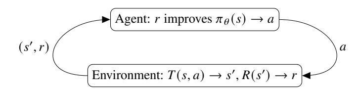

图 7.22：标准强化学习循环。智能体根据环境提供的奖励反馈，学习参数化策略 $\pi_\theta$ [Sutton 和 Barto（2018）](#page-28-0)。

#### 7.3.5 基于模型的强化学习

世界模型既用于智能体 LLM，也用于模型式强化学习。本节简要回顾模型式强化学习，以说明它如何启发 LLM 世界模型。

Dyna 是早期有影响力的模型式方法之一 [Sutton（1991）](#page-28-0)。近期综述包括 [Ha 和 Schmidhuber（2018）](#page-26-0)、[Hafner et al.（2020b）](#page-26-0)、[Moerland et al.（2023）](#page-27-0) 和 [Plaat et al.（2023）](#page-27-0)。

强化学习智能体通过与环境交互、执行动作并获得奖励，逐步学会如何行动。

#### 7.3.5.1 无模型强化学习

在无模型强化学习中，智能体直接根据环境交互学习策略，而不显式构建环境模型（见图 7.22）。马尔可夫决策过程（MDP）通常由四个部分描述：状态空间 $S$、动作函数 $A$、转移函数 $T(s,a)\rightarrow s'$ 和奖励函数 $R(s)\rightarrow r$。在状态 $s$ 下采取动作 $a$，系统进入新状态 $s'$ 并获得奖励 $r$。

目标是学习最优策略 $\pi^*(s)\rightarrow a^*$，为每个状态选择合适动作，并最大化预期累计奖励。无模型方法无法直接访问环境中的转移函数和奖励函数，只能从采样结果中学习。因此，这种方法可能需要大量样本：策略改进依赖实际交互，大型 MDP 往往需要许多数据才能收敛。

{21}------------------------------------------------

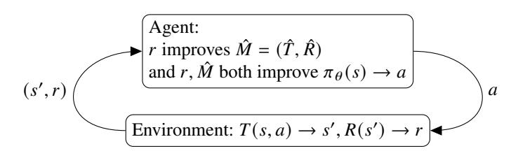

图 7.23：基于模型的强化学习利用环境反馈改进策略 $\pi$ 和局部动力学模型 $\hat{M}=(\hat{T},\hat{R})$，再用该模型进行规划。

#### 7.3.5.2 基于模型的强化学习

无模型强化学习不会保留交互样本，每次改进策略都需要新的交互。但真实世界交互可能很昂贵，例如机器人行动会磨损关节。一个简单的改进方式是保存并重用旧样本；进一步的方法则会学习环境动力学的局部模型 $\hat{M}=(\hat{T},\hat{R})$。训练好模型后，智能体可以低成本地从中生成模拟样本（见图 7.23）。

这类方法属于间接学习：智能体先根据环境交互学习局部动力学模型，再利用模型改进策略。模型中的 $\hat{T}$ 和 $\hat{R}$ 分别近似真实转移函数 $T$ 和奖励函数 $R$；后两者只有环境本身直接掌握。模型式强化学习已应用于围棋 [Silver et al.（2016）](#page-28-0)、外交 [Bakhtin et al.（2022）](#page-24-0)、星际争霸 [Vinyals et al.（2019）](#page-29-0) 以及跨领域学习 [Hafner et al.（2020b）](#page-26-0)。

模型式强化学习也与经典符号人工智能中的规划相关。智能体可以利用高效的潜在表示模拟未来，而无需在真实世界中实际行动。

#### 7.3.5.3 降维

在深度模型式强化学习中，学到的局部动力学模型也常称为世界模型 [Ha 和 Schmidhuber（2018）](#page-26-0)。它可以把高维观测压缩为低维状态和奖励表示，从而更有效地改进策略。

{22}------------------------------------------------

许多环境中都有与智能体决策关系不大的细节。例如，电子游戏背景里不会移动、也不影响行动价值的树木。世界模型可以抽象掉这些细节，降低状态空间的有效维度。

#### 7.3.5.4 联合嵌入预测架构

联合嵌入预测架构（JEPA）由 LeCun et al.（2022）提出，并由 Assran et al.（2023）进一步发展。JEPA 在压缩的潜在表示中预测未来状态，而不是重建原始像素或感官细节。它与模型式强化学习中的降维目标相似，都是学习紧凑的世界表示。

模型式强化学习通过奖励监督学习局部转移模型；JEPA 则从视频或图像等自监督观测中学习，把上下文嵌入映射到目标嵌入。它本身不显式要求动作、奖励或策略优化。两种方法可以结合：JEPA 表示可作为强化学习或规划系统中的感知模块或世界模型 [Lim et al.（2026）](#page-26-0)，例如用于辅助机器人控制 [Destrade et al.（2025）](#page-25-0)。

#### 7.3.5.5 智能体世界模型

在模型式强化学习中，LLM 有两种用法。一种是把预训练、静态的 LLM 作为环境模型 $\hat{T},\hat{R}$，纳入模型式强化学习系统，例如 LLM4WM [Liu et al.（2024）](#page-27-0)。LLM 可通过树搜索或蒙特卡洛树搜索（MCTS）辅助规划。

另一种方法是通过与环境交互的反馈来训练 LLM 世界模型（MBRL4LLM）。LLM 可以借助外部执行框架或后训练过程逐步适应环境。这一研究方向探索智能体如何构建更真实的环境模型并据此行动 [Zuo et al.（2026）](#page-29-0)。5

## 7.4 结语

Transformer 不仅能处理词元化的语言，也可以处理其他模态的数据。本章介绍了多种融合不同模态的模型架构，尽管它们在结构上各有差异。多数模型基于 Transformer，并针对输入数据采用了不同的词元化方法。下一页将归纳这些模型的共同点。

{23}------------------------------------------------

# 参考文献

Mahmoud Assran, Quentin Duval, Ishan Misra, Piotr Bojanowski, Pascal Vincent, Michael Rabbat, Yann LeCun, and Nicolas Ballas. Self-supervised learning from

{24}------------------------------------------------

images with a joint-embedding predictive architecture. In *2023 IEEE/CVF Conference on Computer Vision and Pattern Recognition (CVPR)*, pages 15619–15629. IEEE, 2023. [173](#page-22-0) Shuai Bai, Keqin Chen, Xuejing Liu, Jialin Wang, Wenbin Ge, Sibo Song, Kai Dang, Peng Wang, Shijie Wang, Jun Tang, et al. Qwen2. 5-vl technical report. *arXiv preprint arXiv:2502.13923*, 2025. [168](#page-17-0) Anton Bakhtin, Noam Brown, Emily Dinan, Gabriele Farina, Colin Flaherty, Daniel Fried, Andrew Goff, Jonathan Gray, Hengyuan Hu, et al. Human-level play in the game of diplomacy by combining language models with strategic reasoning. *Science*, 378(6624):1067–1074, 2022. [172](#page-21-0) Jason Baldridge, Jakob Bauer, Mukul Bhutani, Nicole Brichtova, Andrew Bunner, Lluis Castrejon, Kelvin Chan, Yichang Chen, Sander Dieleman, Yuqing Du, et al. Imagen 3. *arXiv preprint arXiv:2408.07009*, 2024. [155](#page-4-0) James Betker, Gabriel Goh, Li Jing, Tim Brooks, Jianfeng Wang, Linjie Li, Long Ouyang, Juntang Zhuang, Joyce Lee, Yufei Guo, et al. Improving image generation with better captions. *Computer Science. https://cdn. openai. com/papers/dall-e-3. pdf*, 2(3):8, 2023. [155,](#page-4-0) [156,](#page-5-0) [157](#page-6-0) Mehar Bhatia, Sahithya Ravi, Aditya Chinchure, Eunjeong Hwang, and Vered Shwartz. From local concepts to universals: Evaluating the multicultural understanding of vision-language models. *arXiv preprint arXiv:2407.00263*, 2024. [152](#page-1-0) Kevin Black, Noah Brown, Danny Driess, Adnan Esmail, Michael Equi, Chelsea Finn, Niccolo Fusai, Lachy Groom, Karol Hausman, Brian Ichter, et al. $\pi^0$: A vision-language-action flow model for general robot control. *arXiv preprint arXiv:2410.24164*, 2024. [161,](#page-10-0) [163](#page-12-0) Anthony Brohan, Noah Brown, Justice Carbajal, Yevgen Chebotar, Xi Chen, Krzysztof Choromanski, Tianli Ding, Danny Driess, Avinava Dubey, Chelsea Finn, et al. Rt-2: Vision-language-action models transfer web knowledge to robotic control. *arXiv preprint arXiv:2307.15818*, 2023. [161,](#page-10-0) [162,](#page-11-0) [163](#page-12-0) Cameron B Browne, Edward Powley, Daniel Whitehouse, Simon M Lucas, Peter I Cowling, Philipp Rohlfshagen, Stephen Tavener, Diego Perez, Spyridon Samothrakis, and Simon Colton. A survey of monte carlo tree search methods. *IEEE Transactions on Computational Intelligence and AI in games*, 4(1):1–43, 2012. [170](#page-19-0) Olena Burda-Lassen, Aman Chadha, Shashank Goswami, and Vinija Jain. How culturally aware are vision-language models? In *2025 IEEE 6th International Conference on Image Processing, Applications and Systems (IPAS)*, pages 1–6. IEEE, 2025. [152](#page-1-0) Wenhao Chai, Enxin Song, Yilun Du, Chenlin Meng, Vashisht Madhavan, Omer Bar-Tal, Jenq-Neng Hwang, Saining Xie, and Christopher D Manning. Auroracap: Efficient, performant video detailed captioning and a new benchmark. *arXiv preprint arXiv:2410.03051*, 2024. [153](#page-2-0)

{25}------------------------------------------------

Lili Chen, Kevin Lu, Aravind Rajeswaran, Kimin Lee, Aditya Grover, Misha Laskin, Pieter Abbeel, Aravind Srinivas, and Igor Mordatch. Decision transformer: Reinforcement learning via sequence modeling. *Advances in neural information processing systems*, 34:15084–15097, 2021. [160](#page-9-0) Xinyun Chen, Maxwell Lin, Nathanael Scharli, and Denny Zhou. Teaching large lan- ¨ guage models to self-debug. *arXiv preprint arXiv:2304.05128*, 2023. [168](#page-17-0) Kanzhi Cheng, Wenpo Song, Jiaxin Fan, Zheng Ma, Qiushi Sun, Fangzhi Xu, Chenyang Yan, Nuo Chen, Jianbing Zhang, and Jiajun Chen. Caparena: Benchmarking and analyzing detailed image captioning in the llm era. *arXiv preprint arXiv:2503.12329*, 2025. [153](#page-2-0) Hao-Tien Lewis Chiang, Zhuo Xu, Zipeng Fu, Mithun George Jacob, Tingnan Zhang, Tsang-Wei Edward Lee, Wenhao Yu, Connor Schenck, David Rendleman, Dhruv Shah, et al. Mobility vla: Multimodal instruction navigation with long-context vlms and topological graphs. *arXiv preprint arXiv:2407.07775*, 2024. [160,](#page-9-0) [161,](#page-10-0) [163](#page-12-0) Matthieu Destrade, Oumayma Bounou, Quentin Le Lidec, Jean Ponce, and Yann LeCun. Value-guided action planning with jepa world models. *arXiv preprint arXiv:2601.00844*, 2025. [173](#page-22-0) Hongyuan Dong, Jiawen Li, Bohong Wu, Jiacong Wang, Yuan Zhang, and Haoyuan Guo. Benchmarking and improving detail image caption. *arXiv preprint arXiv:2405.19092*, 2024. [153](#page-2-0) Alexey Dosovitskiy, Lucas Beyer, Alexander Kolesnikov, Dirk Weissenborn, Xiaohua Zhai, Thomas Unterthiner, Mostafa Dehghani, Matthias Minderer, Georg Heigold, Sylvain Gelly, et al. An image is worth 16x16 words: Transformers for image recognition at scale. *arXiv preprint arXiv:2010.11929*, 2020. [154](#page-3-0) Patrick Esser, Sumith Kulal, Andreas Blattmann, Rahim Entezari, Jonas Muller, Harry ¨ Saini, Yam Levi, Dominik Lorenz, Axel Sauer, Frederic Boesel, et al. Scaling rectified flow transformers for high-resolution image synthesis. In *Forty-first international conference on machine learning*, 2024. [154,](#page-3-0) [155,](#page-4-0) [157](#page-6-0) Carlos E Garcia, David M Prett, and Manfred Morari. Model predictive control: Theory and practice—a survey. *Automatica*, 25(3):335–348, 1989. [168](#page-17-0) Zhiqi Ge, Hongzhe Huang, Mingze Zhou, Juncheng Li, Guoming Wang, Siliang Tang, and Yueting Zhuang. Worldgpt: Empowering llm as multimodal world model. In *Proceedings of the 32nd ACM International Conference on Multimedia*, pages 7346– 7355, 2024. [165,](#page-14-0) [167,](#page-16-0) [170](#page-19-0) Yu Gu, Kai Zhang, Yuting Ning, Boyuan Zheng, Boyu Gou, Tianci Xue, Cheng Chang, Sanjari Srivastava, Yanan Xie, Peng Qi, et al. Is your llm secretly a world model of the internet? model-based planning for web agents. *arXiv preprint arXiv:2411.06559*, 2024. [165,](#page-14-0) [168](#page-17-0)

{26}------------------------------------------------

David Ha and Jurgen Schmidhuber. World models. ¨ *arXiv preprint arXiv:1803.10122*, 2018. [164,](#page-13-0) [171,](#page-20-0) [172](#page-21-0) Danijar Hafner, Timothy Lillicrap, Ian Fischer, Ruben Villegas, David Ha, Honglak Lee, and James Davidson. Learning latent dynamics for planning from pixels. In *International Conference on Machine Learning*, pages 2555–2565, 2019. [164,](#page-13-0) [165](#page-14-0) Danijar Hafner, Timothy Lillicrap, Jimmy Ba, and Mohammad Norouzi. Dream to control: Learning behaviors by latent imagination. In *International Conference on Learning Representations*, 2020a. [165](#page-14-0) Danijar Hafner, Timothy Lillicrap, Mohammad Norouzi, and Jimmy Ba. Mastering atari with discrete world models. *arXiv preprint arXiv:2010.02193*, 2020b. [171,](#page-20-0) [172](#page-21-0) Danijar Hafner, Jurgis Pasukonis, Jimmy Ba, and Timothy Lillicrap. Mastering diverse domains through world models. *arXiv preprint arXiv:2301.04104*, 2023. [165](#page-14-0) Namgyu Ho, Laura Schmid, and Se-Young Yun. Large language models are reasoning teachers. *arXiv preprint arXiv:2212.10071*, 2022. [155](#page-4-0) Michael Janner, Qiyang Li, and Sergey Levine. Offline reinforcement learning as one big sequence modeling problem. *Advances in neural information processing systems*, 34:1273–1286, 2021. [160](#page-9-0) David Klindt, Yann LeCun, and Randall Balestriero. When does lejepa learn a world model? *arXiv preprint arXiv:2605.26379*, 2026. [164](#page-13-0) Jing Yu Koh, Stephen McAleer, Daniel Fried, and Ruslan Salakhutdinov. Tree search for language model agents. *arXiv preprint arXiv:2407.01476*, 2024. [168](#page-17-0) Alex Krizhevsky, Ilya Sutskever, and Geoffrey E Hinton. Imagenet classification with deep convolutional neural networks. *Advances in neural information processing systems*, 25, 2012. [151](#page-0-0) Yann LeCun et al. A path towards autonomous machine intelligence version 0.9. 2, 2022-06-27. *Open Review*, 62(1):1–62, 2022. [164,](#page-13-0) [173](#page-22-0) Jonathan Lee, Annie Xie, Aldo Pacchiano, Yash Chandak, Chelsea Finn, Ofir Nachum, and Emma Brunskill. Supervised pretraining can learn in-context reinforcement learning. *Advances in Neural Information Processing Systems*, 36:43057–43083, 2023. [160](#page-9-0) Junnan Li, Dongxu Li, Silvio Savarese, and Steven Hoi. Blip-2: Bootstrapping language-image pre-training with frozen image encoders and large language models. In *International conference on machine learning*, pages 19730–19742. PMLR, 2023. [167](#page-16-0)

{27}------------------------------------------------

Wenyan Li, Crystina Zhang, Jiaang Li, Qiwei Peng, Raphael Tang, Li Zhou, Weijia Zhang, Guimin Hu, Yifei Yuan, Anders Søgaard, Daniel Hershcovich, and Desmond Elliott. FoodieQA: A multimodal dataset for fine-grained understanding of Chinese food culture. In Yaser Al-Onaizan, Mohit Bansal, and Yun-Nung Chen, editors, *Proceedings of the 2024 Conference on Empirical Methods in Natural Language Processing*, pages 19077–19095, Miami, Florida, USA, November 2024. Association for Computational Linguistics. doi: 10.18653/v1/2024.emnlp-main.1063. URL <https://aclanthology.org/2024.emnlp-main.1063/>. [152](#page-1-0) Jing Yu Lim, Rushi Shah, Zarif Ikram, Samson Yu, Haozhe Ma, Tze-Yun Leong, and Dianbo Liu. Jedi: Joint embedding diffusion world model for online model-based reinforcement learning. *arXiv preprint arXiv:2605.13013*, 2026. [173](#page-22-0) Tsung-Yi Lin, Michael Maire, Serge Belongie, James Hays, Pietro Perona, Deva Ramanan, Piotr Dollar, and C Lawrence Zitnick. Microsoft coco: Common objects ´ in context. In *European conference on computer vision*, pages 740–755. Springer, 2014. [152](#page-1-0) Fangyu Liu, Emanuele Bugliarello, Edoardo Maria Ponti, Siva Reddy, Nigel Collier, and Desmond Elliott. Visually grounded reasoning across languages and cultures. *arXiv preprint arXiv:2109.13238*, 2021. [152](#page-1-0) Haotian Liu, Chunyuan Li, Qingyang Wu, and Yong Jae Lee. Visual instruction tuning. *Advances in neural information processing systems*, 36:34892–34916, 2023. [154,](#page-3-0) [155](#page-4-0) Yueen Ma, Zixing Song, Yuzheng Zhuang, Jianye Hao, and Irwin King. A survey on vision-language-action models for embodied ai. *arXiv preprint arXiv:2405.14093*, 2024. [163](#page-12-0) Yutaka Matsuo, Yann LeCun, Maneesh Sahani, Doina Precup, David Silver, Masashi Sugiyama, Eiji Uchibe, and Jun Morimoto. Deep learning, reinforcement learning, and world models. *Neural Networks*, 152:267–275, 2022. [164](#page-13-0) Thomas M Moerland, Joost Broekens, Aske Plaat, Catholijn M Jonker, et al. Modelbased reinforcement learning: A survey. *Foundations and Trends® in Machine Learning*, 16(1):1–118, 2023. [164,](#page-13-0) [171](#page-20-0) Shravan Nayak, Kanishk Jain, Rabiul Awal, Siva Reddy, Sjoerd Van Steenkiste, Lisa Anne Hendricks, Aishwarya Agrawal, et al. Benchmarking vision language models for cultural understanding. *arXiv preprint arXiv:2407.10920*, 2024. [152](#page-1-0) Aske Plaat, Walter Kosters, and Mike Preuss. Deep model-based reinforcement learning for high-dimensional problems, a survey. *arXiv preprint arXiv:2008.05598*, 2020. [164](#page-13-0) Aske Plaat, Walter Kosters, and Mike Preuss. High-accuracy model-based reinforcement learning, a survey. *Artificial Intelligence Review*, 56(9):9541–9573, 2023. [171](#page-20-0) 

{28}------------------------------------------------

Alec Radford, Jong Wook Kim, Chris Hallacy, Aditya Ramesh, Gabriel Goh, Sandhini Agarwal, Girish Sastry, Amanda Askell, Pamela Mishkin, Jack Clark, et al. Learning transferable visual models from natural language supervision. In *International conference on machine learning*, pages 8748–8763. PMLR, 2021. [154](#page-3-0) Max Schwenzer, Muzaffer Ay, Thomas Bergs, and Dirk Abel. Review on model predictive control: An engineering perspective. *The International Journal of Advanced Manufacturing Technology*, 117(5):1327–1349, 2021. [168](#page-17-0) Dhruv Shah, Błazej Osi ˙ nski, Sergey Levine, et al. Lm-nav: Robotic navigation with ´ large pre-trained models of language, vision, and action. In *Conference on robot learning*, pages 492–504. PMLR, 2023. [160,](#page-9-0) [161](#page-10-0) Mohit Shridhar, Xingdi Yuan, Marc-Alexandre Cotˆ e, Yonatan Bisk, Adam Trischler, ´ and Matthew Hausknecht. Alfworld: Aligning text and embodied environments for interactive learning. *arXiv preprint arXiv:2010.03768*, 2020. [159,](#page-8-0) [160](#page-9-0) Mohit Shridhar, Lucas Manuelli, and Dieter Fox. Cliport: What and where pathways for robotic manipulation. In *Conference on robot learning*, pages 894–906. PMLR, 2022. [158,](#page-7-0) [159,](#page-8-0) [160](#page-9-0) David Silver, Aja Huang, Chris J Maddison, Arthur Guez, Laurent Sifre, George Van Den Driessche, Julian Schrittwieser, Ioannis Antonoglou, Veda Panneershelvam, Marc Lanctot, et al. Mastering the game of go with deep neural networks and tree search. *nature*, 529(7587):484–489, 2016. [172](#page-21-0) Amanpreet Singh, Ronghang Hu, Vedanuj Goswami, Guillaume Couairon, Wojciech Galuba, Marcus Rohrbach, and Douwe Kiela. Flava: A foundational language and vision alignment model. In *Proceedings of the IEEE/CVF conference on computer vision and pattern recognition*, pages 15638–15650, 2022. [155,](#page-4-0) [156](#page-5-0) Richard S Sutton. Dyna, an integrated architecture for learning, planning, and reacting. *ACM Sigart Bulletin*, 2(4):160–163, 1991. [164,](#page-13-0) [171](#page-20-0) Richard S Sutton and Andrew G Barto. *Reinforcement Learning*. Adaptive Computation and Machine Learning series. Bradford Books, Cambridge, MA, 2 edition, November 2018. [171](#page-20-0) Richard S Sutton, Michael Bowling, and Patrick M Pilarski. The alberta plan for ai research. *arXiv preprint arXiv:2208.11173*, 2022. [164](#page-13-0) Hao Tang, Darren Key, and Kevin Ellis. Worldcoder, a model-based llm agent: Building world models by writing code and interacting with the environment. *Advances in Neural Information Processing Systems*, 37:70148–70212, 2024. [165,](#page-14-0) [166,](#page-15-0) [168](#page-17-0) Oriol Vinyals, Igor Babuschkin, Wojciech M Czarnecki, Michael Mathieu, Andrew ¨ Dudzik, Junyoung Chung, David H Choi, Richard Powell, Timo Ewalds, Petko Georgiev, et al. Grandmaster level in starcraft ii using multi-agent reinforcement learning. *Nature*, 575(7782):350–354, 2019. [172](#page-21-0)

{29}------------------------------------------------

Jiuqi Wang, Ethan Blaser, Hadi Daneshmand, and Shangtong Zhang. Transformers learn temporal difference methods for in-context reinforcement learning. *arXiv preprint arXiv:2405.13861*, 2024a. [160](#page-9-0) Peng Wang, Shuai Bai, Sinan Tan, Shijie Wang, Zhihao Fan, Jinze Bai, Keqin Chen, Xuejing Liu, Jialin Wang, Wenbin Ge, et al. Qwen2-vl: Enhancing vision-language model's perception of the world at any resolution. *arXiv preprint arXiv:2409.12191*, 2024b. [169](#page-18-0) Xin Wang, Jiawei Wu, Junkun Chen, Lei Li, Yuan-Fang Wang, and William Yang Wang. Vatex: A large-scale, high-quality multilingual dataset for video-andlanguage research. In *Proceedings of the IEEE/CVF international conference on computer vision*, pages 4581–4591, 2019. [153](#page-2-0) Lilian Weng. What are diffusion models? *lilianweng. github. io*, page 21, 2021. [154](#page-3-0) Jun Xu, Tao Mei, Ting Yao, and Yong Rui. Msr-vtt: A large video description dataset for bridging video and language. In *Proceedings of the IEEE conference on computer vision and pattern recognition*, pages 5288–5296, 2016. [152](#page-1-0) Jianwei Yang, Reuben Tan, Qianhui Wu, Ruijie Zheng, Baolin Peng, Yongyuan Liang, Yu Gu, Mu Cai, Seonghyeon Ye, Joel Jang, et al. Magma: A foundation model for multimodal ai agents. *arXiv preprint arXiv:2502.13130*, 2025. [161,](#page-10-0) [162,](#page-11-0) [163](#page-12-0) Ling Yang, Zhilong Zhang, Yang Song, Shenda Hong, Runsheng Xu, Yue Zhao, Wentao Zhang, Bin Cui, and Ming-Hsuan Yang. Diffusion models: A comprehensive survey of methods and applications. *ACM computing surveys*, 56(4):1–39, 2023. [154,](#page-3-0) [155](#page-4-0) Ruibin Yuan, Hanfeng Lin, Shuyue Guo, Ge Zhang, Jiahao Pan, Yongyi Zang, Haohe Liu, Yiming Liang, Wenye Ma, Xingjian Du, et al. Yue: Scaling open foundation models for long-form music generation. *arXiv preprint arXiv:2503.08638*, 2025. [174](#page-23-0) Xiang Yue, Yuansheng Ni, Kai Zhang, Tianyu Zheng, Ruoqi Liu, Ge Zhang, Samuel Stevens, Dongfu Jiang, Weiming Ren, Yuxuan Sun, et al. Mmmu: A massive multidiscipline multimodal understanding and reasoning benchmark for expert agi. In *Proceedings of the IEEE/CVF Conference on Computer Vision and Pattern Recognition*, pages 9556–9567, 2024. [153](#page-2-0) Chunting Zhou, Lili Yu, Arun Babu, Kushal Tirumala, Michihiro Yasunaga, Leonid Shamis, Jacob Kahn, Xuezhe Ma, Luke Zettlemoyer, and Omer Levy. Transfusion: Predict the next token and diffuse images with one multi-modal model. *arXiv preprint arXiv:2408.11039*, 2024. [163](#page-12-0) Yuxin Zuo, Zikai Xiao, Li Sheng, Fei Huang, Jianhong Tu, Yuxuan Liu, Tianyi Tang, Xiaomeng Hu, Yang Su, Qingfeng Lan, et al. Qwen-agentworld: Language world models for general agents. *arXiv preprint arXiv:2606.24597*, 2026. [173](#page-22-0)
