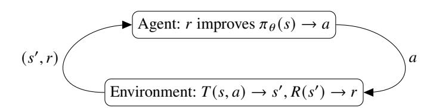
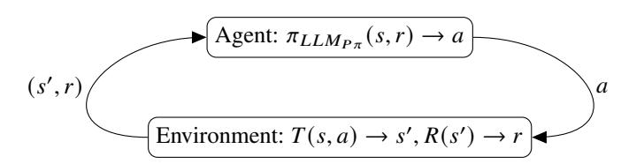
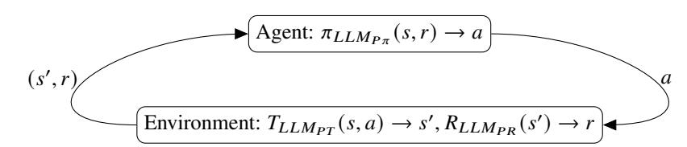
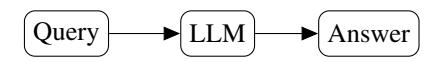
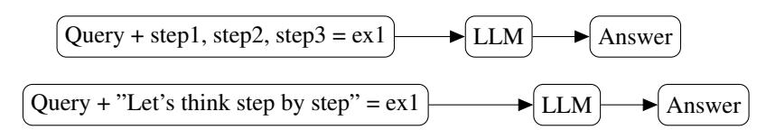
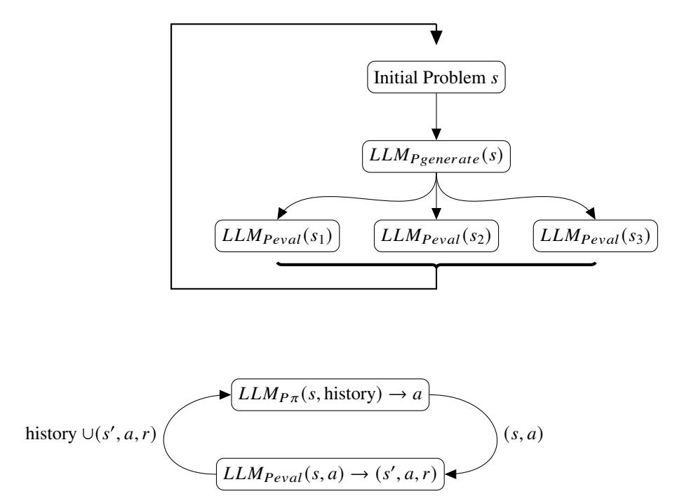
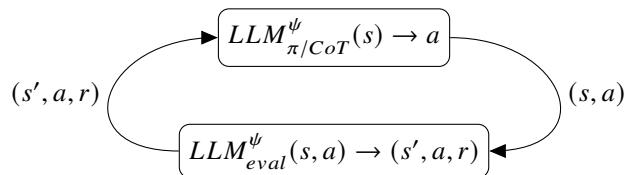

<!-- Source: AgenticLargeLanguageModels.pdf; physical PDF pages 193-210; Marker split PDF pages 1-18. -->

{0}------------------------------------------------

# Chapter 9

# Interaction Styles for Agentic LLMs

### What You Will Learn

This chapter introduces agentic interaction styles and memory. By the end, you will be able to:

- Recognize three historical perspectives on AI agents and relate them to current agentic LLMs.
- Describe five interaction styles for agentic LLMs.
- Explain why agents need memory and identify several memory architectures.

# 9.1 Agents in AI

Agents are a central concept in artificial intelligence. We begin with a brief overview of the main perspectives on AI agents.

## 9.1.1 Agents Act and Adapt in Their Environment

In AI, an entity that acts in the world is called an *agent*. The concept is an attempt to understand intelligence by building systems that perform some of the activities associated with human beings.

An agent is an autonomous software system that acts in an environment. It has goals, perceives its environment, makes decisions, and takes actions to achieve those goals. It can also learn from experience. By adapting to new information, an agent can improve its behavior policy—in reinforcement-learning terms, the policy that selects actions.

Traditional computer programs follow predefined instructions deterministically, which makes them useful for tasks where predictability is essential, from accounting to control systems.

{1}------------------------------------------------

LLM agents are less deterministic and predictable. They can change their behavior, reason, plan, and use tools to carry out workflows in areas such as coding, customer service, and data analysis. They can also hallucinate and make mistakes, so their behavior may be unreliable. In this respect, they resemble people more than conventional computer programs.

AI research has studied agents for decades. Three useful perspectives are robotic assistants, belief–desire–intention (BDI) agents, and swarm agents.

#### 9.1.1.1 Robotic Assistants

The engineering perspective treats agents as tools that perform tasks for people. Examples include a factory welding robot, an aircraft autopilot, or a self-driving car navigating an unpredictable environment.

Other examples include virtual assistants such as Alexa and Siri, coding assistants such as Copilot, and customer-service bots that help people navigate company procedures, file complaints, or request refunds. Robotic assistants can also have substantial reasoning capabilities [Dorri et al., 2018](#page-13-0), and LLMs are increasingly being used in assistants [Plaat et al., 2025](#page-14-0).

#### 9.1.1.2 Agents with Beliefs, Desires, and Intentions

A cognitive-science perspective models aspects of human cognition. In the BDI framework, an agent has beliefs, desires, and intentions. AI agents can implement cognitive models and help researchers explore questions about reasoning, cooperation, creativity, perception, physical action, and self-awareness.

BDI agents originated in logic-based reasoning. They are given goals that they pursue through actions. In this literature, actions are treated as means of achieving an agent's goals [Rao et al., 1995](#page-14-0); [Georgeff et al., 1998](#page-13-0).

#### 9.1.1.3 Swarm Agents

A third perspective focuses on interactions among large numbers of simple agents. Unlike small multi-agent systems of complex agents, swarm systems study how collective behavior can emerge at a scale beyond the reasoning abilities of any individual agent.

{2}------------------------------------------------

Researchers ask questions such as whether a swarm can protect itself from a predator, what conditions enable collaboration, and when a society is peaceful or at war. These questions also raise the idea of a superorganism [Johnson and Linksvayer, 2010](#page-13-0); [Wilson and Sober, 1989](#page-15-0).

Swarm agents draw on the connectionist tradition of embodied AI [Brooks, 1990](#page-13-0). Researchers study how communication among agents can give rise to large-scale patterns such as cooperation. Ant-colony optimization is a well-known swarm algorithm [Dorigo et al., 2007](#page-13-0), and NetLogo is a software environment for studying such patterns [Wilensky and Rand, 2015](#page-15-0).1

Multi-agent systems and agentic LLMs can support all three perspectives: agents as tools, agents as cognitive entities, and agents as a way to study social behavior. Part IV of this book focuses on agents as tools; Part V focuses on cognition and agent societies.

## 9.1.2 Agentic LLMs as Reinforcement-Learning Agents

AI has a long tradition of studying how intelligent agents behave and learn from their environments. Reinforcement learning studies how agents learn from feedback [Sutton and Barto, 2018](#page-15-0); multi-agent reinforcement learning extends this perspective to interacting agents [Wong et al., 2021](#page-15-0).

The next section presents five interaction styles for agentic LLMs. First, we use reinforcement-learning concepts to describe agents that interact with the world.

Figure [9.1](#page-3-0) shows a reinforcement-learning system with an agent and an environment. The agent takes actions; the environment responds with a new state and a reward that indicates how favorable that state is.

The agent uses rewards to learn which actions are favorable in each state. Its goal is to find an effective behavior policy, denoted by \(\pi\), that maps states to actions. An optimal policy is denoted by \(\pi^*\). If a neural network represents the policy, its parameters are denoted by \(\theta\).

The environment models the world in which the agent acts. It changes state in response to an action and returns a reward. These operations can be represented by a transition function \(T\) and a reward function \(R\).

1 <https://www.netlogo.org>

{3}------------------------------------------------

*Figure 9.1: The reinforcement-learning loop. The agent learns a parameterized policy \(\pi_\theta\) from reward feedback \(r\) provided by the environment's transition function \(T\) and reward function \(R\) in response to actions \(a\).* [Sutton and Barto, 2018](#page-15-0)

*Figure 9.2: Reinforcement learning with an LLM parameterizing the agent's policy \(\pi_{\mathrm{LLM}_\pi}\), which uses environmental feedback \(r\) to choose actions \(a\).* 

The reinforcement-learning loop gives a useful model of agents that learn from environmental feedback. From this perspective, an LLM can be treated as a function that maps a prompt to an answer. It can operate in the agent, for example as a policy improver that uses reward feedback *r* to choose an action *a* for state *s*, or it can operate in the environment. In-context reinforcement learning uses an LLM to improve a policy; Tree of Thoughts can use one to generate and evaluate candidate actions.

*Figure 9.3: Reinforcement learning in which LLMs are used for the agent policy π and for the environment's transition T and reward R functions. Each LLM receives a prompt to produce an action, a state, or a reward.*
{4}------------------------------------------------

| Style | Prompt or interaction | LLM training | Example |
|---|---|---|---|
| **A. Query** | Zero-shot user-written query or instruction | Pretrained | GPT-2 [Radford et al., 2019](https://cdn.openai.com/GPT_2_August_Report.pdf) |
| **B. In-context learning** | Few-shot examples | Pretrained | GPT-3 [Brown et al., 2020](#page-13-0) |
| **C. Chain of thought** | Examples of reasoning steps, or a zero-shot CoT instruction | Pretrained | Chain of Thought [Wei et al., 2022](#page-15-0); Zero-shot CoT [Kojima et al., 2022](#page-13-0) |
| **D. Self-reflection** | Feedback harness, prompt optimization, or search/RL | Pretrained model used by a harness | Tree of Thoughts [Yao et al., 2024](#page-16-0); LLaMea [van Stein and Back, 2024](#page-15-0); ReAct [Yao et al., 2022](#page-16-0) |
| **E. Reinforcement fine-tuning** | RL prompt and optimization harness | Pretraining and fine-tuning | RLVR; Tulu 3 [Lambert et al., 2024](#page-14-0) |

*Table 9.1: Five agent styles.*

The LLM can also be part of the environment: it can calculate a state's reward, \(\mathrm{LLM}_R(s)\), or predict the next state, \(\mathrm{LLM}_T(s,a)\). In Figure 9.3, one LLM fills three roles—policy, transition function, and reward function—using a different prompt for each. For example, Tree of Thoughts can use an LLM to evaluate a state. The reinforcement-learning framework provides a common language for comparing these agentic styles.

# 9.2 Learning Mechanisms in Agentic LLMs

Agentic LLM research is relatively new, and the preceding chapters have introduced several ways to use LLMs in agentic systems. Here, we organize those approaches by prompting and training method.

We distinguish five interaction styles. Table 9.1 summarizes how the harness prompts the LLM at inference time, how the model is trained, and representative examples. Each style can support useful assistants or interaction partners in appropriate domains; more elaborate styles have been developed to improve performance on harder tasks.

The table's first column names each style, from a simple query to reinforcement fine-tuning. The second describes the prompting method, from a static instruction to a dynamic RL prompt. The third describes whether the LLM is pretrained or fine-tuned. The last column gives examples from the literature.

## 9.2.1 Agentic Interaction Styles

We now examine the five styles. In the first three, the user supplies a static prompt that does not change during the interaction.

{5}------------------------------------------------

*Figure 9.4: Style A—static query.*

*Figure 9.5: Style B—in-context supervised learning with a prompt containing a few examples.*

#### 9.2.1.1 A. Query Prompt

The first style gives the LLM a simple instruction. Figure 9.4 illustrates this approach. For example, the user might enter, *Lily missed the train. She felt very …* and expect an answer such as *angry* or *sad*. The prompt contains a query but no examples, so this is zero-shot, instruction-only interaction.

A model may answer many such queries because pretraining exposes it to relevant information, and instruction fine-tuning teaches it to follow requests. GPT-2 is an example of an early model used in this way.

#### 9.2.1.2 B. In-Context Learning

In-context learning is a way to learn from examples in the prompt, alongside supervised and reinforcement learning. LLMs can often perform a task from only a few examples, addressing a central challenge in machine learning.

Compared with a simple query, few-shot in-context learning gives the model examples along with the request. These examples condition the decoder to use relevant information encoded in its parameters.

Figure 9.5 illustrates this style. GPT-3 is a well-known example; Brown et al. introduced the few-shot evaluation of language models [Brown et al., 2020](#page-13-0). A prompt might say: *Complete the pairs: sea—la mer; oysters—huîtres; window—la fenêtre; cheese—…* The expected answer is *fromage*.

In-context learning was first observed clearly in sufficiently large models. For example, GPT-3 had 175 billion parameters. The scale at which this behavior emerges depends on the model and training method, and can change as those methods improve.

{6}------------------------------------------------

*Figure 9.6: Style C. Top: chain-of-thought in-context learning with examples of reasoning steps. Bottom: zero-shot chain of thought, prompted with an instruction that often helps.*

#### 9.2.1.3 C. Chain of Thought

Chain-of-thought prompting asks a model to produce intermediate reasoning steps [Wei et al., 2022](#page-15-0); Figure 9.6 (top) illustrates the few-shot form. As discussed in Chapter 6, this approach was developed in part to address LLMs' difficulty with multi-step arithmetic word problems. A limitation of the original method is that users must write task-specific examples for each new reasoning task.

Zero-shot chain of thought is a later development (Figure 9.6, bottom). Kojima et al. found that adding a general instruction such as *Let's think step by step* can improve performance on many benchmarks, although it may be less effective than a task-specific prompt [Kojima et al., 2022](#page-13-0).

Like in-context learning, chain of thought uses examples in the prompt. The distinction is that the examples demonstrate *reasoning steps*, rather than only facts or input-output pairs. Such steps can guide the model through a multi-step solution. Figure 6.1 on page 129 shows few-shot and zero-shot examples.

Chain of thought generally works better with sufficiently capable models, although improved methods can lower the scale required. Reasoning behavior can also be distilled from a large model into a much smaller one [Li et al., 2023](#page-13-0).

#### 9.2.1.4 D. Self-Reflection Harness

The first three styles use a single, static prompt and can perform well on many benchmarks. Planning and other tasks that require state tracking may benefit from a process that explores alternatives and revises its prompts.

In the next two styles, a small algorithm external to the LLM dynamically manages prompts. This algorithm is called a *harness*. Style D uses in-context updates without changing the LLM's parameters; Style E also fine-tunes the model.

These styles are dynamic. As discussed in Chapter 8, a key challenge is keeping the resulting learning process stable.

{7}------------------------------------------------

*Figure 9.7: Style D—self-reflection with an LLM. At the top, a search procedure proposes subproblems and evaluates them; at the bottom, a reinforcement-learning loop updates the policy prompt using the history of state, action, and reward tuples.* [Yao et al., 2024](#page-16-0)

Figure 9.7 illustrates two ways to manage self-reflection: search over candidate subproblems and feedback-driven prompt updates. In the feedback loop, the policy prompt is updated using the interaction history \((s,a,r)\) (see also Section 20.2.1).

{8}------------------------------------------------

*Figure 9.8: Style E—reinforcement fine-tuning of LLM parameters \(\psi\), in addition to reinforcement learning of policy parameters \(\theta\).* [Luong et al., 2024](#page-14-0)

#### 9.2.1.5 E. Reinforcement Fine-Tuning Harness

So far, learning has taken place in context: the model answers using examples in the prompt, while its parameters remain unchanged. In-context learning is convenient, but it limits how much the model can adapt or retain from experience. If the model should learn more deeply from interaction, its parameters may need to change. We call approaches that update model parameters through reward-guided training *reinforcement fine-tuning*. RLVR is one example.

Figure 9.8 marks the trainable LLM parameters as \(\psi\). Compared with Figure 9.7 (bottom), the model itself is now updated using reward signals from the data. In the standard pipeline, fine-tuning happens before inference. For tasks such as mathematics and coding, however, inference-time reasoning rollouts can produce reward signals that are later used to fine-tune the model. Reinforcement fine-tuning therefore couples inference and training: the model generates training targets during interaction, and those targets update the same model. This blurs the boundary between inference and fine-tuning, unlike conventional supervised fine-tuning, where training and inference are separate phases.

LLM development is often described in three stages: pretraining, fine-tuning, and testing (inference). Style D uses feedback-driven learning during inference. Style E updates the model during fine-tuning, using results from agent interaction. It does not mean that the model's parameters are updated during ordinary test-time inference.

Styles D and E require care to achieve stable convergence. At the time of writing, relatively few studies had reported such results.

{9}------------------------------------------------

# 9.3 Memory Architectures for Agentic LLMs

Humans and other living beings use memory to maintain identity, remember relationships, learn from experience, and adapt behavior. Memory loss can change a person's behavior and, in severe cases, undermine their sense of identity.

Agents also need memory. This section explains why agentic LLM systems need it and surveys several memory architectures.

### 9.3.1 The Need for Memory

A statistical model \(f(x)\to\hat y\) estimates an output \(\hat y\) from a relationship \(f\) learned during training. This input-output function does not retain new information on its own; post-training information must be supplied through the input \(x\). Early chatbots therefore used hidden *system prompts* to include conversation history and support coherent dialogue.

As agentic LLM applications expand, more advanced techniques are needed. The following use cases illustrate what memory can provide.

#### 9.3.1.1 Coherent Conversation

Many LLM benchmarks use a challenge-and-response format, which suits statistical models that map inputs to outputs. In practical use, however, people often expect an LLM chatbot to maintain a meaningful conversation. To respond coherently, the chatbot must keep track of what the user and assistant have already said.

Thus, an agentic LLM's first memory requirement is access to relevant conversation history.

#### 9.3.1.2 Adaptation

As defined in Chapter 1, agentic LLMs are expected to learn. If a robot is chopping an onion and the knife has moved, it should adapt by finding the knife before continuing. Agents interact with their environments and should adjust when those environments change.

An agent may rely on a broadly general pretrained policy, or its architecture may need to detect when that policy requires adaptation, fine-tuning, or retraining. Memory can support this process.

{10}------------------------------------------------

As discussed in Section 6.2.4, external prompt-improvement harnesses used for self-reflective agents rely on buffers and other memory structures to improve prompts explicitly.

#### 9.3.1.3 Identity

Experiences shape personality and identity. For an LLM agent to develop a persistent identity, it must either retain experiences in memory for self-reflection or process them in another way that changes its behavior policy.

As agent harnesses gain better memory architectures, they may retain more of their experiences. Over time, those experiences could contribute to a distinctive agent personality.

#### 9.3.1.4 Continual Learning

Traditional machine learning often trains a model on one dataset for one task. Human learning continues throughout life. Continual learning studies how models can learn a sequence of tasks while retaining previously learned capabilities [Wang et al., 2024](#page-15-0); [Li et al., 2025a](#page-14-0). Like metalearning, it addresses generalization across related tasks. Key challenges include catastrophic forgetting and changing data distributions.

Continual-learning research offers architectures that support this kind of training.

## 9.3.2 Memory Architectures

Research on memory architectures for LLM agents is still young. The following sections describe several approaches.

#### 9.3.2.1 Fine-Tuning

One pragmatic approach is to incorporate new information into the model as it arrives. Model parameters can serve as a form of memory, so the model could be fine-tuned on new examples instead of relying on a separate memory-management algorithm.

In an agentic setting, fine-tuning would need to happen quickly enough that users do not experience a noticeable delay. Parameter-efficient methods such as LoRA are one option [Yang et al., 2024](#page-15-0). This approach avoids external memory structures, but fine-tuning is often too slow for interactive use; an in-context or harness-based solution may be more practical.

#### 9.3.2.2 Long Context Windows and Compression

Another approach manages the prompt. Chatbots commonly include a truncated conversation history alongside the user's latest message. This works in many cases, but context windows have finite capacity, and processing long contexts can be expensive because standard attention has quadratic time complexity in sequence length.

Two approaches address this limitation. First, long-context architectures use alternative mechanisms to handle attention over extended inputs [Smith et al., 2022](#page-14-0); recent approaches are surveyed by Liu et al. [2025](#page-14-0). Second, prompt-compression methods summarize or encode the prompt in a smaller representation [Li et al., 2025b](#page-14-0). Prompts can also be divided into chunks [Sheng et al., 2025](#page-14-0), or processed recursively by code generated by an LLM [Zhang et al., 2025a](#page-16-0).

Compression can remove unnecessary tokens; for example, *Prompts can be compressed by filtering unnecessary tokens* might be shortened to *Prompts compressed filtering unnecessary tokens*. Another option is soft prompting [Lester et al., 2021](#page-13-0). Instead of using discrete text tokens, soft prompts learn embeddings through backpropagation and feed them directly into a Transformer. Reported compression rates range from about tenfold [Mu et al., 2023](#page-14-0) to hundreds-fold [Li et al., 2025c](#page-14-0).

#### 9.3.2.3 Explicit Memory Management

An agent harness can store state between LLM calls and include relevant information in later prompts. Section 6.2.4 described external prompt-improvement methods for self-reflection, including Reflexion and Buffer of Thoughts (Figures 6.8 and 6.6).

Agents have different storage needs [Zhang et al., 2025b](#page-16-0); [Chhikara et al., 2025](#page-13-0). Memory can be stored as text or parameters. Common operations include reading, writing, compacting, and forgetting information; systems may also provide additional services. For example, MemoryBank adds hierarchical summaries and uses prompts to maintain a running profile of a user's interaction history [Zhong et al., 2024](#page-16-0).

An agent can also use function calls to read and write external memory. MemGPT explores this approach [Packer et al., 2023](#page-14-0). A-mem uses contextual descriptions of memories and a mailbox-inspired organization [Xu et al., 2025](#page-15-0).

A limitation of explicit memory management is that an LLM may not have been trained to manage memory effectively. Developers can instead write memory-management code when requirements are predictable.

{12}------------------------------------------------

The Model Context Protocol (MCP) provides a set of strategies for managing context; Section 11.4 discusses it in more detail.

**Learning to use memory.** Mem1 takes another approach: after each interaction, the agent updates a compact state to share with future LLM calls. The state has a fixed size, so it does not grow until it exceeds the context window. Reasoning-style tags help construct the shared state, and reinforcement learning trains the agent to consolidate it [Zhou et al., 2025](#page-16-0). Mem-\(\alpha\) also uses reinforcement learning to train agents to use memory effectively [Wang et al., 2025](#page-15-0).

AgeMem integrates memory operations into an agent's policy and optimizes them end to end. It distinguishes long-term from short-term memory and uses a three-stage reinforcement-learning scheme to train the agent to manage both [Yu et al., 2026](#page-16-0).

This remains an active research area, so new studies and frameworks are likely. Zhou et al. provide an overview [Zhou et al., 2026](#page-16-0).

**Vector databases.** In addition to storing prompts as readable text, systems can store their token embeddings. Text storage supports exact or lexical retrieval; embeddings encode semantic relationships and can help retrieve items with similar meanings.

Vector databases store high-dimensional vectors and provide fast similarity search. This makes them useful for retrieving semantically related content in LLM applications [Xie et al., 2023](#page-15-0); [Ma et al., 2023](#page-14-0).

## 9.4 Concluding Remarks

Intelligent agents are a central topic in AI. LLMs have substantially expanded agents' communication and reasoning capabilities. This chapter connected several historical perspectives on agents to current systems and described five interaction styles.

Agents act, and they need memory to interact meaningfully with their environments. Research on agent memory is developing rapidly.

The next chapter turns from theory to a practical case study and applies some of the concepts introduced so far.

{13}------------------------------------------------

# Bibliography
Rodney A Brooks. Elephants don't play chess. *Robotics and autonomous systems*, 6 (1-2):3–15, 1990. [195](#page-2-0) Tom Brown, Benjamin Mann, Nick Ryder, Melanie Subbiah, Jared D Kaplan, Prafulla Dhariwal, Arvind Neelakantan, Pranav Shyam, Girish Sastry, Amanda Askell, et al. Language models are few-shot learners. *Advances in neural information processing systems*, 33:1877–1901, 2020. [197,](#page-4-0) [198](#page-5-0) Prateek Chhikara, Dev Khant, Saket Aryan, Taranjeet Singh, and Deshraj Yadav. Mem0: Building production-ready ai agents with scalable long-term memory. *arXiv preprint arXiv:2504.19413*, 2025. [204](#page-11-0) Marco Dorigo, Mauro Birattari, and Thomas Stutzle. Ant colony optimization. *IEEE computational intelligence magazine*, 1(4):28–39, 2007. [195](#page-2-0) Ali Dorri, Salil S Kanhere, and Raja Jurdak. Multi-agent systems: A survey. *Ieee Access*, 6:28573–28593, 2018. [194](#page-1-0) Michael Georgeff, Barney Pell, Martha Pollack, Milind Tambe, and Michael Wooldridge. The belief-desire-intention model of agency. In *International workshop on agent theories, architectures, and languages*, pages 1–10. Springer, 1998. [194](#page-1-0) Brian R Johnson and Timothy A Linksvayer. Deconstructing the superorganism: social physiology, groundplans, and sociogenomics. *The Quarterly Review of Biology*, 85 (1):57–79, 2010. [195](#page-2-0) Takeshi Kojima, Shixiang Shane Gu, Machel Reid, Yutaka Matsuo, and Yusuke Iwasawa. Large language models are zero-shot reasoners. *Advances in neural information processing systems*, 35:22199–22213, 2022. [197,](#page-4-0) [199](#page-6-0) Nathan Lambert, Jacob Morrison, Valentina Pyatkin, Shengyi Huang, Hamish Ivison, Faeze Brahman, Lester James V Miranda, Alisa Liu, Nouha Dziri, Shane Lyu, et al. Tulu 3: Pushing frontiers in open language model post-training. *arXiv preprint arXiv:2411.15124*, 2024. [197](#page-4-0) Brian Lester, Rami Al-Rfou, and Noah Constant. The power of scale for parameterefficient prompt tuning. In *Proceedings of the 2021 conference on empirical methods in natural language processing*, pages 3045–3059, 2021. [204](#page-11-0) Liunian Harold Li, Jack Hessel, Youngjae Yu, Xiang Ren, Kai-Wei Chang, and Yejin Choi. Symbolic chain-of-thought distillation: Small models can also "think" stepby-step. In Anna Rogers, Jordan Boyd-Graber, and Naoaki Okazaki, editors, *Proceedings of the 61st Annual Meeting of the Association for Computational Linguistics (Volume 1: Long Papers)*, pages 2665–2679, Toronto, Canada, July 2023. Association for Computational Linguistics. doi: 10.18653/v1/2023.acl-long.150. URL <https://aclanthology.org/2023.acl-long.150/>. [199](#page-6-0)

{14}------------------------------------------------

- Yujie Li, Xiangkun Wang, Xin Yang, Marcello Bonsangue, Junbo Zhang, and Tianrui
- Li. Improving open-world continual learning under the constraints of scarce labeled data. In *Proceedings of the 31st ACM SIGKDD Conference on Knowledge Discovery and Data Mining V. 2*, pages 1647–1658, 2025a. [203](#page-10-0) Zongqian Li, Yinhong Liu, Yixuan Su, and Nigel Collier. Prompt compression for large language models: A survey. In *Proceedings of the 2025 Conference of the Nations of the Americas Chapter of the Association for Computational Linguistics: Human Language Technologies (Volume 1: Long Papers)*, pages 7182–7195, 2025b. [204](#page-11-0) Zongqian Li, Yixuan Su, and Nigel Collier. 500xcompressor: Generalized prompt compression for large language models. In *Proceedings of the 63rd Annual Meeting of the Association for Computational Linguistics (Volume 1: Long Papers)*, pages 25081–25091, 2025c. [204](#page-11-0) Jiaheng Liu, Dawei Zhu, Zhiqi Bai, Yancheng He, Huanxuan Liao, Haoran Que, Zekun Wang, Chenchen Zhang, Ge Zhang, Jiebin Zhang, et al. A comprehensive survey on long context language modeling. *arXiv preprint arXiv:2503.17407*, 2025. [204](#page-11-0) Trung Quoc Luong, Xinbo Zhang, Zhanming Jie, Peng Sun, Xiaoran Jin, and Hang
- Li. Reft: Reasoning with reinforced fine-tuning. *arXiv preprint arXiv:2401.08967*, 2024. [201](#page-8-0) Le Ma, Ran Zhang, Yikun Han, Shirui Yu, Zaitian Wang, Zhiyuan Ning, Jinghan Zhang, Ping Xu, Pengjiang Li, Wei Ju, et al. A comprehensive survey on vector database: Storage and retrieval technique, challenge. *arXiv preprint arXiv:2310.11703*, 2023. [205](#page-12-0) Jesse Mu, Xiang Li, and Noah Goodman. Learning to compress prompts with gist tokens. *Advances in Neural Information Processing Systems*, 36:19327–19352, 2023. [204](#page-11-0) Charles Packer, Vivian Fang, Shishir G Patil, Kevin Lin, Sarah Wooders, and Joseph E Gonzalez. Memgpt: towards llms as operating systems., 2023. [204](#page-11-0) Aske Plaat, Max van Duijn, Niki van Stein, Mike Preuss, Peter van der Putten, and Kees Joost Batenburg. Agentic large language models, a survey. *Journal of Artificial Intelligence Research, arXiv preprint arXiv:2503.23037*, 84:29:1–29:74, 2025. [194](#page-1-0) Anand S Rao, Michael P Georgeff, et al. Bdi agents: From theory to practice. In *Icmas*, volume 95, pages 312–319, 1995. [194](#page-1-0) Boheng Sheng, Jiacheng Yao, Meicong Zhang, and Guoxiu He. Dynamic chunking and selection for reading comprehension of ultra-long context in large language models. *arXiv preprint arXiv:2506.00773*, 2025. [204](#page-11-0) Jimmy TH Smith, Andrew Warrington, and Scott W Linderman. Simplified state space layers for sequence modeling. *arXiv preprint arXiv:2208.04933*, 2022. [204](#page-11-0)

{15}------------------------------------------------

- Richard S Sutton and Andrew G Barto. *Reinforcement Learning*. Adaptive Computation and Machine Learning series. Bradford Books, Cambridge, MA, 2 edition, November 2018. [195,](#page-2-0) [196](#page-3-0) Niki van Stein and Thomas Back. Llamea: A large language model evolutionary algo- ¨ rithm for automatically generating metaheuristics. *arXiv preprint arXiv:2405.20132*, 2024. [197](#page-4-0) Ashish Vaswani, Noam Shazeer, Niki Parmar, Jakob Uszkoreit, Llion Jones, Aidan N Gomez, Łukasz Kaiser, and Illia Polosukhin. Attention is all you need. *Advances in neural information processing systems*, 30, 2017. [197,](#page-4-0) [198](#page-5-0) Liyuan Wang, Xingxing Zhang, Hang Su, and Jun Zhu. A comprehensive survey of continual learning: Theory, method and application. *IEEE transactions on pattern analysis and machine intelligence*, 46(8):5362–5383, 2024. [203](#page-10-0) Yu Wang, Ryuichi Takanobu, Zhiqi Liang, Yuzhen Mao, Yuanzhe Hu, Julian McAuley, and Xiaojian Wu. Mem-{\alpha}: Learning memory construction via reinforcement learning. *arXiv preprint arXiv:2509.25911*, 2025. [205](#page-12-0) Jason Wei, Xuezhi Wang, Dale Schuurmans, Maarten Bosma, Fei Xia, Ed Chi, Quoc V Le, Denny Zhou, et al. Chain-of-thought prompting elicits reasoning in large language models. *Advances in neural information processing systems*, 35:24824– 24837, 2022. [197,](#page-4-0) [199](#page-6-0)
- U. Wilensky and W. Rand. *An Introduction to Agent-Based Modeling: Modeling Natural, Social, and Engineered Complex Systems with NetLogo*. The MIT Press. MIT Press, 2015. ISBN 9780262731898. URL [https://books.google.nl/](https://books.google.nl/books?id=LQrhBwAAQBAJ) [books?id=LQrhBwAAQBAJ](https://books.google.nl/books?id=LQrhBwAAQBAJ). [195](#page-2-0) David Sloan Wilson and Elliott Sober. Reviving the superorganism. *Journal of theoretical Biology*, 136(3):337–356, 1989. [195](#page-2-0) Annie Wong, Thomas Back, Anna V Kononova, and Aske Plaat. Multiagent deep ¨ reinforcement learning: Challenges and directions towards human-like approaches. *arXiv preprint arXiv:2106.15691*, 2021. [195](#page-2-0) Xingrui Xie, Han Liu, Wenzhe Hou, and Hongbin Huang. A brief survey of vector databases. In *2023 9th international conference on big data and information analytics (BigDIA)*, pages 364–371. IEEE, 2023. [205](#page-12-0) Wujiang Xu, Zujie Liang, Kai Mei, Hang Gao, Juntao Tan, and Yongfeng Zhang. Amem: Agentic memory for llm agents. *arXiv preprint arXiv:2502.12110*, 2025. [204](#page-11-0) Menglin Yang, Jialin Chen, Jinkai Tao, Yifei Zhang, Jiahong Liu, Jiasheng Zhang, Qiyao Ma, Harshit Verma, Regina Zhang, Min Zhou, et al. Low-rank adaptation for foundation models: A comprehensive review. *arXiv preprint arXiv:2501.00365*, 2024. [203](#page-10-0)

{16}------------------------------------------------

Shunyu Yao, Jeffrey Zhao, Dian Yu, Nan Du, Izhak Shafran, Karthik Narasimhan, and Yuan Cao. React: Synergizing reasoning and acting in language models. *arXiv preprint arXiv:2210.03629*, 2022. [197](#page-4-0) Shunyu Yao, Dian Yu, Jeffrey Zhao, Izhak Shafran, Tom Griffiths, Yuan Cao, and Karthik Narasimhan. Tree of thoughts: Deliberate problem solving with large language models. *Advances in Neural Information Processing Systems*, 36, 2024. [197,](#page-4-0) [201](#page-8-0) Yi Yu, Liuyi Yao, Yuexiang Xie, Qingquan Tan, Jiaqi Feng, Yaliang Li, and Libing Wu. Agentic memory: Learning unified long-term and short-term memory management for large language model agents. *arXiv preprint arXiv:2601.01885*, 2026. [205](#page-12-0) Alex L Zhang, Tim Kraska, and Omar Khattab. Recursive language models. *arXiv preprint arXiv:2512.24601*, 2025a. [204](#page-11-0) Zeyu Zhang, Quanyu Dai, Xiaohe Bo, Chen Ma, Rui Li, Xu Chen, Jieming Zhu, Zhenhua Dong, and Ji-Rong Wen. A survey on the memory mechanism of large language model-based agents. *ACM Transactions on Information Systems*, 43(6):1–47, 2025b. [204](#page-11-0) Wanjun Zhong, Lianghong Guo, Qiqi Gao, He Ye, and Yanlin Wang. Memorybank: Enhancing large language models with long-term memory. In *Proceedings of the AAAI conference on artificial intelligence*, volume 38, pages 19724–19731, 2024. [204](#page-11-0) Wei Zhou, Xuanhe Zhou, Shaokun Han, Hongming Xu, Guoliang Li, Zhiyu Li, Feiyu Xiong, and Fan Wu. Are we ready for an agent-native memory system? *arXiv preprint arXiv:2606.24775*, 2026. [205](#page-12-0) Zijian Zhou, Ao Qu, Zhaoxuan Wu, Sunghwan Kim, Alok Prakash, Daniela Rus, Jinhua Zhao, Bryan Kian Hsiang Low, and Paul Pu Liang. Mem1: Learning to synergize memory and reasoning for efficient long-horizon agents. *arXiv preprint arXiv:2506.15841*, 2025. [205](#page-12-0)

{17}------------------------------------------------

