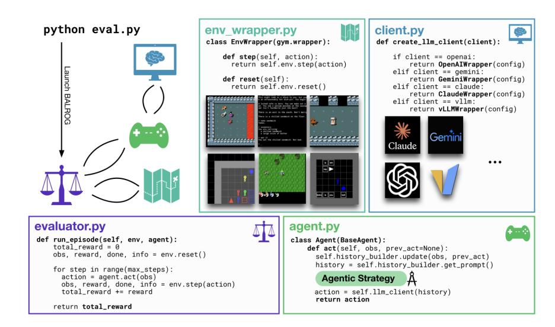
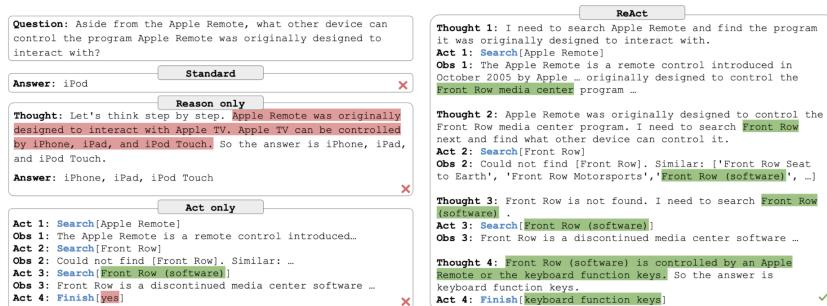
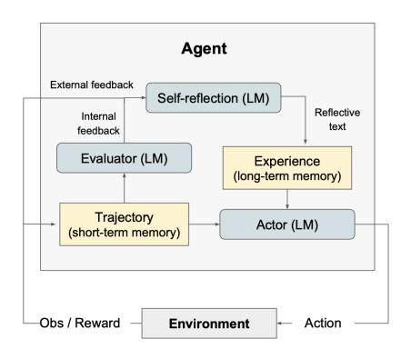

<!-- Source: AgenticLargeLanguageModels.pdf; physical PDF pages 211-222; Marker split PDF pages 1-12. -->


{0}------------------------------------------------

## <span id="page-0-0"></span>第10章

# 案例研究 2：LLM 的 BALROG 推理与反思

#### 你将学到的内容

在本案例研究中，您将获得构建自我反思型推理领域代理的实践经验。具体来说，您将能够：

- 在谜题和游戏的基准测试上运行一个多步骤*推理代理*。
- 用你自己的想法改编一个推理代理。
- 实现你自己的*自我反思*代理。
- 批判性地反思学习代理在谜题和游戏领域中的*性能与稳定性*。

## 10.1 BALROG 概述

在这种情况下，我们将使用一个执行自我反思的智能体大语言模型。我们使用一种用于推理任务的流行基准套件，称为 BALROG.<sup>1</sup> BALROG 是 *B*enchmarking *A*gentic *L*LM 和 VLM *R*easoning *O*n *G*ames 的缩写。BALROG 基准由易到难的各种游戏组成，其中一些游戏对 LLM 来说很难玩好，正如 BALROG 论文在其自己的基准研究中所显示的那样 [\[Paglieri et al.,](#page-10-0) [2025\]](#page-10-0)。

BALROG 最初用于评测标准 LLM，但其代码库也支持开发自定义代理并进行上下文学习实验。
  
 [BALROG 网站](https://balrogai.com)提供代码和排行榜。本章将指导你运行游戏并编写自己的代理。 
  
 <sup>1</sup> Balrog 是来自中土世界的神话恶魔，出现在 J.R.R. 托尔金的奇幻作品中。Balrog 对格雷·甘道夫来说也是难以匹敌的，后者是最强大的巫师。

{1}------------------------------------------------

<span id="page-1-0"></span>

| 技能或指标 | BabyAI | TextWorld | Crafter | Baba Is AI | MiniHack | NLE |
|---|---:|---:|---:|---:|---:|---:|
| 导航 | ✓ | ✓ | ✓ | ✓ | ✓ | ✓ |
| 探索 | ✓ | ✓ | ✓ | ✓ | ✓ | ✓ |
| 资源管理 | ✗ | ✓ | ✓ | ✗ | ✓ | ✓ |
| 复杂信用分配 | ✗ | ✗ | ✓ | ✓ | ✓ | ✓ |
| 推断环境动态 | ✗ | ✗ | ✗ | ✓ | ✓ | ✓ |
| 长期规划 | ✗ | ✗ | ✗ | ✓ | ✓ | ✓ |
| 完成所需回合数 | 10¹ | 10² | 10³ | 10² | 10² | 10⁴–10⁵ |
| 人类掌握所需时间 | 秒 | 分钟 | 小时 | 小时 | 小时 | 年 |

*图 10.1：BALROG 所涵盖的游戏与能力。* [Paglieri et al., 2025](#page-10-0)

BALROG 旨在通过需要推理的任务检验上下文学习代理。六种环境由易到难包括 BabyAI、Crafter、TextWorld、Baba Is AI、MiniHack 和 NetHack 学习环境（NLE）。其中有些以文本为主，有些包含视觉输入，但都要求代理进行推理。NetHack 尤其困难；没有丰富经验，很难取得高分。若不借助攻略便能取得高分，甚至可能成为值得发表的研究成果。

#### 10.1.1 谜题与游戏

BALROG 包含图 10.1 所示的六种谜题与游戏，范围从简单的网格世界导航，到复杂的文字地牢冒险和策略游戏。部分任务回合很长，奖励信号也较为稀疏。BALROG 作者提供了代码库，便于实验和评估自定义代理。要在这些基准上取得好成绩，代理需要具备推理、规划以及适应和反思自身行为的能力。

BabyAI 是一个简单的网格世界游戏，代理需要完成导航任务。简单的强化学习算法就能解决这类任务。任务会用自然语言描述，例如：*走到蓝色球旁，然后拿起灰色钥匙*。对 LLM 代理来说，关键挑战是规划并执行这些步骤。按照 BALROG 论文的预期，LLM 在这个简单环境中应能取得不错的表现。

NetHack 对人类玩家也极具挑战。它是一款文字版、类似《龙与地下城》的游戏，既需要长期战略规划（赢得一局可能需要数十万步），也需要短期战术操作来抵御成群的怪物。由于较早的行动可能影响最终成败，信用分配也很困难。
{2}------------------------------------------------

<span id="page-2-0"></span> 
  
 图 10.2：BALROG 的架构 [\[Paglieri et al.,](#page-10-0) [2025\]](#page-10-0) 
  


### 10.1.2 BALROG 架构

我们现在来看一下BALROG框架的架构。图10.2显示了架构，取自论文[\[Paglieri et al.,](#page-10-0) [2025\]](#page-10-0)。
 
 请熟悉BALROG系统。阅读论文[Paglieri et al.](#page-10-0) [\[2025\]](#page-10-0)，你可以在<https://arxiv.org/abs/2411.13543>找到，或者访问BALROG网站<https://balrogai.com>。

如果尚未安装，请使用 git clone 将 [BALROG GitHub 仓库](https://github.com/balrog-ai/BALROG)克隆到本地。

决定你想使用哪个 LLM。请注意，典型的 BALROG 代理在每个步骤都会进行许多 LLM 调用。如果你想在本地运行 LLM，请安装它，或通过 Huggingface 使用它。如果你想使用（商业的）基于云的 LLM，请获取一个 API 密钥并在你的环境中安装该 API 密钥。如果提供的话，你可能想考虑申请免费的学生套餐。使用前沿 LLM 可能很昂贵，但通常较老或较小的 LLM，其中一些仍然相对功能强大，价格却便宜得多。

BALROG 仓库的 README 介绍了安装和配置 API 密钥的方法，见清单 [10.1](#page-3-0)。首次运行时，任选一个受支持的模型即可；后续练习会比较多个 LLM。

{3}------------------------------------------------

<span id="page-3-0"></span>

```bash
export OPENAI_API_KEY=<KEY>
export ANTHROPIC_API_KEY=<KEY>
export GEMINI_API_KEY=<KEY>
```

*清单 10.1：在环境中设置 API 密钥。*

#### 10.1.3 代理

请阅读 BALROG 的[代理开发教程](https://github.com/balrog-ai/BALROG/blob/main/docs/agents.md)。在 BALROG 中，代理是调用 LLM 并生成下一步操作的小段 Python 程序。代理负责接收模型响应（观测）并据此选择动作；LLM 则负责根据提示生成响应。

BALROG 遵循图 9.7 所示的交互风格 D：提示会根据交互历史逐步构建。

#### 10.1.3.1 提示构建器

代理根据此前交互中的观测和动作构建提示。因此，用强化学习的术语来说，代理承担策略的功能：根据当前观测选择下一步动作。进入 `prompt_builder` 目录，可以修改如何根据动作历史构造提示。

#### 10.1.3.2 代理

代理还负责管理记忆，即保存观测和动作历史，为上下文决策提供信息。这部分需要在 LLM 外部实现。BALROG 中的代理会把观测发送给 LLM，接收响应，再根据响应决定游戏中的下一步动作。

BALROG 提供了多个可供研究的预置代理，包括朴素代理、思维链代理，以及用于更稳健地处理 LLM 响应的变体。编写自定义代理时，可以从 `custom` 代理入手；BALROG 教程中提供了一个简单规划代理示例。
{4}------------------------------------------------

<span id="page-4-0"></span>

```bash
python eval.py \
  agent.type=naive \
  agent.max_image_history=0 \
  agent.max_text_history=16 \
  eval.num_workers=16 \
  client.client_name=openai \
  client.model_id=gpt-4o-mini-2024-07-18
```

*清单 10.2：运行标准评测。*
## 10.2 实施步骤

我们现在将提供一些练习，帮助你探索构建你的代理。

#### 10.2.1 复现论文中的结果

我们首先尝试重现BALROG论文中的结果。请查看 [BALROG GitHub 仓库](https://github.com/balrog-ai/BALROG)，阅读评测指南、代理开发教程和少样本（上下文）学习实验说明。安装所需工具及适用的 Python 版本，并将 Python 加入 PATH；在命令行运行 `python` 检查版本。
 
首先运行清单 [10.2](#page-4-0) 中的标准评测，以确认安装正常。

#### 10.2.2 不同的 LLM

使用多个模型比较标准代理在各基准上的表现，包括托管模型和开放权重模型，例如 OpenAI、Anthropic、DeepSeek、OLMo 和 Qwen 的模型。
  
 运行这些模型很重要，并且将带来对各模型相对优势的更多了解。

#### 10.2.3 不同的谜题

接下来，在不同游戏中运行 LLM 代理，并仔细查看其提示和响应，找出代理失效的位置及其弱点。结合对具体动作和游戏机制的分析，思考如何改进代理。

#### 10.2.4 计算成本

BALROG 代理为代理执行的每一步调用一次 LLM，通常伴随一个很长的提示。在这些谜题和游戏中，会进行许多这样的步骤。运行不同的 

{5}------------------------------------------------

在完整基准测试中，LLM 对不同的随机种子，很容易需要许多令牌。

实验时先选用小型、低成本的 LLM（例如 Qwen-3B），并从 BabyAI 和 Crafter 等较简单的基准开始。扩展实验时要考虑计算开销，确保实验能在合理的时间和预算内完成。

#### 10.2.5 实现自己的推理代理

现在是实现你自己的学习代理的时候了。进入 balrog 的 agents 目录，编辑 custom.py 文件。列表 [10.3](#page-6-0) 再现了 BALROG 说明文档中自定义代理的代码。该代码可以使用列表 [10.4](#page-7-0) 中的命令运行（指定自定义代理，并以较少的工作线程轻量运行）。当然，你可以在命令中指定自己选择的 LLM。

从提供的代码开始，运行它，看看它是如何工作的。然后，你可以尝试进行一些小改进。尝试对 LLM 的提示进行更改，以及对 Python 代码处理代理学习的方式进行更改，无论是在历史提示构建器中、在计划中，还是在学习算法中。

## 10.3 评估

您的代理的性能将由 BALROG 以进展百分比的形式报告。记录每个基准的进展数字，以及您尝试的代理类型。以结构化的方式进行此操作，您可能想编写一个 Python 或 shell 脚本来自动运行实验并记录结果，也可以将进展绘制成图表。考虑使用 wandb.ai。
  
 哪些代理类型表现良好，它们在哪些基准上表现良好？制作一个矩阵，在其中记录代理类型和您尝试的基准类型的进展。

请注意，LLM 实验本质上是非确定性的：使用相同提示的两次运行可能会产生不同的结果。因此，应对每个实验进行多次运行。如果连续五次得到相同的结果，可以开始信任这些结果。如果结果差异很大，可能需要调查原因。原因是纯粹的统计问题吗？降低温度能解决问题吗，还是存在其他问题？

不要盲目信任报告的进度数字。由于你是在计算机上运行代码，可能会有程序错误或其他问题。BALROG 系统可以帮助你更深入地分析运行情况。它会记录可以用电子表格查看的 CSV 文件。看看其中的一些运行情况，然后判断你看到的是否有意义，或者代理是否表现出退化行为。如果出现退化行为，尝试找出原因。你做错了什么吗？基准测试与代理行为之间是否存在意外干扰？奖励环境是否过于平坦，以至于代理无法获得信号去追求目标，而只是进行无意义的随机循环操作？你能对此做些什么吗？

请注意，大语言模型字段，尤其是智能体大语言模型字段是新的，我们的见解和软件框架尚未稳定。一些意外结果是可以预期的，也可能会遇到一些挑战或挫折。

{6}------------------------------------------------

<span id="page-6-0"></span>

```python
from balrog.agents.base import BaseAgent
import re


class CustomAgent(BaseAgent):
    def __init__(self, client_factory, prompt_builder):
        super().__init__(client_factory, prompt_builder)
        self.client = client_factory()
        self.plan = None

    def act(self, obs, prev_action=None):
        if prev_action:
            self.prompt_builder.update_action(prev_action)
        self.prompt_builder.update_observation(obs)

        plan_text = (
            f"Current Plan:\n{self.plan}\n"
            if self.plan
            else "You have no plan yet.\n"
        )
        planning_instructions = """
Review the current plan above if present. Decide whether to continue with it or make changes.
If you make changes, provide the updated plan. Then, provide the next action to take.
You must output an action at every step.
Format your answer in the following way:
PLAN: <your updated plan if changed, or "No changes to the plan." if the current plan is good>
ACTION: <your next action>
""".strip()

        messages = self.prompt_builder.get_prompt()
        if messages and messages[-1].role == "user":
            messages[-1].content += "\n\n" + plan_text + "\n\n" + planning_instructions

        response = self.client.generate(messages)
        plan, action = self._extract_plan_and_action(response.completion)
        if plan != "No changes to the plan.":
            self.plan = plan
        response = response._replace(reasoning=plan, completion=action)
        return response

    def _extract_plan_and_action(self, response_text):
        plan_match = re.search(
            r"PLAN:\s*(.*?)(?=\nACTION:|\Z)",
            response_text,
            re.IGNORECASE | re.DOTALL,
        )
        action_match = re.search(
            r"ACTION:\s*(.*)", response_text, re.IGNORECASE | re.DOTALL
        )
        plan = (
            plan_match.group(1).strip()
            if plan_match
            else "No changes to the plan."
        )
        action = action_match.group(1).strip() if action_match else None
        return plan, action
```

*清单 10.3：BALROG 中的自定义代理代码。*
{7}------------------------------------------------

<span id="page-7-0"></span>

```bash
python eval.py \
  agent.type=custom \
  agent.max_image_history=0 \
  agent.max_history=16 \
  eval.num_workers=64 \
  client.client_name=openai \
  client.model_id=gpt-4o-mini-2024-07-18
```

*清单 10.4：运行自定义代理评测。*



*图 10.3：ReAct 示例：执行搜索。* [Yao et al., 2022](#page-10-0)

制定有条理的实验计划并持续记录结果，有助于更顺利地运行、评估和改进智能体大语言模型实验。

## 10.4 自我反思
{8}------------------------------------------------

<span id="page-8-0"></span>



*图 10.4：Reflexion 架构。* [Shinn et al., 2024](#page-10-0)

**ReAct。** ReAct 使用提示与外部环境交互，并鼓励代理调用工具获取信息（见图 [10.3](#page-7-0)）。参见 [ReAct 网站](https://react-lm.github.io)和[代码仓库](https://github.com/ysymyth/ReAct)。LangChain<sup>2</sup> 和 BeeAI<sup>3</sup> 等框架也实现了 ReAct 提示方法。

了解这些框架，熟悉 ReAct 基于提示的代理交互方式，然后尝试在 BALROG 中实现它。它是否能提升性能？哪些游戏会从外部信息查询中受益？

**Reflexion。** 与基于提示的 ReAct 不同，Reflexion 使用 Python 编写的代理来实现更复杂的行为。它在不同环节使用同一个 LLM，但采用不同提示。其基本思路是：批评现有方案中的问题，可能比从零设计出有效方案更容易。参见 [Reflexion 代码仓库](https://github.com/noahshinn/reflexion)及[方法介绍](https://nanothoughts.substack.com/p/reflecting-on-reflexion)。

图 10.4 展示了 Reflexion 的架构、提示和记忆类型。图 [10.5](#page-9-0) 给出了其算法：代理（\(M_a\)）、评估器（\(M_e\)）和自我反思模块（\(M_{sr}\)）分别调用 LLM。图中算法为伪代码，未规定记忆管理、提示构造和收敛条件等细节；具体实现可参阅代码仓库。

<sup>2</sup> 参见 <https://docs.langchain.com/oss/python/langchain/overview>。

<sup>3</sup> 参见 [BeeAI 的 ReAct 示例](https://github.com/i-am-bee/beeai-framework/blob/main/python/examples/agents/react.py)。

{9}------------------------------------------------

<span id="page-9-0"></span>

```text
算法 1：通过自我反思进行强化

初始化代理、评估器和自我反思模块：M_a、M_e、M_sr
初始化策略 π_θ(a_i | s_i)，其中 θ = {M_a, 记忆}
使用 π_θ 生成初始轨迹 τ_0
使用 M_e 评估 τ_0
使用 M_sr 生成初始自我反思 s_r0
设置记忆 = {s_r0}
设置 t = 0
当 M_e 未通过或 t < 最大试验次数时：
    使用 π_θ 生成轨迹 τ_t = (a_0, o_0, ..., a_t, o_t)
    使用 M_e 评估 τ_t
    使用 M_sr 生成自我反思 s_rt
    将 s_rt 添加到记忆
    将 t 加 1
结束循环
返回
```

*图 10.5：Reflexion 算法。* [Shinn et al., 2024](#page-10-0)

Reflexion 也可能导致不稳定或陷入循环。其记忆管理方式较为简单，可能造成上下文超限。可以尝试在 Python 中手动实现分块或其他记忆压缩方法，也可以借助 LLM 完成压缩。

先运行 Reflexion 代码仓库中的示例，尝试让它在 ALFWorld、HotpotQA 等任务上工作。

**扩展练习。** 尝试在 BALROG 中实现 Reflexion 代理，并在基准上运行。你遇到了哪些问题？与标准 BALROG 代理相比，Reflexion 是否提升了性能？之后还可以研究文献中的其他反思方法、探索新的方法、尝试不同类型的应用和 LLM。

## 10.5 结语

本案例研究展示了 LLM 代理如何进行自我反思。我们使用了用于推理任务的开放式基准套件 BALROG，其中包含从简单到困难的多种游戏。BALROG 的开放设计允许我们编写自定义代理并在这些游戏中评测。

这是一个实践性很强的案例研究。你已经尝试编写用于上下文推理的代理，并通过实现自我反思扩展基础学习方法；你也考察了自我反思在不同 LLM 和高难度基准中的稳定性与表现。
{10}------------------------------------------------

## <span id="page-10-0"></span>参考文献

Davide Paglieri, Bartłomiej Cupiał, Samuel Coward, Ulyana Piterbarg, Maciej Wolczyk, Akbir Khan, Eduardo Pignatelli, Łukasz Kucinski, Lerrel Pinto, Rob Fergus, Jakob Nicolaus Foerster, Jack Parker-Holder, and Tim Rocktäschel. BALROG: Benchmarking agentic LLM and VLM reasoning on games. In *The Thirteenth International Conference on Learning Representations*, 2025. [OpenReview](https://openreview.net/forum?id=fp6t3F669F). [211](#page-0-0), [212](#page-1-0), [213](#page-2-0).

Noah Shinn, Federico Cassano, Ashwin Gopinath, Karthik Narasimhan, and Shunyu Yao. Reflexion: Language agents with verbal reinforcement learning. *Advances in Neural Information Processing Systems*, 36, 2024. [218](#page-7-0), [219](#page-8-0), [220](#page-9-0).

Shunyu Yao, Jeffrey Zhao, Dian Yu, Nan Du, Izhak Shafran, Karthik Narasimhan, and Yuan Cao. ReAct: Synergizing reasoning and acting in language models. *arXiv preprint arXiv:2210.03629*, 2022. [218](#page-7-0).
{11}------------------------------------------------


