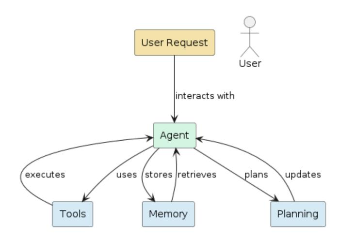
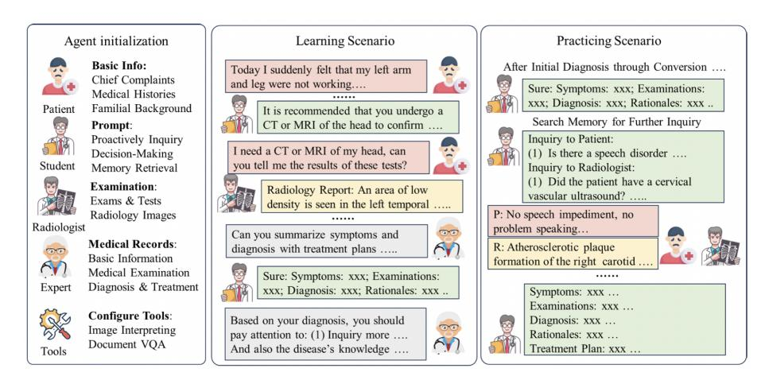

<!-- Source: AgenticLargeLanguageModels.pdf; physical PDF pages 263-276; Marker split PDF pages 1-14. -->

{0}------------------------------------------------

## Chapter 13

# From Tools to Assistants: Real-World Applications

#### What You Will Learn

In this chapter you will learn how agentic language models are deployed as practical assistants across real-world domains. Specifically, you will be able to:

- Describe how assistants go beyond question answering to plan, retrieve information, invoke tools, and *adapt their behavior* over time.
- Compare assistant architectures across *shopping, medicine, aviation, scientific research, and coding*.
- Explain why high-risk domains impose stricter requirements around *safety, transparency, and regulatory compliance* and how agentic designs respond to these demands.
- Critically evaluate assistant behavior and reflect on the *ethical* implications of deploying agentic systems in socially consequential settings.

#### 13.1 Agentic LLMs as Assistants

LLMs have moved from text generators to active assistants. They combine reasoning, retrieval, and tool use to perform actions in the real world. Assistants are the practical (software) form of agentic LLMs: systems that interact, plan, and learn from feedback. Assistants are where reasoning meets reality: they turn language models into collaborative actors in the world.

An assistant links perception, reasoning, and action. Through APIs and external tools, it can converse, execute tasks, and adapt to a specific context. These systems not only support users but also create valuable human-AI interaction data that we can then use for further developments and training the next generation of models.

This chapter reviews the main types of assistants. We begin with conversational systems and their evolution toward multimodal, tool-aware interfaces, then discuss domain-specific assistants in medicine, finance, and trading. Finally, we examine scientific assistants for reasoning and discovery.

{1}------------------------------------------------

Figure 13.1: AssistGPT system architecture [Neszlényi et al., 2024](#page-11-0)

#### 13.2 Conversational Assistants

The first application domain is in general conversational situations, such as helping with meetings by taking meeting minutes, acting as meeting chair or general administrative assistant.

In this type of application, the LLM basically serves to make the interaction between human and computer more natural and streamlined [Neszlényi et al., 2024](#page-11-0); [Oluwagbade, 2024](#page-11-0). For example, the AssistantGPT system [Neszlényi et al., 2024](#page-11-0) is a general-purpose administrative assistant, designed for deployment in an educational or corporate setting. Furthermore, it supports remote work environments such as Teams and Slack. AssistantGPT supports a diverse range of operations, including web searches, API interactions via OpenAPI, voice conversations, and command execution through the shell. The system consists of an LLM with access to various tools such as a planner, and memory (see Figure 13.1).

These conversation and meeting assistants have been shown to improve agile software development team meetings [\[Cabrero-Daniel et al.,](#page-10-0) [2024\]](#page-10-0). They created favorable results for preparation and live assistance during Scrum meetings, although some testers remarked that LLM interventions felt unnatural and inflexible.

Other examples include LLM agents in a collaborative learning classroom setting where the LLM agents improved overall collaboration between participants [\[Wei et al.,](#page-13-0) [2024b\]](#page-13-0). Another study [\[Bastola et al.,](#page-10-0) [2023\]](#page-10-0) reports improved work efficiency in a collaborative task scheduling experiment including conversational assistants.

A slightly different type of assistant is the thinking assistant. This assistant tries

{2}------------------------------------------------

to improve human reflective thinking for difficult decisions, by asking instead of answering [\[Park and Kulkarni,](#page-12-0) [2023\]](#page-12-0). Similar initiatives have recently appeared from the large LLM vendors, such as *Study mode* in OpenAI's ChatGPT and Google's Gemini applications.

Conversational assistants have mostly evolved from regular pretrained LLMs, sometimes fine-tuned for a particular domain. Some approaches use a specialized multi-LLM approach, specializing LLMs for different sub-tasks, or orchestrating a single LLM with different prompt sequences focusing on different sub-tasks.

#### 13.3 Shopping Assistant

In this section we examine how language-based assistants can be applied in the e-commerce domain. Our goal is to highlight the principal components, architectural choices and domain-specific challenges in this domain.

**What does a shopping assistant do?** A shopping assistant is a conversational system built on an LLM that helps users navigate online shopping tasks. It can help in understanding product needs, comparing alternatives, recommending items and completing purchases. Such a system typically complements the underlying LLM with domain-specific modules, including retrieval of up-to-date product information, API access to product catalogs, integration with recommender engines and reasoning (e.g., via chain-of-thought) over user requirements, attributes and constraints.

**Key ingredients.** Because general-purpose LLMs lack built-in awareness of e-commerce concepts (brands, categories, product hierarchies, user purchase behavior), building a capable assistant requires several augmentations:

- Retrieval Augmentation: dynamically fetch product metadata, pricing, availability from external sources.
- Tool / API Invocation: the assistant may call search, filter, ranking tools to interact with product databases.
- Domain fine-tuning or Instruction Tuning: adapt the LLM to the shopping context (branded language, attribute reasoning, user intents).
- Structured Reasoning: add chain-of-thought prompting or explicit reasoning steps. This helps the model compare products, evaluate trade-offs (e.g., price vs features) and align with user preferences.

**Benchmarking shopping assistants.** To study how well models cope with shopping-specific tasks, researchers have developed benchmarks. For example, the *Multi-task Online Shopping Benchmark dataset (ShopMMLU)* [\[Jin et al.,](#page-11-0) [2024\]](#page-11-0) defines 57 tasks grouped into four skills: concept understanding, knowledge reasoning, user-behavior alignment and multilingual capability. It draws on real-world e-commerce data (Amazon product catalogs, sessions and reviews) and evaluates how well an LLM can handle

{3}------------------------------------------------

aspects like brand-model recognition, reasoning about product compatibility, session-based recommendation tasks, and multilingual queries. Another example is the LLaSA system (Large Language and E-commerce Shopping Assistant) [\[Zhang et al.,](#page-13-0) [2024a\]](#page-13-0) which is trained via an instruction dataset (65,000 samples) dubbed *EshopInstruct*. After instruction tuning on shopping tasks, LLaSA competes on the ShopBench benchmark and achieves strong results, showing that adaptation significantly improves performance in this domain.

**Practical recommendations.** The following principles are important for building shopping assistants:

- A capable assistant merges natural-language understanding and domain reasoning. It should understand a request such as *noise-canceling headphones under 200 euros with at least 20 hours of battery life*, and be able to translate this into product attributes and user constraints.
- Domain-specific data matters: off-the-shelf LLMs work to some degree, but fine-tuning or instruction tuning on shopping tasks significantly lifts performance. LLaSA [\[Zhang et al.,](#page-13-0) [2024a\]](#page-13-0) shows this in practice.
- Evaluation must reflect the domain. Accuracy in understanding product attributes or generating queries is less relevant than whether the assistant can align with user behavior, handle multi-step sessions and support multilingual users.
- Tool and retrieval integration is important. The assistant must act as an interface to product systems, not just as a pure language model. This introduces additional complexity (API design, latency, freshness of data and handling integration errors).
- Consider ethics and trust. In shopping, recommendations carry commercial, privacy and bias implications. These issues should be assessed before deploying such a system in production, through questions such as: *which brands are shown*, *is user history handled correctly*, and *how transparent is the reasoning*.

**Challenges and open questions.** Even with recent progress, shopping assistants face several non-trivial challenges. First, handling long interaction trajectories (browsing, refining queries, switching intents) is still difficult for LLM agents. Second, updating product knowledge in real-time (new models, price changes, availability) remains a major engineering pain-point. Third, explaining and justifying recommendations to users (why this product vs another) is under-explored in LLM-based assistants. Finally, cross-lingual behavior and multilingual product queries increase complexity (shopping contexts span languages and regions).

#### 13.4 Flight Operations Assistant

Language-based assistants are also applied in aviation operations, a domain that extends beyond consumer booking and moves into planning and decision support.

{4}------------------------------------------------

**Booking and travel planning.** One of the simpler applications is a conversational booking assistant, similar to the shopping assistants in the previous section. For example, [Manasa et al., 2024](#page-11-0) present a system built on LLaMa 2 with RAG to interactively help users book flights. The assistant is fine-tuned on flight-booking data, and connects to current flight information via retrieval. User testing achieved strong marks for capturing user preferences and guiding the booking process efficiently.

Notice how this use-case remains relatively shallow in operational complexity. The assistant deals with structured user intents (*I want to fly from A to B on date D*), retrieval of up-to-date product data, preference elicitation and generation of responses. It does not (yet) deeply engage with, say, dynamic air-traffic constraints or safety margins.

**Operational decision support.** Moving to more demanding settings, LLM-based assistants are being proposed for actual flight operations. We discuss two examples.

In a study by [Zhou et al., 2024](#page-13-0), the arrival-slot-allocation problem (i.e., determining in which sequence arriving aircraft should land) is formulated as a language modeling task. The authors encode the scheduling inputs and outputs as tokens and fine-tune an LLM to generate conflict-free landing sequences. Their experiments show that the model can reduce conflict rate and total delay time even for airports where traditional methods struggle.

Another operational problem is planning under environmental hazards. [Tabrizian](#page-12-0) [et al.](#page-12-0) [\[2024\]](#page-12-0) use chain-of-thought to support routing or flight plan generation under wind-hazard constraints. Here, the assistant's task is no longer simply *book a flight* but it has to reason about constraints (wind, routing, aircraft performance) and propose operationally feasible plans.

**Key recommendations.** These studies illustrate several important aspects of agentic systems with LLMs:

- **Tool and backend integration:** in operational assistants, the LLM must not only converse but also interface with flight databases, weather feeds, routing engines and slot-allocation systems. This means implementing tool invocation, retrieval pipelines and decision logic.
- **Reasoning under constraints:** these assistants must handle combinatorial or scheduling constraints, generate plans, and deal with real-time uncertainties (such as weather, runway availability). The arrival-slot example is a good example, where the LLM must reason about dynamic sequencing.
- **Domain-specific data and fine-tuning:** standard pretrained LLMs lack aviation-specific knowledge. These systems therefore require domain-specific fine-tuning or prompting, along with datasets, representative tasks, expected outputs, and evaluation metrics tailored to aviation.
- **From conversational agent to autonomous planner:** while booking assistants remain user-driven (the user asks, the assistant helps), operational assistants increasingly take on planning roles. The assistant should handle requests such as

{5}------------------------------------------------

*here are constraints, propose a schedule or route*. This change raises issues of trust, verification and explainability.

- **Evaluation in real contexts:** the evaluation of operational systems often involves more than *does the assistant answer the user?*, but also measure aspects such as conflict rate, delay time, and sequence efficiency. For example, the arrival-slot LLM study measured total delay and conflict rate.

#### 13.5 Medical Assistant

Medicine is one of the most active application domains for LLM-based assistants [\[Thirunavukarasu et al.,](#page-12-0) [2023,](#page-12-0) [Clusmann et al.,](#page-10-0) [2023,](#page-10-0) [Mehandru et al.,](#page-11-0) [2024\]](#page-11-0). Recent studies report that LLMs can outperform trained physicians on diagnostic tasks [Goh et al., 2024](#page-11-0) and exceed human medical scribes in clinical note generation [Yuan et al., 2024](#page-13-0). Other evaluations confirm these strengths, while also identifying systematic weaknesses in specific clinical scenarios [\[Panagoulias et al.,](#page-12-0) [2024\]](#page-12-0).

Agentic architectures are increasingly used to address regulatory, ethical, and usability requirements. [Sudarshan et al.](#page-12-0) [\[2024\]](#page-12-0) present an agentic workflow for generating patient-friendly medical reports that comply with the 21st Century Cures Act. Their system uses reflexion (Section 6.2.4, [\[Shinn et al.,](#page-12-0) [2024\]](#page-12-0)) to iteratively improve clarity and correctness before information is released to patients.

Other studies explore the use of LLM agents for broader clinical support. [Qiu et al., 2024](#page-12-0) identify applications ranging from clinical workflow automation to multi-agent diagnostic support, although concerns remain regarding accuracy, completeness, and hallucinations. A scoping review by [Ullah et al.](#page-12-0) [\[2024\]](#page-12-0) emphasizes that medical domain knowledge and ethical constraints are essential when training and fine-tuning such systems.

To mitigate common failure modes, [Das et al.](#page-10-0) [\[2024\]](#page-10-0) propose an agentic retrieval-based architecture in which the LLM acts as a planner rather than a direct answer generator. The agent coordinates specialized tools to retrieve and synthesize evidence from trusted medical sources, reducing hallucinations and *lost-in-the-middle* errors.

**High-risk application domain.** Medicine is a high-risk application domain, where incorrect or biased outputs can have direct consequences for patient safety. As a result, medical AI systems are subject to strict regulatory frameworks, including the EU AI Act, which classifies many medical uses of AI as high-risk. Transparency, fairness, and accountability therefore play a central role, both in clinical practice and in academic research on medical LLMs. These concerns motivate increased interest in methods that go beyond post-hoc explanations and aim to understand model behavior at a deeper level. We return to this topic in the chapter on *mechanistic interpretability* (Chapter 21), where techniques for analyzing and controlling internal model representations are discussed.

**Medical education.** In medical education, agentic systems are used to simulate realistic training environments. [Wei et al., 2024a](#page-13-0) introduce a multi-agent copilot that supports case-based learning and clinical reasoning practice (Figure 13.2).

{6}------------------------------------------------

Figure 13.2: Medical Education Copilot [Wei et al., 2024a](#page-13-0)

For systematic evaluation of medical retrieval-augmented generation, a dedicated benchmark is provided by [Qiao et al.](#page-12-0) [\[2024\]](#page-12-0).

#### 13.6 Trading Assistant

Financial trading is another specialized domain. Financial organizations already use many non-LLM algorithms to support trading decisions, and interest in agentic LLMs is growing [\[Ding et al.,](#page-10-0) [2024\]](#page-10-0).

InvestorBench is a benchmark for financial trading systems [\[Li et al.,](#page-11-0) [2024\]](#page-11-0). FinAgent is a tool-augmented multimodal agent for financial trading [\[Zhang et al.,](#page-13-0) [2024b\]](#page-13-0). It contains a market intelligence module, which is able to extract insights from multimodal datasets of asset prices, visual representations, news and expert analyses. The system can also perform query retrieval and performs reflection in a low-level module for technical analysis and in a high-level module to analyze past trading decisions.

FinRobot is an agentic LLM platform for financial analysis that assists human traders [Yang et al., 2024a](#page-13-0). It can provide document analysis and generation and market forecasts for individual stocks. FinMem is an agentic LLM framework devised for financial decision-making [\[Yu et al.,](#page-13-0) [2024\]](#page-13-0). It features a layered memory system and adjustable character design for the trading agent. FinMem is inspired by the generative agents framework by [Park et al.](#page-12-0) [\[2023\]](#page-12-0) (see Section 17.2.1 and Case Study 4).

So far, most financial market machine learning has focused on single agent systems. An approach called *TradingAgents* uses a multi-agent system to replicate real-world trading firms' collaborative dynamics [\[Xiao et al.,](#page-13-0) [2024\]](#page-13-0). TradingAgents simulates LLM-powered agents in specialized roles such as fundamental analysts, sentiment analysts, technical analysts and traders with varied risk profiles. The system offers a human manager a buy or sell recommendation; a simulation showed performance above baseline models.

{7}------------------------------------------------

**Evaluation.** Financial trading is a challenging field of research. The competitive interests in financial trading are high, and there is a natural tendency to keep strong research findings private, which creates a tension with the principles of openness and transparency of scientific research.

Furthermore, despite the abundance of available numerical data in the field, there are relatively few benchmarking studies that compare different agentic LLM approaches on the same data. A recent benchmarking study found methodological flaws in some financial LLM studies, such as selecting short evaluation periods with positive market trends or leakage of test data into training data [\[Li et al.,](#page-11-0) [2026\]](#page-11-0).

#### 13.7 Automated Scientific Discovery

The workflow of scientific experimentation is relatively standardized in certain fields of science. For example, in machine learning, (1) ideas are generated, (2) a hypothesis is formulated, (3) an experiment is designed, (4) datasets are acquired, (5) experiments are performed, (6) results are interpreted and (7) a report is produced. This standard workflow has attracted researchers to experiment with agentic LLMs for performing scientific research, see [Eger et al.](#page-11-0) [\[2025\]](#page-11-0) for a survey.

Google and OpenAI have both released Deep Research agents. These agents can perform multi-step research tasks, such as synthesizing online information. They are built with a reasoning LLM and use retrieval augmentation for finding information sources. The systems are able to create scientific research papers that look impressive, but are often not error-free.

AI Scientist [\[Lu et al.,](#page-11-0) [2024\]](#page-11-0) is a framework to automate the process of scientific discovery, from idea generation to paper writing, including a review process. Users must specify a topic and provide an experimentation template and indicate datasets. The authors report experiments in three areas of machine learning: diffusion modeling, transformer-based language modeling, and learning dynamics, with promising results. To improve idea generation and reviewing, the agent accesses open sources. Current limitations include limited experiments, incorrect implementation if ideas, and visual errors when the paper is produced. On the other hand, rarely are entire results hallucinated. Nevertheless, results of the AI scientist are recommended to be taken as hints of promising ideas, worthy of a follow up study [\[Lu et al.,](#page-11-0) [2024\]](#page-11-0).

Building on top of the AI scientist idea, the Agent Laboratory was proposed [\[Schmidgall et al.,](#page-12-0) [2025\]](#page-12-0), an open-source framework that employs specialized LLM-based agents to accelerate the full research cycle. Unlike the AI Scientist, Agent Laboratory is explicitly designed as a co-pilot for human researchers, complementing rather than replacing human ideation. The framework consists of three main phases: *literature review*, *experimentation*, and *report writing*. Each phase is executed by dedicated agents, such as the PhD, Postdoc, and Professor agents, coordinated through a structured pipeline. The system integrates two specialized components: *mle-solver*, responsible for autonomously generating, testing, and refining machine learning code, and *paper-solver*.

{8}------------------------------------------------

Figure 13.3: SWE-Agent for Software Engineering [Yang et al., 2024b](#page-13-0)

Together, the two solvers produce a complete research report in LaTeX format based on the experimental results. They employ iterative refinement, self-evaluation, and reward-based scoring to improve code and report quality across cycles.

Evaluation results demonstrate that Agent Laboratory can autonomously generate complete research projects, including executable code and publication-ready reports, at a fraction of the computational cost of comparable systems (approximately \$2.33 per paper using the gpt-4o backend). Human-in-the-loop or co-pilot mode further improves research quality and usability, with participants reporting high satisfaction and continued use intentions. Nonetheless, human oversight remains essential, as automated self-evaluations tend to overestimate research quality compared to human reviewers.

#### 13.8 Coding Assistants and General Advances

SWE-Agent (short for *software engineering agent*) [\[Yang et al.,](#page-13-0) [2024b\]](#page-13-0) aims to automate the process of software discovery, to help agents to autonomously use computers to solve software engineering tasks. SWE-agent introduces tools to create and edit code files, navigate through software repositories, and execute computer programs. Experiments on coding benchmarks such as HumanEvalFix achieve high success rates of over 80%. This success is attributed to the interactive design of the agent (see Figure 13.3).

MLGym [\[Nathani et al.,](#page-11-0) [2025\]](#page-11-0) follows the popular Gym reinforcement learning framework [\[Brockman et al.,](#page-10-0) [2016\]](#page-10-0). Gym provides a standardized interface between environment and agent. Introduced in 2016, it accelerated the development of reinforcement learning algorithms, facilitating progress in the field. Taking further inspiration from SWE-agent (such as file editing capabilities) the MLGym work shows how the process of scientific discovery can be modeled as an interactive process. Applications are discussed in fields ranging from data science, game theory, computer vision, reinforcement learning, to natural language processing. Experiments are reported with commercial LLMs (OpenAI, Meta, Google, and Anthropic).

Most LLM-based assistants, including research and coding assistants, depend on pre-defined tools, limiting their autonomy and scalability. Toolmaker [Wölflein et al., 2025](#page-13-0) addresses this limitation by enabling agents to create new tools directly from scientific papers and their code repositories. Given a task description and GitHub URL, it installs dependencies, configures a reproducible Docker environment, and builds a Python tool through iterative self-correction and error diagnosis.

{9}------------------------------------------------

 The system was evaluated on TM-Bench (also introduced by [Wölflein et al., 2025](#page-13-0)), a benchmark of 15 real-world scientific tasks across medicine, biology, and AI. Toolmaker achieved 80% task success. Its closed-loop design allows agents not only to use but also to autonomously build new tools, marking a step toward self-extending research assistants and adaptive scientific workflows.

While systems such as Agent Laboratory and Toolmaker focus on the capabilities of individual agents, The Agent Company [\[Xu et al.,](#page-13-0) [2024\]](#page-13-0) provides a comprehensive benchmark to evaluate how LLM agents perform in realistic, work-like environments. It simulates a small software company where agents must complete professional tasks, ranging from software development and project management to finance and human resources, using standard digital tools like browsers, terminals, and communication platforms.

The benchmark includes 175 tasks designed to test multi-step reasoning, tool use, and collaboration with simulated colleagues powered by LLMs. Each task is divided into checkpoints that measure both full and partial completion. Experiments with twelve foundation models, including GPT-4o, Claude, Gemini, and Llama, reveal that even the strongest current systems can autonomously complete only about 30% of tasks. Failures often come from weaknesses in communication, long-horizon planning, and navigation of complex user interfaces.

By introducing a reproducible, self-hosted environment that mirrors a modern workplace, The Agent Company offers a critical stress test for evaluating the maturity of agentic LLMs. It highlights both the rapid progress and the persistent limitations of current systems, underscoring that while digital work automation is within reach, truly autonomous collaboration remains a major research frontier.

#### 13.9 Concluding Remarks

This chapter has shown how agentic LLMs have been used as assistants, interacting with the real world. Assistants move beyond passive question answering toward active collaboration in domains such as dialogue, flight operations, medicine, education and scientific research. They plan, retrieve information, invoke tools, reflect on outcomes and adapt their behavior over time. Agentic LLMs therefore shift the role of language models from isolated reasoning engines to participants in broader socio-technical systems.

**Domain sensitivity and risk.** Not all assistants operate under the same constraints. High-risk domains such as medicine and aviation demand strong guarantees on safety, robustness, transparency and fairness, and are shaped by regulatory frameworks such as the EU AI Act. In these settings, agentic designs increasingly rely on retrieval, planning, verification and human oversight rather than on end-to-end generation. Academic research mirrors these concerns, with growing emphasis on evaluation, bias analysis and interpretability as first-class design objectives rather than afterthoughts.

{10}------------------------------------------------

**Practical advice.** When building assistants, grounding (real-world evaluation) is important. Use architectures where agents retrieve evidence, justify actions and defer to humans under uncertainty (human in the loop). Treat tools as modular components with explicit contracts and failure modes. Log decisions, plans and intermediate states to enable debugging and auditing. In high-stakes domains, we suggest to design for graceful degradation; an agent asking for clarification or abstaining is preferable to confident error.

**Outlook.** The future of agentic assistants lies in tighter integration between reasoning, learning and control. Progress will require richer cognitive structure, continual adaptation from interaction and stronger guarantees around safety and ethics. These goals connect directly to advances in interpretability and transparency. In later chapters, particularly in mechanistic interpretability (Chapter 21), we return to techniques that aim to open the black box and better understand how agentic LLMs represent goals, plans and decisions internally.

#### Bibliography

Ashish Bastola, Hao Wang, Judsen Hembree, Pooja Yadav, Nathan McNeese, and Abolfazl Razi. LLM-based smart reply (lsr): Enhancing collaborative performance with chatgpt-mediated smart reply system (acm)(draft) LLM-based smart reply (lsr): Enhancing collaborative performance with chatgpt-mediated smart reply system. *arXiv preprint arXiv:2306.11980*, 2023. [264](#page-1-0)

Greg Brockman, Vicki Cheung, Ludwig Pettersson, Jonas Schneider, John Schulman, Jie Tang, and Wojciech Zaremba. OpenAI Gym. *arXiv preprint arXiv:1606.01540*, 2016. [271](#page-8-0)

Beatriz Cabrero-Daniel, Tomas Herda, Victoria Pichler, and Martin Eder. Exploring human-ai collaboration in agile: Customised LLM meeting assistants. In *International Conference on Agile Software Development*, pages 163–178. Springer Nature Switzerland Cham, 2024. [264](#page-1-0)

Jan Clusmann, Fiona R Kolbinger, Hannah Sophie Muti, Zunamys I Carrero, Jan-Niklas Eckardt, Narmin Ghaffari Laleh, Chiara Maria Lavinia Löffler, Sophie-  Caroline Schwarzkopf, Michaela Unger, Gregory P Veldhuizen, et al. The future landscape of large language models in medicine. *Communications medicine*, 3(1): 141, 2023. [268](#page-5-0)

Rangan Das, K Maheswari, Shaheen Siddiqui, Nikita Arora, Ankush Paul, Jeet Nanshi, Varun Udbalkar, Apoorva Sarvade, Harsha Chaturvedi, Tammy Shvartsman, et al. Improved precision oncology question-answering using agentic LLM. *medRxiv*, pages 2024–09, 2024. [268](#page-5-0)

Han Ding, Yinheng Li, Junhao Wang, and Hang Chen. Large language model agent in financial trading: A survey. *arXiv preprint arXiv:2408.06361*, 2024. [269](#page-6-0)

{11}------------------------------------------------

Steffen Eger, Yong Cao, Jennifer D'Souza, Andreas Geiger, Christian Greisinger, Stephanie Gross, Yufang Hou, Brigitte Krenn, Anne Lauscher, Yizhi Li, et al. Transforming science with large language models: A survey on AI-assisted scientific discovery, experimentation, content generation, and evaluation. *arXiv preprint arXiv:2502.05151*, 2025. [270](#page-7-0)

Ethan Goh, Robert Gallo, Jason Hom, Eric Strong, Yingjie Weng, Hannah Kerman, Josephine A Cool, Zahir Kanjee, Andrew S Parsons, Neera Ahuja, et al. Large lan-  guage model influence on diagnostic reasoning: a randomized clinical trial. *JAMA Network Open*, 7(10):e2440969–e2440969, 2024. [268](#page-5-0)

Yilun Jin, Zheng Li, Chenwei Zhang, Tianyu Cao, Yifan Gao, Pratik Jayarao, Mao Li, Xin Liu, Ritesh Sarkhel, Xianfeng Tang, et al. Shopping mmlu: A massive multi-task online shopping benchmark for large language models. *arXiv preprint arXiv:2410.20745*, 2024. [265](#page-2-0)

Haohang Li, Yupeng Cao, Yangyang Yu, Shashidhar Reddy Javaji, Zhiyang Deng, Yueru He, Yuechen Jiang, Zining Zhu, Koduvayur Subbalakshmi, Guojun Xiong, et al. InvestorBench: A benchmark for financial decision-making tasks with LLMbased agent. *arXiv preprint arXiv:2412.18174*, 2024. [269](#page-6-0)

Weixian Waylon Li, Hyeonjun Kim, Mihai Cucuringu, and Tiejun Ma. Can LLM-based financial investing strategies outperform the market in long run? In *Proceedings of the 32nd ACM SIGKDD Conference on Knowledge Discovery and Data Mining V. 1*, pages 2711–2722, 2026. [270](#page-7-0)

Chris Lu, Cong Lu, Robert Tjarko Lange, Jakob Foerster, Jeff Clune, and David Ha. The ai scientist: Towards fully automated open-ended scientific discovery. *arXiv preprint arXiv:2408.06292*, 2024. [270](#page-7-0)

SA Manasa, Pankaj Agarwal, Goutam Pal, P Mahendra, Shankar Rao Pendyala, and Sachin Marge. Towards seamless air travel: Developing a next-generation flight booking assistant. *Journal of Electrical Systems*, 20(2):2558–2567, 2024. [267](#page-4-0)

Nikita Mehandru, Brenda Y Miao, Eduardo Rodriguez Almaraz, Madhumita Sushil, Atul J Butte, and Ahmed Alaa. Evaluating large language models as agents in the clinic. *NPJ digital medicine*, 7(1):84, 2024. [268](#page-5-0)

Deepak Nathani, Lovish Madaan, Nicholas Roberts, Nikolay Bashlykov, Ajay Menon, Vincent Moens, Amar Budhiraja, Despoina Magka, Vladislav Vorotilov, Gaurav Chaurasia, et al. MLGym: A new framework and benchmark for advancing ai research agents. *arXiv preprint arXiv:2502.14499*, 2025. [271](#page-8-0)

Kalm an Bal  azs Neszl  enyi, Alex Milos, and Attila Kiss. Assistantgpt: Enhancing user  interaction with LLM integration. In *2024 IEEE 22nd Jubilee International Symposium on Intelligent Systems and Informatics (SISY)*, pages 000619–000624. IEEE, 2024. [264](#page-1-0)

Elizabeth Oluwagbade. Conversational ai as the new employee liaison: LLM-powered chatbots in enhancing workplace collaboration and inclusion, 2024. [264](#page-1-0)

{12}------------------------------------------------

Dimitrios P Panagoulias, Maria Virvou, and George A Tsihrintzis. Evaluating LLM– generated multimodal diagnosis from medical images and symptom analysis. *arXiv preprint arXiv:2402.01730*, 2024. [268](#page-5-0)

Joon Sung Park, Joseph O'Brien, Carrie Jun Cai, Meredith Ringel Morris, Percy Liang, and Michael S Bernstein. Generative agents: Interactive simulacra of human behavior. In *Proceedings of the 36th annual acm symposium on user interface software and technology*, pages 1–22, 2023. [269](#page-6-0)

Soya Park and Chinmay Kulkarni. Thinking assistants: LLM-based conversational assistants that help users think by asking rather than answering. *arXiv preprint arXiv:2312.06024*, 2023. [265](#page-2-0)

Shuofei Qiao, Runnan Fang, Zhisong Qiu, Xiaobin Wang, Ningyu Zhang, Yong Jiang, Pengjun Xie, Fei Huang, and Huajun Chen. Benchmarking agentic workflow generation. *arXiv preprint arXiv:2410.07869*, 2024. [269](#page-6-0)

Jianing Qiu, Kyle Lam, Guohao Li, Amish Acharya, Tien Yin Wong, Ara Darzi, Wu Yuan, and Eric J Topol. LLM-based agentic systems in medicine and healthcare. *Nature Machine Intelligence*, pages 1–3, 2024. [268](#page-5-0)

Samuel Schmidgall, Yusheng Su, Ze Wang, Ximeng Sun, Jialian Wu, Xiaodong Yu, Jiang Liu, Michael Moor, Zicheng Liu, and Emad Barsoum. Agent laboratory: Using LLM agents as research assistants. *arXiv preprint arXiv:2501.04227*, 2025. [270](#page-7-0)

Noah Shinn, Federico Cassano, Ashwin Gopinath, Karthik Narasimhan, and Shunyu Yao. Reflexion: Language agents with verbal reinforcement learning. *Advances in Neural Information Processing Systems*, 36, 2024. [268](#page-5-0)

Malavikha Sudarshan, Sophie Shih, Estella Yee, Alina Yang, John Zou, Cathy Chen, Quan Zhou, Leon Chen, Chinmay Singhal, and George Shih. Agentic LLM workflows for generating patient-friendly medical reports. *arXiv preprint arXiv:2408.01112*, 2024. [268](#page-5-0)

Amin Tabrizian, Pranav Gupta, Abenezer Taye, James Jones, Ellis Thompson, Shulu Chen, Timothy Bonin, Derek Eberle, and Peng Wei. Using large language models to automate flight planning under wind hazards. In *2024 AIAA DATC/IEEE 43rd Digital Avionics Systems Conference (DASC)*, pages 1–8. IEEE, 2024. [267](#page-4-0)

Arun James Thirunavukarasu, Darren Shu Jeng Ting, Kabilan Elangovan, Laura Gutierrez, Ting Fang Tan, and Daniel Shu Wei Ting. Large language models in medicine. *Nature medicine*, 29(8):1930–1940, 2023. [268](#page-5-0)

Ehsan Ullah, Anil Parwani, Mirza Mansoor Baig, and Rajendra Singh. Challenges and barriers of using large language models (LLM) such as chatgpt for diagnostic medicine with a focus on digital pathology–a recent scoping review. *Diagnostic pathology*, 19 (1):43, 2024. [268](#page-5-0)

{13}------------------------------------------------

Hao Wei, Jianing Qiu, Haibao Yu, and Wu Yuan. Medco: Medical education copilots based on a multi-agent framework. *arXiv preprint arXiv:2408.12496*, 2024a. [268,](#page-5-0) [269](#page-6-0)

Rongxuan Wei, Kangkang Li, and Jiaming Lan. Improving collaborative learning performance based on LLM virtual assistant. In *2024 13th International Conference on Educational and Information Technology (ICEIT)*, pages 1–6. IEEE, 2024b. [264](#page-1-0)

Georg Wölflein, Dyke Ferber, Daniel Truhn, Ognjen Arandjelović, and Jakob Nikolas Kather. LLM agents making agent tools. *arXiv preprint arXiv:2502.11705*, 2025. [271,](#page-8-0) [272](#page-9-0)

Yijia Xiao, Edward Sun, Di Luo, and Wei Wang. TradingAgents: Multi-agents LLM financial trading framework. *arXiv preprint arXiv:2412.20138*, 2024. [269](#page-6-0)

Frank F Xu, Yufan Song, Boxuan Li, Yuxuan Tang, Kritanjali Jain, Mengxue Bao, Zora Z Wang, Xuhui Zhou, Zhitong Guo, Murong Cao, et al. The Agent Company: benchmarking LLM agents on consequential real world tasks. *arXiv preprint arXiv:2412.14161*, 2024. [272](#page-9-0)

Hongyang Yang, Boyu Zhang, Neng Wang, Cheng Guo, Xiaoli Zhang, Likun Lin, Junlin Wang, Tianyu Zhou, Mao Guan, Runjia Zhang, et al. FinRobot: An open-source ai agent platform for financial applications using large language models. *arXiv preprint arXiv:2405.14767*, 2024a. [269](#page-6-0)

John Yang, Carlos E Jimenez, Alexander Wettig, Kilian Lieret, Shunyu Yao, Karthik R Narasimhan, and Ofir Press. SWE-Agent: Agent-computer interfaces enable automated software engineering. In *The Thirty-eighth Annual Conference on Neural Information Processing Systems*, 2024b. [271](#page-8-0)

Yangyang Yu, Haohang Li, Zhi Chen, Yuechen Jiang, Yang Li, Denghui Zhang, Rong Liu, Jordan W Suchow, and Khaldoun Khashanah. FinMem: A performanceenhanced LLM trading agent with layered memory and character design. In *Proceedings of the AAAI Symposium Series*, volume 3, pages 595–597, 2024. [269](#page-6-0)

Dong Yuan, Eti Rastogi, Gautam Naik, Sree Prasanna Rajagopal, Sagar Goyal, Fen Zhao, Bharath Chintagunta, and Jeff Ward. A continued pretrained LLM approach for automatic medical note generation. *arXiv preprint arXiv:2403.09057*, 2024. [268](#page-5-0)

Shuo Zhang, Boci Peng, Xinping Zhao, Boren Hu, Yun Zhu, Yanjia Zeng, and Xuming Hu. LLaSA: Large language and e-commerce shopping assistant. *arXiv preprint arXiv:2408.02006*, 2024a. [266](#page-3-0)

Wentao Zhang, Lingxuan Zhao, Haochong Xia, Shuo Sun, Jiaze Sun, Molei Qin, Xinyi Li, Yuqing Zhao, Yilei Zhao, Xinyu Cai, et al. FinAgent: A multimodal foundation agent for financial trading: Tool-augmented, diversified, and generalist. *arXiv preprint arXiv:2402.18485*, 2024b. [269](#page-6-0)

Wentao Zhou, Jinlin Wang, Longtao Zhu, Yi Wang, and Yulong Ji. Flight arrival scheduling via large language model. *Aerospace*, 11(10):813, 2024. [267](#page-4-0)