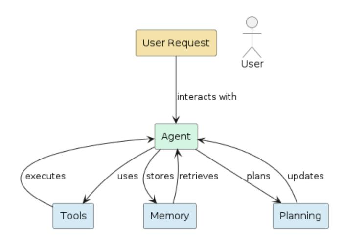
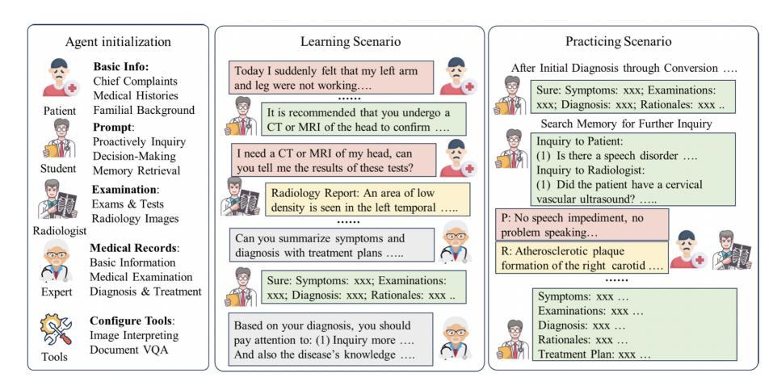

<!-- Source: AgenticLargeLanguageModels.pdf; physical PDF pages 263-276; Marker split PDF pages 1-14. -->

{0}------------------------------------------------

## 第 13 章

# 从工具到助手：实际应用

#### 你将学到的内容

本章介绍智能体大语言模型如何从工具调用进一步发展为能够完成实际任务的助手。读完后，你将能够：

- 说明助手如何超越问答，通过规划、检索与工具调用完成任务，并根据反馈调整行为。
- 比较购物、医疗、航空、金融、科学研究和软件开发等领域的助手架构。
- 解释高风险场景对安全性、透明度及合规性提出的额外要求。
- 批判性地评估助手的表现，并分析部署自主系统可能带来的伦理影响。

## 13.1 智能体大语言模型作为助手

LLM 的应用已不再局限于文本生成。结合推理、检索和工具调用，模型可以参与实际任务的执行。**智能体助手**是这种能力的一种软件实现：系统能够与用户和环境交互、规划步骤，并根据反馈调整后续行动。

助手将感知、推理与行动连接成工作流程。借助 API 和外部工具，它不仅能交流，还能处理任务并适应具体场景。交互过程也可能产生有价值的反馈数据，供后续系统改进与模型训练使用；相关数据的使用仍应遵守隐私及授权要求。
  
本章先讨论对话与购物助手，再依次介绍航空、医疗和金融等专用领域，最后考察面向科学发现与软件工程的智能体系统。

{1}------------------------------------------------

 
  
 图 13.1：AssistGPT 系统架构 [Neszlényi et al., 2024](#page-11-0) 
  
 

## 13.2 对话助手

最常见的应用是日常对话与行政协作，例如整理会议纪要、协助主持会议或处理一般事务。

这类系统主要借助 LLM 改善人机交互的自然度与流畅性 [Neszlényi et al., 2024](#page-11-0)；[Oluwagbade, 2024](#page-11-0)。例如，**AssistantGPT** [Neszlényi et al., 2024](#page-11-0) 面向教育与企业中的行政协作，可连接 Teams、Slack 等远程办公平台，支持网页搜索、OpenAPI 接口调用、语音对话及 Shell 命令执行。其架构由 LLM 与规划、记忆等组件组成（见图 13.1）。

已有研究在敏捷软件开发团队的会议中观察到助手的积极作用 [\[Cabrero-Daniel et al.,](#page-10-0) [2024\]](#page-10-0)，尤其体现在 Scrum 会议准备和实时辅助方面。不过，部分参与者也认为模型的介入不够自然、灵活性不足。

其他例子包括在协作学习课堂环境中使用 LLM 代理，其中 LLM 代理提高了参与者之间的整体协作 [\[Wei et al.,](#page-13-0) [2024b\]](#page-13-0)。另一项研究 [\[Bastola et al.,](#page-10-0) [2023\]](#page-10-0) 报告了在包括对话助手的协作任务调度实验中工作效率有所提高。一种略有不同的助手是思维助手。这类助手会通过提问而非直接回答，帮助人们反思复杂决策

{2}------------------------------------------------

[\[Park and Kulkarni,](#page-12-0) [2023\]](#page-12-0)。最近，一些大型LLM供应商也出现了类似的举措，例如OpenAI的ChatGPT中的*学习模式*和谷歌的Gemini应用程序。

对话助手通常建立在预训练 LLM 之上，并可按领域需求微调。系统也可以通过多个专用模型分工，或用不同提示步骤组织单个模型，以处理不同子任务。

## 13.3 购物助理

购物助手是理解智能体应用的一个直观案例：它不仅需要理解用户语言，还要连接产品目录、推荐系统与实时数据，并处理电子商务特有的约束。

**购物助手能做什么？** 基于 LLM 的购物助手可以理解需求、比较商品、提供推荐，并协助完成购买流程。为了让建议与真实商品相符，系统通常还要检索当前的产品信息，访问商品目录 API，连接推荐引擎，并根据价格、功能及其他约束评估备选方案。

**关键组成部分。** 仅凭通用语言模型的参数知识，难以可靠处理品牌、商品分类、具体规格和用户行为等领域问题。实用的购物助手通常需要以下能力：
 
- **检索增强**：动态获取商品元数据、价格和库存等信息。
- **工具与 API 调用**：连接商品数据库，执行搜索、筛选和排序。
- **领域适配**：通过微调或指令训练改善品牌术语、属性推理与意图识别。
- **结构化推理**：引导模型比较商品，分析价格、功能等取舍，并考虑用户偏好。

**购物助手基准测试。** 为了研究模型在购物领域任务中的表现，研究人员开发了基准测试。例如，*多任务在线购物基准数据集（ShopMMLU）* [\[Jin et al.,](#page-11-0) [2024\]](#page-11-0) 定义了 57 个任务，分为四项技能：概念理解、知识推理、用户行为匹配和多语言能力。该数据集利用真实世界的电子商务数据（亚马逊产品目录、会话和评论），并评估 LLM 处理
{3}------------------------------------------------

的方面，如品牌型号识别、产品兼容性推理、基于会话的推荐任务以及多语言查询。另一个例子是LLaSA系统（大型语言和电子商务购物助手）[\[Zhang et al.,](#page-13-0) [2024a\]](#page-13-0)，它通过一个名为*EshopInstruct*的指令数据集（65,000个样本）进行训练。在购物任务上的指令微调后，LLaSA在ShopBench基准测试中表现出色，显示出适应性显著提升了该领域的性能。

**实用建议。** 以下原则对构建购物助手非常重要：

- 一个有能力的助手将自然语言理解与领域推理结合起来。它应该知道“价格低于200欧元的降噪耳机，电池续航约20小时”意味着什么，并能够将其转化为产品属性和用户约束。
- 特定领域的数据很重要：现成的 LLM 在某种程度上有效，但在购物任务上进行微调或指令微调可以显著提高性能。LLaSA [\[Zhang et al.,](#page-13-0) [2024a\]](#page-13-0) 在实践中显示了这一点。
- 评估必须反映领域特点。对产品属性理解的准确性或生成查询的能力不如助理是否能与用户行为保持一致、处理多步骤会话以及支持多语言用户重要。
- 工具和检索整合很重要。助手必须作为产品系统的接口，而不仅仅是一个纯粹的语言模型。这会引入额外的复杂性（API设计、延迟、数据新鲜度以及处理整合错误）。
- 考虑伦理和信任。在购物中，推荐涉及商业、隐私和偏见的影响。在将此类系统投入生产之前，应通过以下问题评估这些问题：*显示了哪些品牌*、*用户历史是否正确处理*以及*推理过程有多透明*。

**挑战与开放问题。** 购物助手仍需处理长时间的会话历史，例如持续浏览、反复修改查询和临时改变购买意图。新产品、价格与库存变化也要求系统及时更新知识。除此之外，推荐理由的可解释性、跨语言查询及不同地区的商品差异，都是实际部署时需要解决的问题。

## 13.4 飞行操作助理

基于语言的助手也被应用于航空运营，这是一个超越消费者预订并进入规划和决策支持的领域。

{4}------------------------------------------------

 **预订和旅行规划。** 一个较简单的应用是对话式预订助手，类似于上一节中的购物助手。例如，[Manasa et al.](#page-11-0) [\[2024\]](#page-11-0) 展示了一个基于 LLaMa 2 并结合 RAG 的系统，用于互动式帮助用户预订航班。该助手经过航班预订数据的微调，并通过检索连接到当前的航班信息。用户测试在捕捉用户偏好和高效引导预订流程方面取得了很好的评分。

请注意，这个用例在操作复杂性上仍然相对浅显。助手处理结构化的用户意图（*我想在D日期从A飞到B*）、最新产品数据的检索、偏好获取以及响应生成。它尚未（或还未）深入涉及诸如动态航空交通限制或安全余量等问题。
  
 **操作决策支持。** 进入更高要求的环境，LLM基础的助手正被提议用于实际航班操作。我们讨论两个例子。

在 [Zhou et al.](#page-13-0) [\[2024\]](#page-13-0) 的一项研究中，抵达时段分配问题（即确定抵达飞机的降落顺序）被表述为一个语言建模任务。作者将调度的输入和输出编码为标记，并微调 LLM 以生成无冲突的降落序列。他们的实验表明，即使在传统方法难以应对的机场，该模型也能降低冲突率和总延误时间。

另一个操作问题是在环境危险下进行规划。[Tabrizian](#page-12-0) [et al.](#page-12-0) [\[2024\]](#page-12-0) 使用思维链在风险约束下支持航线或飞行计划生成。在这里，助理的任务不再只是*预订航班*，而是必须考虑约束（风、航线、飞机性能）并提出操作上可行的计划。
 
 **关键建议。** 这些研究展示了具有 LLM 的代理系统的几个重要方面：
 
- 工具/后端集成：在操作助理中，LLM不仅必须进行对话，还必须与飞行数据库、天气信息、航线引擎和时隙分配系统进行接口。这意味着需要实现工具调用、检索管道和决策逻辑。
- 在约束条件下的推理：这些助手必须处理组合或调度约束，生成计划，并应对实时不确定性（例如天气、跑道可用性）。到达时隙的例子就是一个很好的例子，其中LLM必须推理动态排序。
- 特定领域数据和微调：标准预训练LLM缺乏关于航空操作的先验知识。上述系统经过针对该领域的微调或特定提示。需要一个包含领域任务、提示、预期输出的数据集，以及为该领域量身定制的评估指标。
- 从对话代理到自主规划者：虽然预订助理仍然以用户为主（用户提出要求，助理提供帮助），但运营助理越来越多地承担规划角色。助理应处理诸如以下的请求

{5}------------------------------------------------

*这里有约束条件，提出一个时间表或路线*. 这一变化引发了信任、验证和可解释性的问题。

- 在真实环境中的评估：对操作系统的评估通常不仅涉及*助手是否回答了用户？*，还会衡量诸如冲突率、延迟时间和序列效率等方面。例如，抵达时隙 LLM 研究测量了总延迟和冲突率。

## 13.5 医疗助理

医学是基于 LLM 的助手最活跃的应用领域之一 [\[Thirunavukarasu et al.,](#page-12-0) [2023,](#page-12-0) [Clusmann et al.,](#page-10-0) [2023,](#page-10-0) [Mehandru et al.,](#page-11-0) [2024\]](#page-11-0)。最近的研究报告显示，LLM 在诊断任务上可以超越受过训练的医生 [\[Goh](#page-11-0) [et al.,](#page-11-0) [2024\]](#page-11-0)，并在临床病历生成方面超过人类医疗抄写员 [\[Yuan et al.,](#page-13-0) [2024\]](#page-13-0)。其他评估也证实了这些优势，同时也指出在特定临床场景中的系统性弱点 [\[Panagoulias et al.,](#page-12-0) [2024\]](#page-12-0)。

代理架构越来越多地用于应对监管、伦理和可用性要求。[Sudarshan et al.](#page-12-0) [\[2024\]](#page-12-0) 提出了一个代理工作流程，用于生成符合《21世纪治愈法案》的患者友好型医疗报告。他们的系统使用反思（第6.2.4节，[\[Shinn et al.,](#page-12-0) [2024\]](#page-12-0)）在信息发布给患者之前迭代地提高报告的清晰度和准确性。

其他研究探索了使用 LLM 代理进行更广泛的临床支持。[Qiu](#page-12-0) [et al.](#page-12-0) [\[2024\]](#page-12-0) 识别了从临床工作流程自动化到多代理诊断支持的应用，尽管在准确性、完整性和幻觉方面仍存在顾虑。[Ullah et al.](#page-12-0) [\[2024\]](#page-12-0) 的一项范围审查强调，在训练和微调这类系统时，医学领域知识和伦理约束是必不可少的。

为了减轻常见的故障模式，[Das et al.](#page-10-0) [\[2024\]](#page-10-0) 提出了一种基于代理检索的架构，其中 LLM 充当规划者而不是直接的答案生成器。该代理协调专门的工具从可信的医疗来源检索和综合证据，从而减少幻觉和“中间丢失”错误。

**高风险应用领域。** 医学是一个高风险应用领域，其中不正确或有偏差的输出可能直接影响患者安全。因此，医疗人工智能系统受到严格的监管框架约束，包括欧盟《人工智能法》，该法将许多医疗人工智能用途归类为高风险。因此，透明性、公平性和问责制在临床实践和医学 LLM 的学术研究中都起着核心作用。这些问题推动了对超越事后解释、旨在更深入理解模型行为的方法的兴趣增加。我们将在关于*机制可解释性*的章节（第21章）中回到这一主题，讨论分析和控制内部模型表示的技术。

在医学教育中，智能体系统被用于模拟真实的医学训练环境。[Wei et al., 2024a](#page-13-0) 介绍了一个多智能体助手，支持基于案例的学习和临床推理练习（见图 13.2）。

{6}------------------------------------------------

 
  
 图 13.2：医学教育助手 [Wei et al., 2024a](#page-13-0)

为了对医学检索增强生成进行系统评估，由 [Qiao et al.](#page-12-0) [\[2024\]](#page-12-0) 提供了专门的基准。

## 13.6 交易助理

另一个专门的领域是金融交易。已经有许多（非 LLM）算法被金融机构用于交易决策。金融界对智能体大语言模型的兴趣很大 [\[Ding et al.,](#page-10-0) [2024\]](#page-10-0)。

InvestorBench 是一个用于金融交易系统的基准 [\[Li et al.,](#page-11-0) [2024\]](#page-11-0)。FinAgent 是一个工具增强的多模态金融交易代理 [\[Zhang et al.,](#page-13-0) [2024b\]](#page-13-0)。它包含一个市场情报模块，能够从资产价格、多模态数据集的可视化表示、新闻和专家分析中提取洞察。该系统还可以执行查询检索，并在低级模块中进行技术分析反思，在高级模块中分析过去的交易决策。

FinRobot 是一个用于金融分析、协助人工交易员的智能体大语言模型 [Yang et al., 2024a](#page-13-0)，可提供文档分析和生成以及个股市场预测。FinMem 是一个为金融决策制定的智能体大语言模型框架 [\[Yu et al.,](#page-13-0) [2024\]](#page-13-0)。它具有分层记忆系统和可调的交易代理角色设计。FinMem 的灵感来自 [Park et al.](#page-12-0) [\[2023\]](#page-12-0) 的生成代理框架（见第 17.2.1 节和案例研究 4）。

到目前为止，大多数金融市场的机器学习研究都集中在单一代理系统上。一种称为*TradingAgents*的方法使用多代理系统来复制现实世界交易公司的协作动态 [\[Xiao et al.,](#page-13-0) [2024\]](#page-13-0)。TradingAgents 模拟了由 LLM 驱动的代理，担任专业角色，如基本面分析师、情绪分析师、技术分析师以及具有不同风险偏好的交易员。系统向人工经理提供买入或卖出建议；一项模拟显示，其表现优于基线模型。

{7}------------------------------------------------

  
 **评估。** 金融交易是一个具有挑战性的研究领域。金融交易中的竞争利益很高，并且有一种自然倾向是将重要的研究发现保密，这与科学研究的开放性和透明性原则产生了冲突。

此外，尽管该领域有大量可用的数值数据，但在相同数据上比较不同智能体大语言模型方法的基准研究却相对较少。一项近期的基准研究发现一些金融LLM研究存在方法上的缺陷，例如选择具有正向市场趋势的短期评估期，或训练数据中测试数据的泄露[\[Li et al.,](#page-11-0) [2026\]](#page-11-0)。

## 13.7 自动化科学发现

在某些科学领域，科学实验的工作流程相对标准化。例如，在机器学习中，(1) 产生想法，(2) 制定假设，(3) 设计实验，(4) 获取数据集，(5) 执行实验，(6) 解释结果，(7) 撰写报告。这一标准化工作流程吸引了研究人员使用智能体大语言模型进行科学研究，见 [Eger et al.](#page-11-0) [\[2025\]](#page-11-0) 的调查。

谷歌和 OpenAI 都发布了深度研究代理。这些代理能够执行多步骤的研究任务，例如综合在线信息。它们是用推理 LLM 构建的，并使用检索增强来查找信息来源。这些系统能够创建看起来很令人印象深刻的科学研究论文，但通常并非没有错误。

人工智能科学家 [\[Lu et al.,](#page-11-0) [2024\]](#page-11-0) 是一个框架，用于自动化科学发现的过程，从创意生成到论文写作，包括审稿过程。用户必须指定一个主题并提供实验模板，同时指明数据集。作者报告了机器学习三个领域的实验：扩散建模、基于变压器的语言建模以及学习动态，并取得了有希望的结果。为了改善创意生成和审稿，智能体可以访问开放资源。当前的限制包括实验数量有限、创意实现可能不正确以及论文生成时可能出现视觉错误。另一方面，整个结果被虚构的情况很少。然而，人工智能科学家的结果建议作为有前景创意的提示，值得进一步研究 [\[Lu et al.,](#page-11-0) [2024\]](#page-11-0)。

在 AI 科学家理念的基础上，提出了 Agent Laboratory [\[Schmidgall et al.,](#page-12-0) [2025\]](#page-12-0)，这是一个开源框架，利用专门的 LLM 基代理来加速完整的研究周期。与 AI 科学家不同，Agent Laboratory 明确设计为人类研究者的协同助手，补充而不是替代人类的创意。该框架由三个主要阶段组成：*文献综述*、*实验* 和 *报告撰写*。每个阶段由专门的代理执行，如博士、博士后和教授代理，并通过结构化流程进行协调。系统集成了两个专门组件：*mle-solver*，负责自主生成、测试和改进机器学习代码，以及 *paper-solver*。

{8}------------------------------------------------

 
  
 图 13.3：用于软件工程的 SWE-Agent [Yang et al., 2024b](#page-13-0) 
  
 两个求解器协同工作，可依据实验结果生成完整的 LaTeX 格式研究报告。它们通过迭代改进、自我评估和奖励评分，不断提升代码与报告的质量。
 
评估结果表明，Agent Laboratory 能够自主生成完整的研究项目，包括可执行代码和可发布的报告，其计算成本仅为同类系统的一小部分（使用 gpt-4o 后端每篇论文约 2.33 美元）。引入人工参与的循环或副驾驶模式进一步提高了研究质量和可用性，参与者报告了高度满意和持续使用意向。尽管如此，人工监督仍然必不可少，因为与人工审稿人相比，自动自评往往高估研究质量。

## 13.8 编码助手与一般进展

SWE-Agent（*软件工程代理*的缩写）[\[Yang et al.,](#page-13-0) [2024b\]](#page-13-0) 旨在自动化软件发现的过程，帮助代理自主使用计算机解决软件工程任务。SWE-agent 引入了创建和编辑代码文件、浏览软件仓库以及执行计算机程序的工具。在 HumanEvalFix 等编程基准上的实验取得了超过 80% 的高成功率。这一成功归因于代理的交互式设计（见图 13.3）。

MLGym [\[Nathani et al.,](#page-11-0) [2025\]](#page-11-0) 遵循流行的 Gym 强化学习框架 [\[Brockman et al.,](#page-10-0) [2016\]](#page-10-0)。Gym 提供了环境与智能体之间的标准化接口。它于2016年推出，加速了强化学习算法的发展，促进了这一领域的进步。从 SWE-agent（如文件编辑功能）获得进一步启发，MLGym 工作展示了科学发现过程如何被建模为一个互动过程。应用案例涉及从数据科学、博弈论、计算机视觉、强化学习到自然语言处理等多个领域。实验报告涉及商业 LLM（OpenAI、Meta、Google 及 Anthropic）。

大多数基于 LLM 的助手，包括研究和编码助手，都依赖预定义的工具，从而限制了它们的自主性和可扩展性。工具开发者 [Wölflein et al., 2025](#page-13-0) 通过使代理能够直接从科学论文及其代码仓库创建新工具来解决这一限制。给定任务描述和 GitHub URL，系统会安装依赖项、配置可复现的 Docker 环境，并通过迭代纠错与错误诊断来构建 Python 工具。

{9}------------------------------------------------

该系统在 TM-Bench（也由 [Wölflein et al., 2025](#page-13-0) 提出）上进行了评估，这是一个涵盖医学、生物学和人工智能的 15 个真实科学任务的基准。Toolmaker 实现了 80% 的任务成功率。其闭环设计不仅允许代理使用工具，还可以自主构建新工具，标志着向自我扩展的研究助理和自适应科学工作流程迈出了一步。

虽然像Agent Laboratory和Toolmaker这样的系统关注单个智能体的能力，但Agent Company [\[Xu et al.,](#page-13-0) [2024\]](#page-13-0)提供了一个全面的基准，用于评估LLM智能体在现实工作环境中的表现。它模拟了一家小型软件公司，其中智能体必须完成从软件开发和项目管理到财务和人力资源的专业任务，使用标准的数字工具，如浏览器、终端和通讯平台。

该基准包含175个任务，旨在测试多步骤推理、工具使用，以及与由LLM驱动的模拟同事的协作。每个任务分为检查点，用于衡量完全完成和部分完成的情况。对包括GPT-4o、Claude、Gemini和Llama在内的十二个基础模型进行的实验显示，即便是当前最强的系统，也只能自主完成约30%的任务。失败通常源于沟通能力的薄弱、长远规划能力不足以及复杂用户界面导航的困难。

通过引入一个可复现的、自主托管的环境，模拟现代工作场所，代理公司提供了一个评估智能体大语言模型成熟度的重要压力测试。它既突出了当前系统的快速进展，也揭示了其持续存在的局限性，强调了虽然数字化工作自动化触手可及，但真正的自主协作仍然是一个重大的研究前沿。

## 13.9 结语

本章展示了智能体大语言模型是如何被用作助手，与现实世界互动。助手不仅仅停留在被动回答问题上，而是向在对话、飞行操作、医学、教育和科学研究等领域的主动协作发展。它们会进行计划、检索信息、调用工具、反思结果并随着时间调整行为。因此，智能体大语言模型将语言模型的角色从孤立的推理引擎转变为更广泛社会技术系统的参与者。

**领域敏感性与风险。** 并非所有助手都在相同的约束下运作。高风险领域如医疗和航空对安全性、稳健性、透明度和公平性有严格要求，并受诸如《欧盟人工智能法案》等监管框架影响。在这些环境中，代理设计越来越依赖于检索、规划、验证和人工监督，而非端到端生成。学术研究也反映了这些关注点，越来越强调将评估、偏见分析和可解释性作为首要设计目标，而非事后考虑。

{10}------------------------------------------------

**实用建议。** 在构建助手时，落地（真实世界评估）非常重要。使用那些能让代理检索证据、证明行动合理性并在不确定情况下向人类请示（人类在环）的架构。将工具视为具有明确合同和故障模式的模块化组件。记录决策、计划和中间状态，以便进行调试和审计。在高风险领域，我们建议设计时考虑优雅降级；让代理请求澄清或选择回避，总比自信地出错要好。

**展望。** 具有代理能力的助手的未来在于推理、学习与控制之间的更紧密整合。进展将需要更丰富的认知结构、通过互动持续适应以及对安全性和伦理性提供更强的保证。这些目标直接与可解释性和透明度的进展相关。在后续章节，特别是在机制可解释性（第21章）中，我们将回到旨在打开黑箱、并更好地理解智能体大语言模型如何内部表示目标、计划和决策的技术。

## 参考文献

Ashish Bastola, Hao Wang, Judsen Hembree, Pooja Yadav, Nathan McNeese, and Abolfazl Razi. LLM-based smart reply (lsr): Enhancing collaborative performance with chatgpt-mediated smart reply system (acm)(draft) LLM-based smart reply (lsr): Enhancing collaborative performance with chatgpt-mediated smart reply system. *arXiv preprint arXiv:2306.11980*, 2023. [264](#page-1-0)

Greg Brockman, Vicki Cheung, Ludwig Pettersson, Jonas Schneider, John Schulman, Jie Tang, and Wojciech Zaremba. OpenAI Gym. *arXiv preprint arXiv:1606.01540*, 2016. [271](#page-8-0)

Beatriz Cabrero-Daniel, Tomas Herda, Victoria Pichler, and Martin Eder. Exploring human-ai collaboration in agile: Customised LLM meeting assistants. In *International Conference on Agile Software Development*, pages 163–178. Springer Nature Switzerland Cham, 2024. [264](#page-1-0)

Jan Clusmann, Fiona R Kolbinger, Hannah Sophie Muti, Zunamys I Carrero, Jan-Niklas Eckardt, Narmin Ghaffari Laleh, Chiara Maria Lavinia Löffler, Sophie-  Caroline Schwarzkopf, Michaela Unger, Gregory P Veldhuizen, et al. The future landscape of large language models in medicine. *Communications medicine*, 3(1): 141, 2023. [268](#page-5-0)

Rangan Das, K Maheswari, Shaheen Siddiqui, Nikita Arora, Ankush Paul, Jeet Nanshi, Varun Udbalkar, Apoorva Sarvade, Harsha Chaturvedi, Tammy Shvartsman, et al. Improved precision oncology question-answering using agentic LLM. *medRxiv*, pages 2024–09, 2024. [268](#page-5-0)

Han Ding, Yinheng Li, Junhao Wang, and Hang Chen. Large language model agent in financial trading: A survey. *arXiv preprint arXiv:2408.06361*, 2024. [269](#page-6-0)

{11}------------------------------------------------

Steffen Eger, Yong Cao, Jennifer D'Souza, Andreas Geiger, Christian Greisinger, Stephanie Gross, Yufang Hou, Brigitte Krenn, Anne Lauscher, Yizhi Li, et al. Transforming science with large language models: A survey on AI-assisted scientific discovery, experimentation, content generation, and evaluation. *arXiv preprint arXiv:2502.05151*, 2025. [270](#page-7-0)

Ethan Goh, Robert Gallo, Jason Hom, Eric Strong, Yingjie Weng, Hannah Kerman, Josephine A Cool, Zahir Kanjee, Andrew S Parsons, Neera Ahuja, et al. Large lan-  guage model influence on diagnostic reasoning: a randomized clinical trial. *JAMA Network Open*, 7(10):e2440969–e2440969, 2024. [268](#page-5-0)

Yilun Jin, Zheng Li, Chenwei Zhang, Tianyu Cao, Yifan Gao, Pratik Jayarao, Mao Li, Xin Liu, Ritesh Sarkhel, Xianfeng Tang, et al. Shopping mmlu: A massive multi-task online shopping benchmark for large language models. *arXiv preprint arXiv:2410.20745*, 2024. [265](#page-2-0)

Haohang Li, Yupeng Cao, Yangyang Yu, Shashidhar Reddy Javaji, Zhiyang Deng, Yueru He, Yuechen Jiang, Zining Zhu, Koduvayur Subbalakshmi, Guojun Xiong, et al. InvestorBench: A benchmark for financial decision-making tasks with LLMbased agent. *arXiv preprint arXiv:2412.18174*, 2024. [269](#page-6-0)

Weixian Waylon Li, Hyeonjun Kim, Mihai Cucuringu, and Tiejun Ma. Can LLM-based financial investing strategies outperform the market in long run? In *Proceedings of the 32nd ACM SIGKDD Conference on Knowledge Discovery and Data Mining V. 1*, pages 2711–2722, 2026. [270](#page-7-0)

Chris Lu, Cong Lu, Robert Tjarko Lange, Jakob Foerster, Jeff Clune, and David Ha. The ai scientist: Towards fully automated open-ended scientific discovery. *arXiv preprint arXiv:2408.06292*, 2024. [270](#page-7-0)

SA Manasa, Pankaj Agarwal, Goutam Pal, P Mahendra, Shankar Rao Pendyala, and Sachin Marge. Towards seamless air travel: Developing a next-generation flight booking assistant. *Journal of Electrical Systems*, 20(2):2558–2567, 2024. [267](#page-4-0)

Nikita Mehandru, Brenda Y Miao, Eduardo Rodriguez Almaraz, Madhumita Sushil, Atul J Butte, and Ahmed Alaa. Evaluating large language models as agents in the clinic. *NPJ digital medicine*, 7(1):84, 2024. [268](#page-5-0)

Deepak Nathani, Lovish Madaan, Nicholas Roberts, Nikolay Bashlykov, Ajay Menon, Vincent Moens, Amar Budhiraja, Despoina Magka, Vladislav Vorotilov, Gaurav Chaurasia, et al. MLGym: A new framework and benchmark for advancing ai research agents. *arXiv preprint arXiv:2502.14499*, 2025. [271](#page-8-0)

Kalm an Bal  azs Neszl  enyi, Alex Milos, and Attila Kiss. Assistantgpt: Enhancing user  interaction with LLM integration. In *2024 IEEE 22nd Jubilee International Symposium on Intelligent Systems and Informatics (SISY)*, pages 000619–000624. IEEE, 2024. [264](#page-1-0)

Elizabeth Oluwagbade. Conversational ai as the new employee liaison: LLM-powered chatbots in enhancing workplace collaboration and inclusion, 2024. [264](#page-1-0)

{12}------------------------------------------------

Dimitrios P Panagoulias, Maria Virvou, and George A Tsihrintzis. Evaluating LLM– generated multimodal diagnosis from medical images and symptom analysis. *arXiv preprint arXiv:2402.01730*, 2024. [268](#page-5-0)

Joon Sung Park, Joseph O'Brien, Carrie Jun Cai, Meredith Ringel Morris, Percy Liang, and Michael S Bernstein. Generative agents: Interactive simulacra of human behavior. In *Proceedings of the 36th annual acm symposium on user interface software and technology*, pages 1–22, 2023. [269](#page-6-0)

Soya Park and Chinmay Kulkarni. Thinking assistants: LLM-based conversational assistants that help users think by asking rather than answering. *arXiv preprint arXiv:2312.06024*, 2023. [265](#page-2-0)

Shuofei Qiao, Runnan Fang, Zhisong Qiu, Xiaobin Wang, Ningyu Zhang, Yong Jiang, Pengjun Xie, Fei Huang, and Huajun Chen. Benchmarking agentic workflow generation. *arXiv preprint arXiv:2410.07869*, 2024. [269](#page-6-0)

Jianing Qiu, Kyle Lam, Guohao Li, Amish Acharya, Tien Yin Wong, Ara Darzi, Wu Yuan, and Eric J Topol. LLM-based agentic systems in medicine and healthcare. *Nature Machine Intelligence*, pages 1–3, 2024. [268](#page-5-0)

Samuel Schmidgall, Yusheng Su, Ze Wang, Ximeng Sun, Jialian Wu, Xiaodong Yu, Jiang Liu, Michael Moor, Zicheng Liu, and Emad Barsoum. Agent laboratory: Using LLM agents as research assistants. *arXiv preprint arXiv:2501.04227*, 2025. [270](#page-7-0)

Noah Shinn, Federico Cassano, Ashwin Gopinath, Karthik Narasimhan, and Shunyu Yao. Reflexion: Language agents with verbal reinforcement learning. *Advances in Neural Information Processing Systems*, 36, 2024. [268](#page-5-0)

Malavikha Sudarshan, Sophie Shih, Estella Yee, Alina Yang, John Zou, Cathy Chen, Quan Zhou, Leon Chen, Chinmay Singhal, and George Shih. Agentic LLM workflows for generating patient-friendly medical reports. *arXiv preprint arXiv:2408.01112*, 2024. [268](#page-5-0)

Amin Tabrizian, Pranav Gupta, Abenezer Taye, James Jones, Ellis Thompson, Shulu Chen, Timothy Bonin, Derek Eberle, and Peng Wei. Using large language models to automate flight planning under wind hazards. In *2024 AIAA DATC/IEEE 43rd Digital Avionics Systems Conference (DASC)*, pages 1–8. IEEE, 2024. [267](#page-4-0)

Arun James Thirunavukarasu, Darren Shu Jeng Ting, Kabilan Elangovan, Laura Gutierrez, Ting Fang Tan, and Daniel Shu Wei Ting. Large language models in medicine. *Nature medicine*, 29(8):1930–1940, 2023. [268](#page-5-0)

Ehsan Ullah, Anil Parwani, Mirza Mansoor Baig, and Rajendra Singh. Challenges and barriers of using large language models (LLM) such as chatgpt for diagnostic medicine with a focus on digital pathology–a recent scoping review. *Diagnostic pathology*, 19 (1):43, 2024. [268](#page-5-0)

{13}------------------------------------------------

Hao Wei, Jianing Qiu, Haibao Yu, and Wu Yuan. Medco: Medical education copilots based on a multi-agent framework. *arXiv preprint arXiv:2408.12496*, 2024a. [268,](#page-5-0) [269](#page-6-0)

Rongxuan Wei, Kangkang Li, and Jiaming Lan. Improving collaborative learning performance based on LLM virtual assistant. In *2024 13th International Conference on Educational and Information Technology (ICEIT)*, pages 1–6. IEEE, 2024b. [264](#page-1-0)

Georg Wölflein, Dyke Ferber, Daniel Truhn, Ognjen Arandjelović, and Jakob Nikolas Kather. LLM agents making agent tools. *arXiv preprint arXiv:2502.11705*, 2025. [271,](#page-8-0) [272](#page-9-0)

Yijia Xiao, Edward Sun, Di Luo, and Wei Wang. TradingAgents: Multi-agents LLM financial trading framework. *arXiv preprint arXiv:2412.20138*, 2024. [269](#page-6-0)

Frank F Xu, Yufan Song, Boxuan Li, Yuxuan Tang, Kritanjali Jain, Mengxue Bao, Zora Z Wang, Xuhui Zhou, Zhitong Guo, Murong Cao, et al. The Agent Company: benchmarking LLM agents on consequential real world tasks. *arXiv preprint arXiv:2412.14161*, 2024. [272](#page-9-0)

Hongyang Yang, Boyu Zhang, Neng Wang, Cheng Guo, Xiaoli Zhang, Likun Lin, Junlin Wang, Tianyu Zhou, Mao Guan, Runjia Zhang, et al. FinRobot: An open-source ai agent platform for financial applications using large language models. *arXiv preprint arXiv:2405.14767*, 2024a. [269](#page-6-0)

John Yang, Carlos E Jimenez, Alexander Wettig, Kilian Lieret, Shunyu Yao, Karthik R Narasimhan, and Ofir Press. SWE-Agent: Agent-computer interfaces enable automated software engineering. In *The Thirty-eighth Annual Conference on Neural Information Processing Systems*, 2024b. [271](#page-8-0)

Yangyang Yu, Haohang Li, Zhi Chen, Yuechen Jiang, Yang Li, Denghui Zhang, Rong Liu, Jordan W Suchow, and Khaldoun Khashanah. FinMem: A performanceenhanced LLM trading agent with layered memory and character design. In *Proceedings of the AAAI Symposium Series*, volume 3, pages 595–597, 2024. [269](#page-6-0)

Dong Yuan, Eti Rastogi, Gautam Naik, Sree Prasanna Rajagopal, Sagar Goyal, Fen Zhao, Bharath Chintagunta, and Jeff Ward. A continued pretrained LLM approach for automatic medical note generation. *arXiv preprint arXiv:2403.09057*, 2024. [268](#page-5-0)

Shuo Zhang, Boci Peng, Xinping Zhao, Boren Hu, Yun Zhu, Yanjia Zeng, and Xuming Hu. LLaSA: Large language and e-commerce shopping assistant. *arXiv preprint arXiv:2408.02006*, 2024a. [266](#page-3-0)

Wentao Zhang, Lingxuan Zhao, Haochong Xia, Shuo Sun, Jiaze Sun, Molei Qin, Xinyi Li, Yuqing Zhao, Yilei Zhao, Xinyu Cai, et al. FinAgent: A multimodal foundation agent for financial trading: Tool-augmented, diversified, and generalist. *arXiv preprint arXiv:2402.18485*, 2024b. [269](#page-6-0)

Wentao Zhou, Jinlin Wang, Longtao Zhu, Yi Wang, and Yulong Ji. Flight arrival scheduling via large language model. *Aerospace*, 11(10):813, 2024. [267](#page-4-0)
