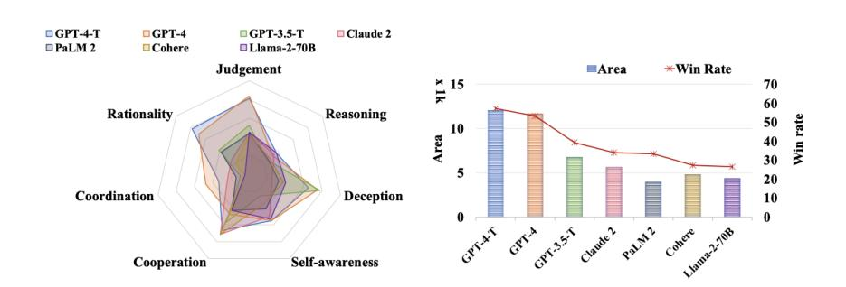
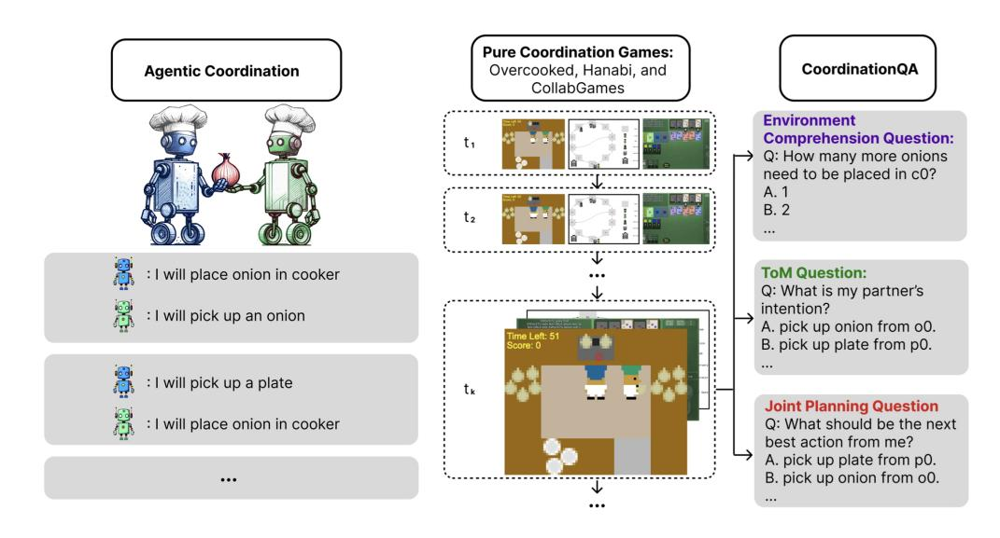
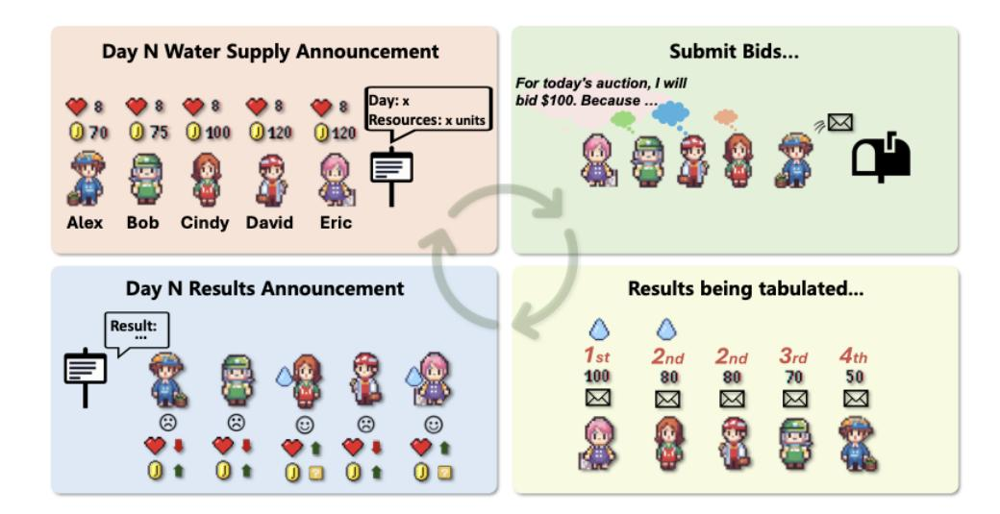
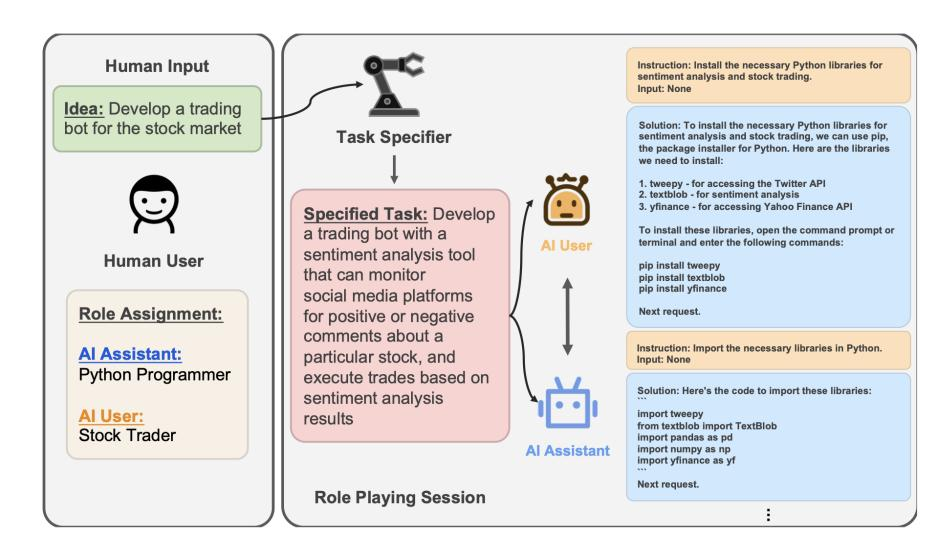
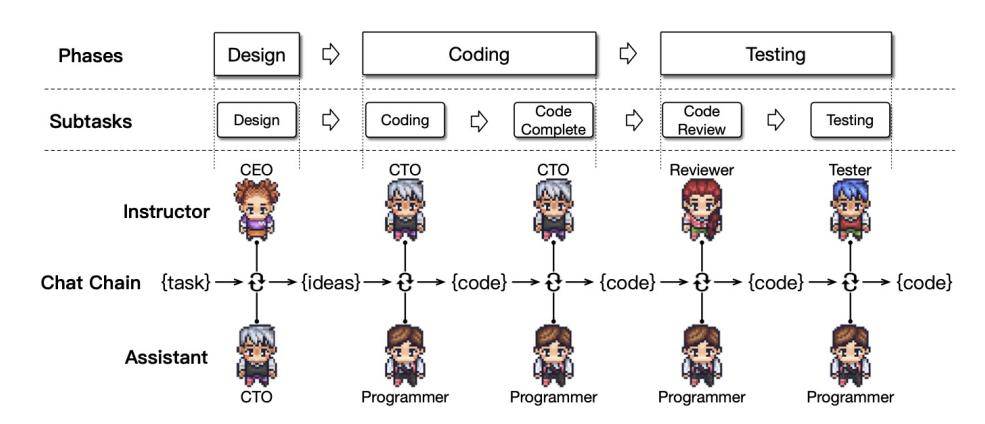
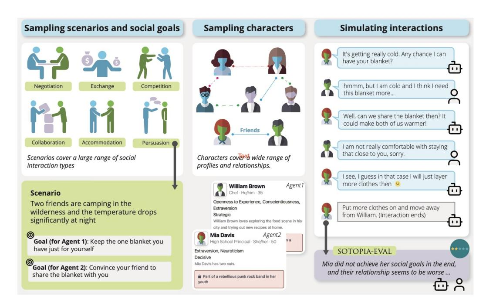

<!-- Source: AgenticLargeLanguageModels.pdf; physical PDF pages 317-334; Marker split PDF pages 1-18. -->

{0}------------------------------------------------

## 第 16 章 {#第16章}

# 多 LLM 系统中的基于角色的交互

#### 你将学到的内容

本章讨论多个 LLM 智能体在明确分工和交互协议下如何协作或竞争。学习后，你将能够：
- 区分**预设角色的多智能体协作**与**开放环境中的涌现式交互**（第 17 章）。
- 理解 LLM 智能体在**博弈论场景**中的合作、竞争和协调表现，并与第 15 章的单模型行为研究进行比较。
- 识别角色互补、讨论辩论、软件团队等**协作模式**及其实现框架。
- 评估多智能体架构何时能够改善结果、何时只是增加推理开销，以及新增的**错误传播和安全风险**。

## 16.1 从单一代理到多智能体

第 15 章主要考察单个模型如何回应社会、策略或道德情境。本章将观察对象扩展为**多个相互作用的智能体**：它们可能在博弈中竞争，也可能通过明确分工解决共同任务。研究的重点不再只是单个模型的行为，而是智能体之间的沟通方式、协调结果以及集体表现。

{1}------------------------------------------------

### 16.1.1 多智能体仿真：历史与现状

在计算社会科学中，使用人工智能代理来研究互动有着悠久的历史 [\[Epstein and Axtell,](#page-14-0) [1996,](#page-14-0) [Macal and North,](#page-15-0) [2010\]](#page-15-0)。传统上，具有基本感知、推理和决策能力的代理群体会在虚拟环境中，或者在基于机器人的模拟中，在真实实验环境中进行互动 [\[Steels,](#page-15-0) [1995,](#page-15-0) [Shoham and Leyton-Brown,](#page-15-0) [2008\]](#page-15-0)。此类模拟的目的通常是将理论与实验工作联系起来，利用人工行为作为关于人类行为的假设的试验场，尤其是在现实实验困难或成本高昂的领域。

历史上，有两个障碍限制了这一研究方向：难以验证行为是否真实，以及模拟代理社会的高计算成本。智能体大语言模型和模拟基础设施 [\[Rutherford et al.,](#page-15-0) [2024\]](#page-15-0) 的进展正在改变这一状况。基于 LLM 的代理能够使用自然语言进行交流，可以处理丰富的背景知识，并且可以赋予不同的角色，使模拟的互动更加生动，并且可以更直接地与人类互动进行比较。

### 16.1.2 基于角色的交互与新兴交互

多智能体研究可以按研究者预先规定的结构程度区分两种方向：在**角色驱动的系统**中，智能体被赋予具体身份、目标和通信协议，研究者比较这些设计如何影响系统表现；在**开放式仿真**中，研究者尽量减少预设角色，关注群体规范、关系与协作方式如何自发形成。本章聚焦前者，第 17 章讨论后者。

两者的评估方式也不同。角色驱动系统通常使用明确的任务指标，并把角色分配、拓扑与通信协议作为实验变量；开放式仿真则更侧重探索性观察。不过，这并非绝对区分：即便是预先定义角色的系统，也可能出现设计者未预期的集体行为。

### 16.1.3 多智能体协作的五个维度

为了比较不同系统，可以采用 [Tran et al.](#page-15-0) [\[2025\]](#page-15-0) 提出的五个协作维度：

1. **参与者**：由同一种模型的多个实例组成，还是由能力不同的异构模型组成。
2. **互动类型**：合作、竞争，或两者并存的竞合。

{2}------------------------------------------------

3. **系统结构**：点对点、集中式或分布式等组织方式。
4. **协作策略**：通过角色分工、提示或模型层面的机制引导行为。
5. **协调协议**：规范智能体之间何时、如何交换信息的机制。

分析框架时，可以逐项检查上述维度，避免只因“使用了多个模型”就将它们视为相同的系统。

### 16.1.4 方法学说明

多智能体评估不仅要处理提示敏感性、数据污染和采样波动，还面临额外的实验设计难题：

- **误差级联**：一个智能体的微小输出差异，可能沿后续通信链放大，增加运行结果的波动。
- **归因困难**：性能提升可能来自协作、协议设计、角色提示，也可能只是因为投入了更多模型调用和推理预算。
- **构念效度**：将模型之间的信息交换称为“团队合作”或“集体决策”，并不自动意味着其机制与人类协作相同。

考虑这些限制后，我们先研究对等智能体之间的战略博弈（第 16.2 节），再分析通过角色与协调协议组织的团队（第 [16.3](#page-6-0) 节）。

## 16.2 LLM 代理之间的战略互动

第 15 章主要介绍模型面对脚本化对手时的战略表现。本节进一步考察**由 LLM 驱动的智能体相互博弈**的情况：参与者处于相对对等的位置，各自根据目标选择策略，没有专门的协调者。我们先讨论跨游戏基准，再考察深入模拟单一情境的研究平台。

{3}------------------------------------------------

 
  
 图16.1：LLM在各种指标上的表现 [\[Xu et al.,](#page-16-0) [2024\]](#page-16-0) 

### 16.2.1 跨游戏战略能力基准测试

**MAgIC** [\[Xu et al.,](#page-16-0) [2024\]](#page-16-0) 通过“卧底”“变色龙”等社交推理游戏，以及成本分担、多人囚徒困境和公共物品博弈，评估模型的理性、判断、推理、欺骗、自我意识、合作与协调等能力（见图 16.1）。实验同时比较了基础模型与经过增强的智能体配置。

在该研究的测试设置下，GPT-o1 和 GPT-4 的整体表现较强。模型在部分判断、理性和合作指标上得分较高，但推理与协调任务仍暴露出明显短板。例外的是通过概率图模型增强的 GPT-o1，这是受 [Koller and Friedman](#page-14-0) [\[2009\]](#page-14-0) 启发，实现的一种类似心智理论的能力。作者表明，概率图模型在各方面都提升了 LLM 的表现。这与第 15.5 节讨论的一般证据一致，即人类在战略环境中高度依赖心智理论。

一个将协调作为研究对象而不是众多特质之一的基准是 LLM-协调基准 [\[Agashe et al.,](#page-13-0) [2025\]](#page-13-0)。LLM 在两个不同的任务中进行评估：纯合作游戏中的代理协调以及关于这些游戏的问题回答（见图 [16.2\)](#page-4-0)）。实验发现，只要决策可以依赖环境变量，LLM 代理表现良好，但当成功需要积极推理合作伙伴的信念和意图时，表现不佳。具体来说，这些环境变量包括游戏布局、物体位置、每个代理当前的位置、哪些门是开着的等等元素。最清晰的例子是 Overcooked-AI，这款游戏是 LLM 表现最好的游戏。这个游戏是完全可观察的，其动作空间包括诸如*从洋葱分配器1拿起一个洋葱*和*将洋葱放到盘子0上*的动作。在大多数场景和布局下，LLM只需要根据游戏环境的状态考虑下一步的最佳动作，而无需考虑其他代理的视角。

《Overcooked》与《Hanabi》的对比尤其能说明这一点：前者往往可以依据共享环境状态行动，后者则要求参与者推断队友掌握的信息及其信念。
{4}------------------------------------------------

 
  
 图16.2：摘自LLM协调基准[\[Agashe et al.,](#page-13-0) [2025\]](#page-13-0)的示意图，该基准使用两种方法评估代理协调能力：在纯协调游戏中的行为，在这些游戏中，代理必须合作以最大化收益（中间），以及关于这些游戏的详细问题（右侧） 

在《Overcooked》中，研究所用的零样本 LLM 智能体可以达到或超过某些经过专门训练的强化学习基线。然而，在《Hanabi》中，强化学习基线模型显示出接近完美的分数，而大多数 LLM 代理几乎无法得分。表现最佳的 LLM 代理（基于 GPT-4-turbo）即使在增强了明确的心智理论推理和自我验证步骤的情况下，也只能达到最大分数的约一半。如果没有这些增强，像 GPT-4-turbo 这样的强大模型的分数几乎完全崩溃，这表明所测得的能力部分是代理框架的特性，而不仅仅是模型本身的特性。LLM 代理在跨玩法中确实表现得更为稳健：强化学习方法在与未见过的伙伴一起游戏时性能急剧下降，而 LLM 代理的零样本特性使其能够在不损失性能的情况下转移到未见过的伙伴身上。

研究中的问答组件（见图16.2，右栏）通过分别针对环境理解、心理理论（ToM）和联合规划来分解问题。他们发现，LLM在第一类中得分普遍较高（最佳模型约80%），在心理理论方面得分较低，而在联合规划方面得分最差（最佳模型不到40%，开源模型甚至低于随机概率）。这与《Overcooked》（环境驱动）和《Hanabi》（心理理论和规划驱动）之间的得分差异一致。

纯合作游戏的关键特征是代理必须完全合作，彼此之间没有竞争动机。相比之下，在竞争环境中，例如 

{5}------------------------------------------------

 
  
 图16.3：奥运会水资源分配挑战游戏 [\[Mao et al.,](#page-15-0) [2023\]](#page-15-0) 
  
 像囚徒困境（或在MAgIC等基准测试中的混合动机游戏）一样，智能体在个人收益和集体收益之间面临真正的矛盾。在这种游戏中，当一个LLM未能合作时，原因并不明确。该智能体可能不擅长协调，*或者*它可能在策略上考虑个人收益。在纯合作游戏中，永远没有背叛的理由，所以任何未能合作都是真正的协调能力缺失。

### 16.2.2 单情景平台中的战略互动

基准测试汇总了许多小型游戏。另一条互补的研究路线是构建单一场景并深入研究智能体行为。
  
 Alympics [\[Mao et al.,](#page-15-0) [2023\]](#page-15-0) 提供了一个受控的实验场，用于模拟由 LLM 驱动的智能体之间的战略互动，其通过一个多轮水资源分配挑战进行说明，在该挑战中稀缺的生存资源必须随时间分配，见图16.3。

AucArena [\[Chen et al.,](#page-14-0) [2023a\]](#page-14-0) 在 LLaMa 2.13b、Mistral 7b、Mixtral 8x7b、Gemini 1.0 以及 GPT 3.5/4.0 上模拟拍卖，发现最有能力的 LLM（如 GPT-4）具备参与拍卖的技能，例如预算管理和目标专注，但即使是该模型，表现也有所不同，作者指出还有很大的改进空间。

### 16.2.3 结论

多个博弈基准都显示出类似的趋势：部分模型能够进行合理的局部决策，但在需要推断队友信息和意图的任务中，协调仍可能失败。
{6}------------------------------------------------

例如，在 MAgIC 的部分判断任务、AucArena 的预算管理，以及依赖可观察环境状态的合作游戏中，研究者观察到了较好的表现。但当协作依赖对伙伴信念与意图的推理时，许多配置仍然效果不佳。

换句话说，模型在将心理理论推理与其行为一致地结合方面存在失败。在第15章，这类失败被称为“知行或字面-功能差距”：GPT-4 在被提示预测巴赫或斯特拉文斯基的交替模式时可以准确回答，但在实际演奏时却未能体现。然而，这里回顾的多智能体研究使这一诊断变得复杂。在 LLM 协作基准测试的问题提问部分，有关联合规划的问题正好涉及代理在每一步游戏中面临的决策。模型在这些问题上的表现最差（在心理理论问题上也好不到哪里去）。问答得分与各游戏中代理表现呈正相关。换句话说，在这里，知道与行动是一起进行的：在模型表现不佳的地方，当直接向它们提出行动问题时，它们的推理也表现不佳。对于纯协调任务，这种缺陷因此在于采取伙伴的视角（心智理论）和联合计划本身，而非推理到行动的转化问题。

在不同的层面上，知行之间的差距重新出现。在 Hanabi 中，GPT-4-turbo 只有在通过明确的心智理论（ToM）推理和自我验证步骤进行支撑时，才能达到合理的表现。如果没有这些步骤，它在每一次 Hanabi 试验中都会犯致命错误。换句话说，它最初会行为错误，但在被提示检查推理和验证步骤时，它会认识到并纠正这些错误。在第15章讨论的战略行为研究中，概率图模型在 MAgIC 中和社会链式思维（Social Chain-of-Thought）也引起了类似的性能提升。*LLM 无法推理他人* 与 *LLM 不会自发使用这种推理*之间的界限显然很薄，而以结构化推理和验证步骤形式存在的能动嵌入可以发挥后者的作用。

下一部分将探讨对同一问题的另一种互补回应：与其提升代理的推理能力，不如通过分配角色来构建互动本身。

## 16.3 基于角色的任务解决与团队合作

上一节中的智能体没有专门分配协调职责，只能依靠各自的策略推理形成合作。本节讨论另一种思路：通过**预设角色与交互协议**降低协调难度。
 
 在第 [16.1.3,](#page-1-0) 节定义的五个维度中，这些研究在保持整体互动类型为合作的情况下，变化了*策略*和*结构*。我们从最简单的结构到最复杂的结构进行讨论：互补对、多方辩论、团队，以及压力下的社会角色扮演。

{7}------------------------------------------------

 
  
 图16.4：CAMEL 中的角色扮演 [\[Li et al.,](#page-14-0) [2023\]](#page-14-0) 

### 16.3.1 互补对

最简单的组织方式是让两个智能体承担互补职责，例如**生成者与评审者**、**经理与执行者**。双方依照各自目标交换信息，共同完成任务。

**CAMEL** [\[Li et al.,](#page-14-0) [2023\]](#page-14-0) 为两个 LLM 设定固定角色，使它们可以在无需人类持续提示的情况下协作完成编程等任务（见图 16.4）。系统通过角色描述和初始任务提示维持分工，再借助对话逐步拆解复杂工作。这类交互能够留下可供分析的协作轨迹，但轨迹本身不等于模型训练。

其他研究将一个 LLM 创作者（或生成器）与一个 LLM 评审者（或评论家）配对，在一个自我反思的环境中进行。在这种方式下，LLM 的生成能力通过一个代理得以利用，而另一个代理则负责执行规则或质量指南。宪法式 AI [\[Bai et al.,](#page-13-0) [2022\]](#page-13-0) 使用一个 LLM 对另一个 LLM 的回答根据一套伦理或质量指南进行批评，并提出修改建议。作者们表明，这种双代理反馈可以产生符合期望原则的经过改进的最终输出。

第三种成对互动形式遵循人类辅导的动态：教师-学习者或专家-新手。第 19.2章讨论了在蒸馏背景下这种结构的各种例子。
  
 这些互补角色的共同思路，是让一个智能体通过评价、指导或反馈帮助另一个智能体发现错误。

{8}------------------------------------------------

图16.5：ChatEval中的三种不同通信策略 [\[Chan et al.,](#page-14-0) [2023\]](#page-14-0) 
  
 具体效果还需要与相同预算下的单智能体方案比较，才能判断提升是否来自协作本身。

### 16.3.2 辩论与讨论

除了成对互动之外，基于角色互动的一个突出例子是使用 LLM 之间的辩论和讨论来提高推理能力和任务表现。

[Du et al.](#page-14-0) [\[2024\]](#page-14-0) 证明了，当多个 LLM 实例提出答案并通过多轮辩论相互批评彼此的推理时，它们可以达成更准确的共识答案，并具有更高的事实正确性。这种方法，用明斯基的心智社会 [\[Minsky,](#page-15-0) [1988\]](#page-15-0) 来描述，在数学应用题和事实问答等任务中显著减少了推理错误和幻觉。

[Liang et al.](#page-14-0) [\[2024\]](#page-14-0) 提出了一个多智能体辩论（MAD）设置，其中两个 LLM 代理在例如针锋相对的谈判中（参见第 15.4节）持相对立场，而第三个代理充当裁判。裁判的角色是引导讨论朝向最终解决方案。结构化的辩论鼓励发散性思维，并且可以推动经过 MAD 增强的较弱模型（如 GPT-3.5）在具有挑战性的基准测试中超越未使用 MAD 的更强模型（如 GPT-4）。作者讨论了他们的 MAD 设置如何克服已知的模型自我反思步骤支架问题。自我反思可能引发所谓的*思维退化*：一旦模型对某个解决方向产生信心，自我反思即使在方向错误的情况下也可能强化这种信心。在 MAD 辩论设置中，另一个代理可以朝不同的方向推动，以避免思维退化。

ChatEval 将这种辩论模式应用于文本评估 [\[Chan et al.,](#page-14-0) [2023\]](#page-14-0)。注意到当多个标注者合作时，人类文本评估的质量会提高，作者创建了一个多智能体裁判团队，由辩手代理、多样化的角色规格和不同的沟通策略组成（见图 16.5），超越了单代理提示策略。

另一种方法，同样受明斯基的心智社会理论启发，是 ReConcile，一个多智能体框架，设计为多样化 LLM 代理之间的圆桌会议 [\[Chen et al.,](#page-14-0) [2023b\]](#page-14-0)。该框架通过多轮讨论增强 LLM 代理之间的协作推理。代理需要通过讨论相互说服，以改进各自的答案。

{9}------------------------------------------------

七项基准测试的实验表明，基于置信度加权的投票机制显著提升了 LLM 的推理能力。此外，作者发现多样性（使用不同的基础模型）对性能至关重要。

MindStorms 引入了一个基于 LLM 的实现 [\[Zhuge et al.,](#page-16-0) [2023\]](#page-16-0) 在 CAMEL 框架 [\[Li et al.,](#page-14-0) [2023\]](#page-14-0) 上。报告了大量实验，最多 129 个代理解决常见的 AI 问题：视觉问答、图像描述、文本到图像生成、三维生成、自我中心检索、具身 AI，以及基于语言的一般任务解决。作者发现，在特定应用中，许多成员之间的 MindStorms 优于较少成员之间的 MindStorms，且较长的 MindStorms 优于较短的。

### 16.3.3 基于角色的软件团队

基于角色的协作的一个有趣应用是软件开发，在这种情况下，完全由 LLM 代理组成的模拟团队开发软件。

由 LLM 进行的自动化编程存在一些问题，例如逻辑不一致和在整个开发流程中蔓延的幻觉。MetaGPT [\[Hong et al.,](#page-14-0) [2024\]](#page-14-0) 建立在已经被人类软件团队验证有效的工作流程之上。该框架将标准操作规程（SOP）转换为提示序列，并为代理分配软件公司的角色：产品经理、架构师、工程师、QA 测试员。通过这种方式，代理将结构化的中间产物沿装配线传递。产品经理编写需求文档，架构师将其转化为设计，工程师进行编码。这样，复杂任务被分解为可管理的子任务，代理可以逐步验证流程，从而显著减少错误。

同样，[Qian et al.](#page-15-0) [\[2024\]](#page-15-0) 引入了 ChatDev，这是一个虚拟软件公司，其中代理通过开发过程的各个阶段协作：设计、编码和测试。协作被组织为一个*聊天链*：每个阶段被分解为导师与助手代理之间的简短对话（见图 [16.6\)](#page-10-0)）。使用一种通信协议，使代理在回应前先请求更多细节，会产生作者所称的*去幻觉化*，提高每个步骤的可靠性。该框架展示了如何通过自然语言的结构化沟通促进多智能体协作。

当 MetaGPT 和 ChatDev 固化特定的组织结构时，Auto-Gen [\[Wu et al.,](#page-15-0) [2024\]](#page-15-0) 提供了一个基于可定制代理之间对话的灵活编程框架，这些代理可以结合 LLM、工具和人类输入。它被设计为一个开源平台，使开发者能够根据具体应用定义代理和交互结构。实验表明其在数学、编码、问答、娱乐及其他领域的任务中都很有效。

### 16.3.4 社会角色扮演

上述讨论的系统分配角色以解决任务。最后一类工作是分配角色，以研究社会行为本身：当 LLM 代理被置于社交压力较大或存在冲突的情境中时，会出现什么行为？

{10}------------------------------------------------

 
  
 图 16.6：ChatDev 的链式工作流，展示由 ChatGPT-3.5 驱动的代理之间的多轮双边通信 [\[Qian et al.,](#page-15-0) [2024\]](#page-15-0) 
  
 

在 SOTOPIA [\[Zhou et al.,](#page-16-0) [2023\]](#page-16-0)中，代理会协调、协作并竞争，以实现复杂的社会目标。SOTOPIA 环境从 90 个自动生成的社会场景中抽取*互动情节*，构成规模大且多样的任务空间；这些场景包含 40 个角色，每个角色都有独特的个性、职业、秘密、背景故事及人际关系（图[16.7\)](#page-11-0)）。研究者使用不同的 LLM 驱动代理评估社会智能，并将结果与人类参与者进行比较，发现了以下趋势：

- 在涉及社会推理的静态基准测试（例如 ToMBench，参见第 15.5 节）上表现良好的模型，并不一定能在互动场景中取得成功，这再次说明了知行差距（第 15.4 节）。
- 较弱的代理会拖累对话伙伴；这与前文所述的互补效应相反——在后者中，代理能够相互纠正，减少思维生成过程中的错误。
- 泄露秘密和违反社会规范在所有模型中都有观察到，这与在道德行为背景下讨论的观察结果一致（第 15.6节）。
- 与即使是表现最好的模型（GPT-4）相比，人类在最具挑战性的SOTOPIA任务上的表现明显更好。

研究者认为，SOTOPIA 的动态互动特性给 LLM 代理带来了独特挑战，而静态基准测试往往无法揭示这些问题。
 
 在极端环境下的社会互动在 [\[Campedelli et al.,](#page-13-0) [2024\]](#page-13-0) 中进行了研究。受到臭名昭著的斯坦福监狱实验的启发，[\[Zimbardo,](#page-16-0) [1972\]](#page-16-0)，作者们在囚犯的环境中研究了劝说性和虐待行为的出现 

{11}------------------------------------------------

 
  
 图 16.7：SOTOPIA中具有冲突社会目标的情景示意图 [\[Zhou et al.,](#page-16-0) [2023\]](#page-16-0) 
 
{12}------------------------------------------------

与狱警的对抗。研究发现，囚犯和狱警的指定性格会影响说服力以及反社会行为的出现。关键在于，这表明通过角色分配和特定的互动环境，反社会行为可以在LLM 代理中出现。这揭示了与最初的人类参与实验的惊人相似之处，并再次提醒我们模型评判情况的方式（通常反映人口平均的道德规范）与代理在特定行动情境中可以表现的行为之间的差距（参见第 15.6节）。该研究还发现，角色分配并非中性工程工具：它可能以不当的方式塑造行为。

为了模拟合作环境下的战略决策，研究人员引入了 GovSim [\[Piatti et al.,](#page-15-0) [2024\]](#page-15-0)。他们研究了道德考量、战略规划和谈判技能如何影响合作结果。大多数 LLM 无法达到均衡，因为它们未能理解其行为对群体的长期影响。有趣的是，引入一种特殊的 *普遍化* 推理语言 [\[Levine et al.,](#page-14-0) [2020\]](#page-14-0)（促使模型提出康德问题：*如果每个人都这样做会怎样？*）使更多模型能够实现可持续的结果。类似的结果也在 NegotiationArena 中得以展示，该平台由 [Bianchi et al.](#page-13-0) [\[2024\]](#page-13-0) 引入。他们展示了 LLM 代理如何在谈判环境中通过灵活的对话进行复杂的谈判。通过采用不同的行为策略，灵活的对话显著改善了谈判结果。

### 16.3.5 结论

本节中的研究响应了第 15.4节中指出的协调弱点，这不是通过使单个代理成为更好的推理者（如第 15.5.2节所述）来实现的，而是通过围绕代理构建互动来实现的。互补角色告诉每个代理它应该做出的贡献，而互动协议和标准操作程序（SOP）则规范代理何时以及以何种形式进行交流。在某些设置中，法官或投票机制可以帮助将分歧引导向有成效的解决方案。

角色和交互协议提供了关键的支撑，否则内部协调可能会不足。这可以被视为第15章讨论的结构化推理方案的多智能体类比，例如社交链式思维、概率图或围绕道德规则的审议。这些方案在无约束推理不起作用的情况下证明可以提升性能。无论在单智能体还是多智能体场景中，模型都具备潜在的社交、道德等知识与能力；但要让这些能力发挥出来，仍需要明确的结构支撑。

## 16.4 结论性意见

本章从多智能体的战略博弈出发，逐步讨论角色互补、辩论与软件团队等协作方式，并检视这些方法的效果与局限。
  
 在第 15 章中，我们发现单个模型往往协调不佳：即使能在形式上预测合作伙伴的行为，也可能无法在代理实践中依据预测采取行动。这两种情况同样出现在多智能体场景中。在多智能体博弈研究中（如 [Xu et al., 2024](#page-16-0)；[Agashe et al., 2025](#page-13-0)），一些智能体虽然能够评估自身收益，却未必能够协调行动。{13}------------------------------------------------

核心挑战在于模型能否充分考虑其他参与者的视角，并据此调整自己的行动。这与第 15.5 节讨论的心智理论能力及知行差距相呼应。这也呼应了相关研究的发现：智能体之间的不对齐是多智能体系统的一类主要失效模式 [\[Cemri et al.,](#page-14-0) [2025\]](#page-14-0).

这一差距也涉及**构念效度**：心智理论测试中的高分不能直接证明模型拥有人类式社会认知；同样，多智能体系统优于一次 LLM 调用，也不能直接证明存在真正意义上的集体智能。强有力的基线、匹配的推理预算，以及对协作结构和交互协议的消融，将是第 15.5 节中讨论的扰动 ToM 测试在多智能体环境中的对应做法。在多智能体领域需要更多研究，以建立智能体大语言模型交互状态的可靠实证图景。

此外，多智能体设置也带来了新的风险类别。角色分配被发现可能在受斯坦福监狱实验启发的环境中激活反社会甚至虐待行为 [Campedelli 等，2024]。在其他研究中，协调不当、连锁幻觉和弱点相互强化，引发了规范违规、秘密泄露和任务表现下降。在某些情况下，明确角色和互动协议可以支撑行为并提高绩效，而在其他情况下，它们也可能成为障碍或风险来源。

在下一章中，我们将讨论那些角色和协议不是被分配的，而是从互动本身中产生的研究。

## 参考文献

Saaket Agashe, Yue Fan, Anthony Reyna, and Xin Eric Wang. Llm-coordination: evaluating and analyzing multi-agent coordination abilities in large language models. In *Findings of the Association for Computational Linguistics: NAACL 2025*, pages 8038–8057, 2025. [320,](#page-3-0) [321,](#page-4-0) 330

Yuntao Bai, Saurav Kadavath, Sandipan Kundu, Amanda Askell, Jackson Kernion, Andy Jones, Anna Chen, Anna Goldie, Azalia Mirhoseini, Cameron McKinnon, et al. Constitutional ai: Harmlessness from ai feedback. *arXiv preprint arXiv:2212.08073*, 2022. [324](#page-7-0)

Federico Bianchi, Patrick John Chia, Mert Yuksekgonul, Jacopo Tagliabue, Dan Jurafsky, and James Zou. How well can llms negotiate? negotiationarena platform and analysis. *arXiv preprint arXiv:2402.05863*, 2024. [329](#page-12-0)

Gian Maria Campedelli, Nicolo Penzo, Massimo Stefan, Roberto Dessì, Marco Guerini, Bruno Lepri, and Jacopo Staiano. I want to break free! persuasion and antisocial behavior of llms in multi-agent settings with social hierarchy. *arXiv preprint arXiv:2410.07109*, 2024. [327,](#page-10-0) 330

{14}------------------------------------------------

Mert Cemri, Melissa Z. Pan, Shuyi Yang, Lakshya A. Agrawal, Bhavya Chopra, Rishabh Tiwari, Kurt Keutzer, Aditya Parameswaran, Dan Klein, Kannan Ramchandran, Matei Zaharia, Joseph E. Gonzalez, and Ion Stoica. Why do multi-agent llm systems fail?, 2025. URL <https://arxiv.org/abs/2503.13657>. [330](#page-13-0)

Chi-Min Chan, Weize Chen, Yusheng Su, Jianxuan Yu, Wei Xue, Shanghang Zhang, Jie Fu, and Zhiyuan Liu. Chateval: Towards better llm-based evaluators through multi-agent debate. *arXiv preprint arXiv:2308.07201*, 2023. [325](#page-8-0)

Jiangjie Chen, Siyu Yuan, Rong Ye, Bodhisattwa Prasad Majumder, and Kyle Richardson. Put your money where your mouth is: Evaluating strategic planning and execution of llm agents in an auction arena. *arXiv preprint arXiv:2310.05746*, 2023a. [322](#page-5-0)

Justin Chih-Yao Chen, Swarnadeep Saha, and Mohit Bansal. Reconcile: Round-table conference improves reasoning via consensus among diverse llms. *arXiv preprint arXiv:2309.13007*, 2023b. [325](#page-8-0)

Yilun Du, Shuang Li, Antonio Torralba, Joshua B. Tenenbaum, and Igor Mordatch. Improving factuality and reasoning in language models through multiagent debate. In *Proceedings of the 41st International Conference on Machine Learning*, ICML'24. JMLR.org, 2024. [325](#page-8-0)

Joshua M Epstein and Robert Axtell. *Growing artificial societies: social science from the bottom up*. Brookings Institution Press, 1996. [318](#page-1-0)

Sirui Hong, Mingchen Zhuge, Jiaqi Chen, Xiawu Zheng, Yuheng Cheng, Ceyao Zhang, Jinlin Wang, Zili Wang, Steven Ka Shing Yau, Zijuan Lin, Liyang Zhou, Chenyu Ran, Lingfeng Xiao, Chenglin Wu, and Jürgen Schmidhuber. Metagpt: ¨ Meta programming for a multi-agent collaborative framework, 2024. URL [https:](https://arxiv.org/abs/2308.00352) [//arxiv.org/abs/2308.00352](https://arxiv.org/abs/2308.00352). [326](#page-9-0)

Daphne Koller and Nir Friedman. *Probabilistic Graphical Models: Principles and Techniques*. MIT Press, 01 2009. ISBN 978-0-262-01319-2. [320](#page-3-0)

Sydney Levine, Max Kleiman-Weiner, Laura Schulz, Joshua Tenenbaum, and Fiery Cushman. The logic of universalization guides moral judgment. *Proceedings of the National Academy of Sciences*, 117(42):26158–26169, 2020. [329](#page-12-0)

Guohao Li, Hasan Hammoud, Hani Itani, Dmitrii Khizbullin, and Bernard Ghanem. Camel: Communicative agents for" mind" exploration of large language model society. *Advances in Neural Information Processing Systems*, 36:51991–52008, 2023. [324,](#page-7-0) [326](#page-9-0)

Tian Liang, Zhiwei He, Wenxiang Jiao, Xing Wang, Yan Wang, Rui Wang, Yujiu Yang, Shuming Shi, and Zhaopeng Tu. Encouraging divergent thinking in large language models through multi-agent debate. In Yaser Al-Onaizan, Mohit Bansal, and Yun-Nung Chen, editors, *Proceedings of the 2024 Conference on Empirical Methods in Natural Language Processing*, pages 17889–17904,

{15}------------------------------------------------

Miami, Florida, USA, November 2024. Association for Computational Linguistics. doi: 10.18653/v1/2024.emnlp-main.992. URL [https://aclanthology.](https://aclanthology.org/2024.emnlp-main.992/) [org/2024.emnlp-main.992/](https://aclanthology.org/2024.emnlp-main.992/). [325](#page-8-0)

C M Macal and M J North. Tutorial on agent-based modelling and simulation. *Journal of Simulation*, 4(3):151–162, 2010. ISSN 1747-7786. doi: 10.1057/jos.2010.3. URL <https://doi.org/10.1057/jos.2010.3>. [318](#page-1-0)

Shaoguang Mao, Yuzhe Cai, Yan Xia, Wenshan Wu, Xun Wang, Fengyi Wang, Tao Ge, and Furu Wei. Alympics: Language agents meet game theory. *arXiv preprint arXiv:2311.03220*, 2023. [322](#page-5-0)

Marvin Minsky. *Society of mind*. Simon and Schuster, 1988. [325](#page-8-0)

Giorgio Piatti, Zhijing Jin, Max Kleiman-Weiner, Bernhard Scholkopf, Mrinmaya Sachan, and Rada Mihalcea. Cooperate or collapse: Emergence of sustainability behaviors in a society of llm agents. *arXiv preprint arXiv:2404.16698*, 2024. [329](#page-12-0)

Chen Qian, Wei Liu, Hongzhang Liu, Nuo Chen, Yufan Dang, Jiahao Li, Cheng Yang, Weize Chen, Yusheng Su, Xin Cong, Juyuan Xu, Dahai Li, Zhiyuan Liu, and Maosong Sun. ChatDev: Communicative agents for software development. In Lun-Wei Ku, Andre Martins, and Vivek Srikumar, editors, *Proceedings of the 62nd Annual Meeting of the Association for Computational Linguistics (Volume 1: Long Papers)*, pages 15174–15186, Bangkok, Thailand, August 2024. Association for Computational Linguistics. doi: 10.18653/v1/2024.acl-long.810. URL <https://aclanthology.org/2024.acl-long.810/>. [326,](#page-9-0) [327](#page-10-0)

Alexander Rutherford, Benjamin Ellis, Matteo Gallici, Jonathan Cook, Andrei Lupu, Gardhar Ingvarsson, Timon Willi, Akbir Khan, Christian Schroeder de Witt, Alexandra Souly, et al. Jaxmarl: Multi-agent rl environments and algorithms in jax. In *Proceedings of the 23rd International Conference on Autonomous Agents and Multiagent Systems*, pages 2444–2446, 2024. [318](#page-1-0)

Yoav Shoham and Kevin Leyton-Brown. *Multiagent systems: Algorithmic, gametheoretic, and logical foundations*. Cambridge University Press, 2008. [318](#page-1-0)

Luc Steels. A self-organizing spatial vocabulary. *Artificial life*, 2(3):319–332, 1995. [318](#page-1-0)

Khanh-Tung Tran, Dung Dao, Minh-Duong Nguyen, Quoc-Viet Pham, Barry O'Sullivan, and Hoang D Nguyen. Multi-agent collaboration mechanisms: A survey of llms. *arXiv preprint arXiv:2501.06322*, 2025. [318](#page-1-0)

Qingyun Wu, Gagan Bansal, Jieyu Zhang, Yiran Wu, Beibin Li, Erkang Zhu, Li Jiang, Xiaoyun Zhang, Shaokun Zhang, Jiale Liu, Ahmed Hassan Awadallah, Ryen W White, Doug Burger, and Chi Wang. Autogen: Enabling next-gen LLM applications via multi-agent conversation. In *ICLR 2024 Workshop on Large Language Model (LLM) Agents*, 2024. URL [https://openreview.net/forum?id=](https://openreview.net/forum?id=uAjxFFing2) [uAjxFFing2](https://openreview.net/forum?id=uAjxFFing2). [326](#page-9-0)

{16}------------------------------------------------

Lin Xu, Zhiyuan Hu, Daquan Zhou, Hongyu Ren, Zhen Dong, Kurt Keutzer, See Kiong Ng, and Jiashi Feng. Magic: Investigation of large language model powered multiagent in cognition, adaptability, rationality and collaboration. In *Proceedings of the 2024 Conference on Empirical Methods in Natural Language Processing*, pages 7315–7332, 2024. [320,](#page-3-0) [330](#page-13-0)

Xuhui Zhou, Hao Zhu, Leena Mathur, Ruohong Zhang, Haofei Yu, Zhengyang Qi, Louis-Philippe Morency, Yonatan Bisk, Daniel Fried, Graham Neubig, and Maarten Sap. Sotopia: Interactive evaluation for social intelligence in language agents, 2023. URL <https://arxiv.org/abs/2310.11667>. [327,](#page-10-0) [328](#page-11-0)

Mingchen Zhuge, Haozhe Liu, Francesco Faccio, Dylan R Ashley, Robert Csordás, Anand Gopalakrishnan, Abdullah Hamdi, Hasan Abed Al Kader Hammoud, Vincent Herrmann, Kazuki Irie, et al. Mindstorms in natural language-based societies of mind. *arXiv preprint arXiv:2305.17066*, 2023. [326](#page-9-0)

Philip G Zimbardo. *Stanford prison experiment: A simulation study of the psychology of imprisonment*. Philip G. Zimbardo, Incorporated, 1972. [327](#page-10-0)

{17}------------------------------------------------

