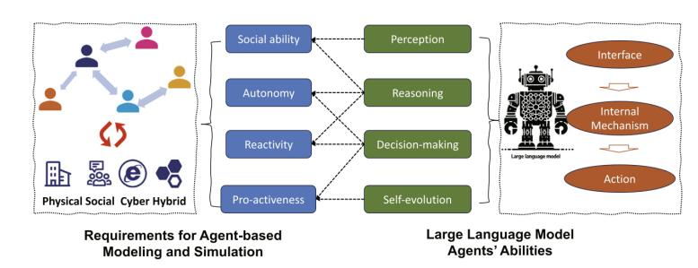
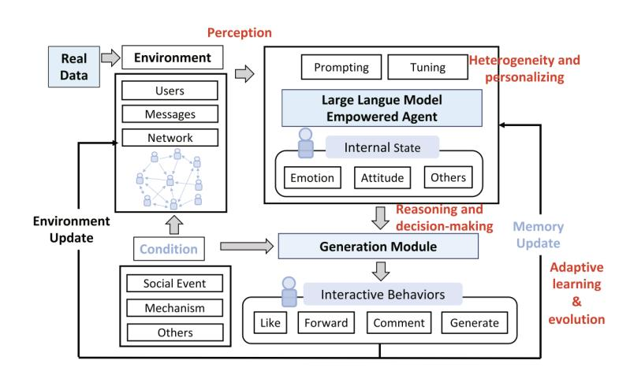
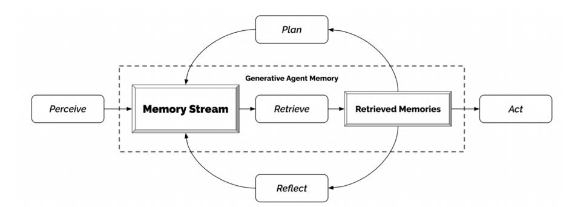
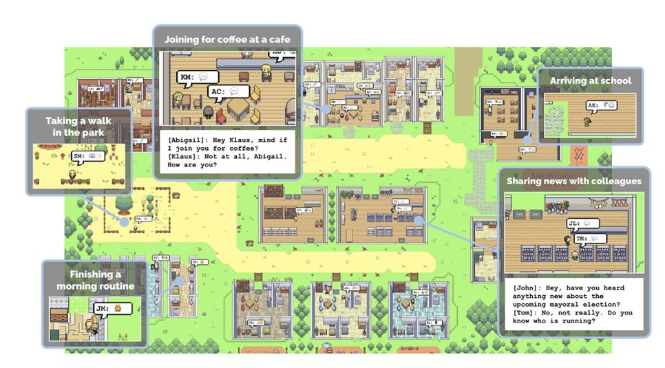
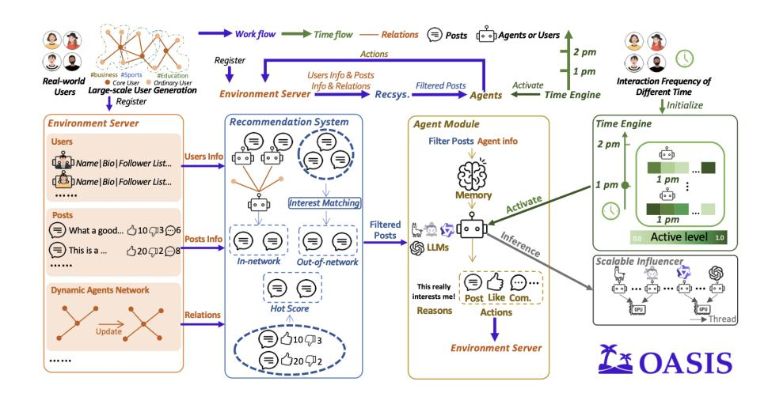
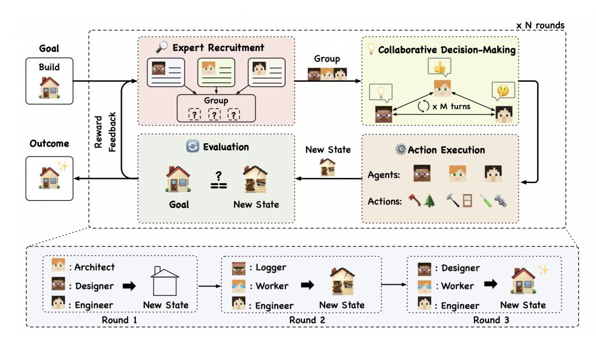
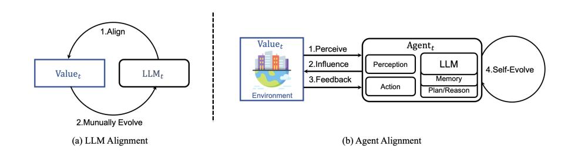
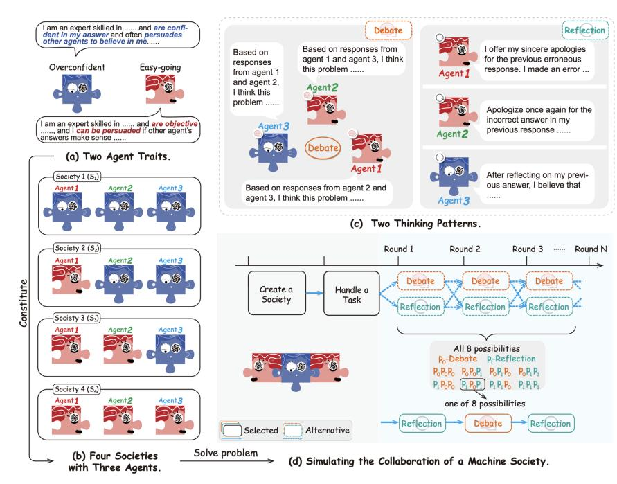

{0}------------------------------------------------

# Chapter 17

# Emergent Behavior in Multi-LLM Systems

#### What You Will Learn

In this chapter, you will learn how multiple LLM agents behave when they are *not* assigned roles, and how to study emergent behavior in open-ended systems. Specifically, you will be able to:

- Distinguish emergent multi-agent simulations from role-based interaction and explain why open-ended settings call for different *research questions and evaluation* methods.
- Describe the *architecture* of generative-agent simulations and how their infrastructure scales from a handful of agents to thousands.
- Explain how conventions, norms, and meta-norms emerge at the global level from local agent interactions in natural language.
- Explain how multi-agent simulation can serve as a *scientific instrument* in computational social science.
- Understand the importance of *open-world* benchmark environments for data generation.
- Critically assess claims about concepts carried over from human contexts, such as emergence, self-organization, and collective intelligence, and evaluate the *safety risks* of open-ended multi-agent systems.

#### 17.1 What Is Emergent Multi-Agent Behavior?

The previous chapter studied multi-LLM systems in which every agent had an assigned role and protocols guided their interactions. The research questions concerned behavior within a designed structure: how well could a team of agents solve a task under controlled conditions? Here, agents are placed in an open-ended environment, and the questions shift from *How do agents behave and perform within a given global structure?* to *What global structures emerge from local agent interactions?*

{1}------------------------------------------------

Figure 17.1: Agent-based Modeling and LLM Agents [\[Gao et al.,](#page-13-0) [2024\]](#page-13-0)

Figure 17.2: Structure of LLM Agents for Multi-Agent Modeling [\[Gao et al.,](#page-13-0) [2023\]](#page-13-0)

As discussed throughout this book, agentic LLMs have enhanced abilities in perception, memory, reasoning, decision-making, and adaptive learning, and can display diverse personality profiles [\[Gao et al.,](#page-13-0) [2023,](#page-13-0) [2024\]](#page-13-0). These features make them suitable for open-ended multi-agent simulations without prior role assignment, where they can serve as proxies for human behavior in a society. Because LLM agents communicate in natural language, researchers can read and interpret their interactions, including intermediate steps. Compared with simulations in classical frameworks, this makes them more comparable to human interaction and addresses a long-standing interest in the social sciences. Figures 17.1 and 17.2 show a general architecture for LLM agents designed for such simulations.

{2}------------------------------------------------

#### 17.1.1 From Agent-Based Modeling to Generative Agent Societies

The study of populations of interacting artificial agents has a decades-long history. In agent-based modeling, macro-level patterns and regularities arise bottom-up out of local interactions of simple agents [\[Epstein and Axtell,](#page-13-0) [1996,](#page-13-0) [Macal and North,](#page-14-0) [2010\]](#page-14-0). One of the most influential results in agent-based modeling was that cooperation and norms can emerge in populations of self-interested agents [\[Axelrod,](#page-12-0) [1986\]](#page-12-0). Cultural evolution theory formalized how behavior can spread through a population by means of imitation, communication, and education [\[Boyd and Richerson,](#page-12-0) [1988\]](#page-12-0). [Steels](#page-15-0) [\[1995\]](#page-15-0)'s *naming game* demonstrated that even shared vocabularies (which are also in essence conventions) can emerge from pairwise interactions without central coordination.

In classic agent-based simulations, agents followed hand-coded rules and exchanged abstract information, rather than using natural language like the agents in this chapter. Another key contrast is that classic agents possess no background knowledge of the world in any sense comparable to what LLM agents have. LLMs allow for an entirely different level of simulations in which agents with rich and diverse personas gossip, persuade, misunderstand, and negotiate in ways that are directly recognizable to humans. Advances in simulation infrastructure make it feasible to run such agents at population scale [\[Gao et al.,](#page-13-0) [2024,](#page-13-0) [Yang et al.,](#page-15-0) [2024\]](#page-15-0). The result is a new generation of *generative agent societies* that give a new impulse to the long-standing agent-based modeling research agenda, while also introducing novel methodological problems and considerations.

Section 16.1.3 introduced five dimensions for describing the degree of researcher control over multi-LLM systems [\[Tran et al.,](#page-15-0) [2025\]](#page-15-0). The difference between role-based and open-ended simulations is a matter of degree rather than kind. Open-ended simulations sit at one end of the spectrum, opposite interactions with predefined roles and protocols. Open-ended simulations still involve design choices that seed the outcomes, but they do so in a less deterministic way, purposefully leaving space for new patterns to emerge. This shifts the focus of the research: instead of evaluating performance on a task or clearly defined goal, studies have an open lens—the interaction pattern is the research goal. Open-ended simulations observe and explore in a more ethnographic way how agents behave and interact, which requires different methodologies, as we will now discuss.

#### 17.1.2 A Methodological Note

The methodological issues discussed in Chapters 15 and 16 all carry over to the open-ended setting: prompt sensitivity, run-to-run variability, cascading hallucinations, mutual reinforcement of weaknesses, and validity of terminology from the human context, all pose challenges for open-ended simulations. We will see that this setting amplifies some problems, while mitigating others. For example, in the absence of protocols that apply every time agents interact, small variations at the level of a single agent may put the entire simulation on a different track. This is what makes open-ended simulations both interesting and brittle. An example of a new issue that the open-ended setting introduces is that there can be a fine line between emergence and retrieval: when LLM 

{3}------------------------------------------------

agents in an open-ended simulation converge on a norm, it is unclear whether this norm emerges *de novo* from their interaction, or whether it was simply retrieved from their pretrained world knowledge.

Overviews of this emerging field are provided by [Mou et al.](#page-14-0) [\[2024\]](#page-14-0), [Savarimuthu et al.](#page-15-0) [\[2024\]](#page-15-0), and [Xi et al.](#page-15-0) [\[2023\]](#page-15-0). Section 17.2 reviews simulation infrastructure and platforms; Section [17.3](#page-7-0) covers conventions and norms; and Section [17.4](#page-10-0) discusses open-world environments. Section [17.5](#page-11-0) considers their risks. Chapter 18 provides a hands-on case study of an open-ended simulation.

#### 17.2 Simulation Infrastructure

Open-ended simulations require infrastructure that records research data while agents interact over extended periods. It must also leave enough room for bottom-up phenomena and unknown structures to emerge. In this section we focus on scale, going from a single simulated community inhabiting a virtual town to societies of a million agents.

#### 17.2.1 Small Worlds

A system called Generative Agents was introduced by [Park et al.](#page-14-0) [\[2023\]](#page-14-0). Generative Agents is an environment where users can interact with a simulated town populated by 25 LLM agents. Based on social simulacra techniques proposed earlier [\[Park](#page-14-0) [et al.,](#page-14-0) [2022\]](#page-14-0), each agent was initiated with a unique persona and memory. For each agent, a record is kept of all the experiences and conversations in the simulation. This record is used to synthesize higher-level reflections, and plan further behavior (see Figure [17.3\)](#page-4-0).

In Generative Agents, the agents behave somewhat like characters in the video game The Sims [\[Nutt and Railton,](#page-14-0) [2003\]](#page-14-0): they initiate conversations, form relationships, spread information, and coordinate ad hoc group activities (see Figure [17.4\)](#page-4-0). Note that the interactions are influenced by user input and are therefore semi-autonomous, the simulation is largely unscripted, but not fully. How a simulation works is illustrated by the example of a Valentine's Day party: the plan for the party was initiated with a user prompt, and subsequently multiple agents spread invitations to one another and show up at the right time with coordinated plans (some are late, just as in real life). The agents developed believable social routines (such as daily schedules, and gossiping) and even exhibit human-like character traits (some agents demonstrated deception or stubbornness, while others showed cooperation). These results show that, with the right starting prompt, social patterns can emerge from dynamic, semi-autonomous, LLM interactions.

{4}------------------------------------------------

Figure 17.3: The Memory–Reflection–Planning loop is the enabling design of the Generative Agents system: without retrieval over an ever-growing experience record and periodic reflection, agents lose coherence within hours of simulated time [\[Park et al.,](#page-14-0) [2023\]](#page-14-0)

Figure 17.4: Illustration of the Generative Agents simulation featuring 25 agents and an interactive design that allows users to set behavior in motion [\[Park et al.,](#page-14-0) [2023\]](#page-14-0)

{5}------------------------------------------------

Figure 17.5: Components of OASIS [\[Yang et al.,](#page-15-0) [2024\]](#page-15-0)

#### 17.2.2 Societies of Thousands to a Million Agents

Scaling the Generative Agents architecture beyond 25 agents raises questions about inference cost and environments that are rich enough to occupy thousands of agents.1 Large-scale social simulations require trade-offs among available computing power, total runtime, the number of agents, and the accuracy of individual agent behavior. Several platforms address these questions.

AgentSociety is a simulation at a large scale, involving over 10,000 agents [\[Piao](#page-14-0) [et al.,](#page-14-0) [2025b\]](#page-14-0). It couples LLM-driven agents with a realistic urban environment focused on mobility, employment, and consumption. It aims not only to study everyday social dynamics (as in Generative Agents), but also offers a testbed for computational social experiments. To allow for the required scale, the simulation runs on a distributed inference backend, with stricter control of agent behavior.

OASIS is a scalable social media simulator for Twitter/X and Reddit [\[Yang et al.,](#page-15-0) [2024\]](#page-15-0). It supports modeling of up to one million LLM agents. It is built on CAMEL [\[Li et al.,](#page-13-0) [2023\]](#page-13-0) and has role-based agents as its starting point. In OASIS, not every agent action involves an LLM call, and not all agents are active all the time. At its large scale, OASIS shows various social group phenomena, including spreading of (mis)information, group polarization, and herd effects. OASIS is built upon an environment server, recommender system, agent module, time engine, and scalable inferencer (see Figure 17.5).

Project Sid [\[Ahn et al.,](#page-12-0) [2024\]](#page-12-0) places up to 1000 agents in a Minecraft world and reports a striking emergence result: agents are observed to develop specialized economic roles (farmers, miners, guards), adhere to collectively adopted rules such as taxation,

1As you will experience hands-on in the next chapter, running a variant of the Generative Agents architecture with only three active agents is already computationally challenging.

{6}------------------------------------------------

and transmit cultural and even religious memes across settlements. However, even though the interactions were not scripted, the emergence–retrieval caveat discussed above applies here: the observed roles and behaviors may already be richly represented in the training data of the LLMs powering the individual agents.

#### 17.2.3 Simulation as a Scientific Instrument

Beyond showcasing scalable LLM technology, these platforms can support carefully designed computational social experiments. Generative-agent societies have been used to study long-standing social-science questions (Section [17.1](#page-0-0)). For example, AgentSociety has been used to examine the spread of inflammatory messages, polarization, the effects of universal basic income policies, and the impact of external shocks such as hurricanes [\[Piao et al.,](#page-14-0) [2025b,a\]](#page-14-0). Such experiments may be unethical, impractical, or impossible to run with human populations. The authors argue that simulations allow researchers to repeat experiments and modify them at every step.

[Li et al.](#page-13-0) [\[2024b\]](#page-13-0) further illustrate the approach for misinformation. Their agents exhibit diverse profiles in terms of gender, age, and the big five personality traits.2 One finding was that encouraging comments did not significantly reduce misinformation, whereas publicly labeling information with accuracy scores and blocking specific influencers proved effective, particularly in scale-free networks [\[Barabási](#page-12-0), [2009\]](#page-12-0). This research pattern is typical: researchers implement a candidate intervention by changing the simulated platform, then measure its macro-level effects across many runs. Whether those effects transfer to human populations is a question of validity, discussed in Section [17.1.2](#page-2-0). Such simulations are best treated as tools for generating hypotheses and conducting preliminary tests, not as substitutes for field experiments.

AgentVerse [\[Chen et al.,](#page-13-0) [2023\]](#page-13-0) is a borderline case: strictly speaking, it is a role-based system of the kind studied in Chapter 16. Problem solving in AgentVerse proceeds through four stages—expert recruitment, collaborative decision-making, action execution, and evaluation—repeated until the result is satisfactory (Figure [17.6\)](#page-7-0). It is relevant here because agents also display behavior *beyond* the design, including volunteering to help peers and conforming by adjusting deviant behavior in response to criticism. Destructive behavior was observed as well, sometimes leading to harmful outcomes. The emergence of macro-scale behavior in a role-scripted simulation shows that the distinction between role-based and emergent systems is a spectrum: even tightly protocolized systems can display behavior that nobody deliberately designed. We return to the associated risks in Section [17.5](#page-11-0).

2Also known as OCEAN: Openness, Conscientiousness, Extraversion, Agreeableness, and Neuroticism.

{7}------------------------------------------------

Figure 17.6: Four Stages for Decision Making in AgentVerse [\[Chen et al.,](#page-13-0) [2023\]](#page-13-0)

#### 17.3 Emergent Conventions and Norms

Several open-ended multi-agent simulations have exhibited emergent patterns. This section shifts the focus from infrastructure and interaction to conventions and norms.

EvolutionaryAgent [\[Li et al.,](#page-13-0) [2024a\]](#page-13-0) studies agent alignment in a multi-agent system, with evolutionary methods that go beyond Reinforcement Learning from Human Feedback (see Figure [17.7\)](#page-8-0). EvolutionaryAgent follows a controlled approach to norm emergence: it does not permit the evolution of social norms to be disorderly or random, but it also does not intervene in each step of their evolution. The authors define initial social norms and a desired direction for their evolution. Agents with higher fitness (more norm-conforming) are more likely to reproduce, leading to the diffusion of their strategies, gradually stabilizing and forming new social norms. Defining a complete, realistic, and complex virtual society is challenging. The study asks how a system could enable intricate agent behaviors in such a virtual society and how those behaviors might give rise to new dynamics. The system provides a sandbox for investigating AI safety before these systems affect the real world.

Based on [Steels](#page-15-0) [\[1995\]](#page-15-0)'s naming game, different approaches were implemented, using agents powered by LLaMa 3 and Claude 3.5 [\[Kouwenhoven et al.,](#page-13-0) [2024,](#page-13-0) [Ashery](#page-12-0) [et al.,](#page-12-0) [2024,](#page-12-0) [Baronchelli,](#page-12-0) [2023\]](#page-12-0). These studies found that globally accepted conventions (or norms) can spontaneously arise from local interactions between communicating LLMs. The authors also show how strong collective biases can emerge during

{8}------------------------------------------------

Figure 17.7: Overview of EvolutionaryAgent [\[Li et al.,](#page-13-0) [2024a\]](#page-13-0)

this process, even when individual agents appear to be unbiased, and how minority groups of committed LLMs can drive social change by establishing new social conventions that can overturn established behaviors.

The emergence of norms is studied at another level by [Horiguchi et al.](#page-13-0) [\[2024\]](#page-13-0), who explore the potential for LLM agents to spontaneously generate and adhere to normative strategies, building upon the foundational work of Axelrod's *metanorm* games. Metanorms are norms about enforcing norms: the punishment of those who do not punish agents that are breaking norms [\[Axelrod,](#page-12-0) [1986\]](#page-12-0). Controlling for the personality traits *vengefulness* and *boldness*, they find that through dialogue, LLM agents can form complex social norms, such as meta-norms, purely through natural language interaction. A related study by [He et al.](#page-13-0) [\[2024\]](#page-13-0) evaluates the capability of LLMs to detect norm violations. Using simulated data from 80 household stories, they tested whether 10 norms had been violated. GPT-4 detected norm violations, while Mistral lagged behind.

[Qiu et al.](#page-14-0) [\[2024\]](#page-14-0) go beyond norms to study LLM agents’ cultural and social awareness. They introduce CASA, a benchmark designed to assess LLM agents' sensitivity to cultural and social norms across two web-based tasks: online shopping and social discussion forums. (CASA is based on WebArena [\[Qi et al.,](#page-14-0) [2024\]](#page-14-0).) Current LLMs perform significantly better in non-agentic than in agentic web environments; agents achieve less than 10% awareness coverage and violate norms in more than 40% of cases. However, using prompting and fine-tuning on specific datasets, cultural and social awareness can be improved.

Inspired by Minsky’s Society of Mind [\[Minsky,](#page-14-0) [1988\]](#page-14-0), [Zhang et al.](#page-15-0) [\[2023\]](#page-15-0) explored cooperation mechanisms in an agentic LLM simulation. This simulation consists of four different societies of LLM agents, where each agent is characterized by a specific trait (easy-going or overconfident) and engages in cooperation with a distinct thinking pattern (debate or reflection). They found that LLM agents displayed human-like social behaviors, including conformity and consensus-building, consistent with foundational social psychology theories. Figure [17.8](#page-9-0) illustrates the societies with different types of agents.

Whether groups of LLM agents can collaborate and debate across national contexts was studied by [\[Baltaji et al.,](#page-12-0) [2024\]](#page-12-0).

{9}------------------------------------------------

Figure 17.8: Agents with Different Traits Make Up Diverse Machine Societies [\[Zhang et al.,](#page-15-0) [2023\]](#page-15-0)

Multi-agent discussions can support collective AI decisions that reflect diverse perspectives, although agents are susceptible to conformity due to perceived peer pressure. They can also lose track of their personas and opinions. Instructions that encourage debate increase the risk of errors.

{10}------------------------------------------------

#### 17.4 Evaluating Agents in Open-World Environments

One motivation for agentic LLM research is that performance may plateau when training data is limited. Open-world multi-agent interaction aims to address this problem by generating data through multi-agent simulations. Machine-learning systems cannot acquire more complexity than their datasets or environments contain. An open-world model aims to create effectively unlimited datasets or environments in which agents can continue learning and improving. How can such ongoing challenges be created? LLMs have renewed interest in this question. One example is the multi-agent fine-tuning approach [\[Subramaniam et al.,](#page-15-0) [2025\]](#page-15-0).

Current agents are primarily developed and tested in simplified synthetic environments, leading to a disconnect from real-world scenarios. [Zhou et al.](#page-16-0) [\[2023\]](#page-16-0) build an environment, WebArena, that is more realistic and reproducible. WebArena is an environment with fully functional websites from four common domains: e-commerce, social forum discussions, collaborative software development, and content management.

Games are also often used as benchmarks for interactive behavior. Real-world tasks require handling intricate interactions, advanced spatial reasoning, long-term planning, and continuous exploration of new strategies. BALROG [\[Paglieri et al.,](#page-14-0) [2025\]](#page-14-0), the system that we used for Case Study 2, incorporates planning environments of varying levels of difficulty, ranging from tasks that are solvable by non-expert humans in seconds to challenging ones that may take years to master (such as the NetHack Learning Environment). They find that while current models achieve partial success in the easier games, they struggle significantly with more challenging tasks such as vision-based decision-making.

Progress in machine learning depends on the availability of benchmarks. As models evolve, there is a need to create benchmarks that can measure progress on new generative capabilities [\[Butt et al.,](#page-12-0) [2024\]](#page-12-0). BENCHAGENTS decomposes the benchmark creation process into planning, generation, data verification, and evaluation, each of which is executed by an LLM agent. These agents interact with each other and utilize human-in-the-loop feedback to explicitly improve and flexibly control data diversity and quality. BENCHAGENTS creates benchmarks to evaluate capabilities related to planning and constraint satisfaction.

AgentBoard provides an evaluation of the breadth of existing benchmarks [\[Ma](#page-13-0) [et al.,](#page-13-0) [2024\]](#page-13-0). Benchmarks should have task diversity. It is necessary to cover various agent tasks such as embodied, web, and tool tasks. Additionally, multi round interaction is important, to mimic realistic scenarios. Existing benchmarks typically adopt single-round tasks. Furthermore, agents should be evaluated in partially observable environments, to test if they can actively explore their surroundings. Existing agent 

{11}------------------------------------------------

benchmarks fail to satisfy all of these criteria [\[Ma et al.,](#page-13-0) [2024\]](#page-13-0).

Research on open-world environments is related to curriculum learning. Pre-LLMs work already shows that agent societies may create an automated curriculum of ever increasing difficulty [\[Elman,](#page-13-0) [1991,](#page-13-0) [Bengio et al.,](#page-12-0) [2009,](#page-12-0) [Silver et al.,](#page-15-0) [2017,](#page-15-0) [Soviany et al.,](#page-15-0) [2022\]](#page-15-0), requiring increasing levels of intelligent behavior from the agents [\[Racaniere](#page-15-0) [et al.,](#page-15-0) [2019\]](#page-15-0). Similar results have been observed for LLMs [\[Feng et al.,](#page-13-0) [2023\]](#page-13-0). For example, WebArena is used to study self-evolving curricula [\[Qi et al.,](#page-14-0) [2024\]](#page-14-0), which can also help robot training [\[Ryu et al.,](#page-15-0) [2024\]](#page-15-0) or to mitigate hallucination [\[Zhao et al.,](#page-15-0) [2024\]](#page-15-0).

#### 17.5 Risks of Emergent Behavior

Chapter 16 closed by noting that role assignment introduces risk, since agents may display unintended, even anti-social, behavior simply by playing a part too well. The open-ended setting arguably raises the stakes, since fewer safeguards are built in, and undesirable behavior can arise bottom-up from interaction dynamics. In a sense, this anti-social behavior should not be too surprising, when we remember that the goal of the earliest multi-agent simulations was to find out if cooperative behavior could ever emerge out of the interaction between self-interested agents—which, to the surprise of the researchers, happened, but only under the right circumstances [\[Axelrod,](#page-12-0) [1981\]](#page-12-0). The boundary between cooperative and competitive behavior is thin.

AgentVerse observed destructive behaviors emerging alongside cooperative ones, occasionally leading to detrimental outcomes [\[Chen et al.,](#page-13-0) [2023\]](#page-13-0). The naming-game studies showed that strong collective biases can emerge from populations of individually unbiased agents, and that small committed minorities can overturn established conventions [\[Ashery et al.,](#page-12-0) [2024,](#page-12-0) [Kouwenhoven et al.,](#page-13-0) [2024\]](#page-13-0). These mechanisms are neutral in themselves but could be exploited by agents that are not well-intended. At platform scale, OASIS and AgentSociety reproduce misinformation spread, group polarization, herding effects, and the propagation of toxic content [\[Yang et al.,](#page-15-0) [2024,](#page-15-0) [Piao](#page-14-0) [et al.,](#page-14-0) [2025a\]](#page-14-0); the same fidelity that makes these simulations scientifically useful makes them *in principle* rehearsal spaces for manipulation strategies.

One constructive response is to use these risks to guide safety research. EvolutionaryAgent frames its virtual society explicitly as a sandbox for investigating AI safety before such systems affect the real world [\[Li et al.,](#page-13-0) [2024a\]](#page-13-0). If norms among agents can be steered toward a desired direction in simulation, then the same machinery can be used to stress-test alignment approaches under population dynamics rather than in isolation. Open-ended simulation can be used to understand the circumstances when risks first emerge, and to study defenses against these risks at low cost.

#### 17.6 Concluding Remarks

We have covered open-ended multi-LLM simulations without prior role assignment. These simulations renew longstanding social-science efforts to model self-organizing behavior and collective intelligence, and to understand how social conventions and norms develop. {12}------------------------------------------------

 The scale of such simulations varies from a few interacting agents up to a million.

The availability of infrastructure that supports large-scale simulations enables further studies. However, an open question is to what extent autonomous simulations are truly open-ended, and not influenced by the LLM prompts and agent scaffolding. Furthermore, although the purpose of open-ended simulations is to observe emerging behavior, behavioral patterns must be interpreted with care. All LLM agents are pretrained on human-generated data. It is difficult to distinguish which elements of behavior emerge from agent-to-agent interaction, and which elements are merely the result of retrieved pretrained behaviors.

# Bibliography

Andrew Ahn, Nic Becker, Stephanie Carroll, Nico Christie, Manuel Cortes, Arda Demirci, Melissa Du, Frankie Li, Shuying Luo, Peter Y Wang, Mathew Willows, Feitong Yang, and Guangyu Robert Yang. Project Sid: Many-Agent Simulations Toward AI Civilization, 2024. URL <https://arxiv.org/abs/2411.00114>. [340](#page-5-0)

Ariel Flint Ashery, Luca Maria Aiello, and Andrea Baronchelli. The dynamics of social conventions in LLM populations: Spontaneous emergence, collective biases and tipping points. *arXiv preprint arXiv:2410.08948*, 2024. [342,](#page-7-0) [346](#page-11-0)

Robert Axelrod. The emergence of cooperation among egoists. *American political science review*, 75(2):306–318, 1981. [346](#page-11-0)

Robert Axelrod. An evolutionary approach to norms. *American political science review*, 80(4):1095–1111, 1986. [337,](#page-2-0) [343](#page-8-0)

Razan Baltaji, Babak Hemmatian, and Lav R Varshney. Conformity, confabulation, and impersonation: Persona inconstancy in multi-agent LLM collaboration. *arXiv preprint arXiv:2405.03862*, 2024. [343](#page-8-0)

Albert-László Barabási. Scale-free networks: a decade and beyond.  *Science*, 325 (5939):412–413, 2009. [341](#page-6-0)

Andrea Baronchelli. Shaping new norms for artificial intelligence: A complex systems perspective. *arXiv preprint arXiv:2307.08564*, 2023. [342](#page-7-0)

Yoshua Bengio, Jérôme Louradour, Ronan Collobert, and Jason Weston. Curriculum learning. In *Proceedings of the 26th annual international conference on machine learning*, pages 41–48, 2009. [346](#page-11-0)

Robert Boyd and Peter J Richerson. *Culture and the evolutionary process*. University of Chicago press, 1988. [337](#page-2-0)

Natasha Butt, Varun Chandrasekaran, Neel Joshi, Besmira Nushi, and Vidhisha Balachandran. Benchagents: Automated benchmark creation with agent interaction. *arXiv preprint arXiv:2410.22584*, 2024. [345](#page-10-0)

{13}------------------------------------------------

Weize Chen, Yusheng Su, Jingwei Zuo, Cheng Yang, Chenfei Yuan, Chen Qian, Chi-Min Chan, Yujia Qin, Yaxi Lu, Ruobing Xie, et al. AgentVerse: Facilitating multi-agent collaboration and exploring emergent behaviors in agents. *arXiv preprint arXiv:2308.10848*, 2(4):5, 2023. [341,](#page-6-0) [342,](#page-7-0) [346](#page-11-0)

Jeffrey L Elman. Incremental learning, or the importance of starting small. In *Proceedings of the Annual Meeting of the Cognitive Science Society*, volume 13, 1991. [346](#page-11-0)

Joshua M Epstein and Robert Axtell. *Growing artificial societies: social science from the bottom up*. Brookings Institution Press, 1996. [337](#page-2-0)

Tao Feng, Zifeng Wang, and Jimeng Sun. Citing: Large language models create curriculum for instruction tuning. *arXiv preprint arXiv:2310.02527*, 2023. [346](#page-11-0)

Chen Gao, Xiaochong Lan, Zhihong Lu, Jinzhu Mao,

Jinghua Piao, Huandong Wang, Depeng Jin, and Yong Li. π3 : Social-network simulation system with large language model-empowered agents. *arXiv preprint arXiv:2307.14984*, 2023. [336](#page-1-0)

Chen Gao, Xiaochong Lan, Nian Li, Yuan Yuan, Jingtao Ding, Zhilun Zhou, Fengli Xu, and Yong Li. Large language models empowered agent-based modeling and simulation: A survey and perspectives. *Humanities and Social Sciences Communications*, 11(1):1–24, 2024. [336,](#page-1-0) [337](#page-2-0)

Shawn He, Surangika Ranathunga, Stephen Cranefield, and Bastin Tony Roy Savarimuthu. Norm violation detection in multi-agent systems using large language models: A pilot study. *arXiv preprint arXiv:2403.16517*, 2024. [343](#page-8-0)

Ilya Horiguchi, Takahide Yoshida, and Takashi Ikegami. Evolution of social norms in llm agents using natural language. *arXiv preprint arXiv:2409.00993*, 2024. [343](#page-8-0)

Tom Kouwenhoven, Max Peeperkorn, and Tessa Verhoef. Searching for structure: Investigating emergent communication with large language models, 2024. URL <https://arxiv.org/abs/2412.07646>. [342,](#page-7-0) [346](#page-11-0)

Guohao Li, Hasan Hammoud, Hani Itani, Dmitrii Khizbullin, and Bernard Ghanem. CAMEL: Communicative Agents for “Mind” Exploration of large language model society. *Advances in Neural Information Processing Systems*, 36:51991–52008, 2023. [340](#page-5-0)

Shimin Li, Tianxiang Sun, Qinyuan Cheng, and Xipeng Qiu. Agent alignment in evolving social norms. *arXiv preprint arXiv:2401.04620*, 2024a. [342,](#page-7-0) [343,](#page-8-0) [346](#page-11-0)

Xinyi Li, Yu Xu, Yongfeng Zhang, and Edward C Malthouse. Large language model-driven multi-agent simulation for news diffusion under different network structures. *arXiv preprint arXiv:2410.13909*, 2024b. [341](#page-6-0)

Chang Ma, Junlei Zhang, Zhihao Zhu, Cheng Yang, Yujiu Yang, Yaohui Jin, Zhenzhong Lan, Lingpeng Kong, and Junxian He. AgentBoard: An analytical evaluation board of multi-turn llm agents. *arXiv preprint arXiv:2401.13178*, 2024. [345,](#page-10-0) [346](#page-11-0)

{14}------------------------------------------------

C M Macal and M J North. Tutorial on agent-based modelling and simulation. *Journal of Simulation*, 4(3):151–162, 2010. ISSN 1747-7786. doi: 10.1057/jos.2010.3. URL <https://doi.org/10.1057/jos.2010.3>. [337](#page-2-0)

Marvin Minsky. *Society of mind*. Simon and Schuster, 1988. [343](#page-8-0)

Xinyi Mou, Xuanwen Ding, Qi He, Liang Wang, Jingcong Liang, Xinnong Zhang, Libo Sun, Jiayu Lin, Jie Zhou, Xuanjing Huang, et al. From individual to society: A survey on social simulation driven by large language model-based agents. *arXiv preprint arXiv:2412.03563*, 2024. [338](#page-3-0)

Diane Nutt and Diane Railton. The sims: Real life as genre. *Information Communication & Society*, 6(4):577–592, 2003. [338](#page-3-0)

Davide Paglieri, Bartłomiej Cupiał, Samuel Coward, Ulyana Piterbarg, Maciej Wolczyk, Akbir Khan, Eduardo Pignatelli, Łukasz Kucinski, Lerrel Pinto, Rob Fergus, Jakob Nicolaus Foerster, Jack Parker-Holder, and Tim Rocktäschel. BALROG: Benchmarking agentic LLM and VLM reasoning on games. In *The Thirteenth International Conference on Learning Representations*, 2025. URL <https://openreview.net/forum?id=fp6t3F669F>. [345](#page-10-0)

Joon Sung Park, Lindsay Popowski, Carrie Cai, Meredith Ringel Morris, Percy Liang, and Michael S Bernstein. Social simulacra: Creating populated prototypes for social computing systems. In *Proceedings of the 35th Annual ACM Symposium on User Interface Software and Technology*, pages 1–18, 2022. [338](#page-3-0)

Joon Sung Park, Joseph O'Brien, Carrie Jun Cai, Meredith Ringel Morris, Percy Liang, and Michael S Bernstein. Generative agents: Interactive simulacra of human behavior. In *Proceedings of the 36th annual acm symposium on user interface software and technology*, pages 1–22, 2023. [338,](#page-3-0) [339](#page-4-0)

Jinghua Piao, Zhihong Lu,

Chen Gao, Fengli Xu, Fernando P. Santos, Yong Li, and James Evans. Emergence of human-like polarization among large language model agents, 2025a. URL <https://arxiv.org/abs/2501.05171>. [341,](#page-6-0) [346](#page-11-0)

Jinghua Piao, Yuwei Yan, Jun Zhang, Nian Li, Junbo Yan, Xiaochong Lan, Zhihong Lu, Zhiheng Zheng, Jing Yi Wang, Di Zhou,

Chen Gao, Fengli Xu, Fang Zhang, Ke Rong, Jun Su, and Yong Li. Agentsociety: Large-scale simulation of llm-driven generative agents advances understanding of human behaviors and society, 2025b. URL <https://arxiv.org/abs/2502.08691>. [340,](#page-5-0) [341](#page-6-0)

Zehan Qi, Xiao Liu, Iat Long Iong, Hanyu Lai, Xueqiao Sun, Xinyue Yang, Jiadai Sun, Yu Yang, Shuntian Yao, Tianjie Zhang, et al. Webrl: Training llm web agents via self-evolving online curriculum reinforcement learning. *arXiv preprint arXiv:2411.02337*, 2024. [343,](#page-8-0) [346](#page-11-0)

Haoyi Qiu, Alexander R Fabbri, Divyansh Agarwal, Kung-Hsiang Huang, Sarah Tan, Nanyun Peng, and Chien-Sheng Wu. Evaluating cultural and social awareness of llm web agents. *arXiv preprint arXiv:2410.23252*, 2024. [343](#page-8-0)

{15}------------------------------------------------

Sebastien Racaniere, Andrew K Lampinen, Adam Santoro, David P Reichert, Vlad Firoiu, and Timothy P Lillicrap. Automated curricula through setter-solver interactions. *arXiv preprint arXiv:1909.12892*, 2019. [346](#page-11-0)

Kanghyun Ryu, Qiayuan Liao, Zhongyu Li, Koushil Sreenath, and Negar Mehr. Curricullm: Automatic task curricula design for learning complex robot skills using large language models. *arXiv preprint arXiv:2409.18382*, 2024. [346](#page-11-0)

Bastin Tony Roy Savarimuthu, Surangika Ranathunga, and Stephen Cranefield. Harnessing the power of llms for normative reasoning in mass. *arXiv preprint arXiv:2403.16524*, 2024. [338](#page-3-0)

David Silver, Julian Schrittwieser, Karen Simonyan, Ioannis Antonoglou, Aja Huang, Arthur Guez, Thomas Hubert, Lucas Baker, Matthew Lai, Adrian Bolton, et al. Mastering the game of go without human knowledge. *nature*, 550(7676):354–359, 2017. [346](#page-11-0)

Petru Soviany, Radu Tudor Ionescu, Paolo Rota, and Nicu Sebe. Curriculum learning: A survey. *International Journal of Computer Vision*, 130(6):1526–1565, 2022. [346](#page-11-0)

Luc Steels. A self-organizing spatial vocabulary. *Artificial life*, 2(3):319–332, 1995. [337,](#page-2-0) [342](#page-7-0)

Vighnesh Subramaniam, Yilun Du, Joshua B Tenenbaum, Antonio Torralba, Shuang Li, and Igor Mordatch. Multiagent finetuning: Self improvement with diverse reasoning chains. *arXiv preprint arXiv:2501.05707*, 2025. [345](#page-10-0)

Khanh-Tung Tran, Dung Dao, Minh-Duong Nguyen, Quoc-Viet Pham, Barry O'Sullivan, and Hoang D Nguyen. Multi-agent collaboration mechanisms: A survey of llms. *arXiv preprint arXiv:2501.06322*, 2025. [337](#page-2-0)

Zhiheng Xi, Wenxiang Chen, Xin Guo, Wei He, Yiwen Ding, Boyang Hong, Ming Zhang, Junzhe Wang, Senjie Jin, Enyu Zhou, et al. The rise and potential of large language model based agents: A survey. *arXiv preprint arXiv:2309.07864*, 2023. [338](#page-3-0)

Ziyi Yang, Zaibin Zhang, Zirui Zheng, Yuxian Jiang, Ziyue Gan, Zhiyu Wang, Zijian Ling, Jinsong Chen, Martz Ma, Bowen Dong, et al. Oasis: Open agents social interaction simulations on one million agents. *arXiv preprint arXiv:2411.11581*, 2024. [337,](#page-2-0) [340,](#page-5-0) [346](#page-11-0)

Jintian Zhang, Xin Xu, Ningyu Zhang, Ruibo Liu, Bryan Hooi, and Shumin Deng. Exploring collaboration mechanisms for llm agents: A social psychology view. *arXiv preprint arXiv:2310.02124*, 2023. [343,](#page-8-0) [344](#page-9-0)

Zirui Zhao, Hanze Dong, Amrita Saha, Caiming Xiong, and Doyen Sahoo. Automatic curriculum expert iteration for reliable llm reasoning. *arXiv preprint arXiv:2410.07627*, 2024. [346](#page-11-0)

{16}------------------------------------------------

Shuyan Zhou, Frank F Xu, Hao Zhu, Xuhui Zhou, Robert Lo, Abishek Sridhar, Xianyi Cheng, Tianyue Ou, Yonatan Bisk, Daniel Fried, et al. Webarena: A realistic web environment for building autonomous agents. *arXiv preprint arXiv:2307.13854*, 2023. [345](#page-10-0)

{17}------------------------------------------------

