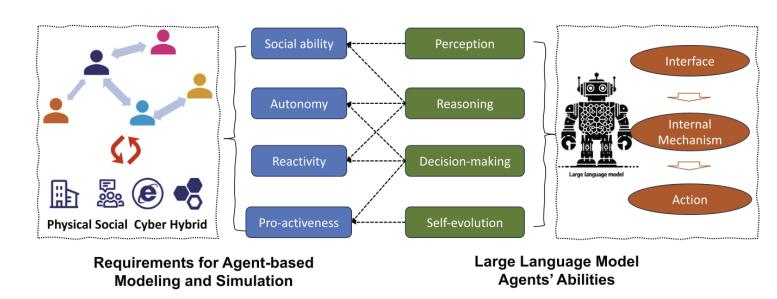
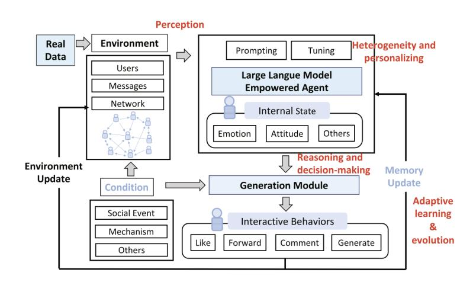
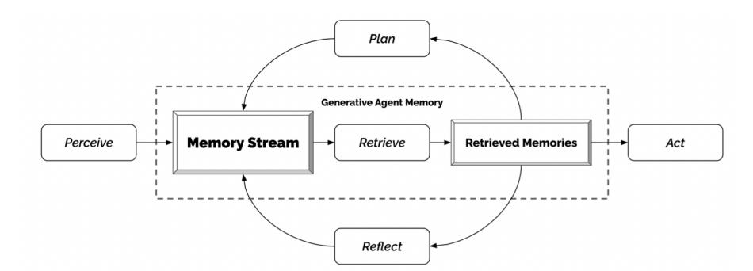
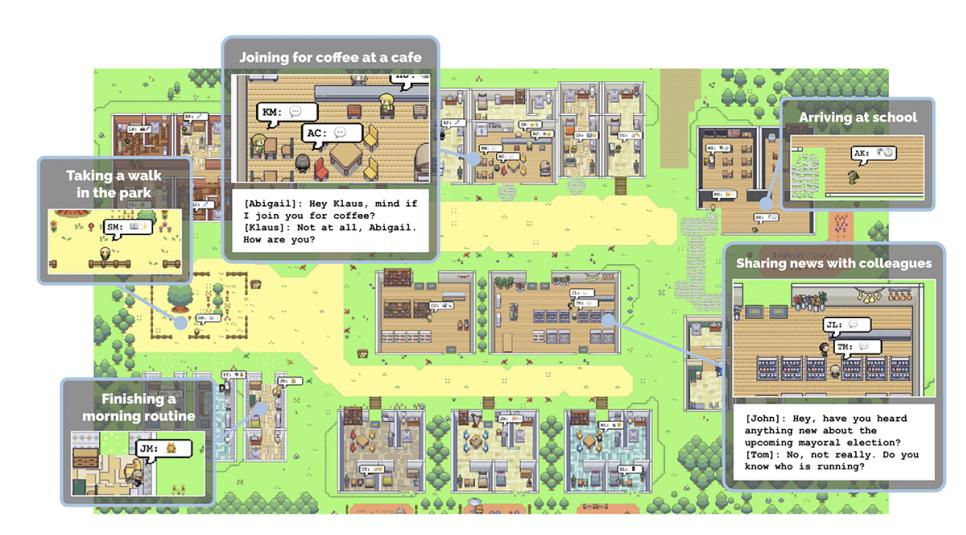
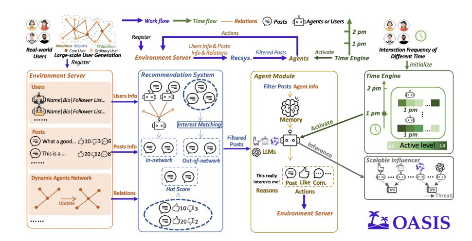
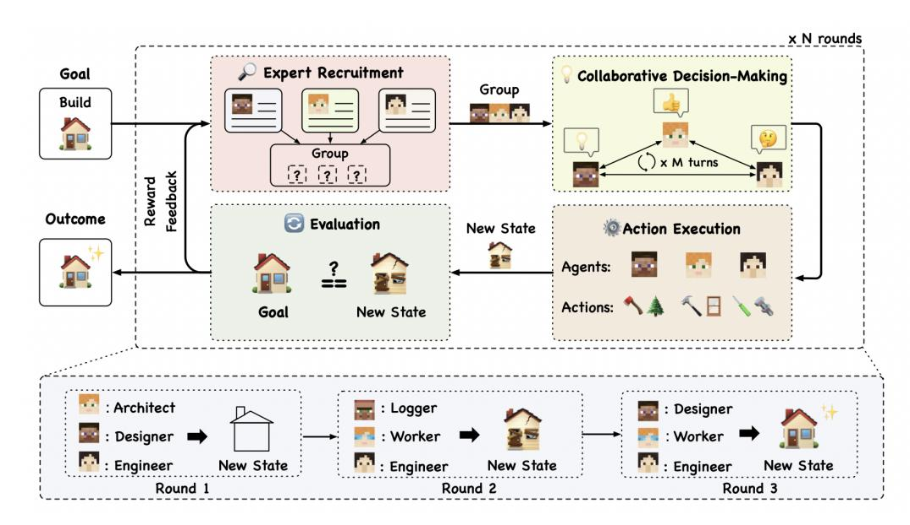
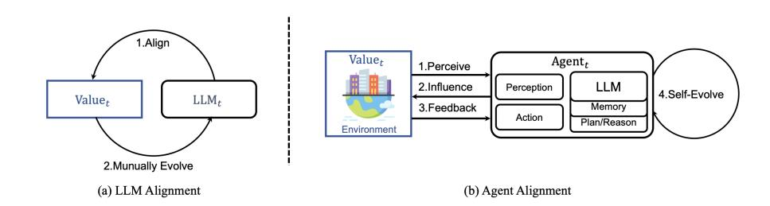
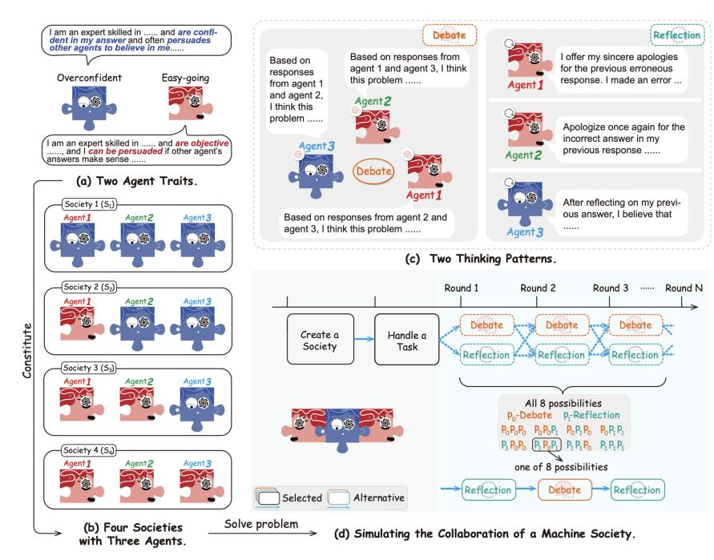

{0}------------------------------------------------

# 第 17 章

# 多 LLM 系统中的涌现行为

#### 你将学到的内容

本章从预设角色的团队协作转向**开放式多智能体仿真**，讨论局部交互如何形成群体层面的惯例、规范和风险。阅读后，你将能够：

- 区分**开放式涌现仿真**与**基于角色的协作**，理解两者采用不同研究问题与评估方法的原因。
- 说明生成式智能体的基本架构及模拟平台从小型社群扩展到大规模群体的实现挑战。
- 分析局部交互可能如何形成**惯例、规范和元规范**，并审视“涌现”这一解释的证据。
- 说明多智能体模拟作为**计算社会科学实验工具**的用途与局限。
- 理解**开放世界基准**如何用于测试长期交互能力并生成新任务。
- 评估自组织、集体智能等概念的适用边界，以及开放式多智能体系统的安全风险。

## 17.1 什么是多智能体系统中的涌现行为？

第 16 章主要研究**角色和协作协议已被设计好的多智能体系统**，重点在于团队能否完成明确任务。本章将智能体置于开放式环境，研究问题随之改变：**不是团队在既定结构下表现如何，而是群体结构会如何从局部互动中逐渐形成。**

{1}------------------------------------------------

图 17.1：基于代理的建模与 LLM 代理 [\[Gao et al.,](#page-13-0) [2024\]](#page-13-0)

图 17.2：多智能体建模中 LLM 代理的结构 [\[Gao et al.,](#page-13-0) [2023\]](#page-13-0)

具备记忆、规划和自然语言交互能力的 LLM 智能体，为开放式社会模拟提供了新的技术条件 [\[Gao et al.,](#page-13-0) [2023,](#page-13-0) [2024\]](#page-13-0)。研究者既可以观察最终群体行为，也可以阅读智能体之间的交互记录。不过，**能够生成逼真的互动，不等于已经验证其行为代表真实人类社会**。图 17.1 与图 17.2 展示了相关系统的基本架构。

{2}------------------------------------------------

### 17.1.1 从基于代理的建模到生成式代理社会

对相互作用的人工智能体群体进行研究已有数十年历史。在基于智能体的建模中，宏观层面的模式和规律是从简单智能体的局部交互中自下而上产生的 [\[Epstein and Axtell,](#page-13-0) [1996,](#page-13-0) [Macal and North,](#page-14-0) [2010\]](#page-14-0)。基于智能体建模中最有影响力的结果之一是，自利智能体的群体中可以出现合作与规范 [\[Axelrod,](#page-12-0) [1986\]](#page-12-0)。文化进化理论形式化了行为如何通过模仿、沟通和教育在群体中传播 [\[Boyd and Richerson,](#page-12-0) [1988\]](#page-12-0)。[Steels](#page-15-0) [\[1995\]](#page-15-0) 的*命名游戏*表明，即使是共享词汇（本质上也是一种约定）也可以通过成对交互而无需中央协调而产生。

传统**基于智能体的建模（ABM）**通常使用手工定义的行为规则，并以结构化信号交换信息。LLM 则能生成自然语言对话，并利用训练中获得的知识，在模拟中展现协商、误解与相互影响等复杂互动。随着平台扩展能力提升，研究者开始构建更大规模的**生成式智能体社会** [\[Gao et al.,](#page-13-0) [2024,](#page-13-0) [Yang et al.,](#page-15-0) [2024\]](#page-15-0)。这拓展了传统 ABM 的研究手段，也使模型偏差、可复现性和结果解释变得更加重要。

第 16.1.3 节介绍了 Tran 等人提出的五个维度，用于描述研究者对多 LLM 系统的控制程度 [\[Tran et al.,](#page-15-0) [2025\]](#page-15-0)。基于角色的模拟与开放式模拟之间是程度之别，而非类型之别。开放式模拟位于光谱的一端，与角色预设、协议明确的交互相对。开放式模拟仍包含会影响结果的设计选择，只是这些选择的决定性较弱，并有意为新模式的涌现留出空间。这改变了研究重点：研究不再评估代理完成某项任务或明确目标的表现，而是把互动模式本身作为研究对象。开放式模拟以更接近民族志研究的方式观察和探索代理的行为与互动，因此需要采用不同的方法。

### 17.1.2 方法论说明

前两章讨论的提示敏感性、实验波动和错误级联，在开放式模拟中依然存在。由于缺少固定的互动协议，一个智能体的细微变化可能不断传递，最终产生截然不同的群体轨迹。此外，还存在一个特别重要的解释问题：**观察到的群体规范究竟来自智能体互动，还是模型对训练中已有社会知识的复现？**

{3}------------------------------------------------

当 LLM 代理在开放式模拟中形成某种规范时，研究者很难判断该规范是从代理互动中*自发涌现*的，还是从模型预训练的世界知识中检索而来。

相关研究综述见 [Mou et al.（2024）](#page-14-0)、[Savarimuthu et al.（2024）](#page-15-0) 和 [Xi et al.（2023）](#page-15-0)。下文依次介绍模拟平台（第 17.2 节）、规范涌现（第 [17.3](#page-7-0) 节）、开放世界基准（第 [17.4](#page-10-0) 节）及相关风险（第 [17.5](#page-11-0) 节）；第 18 章提供实践案例。

## 17.2 仿真基础设施

要研究长期互动，模拟平台不仅需要维护状态与日志，还必须支持多智能体调度、持久记忆和可复现运行。同时，环境又不能把所有交互都预先写死。下面按规模从小型虚拟社区到百万级智能体平台展开。

### 17.2.1 小世界

Park 等人 [\[2023\]](#page-14-0) 提出了 Generative Agents 系统。在这个环境中，用户可以与一座由 25 个 LLM 代理组成的模拟小镇互动。基于先前提出的社会模拟技术 [\[Park](#page-14-0) [et al.,](#page-14-0) [2022\]](#page-14-0)，每个代理都被赋予了独特的角色和记忆。对于每个代理，都会记录模拟中的所有经历和对话。这些记录用于综合更高级的反思，并规划进一步的行为（见图 [17.3\)](#page-4-0)。
 
在生成式智能体中，智能体的行为有点像电子游戏《模拟人生》中的角色 [\[Nutt and Railton,](#page-14-0) [2003\]](#page-14-0)：它们会主动发起对话、建立关系、传播信息，并协调临时的群体活动（见图 [17.4\)](#page-4-0)）。需要注意的是，这些互动会受到用户输入影响，因此具有半自主性。模拟大体上不受预先脚本控制，但也并非完全自主。情人节派对的例子可以说明模拟的运作方式：派对的计划是由用户提示发起的，随后多个智能体互相传播邀请，并按协调好的计划准时出现（有些会迟到，就像现实生活中一样）。这些代理形成了可信的社交日常（例如日常安排和闲聊），甚至表现出类似人类的性格特征（一些代理表现出欺骗或固执，而其他代理则表现出合作）。这些结果表明，在合适的初始提示下，社交模式可以从动态的、半自主的 LLM 互动中出现。

{4}------------------------------------------------

 
  
 图 17.3：记忆-反思-规划循环是生成式智能体系统的核心设计：如果没有对持续增长的经验记录进行检索以及定期反思，智能体在模拟时间的几小时内就会失去连贯性 [\[Park et al.,](#page-14-0) [2023\]](#page-14-0) 
  
  
  
 图 17.4：生成式智能体模拟示例，包含 25 个智能体和允许用户设置行为的交互式设计 [\[Park et al.,](#page-14-0) [2023\]](#page-14-0) 

{5}------------------------------------------------

 
  
 图 17.5：OASIS 的组成部分 [\[Yang et al.,](#page-15-0) [2024\]](#page-15-0) 
 
### 17.2.2 从数千到一百万个代理的社会

将生成式代理架构扩展到 25 个以上代理时，需要考虑推理成本，以及如何构建足够丰富、能够容纳数千个代理的环境。1 大规模社会模拟需要在可用算力、总运行时间、代理数量和单个代理行为的准确性之间权衡。有几个平台解决了这些问题。

AgentSociety 是一项大规模模拟，包含超过 10,000 个代理 [\[Piao](#page-14-0) [et al.,](#page-14-0) [2025b\]](#page-14-0)。它将 LLM 驱动的代理与一个以移动性、就业和消费为重点的现实城市环境相结合。它不仅用于研究日常社会动态（如 Generative Agents），也为计算社会实验提供了试验平台。为了实现所需的规模，该模拟在分布式推理后端上运行，并对代理行为进行更严格的控制。

OASIS 是一个可扩展的社交媒体模拟器，适用于 Twitter/X 和 Reddit [\[Yang et al.,](#page-15-0) [2024\]](#page-15-0)。它支持对多达一百万个 LLM 代理进行建模。它建立在 CAMEL [\[Li et al.,](#page-13-0) [2023\]](#page-13-0) 之上，并以基于角色的代理作为起点。在 OASIS 中，并非每个代理的行动都涉及 LLM 调用，并且并非所有代理始终都是活跃的。在大规模运行时，OASIS 展示了多种群体社会现象，包括（错误）信息的传播、群体极化和羊群效应。OASIS 构建于环境服务器、推荐系统、代理模块、时间引擎和可扩展推理器之上（见图 17.5）。

Project Sid [\[Ahn et al.,](#page-12-0) [2024\]](#page-12-0) 在 Minecraft 世界中放置多达 1000 个代理，并报告了一个引人注目的涌现结果：观察到代理发展出专业的经济角色（农民、矿工、守卫），遵守集体采用的规则，如征税，
 
 1 正如你将在下一章亲身体验的那样，仅运行一个只有三个活跃代理的生成式代理架构的变体已在计算上具有挑战性。

{6}------------------------------------------------

并在不同定居点之间传递文化甚至宗教的模因。然而，尽管这些互动不是预先设计的，上述提出的涌现与检索之间的区别在这里同样适用：所观察到的角色和行为预计将在驱动各个代理的LLM 的训练数据中被丰富描述。

### 17.2.3 将模拟作为科学工具

除了作为可扩展 LLM 技术的令人印象深刻的展示平台外，如果使用得当，这些平台还可以用于复杂的计算社会实验。模拟生成代理社会已经被用来研究社会科学中长期关注的问题（第 [17.1\)](#page-0-0) 节。例如，AgentSociety 已用于多项案例研究，包括煽动性信息的传播、极化现象、全民基本收入政策的影响，以及外部冲击（如飓风）对社会的影响 [\[Piao et al.,](#page-14-0) [2025b,a\]](#page-14-0)。这类实验若在真实人群中开展，可能不符合伦理、不切实际，甚至完全无法进行。作者认为，模拟实验可以重复开展，并能在每一步调整实验设置。

[Li et al.](#page-13-0) [\[2024b\]](#page-13-0) 进一步说明了对虚假信息的处理方法。这些智能体在性别、年龄以及五大人格特质方面表现出多样化的特征。2 其中一个发现是，鼓励性的评论并不能显著减少虚假信息的传播，而公开标注信息的准确性评分并阻止特定影响者则被证明是有效策略，尤其是在无尺度网络中 [\[Barabasi](#page-12-0) , [2009\]](#page-12-0)。这类研究通常将候选干预措施作为对模拟平台的改动，并通过多次运行测量其宏观效果。这些效果是否转移到人类群体上，正是第 [17.1.2](#page-2-0) 节讨论的模拟有效性问题，这类模拟更适合作为提出假设和开展预实验的工具，而不是现场实验的替代品。

边界案例：AgentVerse [\[Chen et al.,](#page-13-0) [2023\]](#page-13-0) 严格来说属于第 16 章研究的那类基于角色的系统。在 AgentVerse 中，问题解决被分为专家招募、协作决策、行动执行和评估四个阶段，反复迭代直到结果令人满意（图 [17.6\)](#page-7-0)）。这里提及它，是因为系统还出现了设计之外的行为：智能体表现出自发行为，例如志愿行为，表现为智能体主动为同伴提供帮助；以及从众行为，即智能体在他人批评下调整偏离的行为。破坏性行为也被观察到，偶尔导致不希望和有害的结果。角色脚本化模拟中也会涌现宏观行为，这说明基于角色与涌现式系统之间是一个连续谱：即使在协议严格的系统中，也会出现无人刻意设计的行为。我们将在第 [17.5](#page-11-0) 节回到与这一观察相关的风险。

2也称为OCEAN：开放性、尽责性、外向性、宜人性和神经质。

{7}------------------------------------------------

 
  
 图 17.6：AgentVerse 中决策的四个阶段 [\[Chen et al.,](#page-13-0) [2023\]](#page-13-0) 
 
## 17.3 涌现的惯例和规范

前文讨论了模拟环境与基础设施，下面转而关注群体层面的结果：局部交流如何逐渐形成被群体接受的惯例和行为规范。

进化智能体 [\[Li et al.,](#page-13-0) [2024a\]](#page-13-0) 在一个多智能体系统中研究智能体对齐，使用超越基于人类反馈的强化学习的进化方法（见图 [17.7\)](#page-8-0)）。进化智能体遵循一种受控的规范产生方法：它不允许社会规范的演化无序或随机，但也不会干预其演化的每一个步骤。作者定义了初始社会规范和期望的演化方向。适应度更高（更符合规范）的智能体更有可能被选中繁衍，从而导致它们策略的扩散，逐渐稳定并形成新的社会规范。定义一个完整、现实且复杂的虚拟社会是具有挑战性的。这项工作的目的是研究如果存在这样一个虚拟社会，系统如何能够进一步促使代理的复杂行为，以及这将如何导致新动态的出现。该系统提供了一个沙盒，用于在 AI 系统影响现实世界之前研究其安全性。

基于 [Steels](#page-15-0) [\[1995\]](#page-15-0) 的命名游戏，实施了不同的方法，使用了由 LLaMa 3 和 Claude 3.5 提供支持的代理 [\[Kouwenhoven et al.,](#page-13-0) [2024,](#page-13-0) [Ashery](#page-12-0) [et al.,](#page-12-0) [2024,](#page-12-0) [Baronchelli,](#page-12-0) [2023\]](#page-12-0)。这些研究发现，LLM 通过交流进行局部互动时，可以自发形成广泛接受的惯例（或规范）。研究者还发现，在这一过程中，即使个体代理看起来没有偏见，群体层面仍可能出现强烈的集体偏见；少数坚定的 LLM 代理也可能通过建立新的社会惯例推动社会变迁，甚至改变既有行为。

{8}------------------------------------------------

图17.7：进化代理概览 [\[Li et al.,](#page-13-0) [2024a\]](#page-13-0)

规范的出现被 [Horiguchi et al.](#page-13-0) [\[2024\]](#page-13-0) 在另一个层面上研究，他们探讨了 LLM 代理自发生成和遵守规范性策略的潜力，这一研究建立在 Axelrod 的 *metanorm* 游戏的基础工作之上。元规范是关于执行规范的规范：惩罚那些不惩罚违规者的人 [\[Axelrod,](#page-12-0) [1986\]](#page-12-0)。在控制报复倾向和大胆程度这两项人格特质后，他们发现，通过对话，LLM 代理可以完全通过自然语言互动形成复杂的社会规范，例如元规范。一项相关的研究由 [He et al.](#page-13-0) [\[2024\]](#page-13-0) 进行，评估了 LLM 检测规范违规的能力。基于一个家庭情境中 80 个故事的模拟数据，他们调查了 10 条规范是否被违反，研究发现，GPT-4 能够检测规范违规，Mistral 的表现则稍逊一筹。

[Qiu et al.](#page-14-0) [\[2024\]](#page-14-0) 进一步研究 LLM 代理对文化和社会规范的认知。他们引入了 CASA，这是一种基准，用于评估 LLM 代理在两个基于网络的任务中对文化和社会规范的敏感性：在线购物和社交讨论论坛。（CASA 基于 WebArena [\[Qi et al.,](#page-14-0) [2024\]](#page-14-0)。）目前，LLM 在非代理的网络环境中表现显著优于在代理环境中，代理对规范的识别覆盖率不到 10%，违规率超过 40%。然而，通过在特定数据集上使用提示和微调，可以提高文化和社会意识。

受明斯基《心智的社会》[\[Minsky,](#page-14-0) [1988\]](#page-14-0)的启发，Zhang 等人 [\[2023\]](#page-15-0) 在一项 LLM 代理模拟中研究了合作机制。该模拟由四种不同社会的LLM 代理组成，每个代理以特定特质（随和或过度自信）为特征，并以不同的思维模式（辩论或反思）进行合作。他们发现LLM 代理表现出类似人类的社会行为，如从众和达成共识，与基础社会心理学理论相符。图 [17.8](#page-9-0)展示了不同类型代理的社会。

Baltaji 等人 [\[2024\]](#page-12-0) 研究了 LLM 代理群体能否成功开展跨国合作与辩论。

{9}------------------------------------------------

 
  
 图 17.8：具有不同特质的代理组成多样化的机器社会 [\[Zhang](#page-15-0) [et al.,](#page-15-0) [2023\]](#page-15-0) 
 
{10}------------------------------------------------

多代理讨论有助于形成能够体现多元观点的集体决策，但代理也可能因感受到同伴压力而从众，甚至偏离原有角色和观点。鼓励辩论的指令也会增加出错风险。

## 17.4 在开放世界环境中评估代理能力

开放世界研究的一个动机是：固定训练数据和静态任务可能难以覆盖不断变化的交互情境。多智能体模拟尝试持续生成新的环境、任务与数据，为模型提供更丰富的训练和评估条件。这并不意味着模拟能够自动提供无限且高质量的数据；关键在于不断提出**有意义、可验证且难度适当**的新挑战。多智能体微调研究也开始探索这种思路 [\[Subramaniam et al.,](#page-15-0) [2025\]](#page-15-0)。

早期评估常采用较简化的合成环境，难以体现真实任务的交互复杂度。**WebArena** [Zhou et al.（2023）](#page-16-0) 提供了更接近实际网站操作的可复现环境，涵盖电子商务、社交讨论、协作软件开发和内容管理等场景。

游戏也常被用作评估交互行为的基准。现实世界的任务需要处理复杂的交互、高级空间推理、长期规划以及持续探索新策略。BALROG [\[Paglieri et al.,](#page-14-0) [2025\]](#page-14-0)，我们在案例研究2中使用的系统，涵盖了不同难度级别的规划环境，从非专业人类几秒钟内即可解决的任务，到可能需要多年才能掌握的具有挑战性的任务（例如 NetHack Learning Environment）。他们发现，尽管当前模型在较简单的游戏中取得了部分成功，但在视觉决策等更具挑战性的任务中显著困难。

随着智能体能力演进，测试任务也需要更新 [\[Butt et al.,](#page-12-0) [2024\]](#page-12-0)。**BENCHAGENTS** 将基准构建拆为规划、样例生成、数据验证和评估等步骤，交给不同的 LLM 智能体协作，并通过人工反馈控制样例质量与多样性，重点评估规划和约束满足能力。

Ma 等人 [\[2024\]](#page-13-0) 提出的 AgentBoard 评估了现有基准的覆盖广度。基准应具有任务多样性，有必要涵盖各种代理任务，例如具身任务、网络任务和工具任务。此外，多轮交互很重要，以模拟现实场景。现有基准通常采用单轮任务。此外，应在部分可观测环境中评估代理，以测试它们是否能够主动探索周围环境。现有代理 

{11}------------------------------------------------

基准测试未能满足所有这些标准[\[Ma et al.,](#page-13-0) [2024\]](#page-13-0)。

对开放世界环境的研究与课程学习相关。LLM 之前的工作已经显示，智能体社会可能创建一个难度不断增加的自动课程 [\[Elman,](#page-13-0) [1991,](#page-13-0) [Bengio et al.,](#page-12-0) [2009,](#page-12-0) [Silver et al.,](#page-15-0) [2017,](#page-15-0) [Soviany et al.,](#page-15-0) [2022\]](#page-15-0)，这需要智能体具备越来越高水平的智能行为 [\[Racaniere](#page-15-0) [et al.,](#page-15-0) [2019\]](#page-15-0)。对于 LLM [\[Feng et al.,](#page-13-0) [2023\]](#page-13-0)，也观察到了类似的结果。例如，WebArena 被用来研究自我进化课程 [\[Qi et al.,](#page-14-0) [2024\]](#page-14-0)，这也可以帮助机器人训练 [\[Ryu et al.,](#page-15-0) [2024\]](#page-15-0) 或减轻幻觉 [\[Zhao et al.,](#page-15-0) [2024\]](#page-15-0)。

## 17.5 涌现行为的风险

第 16 章指出，角色分配本身也会带来风险：代理可能因过度投入角色而表现出意料之外、甚至反社会的行为。可以说，开放式环境提高了风险，因为其中内置的保障更少，而不良行为可能会从互动动态中自下而上地出现。这并不令人意外：早期多智能体模拟的目标之一，就是探究自利代理之间能否涌现合作行为。研究者当时惊讶地发现，合作确实可能出现，但需要满足适当条件[\[Axelrod,](#page-12-0) [1981\]](#page-12-0)。合作与竞争之间的界限并不总是清晰。

AgentVerse 中既出现了合作行为，也观察到破坏性行为，有时会导致有害的结果 [\[Chen et al.,](#page-13-0) [2023\]](#page-13-0)。命名游戏研究表明，强大的集体偏见可以从个体无偏的群体中产生，并且小规模坚定的少数群体可以推翻已建立的惯例 [\[Ashery et al.,](#page-12-0) [2024,](#page-12-0) [Kouwenhoven et al.,](#page-13-0) [2024\]](#page-13-0)。这些机制本身是中性的，但可能会被意图不良的代理利用。在平台规模上，OASIS 和 AgentSociety 模拟了错误信息传播、群体极化、羊群效应以及有害内容的传播 [\[Yang et al.,](#page-15-0) [2024,](#page-15-0) [Piao](#page-14-0) [et al.,](#page-14-0) [2025a\]](#page-14-0)；正是这种使这些模拟在科学上有用的逼真度，从原则上来说，也使它们成为操纵策略的排练空间。

一种建设性的应对方式，是把这种风险转化为安全研究的机会。EvolutionaryAgent 明确地将其虚拟社会框定为一个沙盒，用于在 AI 系统影响现实世界之前研究其安全性 [\[Li et al.,](#page-13-0) [2024a\]](#page-13-0)。如果能在模拟中把代理间的规范引导至预期方向，同一机制也可用于在群体动态下对齐方法进行压力测试，而不是只在孤立场景中测试。开放式模拟可以用来理解风险首次出现的情况，以及以低成本研究针对这些风险的防御措施。

## 17.6 结论性意见

本章探讨了开放式多智能体仿真如何用于研究自组织、群体惯例与社会规范。与预设任务的团队不同，这类研究更关心**集体行为是怎样产生的，以及能否被可靠解释**。

{12}------------------------------------------------

平台规模已从少数智能体扩展到研究中报告的百万级模拟配置，但规模并不直接等于真实性或科学有效性。

支持大规模模拟的基础设施的可用性使得进一步的研究成为可能。然而，一个悬而未决的问题是，自主模拟在多大程度上是真正开放式的，而不是受到 LLM 提示和代理脚手架的影响。此外，尽管开放式模拟的目的是观察涌现行为，但解释行为结果时必须谨慎。所有 LLM 代理都在由人类生成的数据上预训练。很难区分哪些行为模式的元素是由代理之间的互动产生的，哪些元素仅仅是预训练行为检索的结果。

# 参考文献

Andrew Ahn, Nic Becker, Stephanie Carroll, Nico Christie, Manuel Cortes, Arda Demirci, Melissa Du, Frankie Li, Shuying Luo, Peter Y Wang, Mathew Willows, Feitong Yang, and Guangyu Robert Yang. Project sid: Many-agent simulations toward ai civilization, 2024. URL <https://arxiv.org/abs/2411.00114>. [340](#page-5-0)

Ariel Flint Ashery, Luca Maria Aiello, and

Andrea Baronchelli. The dynamics of social conventions in llm populations: Spontaneous emergence, collective biases and tipping points. *arXiv preprint arXiv:2410.08948*, 2024. [342,](#page-7-0) [346](#page-11-0)

Robert Axelrod. The emergence of cooperation among egoists. *American political science review*, 75(2):306–318, 1981. [346](#page-11-0)

Robert Axelrod. An evolutionary approach to norms. *American political science review*, 80(4):1095–1111, 1986. [337,](#page-2-0) [343](#page-8-0)

Razan Baltaji, Babak Hemmatian, and Lav R Varshney. Conformity, confabulation, and impersonation: Persona inconstancy in multi-agent llm collaboration. *arXiv preprint arXiv:2405.03862*, 2024. [343](#page-8-0)

Albert-László Barabási. Scale-free networks: a decade and beyond.  *Science*, 325 (5939):412–413, 2009. [341](#page-6-0)

Andrea Baronchelli. Shaping new norms for artificial intelligence: A complex systems perspective. *arXiv preprint arXiv:2307.08564*, 2023. [342](#page-7-0)

Yoshua Bengio, Jérôme Louradour, Ronan Collobert, and Jason Weston. Curriculum learning. In *Proceedings of the 26th annual international conference on machine learning*, pages 41–48, 2009. [346](#page-11-0)

Robert Boyd and Peter J Richerson. *Culture and the evolutionary process*. University of Chicago press, 1988. [337](#page-2-0)

Natasha Butt, Varun Chandrasekaran, Neel Joshi, Besmira Nushi, and Vidhisha Balachandran. Benchagents: Automated benchmark creation with agent interaction. *arXiv preprint arXiv:2410.22584*, 2024. [345](#page-10-0)

{13}------------------------------------------------

Weize Chen, Yusheng Su, Jingwei Zuo, Cheng Yang, Chenfei Yuan, Chen Qian, Chi-Min Chan, Yujia Qin, Yaxi Lu, Ruobing Xie, et al. AgentVerse: Facilitating multi-agent collaboration and exploring emergent behaviors in agents. *arXiv preprint arXiv:2308.10848*, 2(4):5, 2023. [341,](#page-6-0) [342,](#page-7-0) [346](#page-11-0)

Jeffrey L Elman. Incremental learning, or the importance of starting small. In *Proceedings of the Annual Meeting of the Cognitive Science Society*, volume 13, 1991. [346](#page-11-0)

Joshua M Epstein and Robert Axtell. *Growing artificial societies: social science from the bottom up*. Brookings Institution Press, 1996. [337](#page-2-0)

Tao Feng, Zifeng Wang, and Jimeng Sun. Citing: Large language models create curriculum for instruction tuning. *arXiv preprint arXiv:2310.02527*, 2023. [346](#page-11-0)

Chen Gao, Xiaochong Lan, Zhihong Lu, Jinzhu Mao,

Jinghua Piao, Huandong Wang, Depeng Jin, and Yong Li. π3 : Social-network simulation system with large language model-empowered agents. *arXiv preprint arXiv:2307.14984*, 2023. [336](#page-1-0)

Chen Gao, Xiaochong Lan, Nian Li, Yuan Yuan, Jingtao Ding, Zhilun Zhou, Fengli Xu, and Yong Li. Large language models empowered agent-based modeling and simulation: A survey and perspectives. *Humanities and Social Sciences Communications*, 11(1):1–24, 2024. [336,](#page-1-0) [337](#page-2-0)

Shawn He, Surangika Ranathunga, Stephen Cranefield, and Bastin Tony Roy Savarimuthu. Norm violation detection in multi-agent systems using large language models: A pilot study. *arXiv preprint arXiv:2403.16517*, 2024. [343](#page-8-0)

Ilya Horiguchi, Takahide Yoshida, and Takashi Ikegami. Evolution of social norms in llm agents using natural language. *arXiv preprint arXiv:2409.00993*, 2024. [343](#page-8-0)

Tom Kouwenhoven, Max Peeperkorn, and Tessa Verhoef. Searching for structure: Investigating emergent communication with large language models, 2024. URL <https://arxiv.org/abs/2412.07646>. [342,](#page-7-0) [346](#page-11-0)

Guohao Li, Hasan Hammoud, Hani Itani, Dmitrii Khizbullin, and Bernard Ghanem. CAMEL: Communicative Agents for “Mind” Exploration of large language model society. *Advances in Neural Information Processing Systems*, 36:51991–52008, 2023. [340](#page-5-0)

Shimin Li, Tianxiang Sun, Qinyuan Cheng, and Xipeng Qiu. Agent alignment in evolving social norms. *arXiv preprint arXiv:2401.04620*, 2024a. [342,](#page-7-0) [343,](#page-8-0) [346](#page-11-0)

Xinyi Li, Yu Xu, Yongfeng Zhang, and Edward C Malthouse. Large language model-driven multi-agent simulation for news diffusion under different network structures. *arXiv preprint arXiv:2410.13909*, 2024b. [341](#page-6-0)

Chang Ma, Junlei Zhang, Zhihao Zhu, Cheng Yang, Yujiu Yang, Yaohui Jin, Zhenzhong Lan, Lingpeng Kong, and Junxian He. AgentBoard: An analytical evaluation board of multi-turn llm agents. *arXiv preprint arXiv:2401.13178*, 2024. [345,](#page-10-0) [346](#page-11-0)

{14}------------------------------------------------

C M Macal and M J North. Tutorial on agent-based modelling and simulation. *Journal of Simulation*, 4(3):151–162, 2010. ISSN 1747-7786. doi: 10.1057/jos.2010.3. URL <https://doi.org/10.1057/jos.2010.3>. [337](#page-2-0)

Marvin Minsky. *Society of mind*. Simon and Schuster, 1988. [343](#page-8-0)

Xinyi Mou, Xuanwen Ding, Qi He, Liang Wang, Jingcong Liang, Xinnong Zhang, Libo Sun, Jiayu Lin, Jie Zhou, Xuanjing Huang, et al. From individual to society: A survey on social simulation driven by large language model-based agents. *arXiv preprint arXiv:2412.03563*, 2024. [338](#page-3-0)

Diane Nutt and Diane Railton. The sims: Real life as genre. *Information Communication & Society*, 6(4):577–592, 2003. [338](#page-3-0)

Davide Paglieri, Bartłomiej Cupiał, Samuel Coward, Ulyana Piterbarg, Maciej Wolczyk, Akbir Khan, Eduardo Pignatelli, Łukasz Kucinski, Lerrel Pinto, Rob Fergus, Jakob Nicolaus Foerster, Jack Parker-Holder, and Tim Rocktäschel. BALROG: Benchmarking agentic LLM and VLM reasoning on games. In *The Thirteenth International Conference on Learning Representations*, 2025. URL <https://openreview.net/forum?id=fp6t3F669F>. [345](#page-10-0)

Joon Sung Park, Lindsay Popowski, Carrie Cai, Meredith Ringel Morris, Percy Liang, and Michael S Bernstein. Social simulacra: Creating populated prototypes for social computing systems. In *Proceedings of the 35th Annual ACM Symposium on User Interface Software and Technology*, pages 1–18, 2022. [338](#page-3-0)

Joon Sung Park, Joseph O'Brien, Carrie Jun Cai, Meredith Ringel Morris, Percy Liang, and Michael S Bernstein. Generative agents: Interactive simulacra of human behavior. In *Proceedings of the 36th annual acm symposium on user interface software and technology*, pages 1–22, 2023. [338,](#page-3-0) [339](#page-4-0)

Jinghua Piao, Zhihong Lu,

Chen Gao, Fengli Xu, Fernando P. Santos, Yong Li, and James Evans. Emergence of human-like polarization among large language model agents, 2025a. URL <https://arxiv.org/abs/2501.05171>. [341,](#page-6-0) [346](#page-11-0)

Jinghua Piao, Yuwei Yan, Jun Zhang, Nian Li, Junbo Yan, Xiaochong Lan, Zhihong Lu, Zhiheng Zheng, Jing Yi Wang, Di Zhou,

Chen Gao, Fengli Xu, Fang Zhang, Ke Rong, Jun Su, and Yong Li. Agentsociety: Large-scale simulation of llm-driven generative agents advances understanding of human behaviors and society, 2025b. URL <https://arxiv.org/abs/2502.08691>. [340,](#page-5-0) [341](#page-6-0)

Zehan Qi, Xiao Liu, Iat Long Iong, Hanyu Lai, Xueqiao Sun, Xinyue Yang, Jiadai Sun, Yu Yang, Shuntian Yao, Tianjie Zhang, et al. Webrl: Training llm web agents via self-evolving online curriculum reinforcement learning. *arXiv preprint arXiv:2411.02337*, 2024. [343,](#page-8-0) [346](#page-11-0)

Haoyi Qiu, Alexander R Fabbri, Divyansh Agarwal, Kung-Hsiang Huang, Sarah Tan, Nanyun Peng, and Chien-Sheng Wu. Evaluating cultural and social awareness of llm web agents. *arXiv preprint arXiv:2410.23252*, 2024. [343](#page-8-0)

{15}------------------------------------------------

Sebastien Racaniere, Andrew K Lampinen, Adam Santoro, David P Reichert, Vlad Firoiu, and Timothy P Lillicrap. Automated curricula through setter-solver interactions. *arXiv preprint arXiv:1909.12892*, 2019. [346](#page-11-0)

Kanghyun Ryu, Qiayuan Liao, Zhongyu Li, Koushil Sreenath, and Negar Mehr. Curricullm: Automatic task curricula design for learning complex robot skills using large language models. *arXiv preprint arXiv:2409.18382*, 2024. [346](#page-11-0)

Bastin Tony Roy Savarimuthu, Surangika Ranathunga, and Stephen Cranefield. Harnessing the power of llms for normative reasoning in mass. *arXiv preprint arXiv:2403.16524*, 2024. [338](#page-3-0)

David Silver, Julian Schrittwieser, Karen Simonyan, Ioannis Antonoglou, Aja Huang, Arthur Guez, Thomas Hubert, Lucas Baker, Matthew Lai, Adrian Bolton, et al. Mastering the game of go without human knowledge. *nature*, 550(7676):354–359, 2017. [346](#page-11-0)

Petru Soviany, Radu Tudor Ionescu, Paolo Rota, and Nicu Sebe. Curriculum learning: A survey. *International Journal of Computer Vision*, 130(6):1526–1565, 2022. [346](#page-11-0)

Luc Steels. A self-organizing spatial vocabulary. *Artificial life*, 2(3):319–332, 1995. [337,](#page-2-0) [342](#page-7-0)

Vighnesh Subramaniam, Yilun Du, Joshua B Tenenbaum, Antonio Torralba, Shuang Li, and Igor Mordatch. Multiagent finetuning: Self improvement with diverse reasoning chains. *arXiv preprint arXiv:2501.05707*, 2025. [345](#page-10-0)

Khanh-Tung Tran, Dung Dao, Minh-Duong Nguyen, Quoc-Viet Pham, Barry O'Sullivan, and Hoang D Nguyen. Multi-agent collaboration mechanisms: A survey of llms. *arXiv preprint arXiv:2501.06322*, 2025. [337](#page-2-0)

Zhiheng Xi, Wenxiang Chen, Xin Guo, Wei He, Yiwen Ding, Boyang Hong, Ming Zhang, Junzhe Wang, Senjie Jin, Enyu Zhou, et al. The rise and potential of large language model based agents: A survey. *arXiv preprint arXiv:2309.07864*, 2023. [338](#page-3-0)

Ziyi Yang, Zaibin Zhang, Zirui Zheng, Yuxian Jiang, Ziyue Gan, Zhiyu Wang, Zijian Ling, Jinsong Chen, Martz Ma, Bowen Dong, et al. Oasis: Open agents social interaction simulations on one million agents. *arXiv preprint arXiv:2411.11581*, 2024. [337,](#page-2-0) [340,](#page-5-0) [346](#page-11-0)

Jintian Zhang, Xin Xu, Ningyu Zhang, Ruibo Liu, Bryan Hooi, and Shumin Deng. Exploring collaboration mechanisms for llm agents: A social psychology view. *arXiv preprint arXiv:2310.02124*, 2023. [343,](#page-8-0) [344](#page-9-0)

Zirui Zhao, Hanze Dong, Amrita Saha, Caiming Xiong, and Doyen Sahoo. Automatic curriculum expert iteration for reliable llm reasoning. *arXiv preprint arXiv:2410.07627*, 2024. [346](#page-11-0)

{16}------------------------------------------------

Shuyan Zhou, Frank F Xu, Hao Zhu, Xuhui Zhou, Robert Lo, Abishek Sridhar, Xianyi Cheng, Tianyue Ou, Yonatan Bisk, Daniel Fried, et al. Webarena: A realistic web environment for building autonomous agents. *arXiv preprint arXiv:2307.13854*, 2023. [345](#page-10-0)

{17}------------------------------------------------

