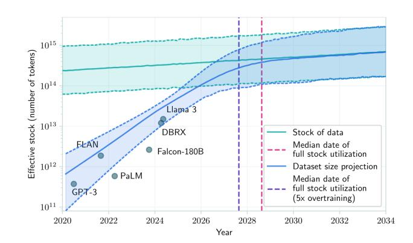
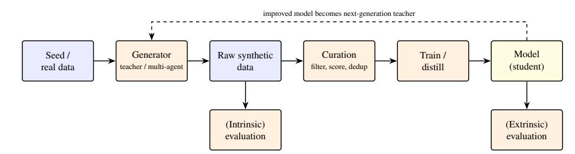
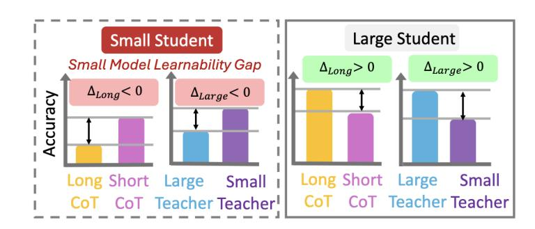
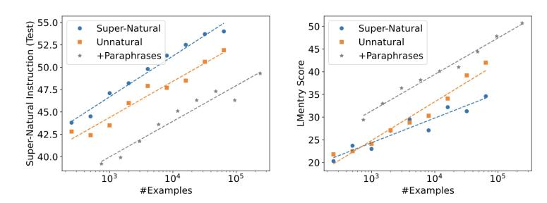
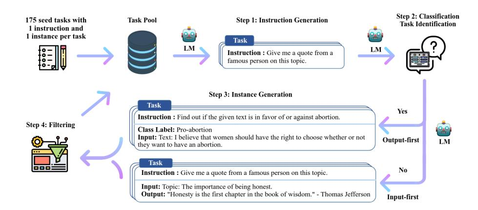

<!-- Source: AgenticLargeLanguageModels.pdf; physical PDF pages 363-390; Marker split PDF pages 1-28. -->

{0}------------------------------------------------

# Chapter 19

# \*Synthetic Data Generation for Training Agentic LLMs

#### What You Will Learn

In this chapter you will learn the role that synthetic data can play in the development of agentic large language models. Specifically, you will be able to:

- Characterize the importance of *data* in the LLM training pipeline.
- Explain the general loop of *distilling knowledge* from stronger models for weaker students.
- Describe the *pipeline components* for which synthetic data is being used as an alternative to human-generated content.
- Outline the various strategies for *curating and evaluating* synthetic data.
- Contrast the advantages and disadvantages of using synthetic data by describing the *risks* of using artificially generated data.

#### 19.1 The Importance of Data

The rapid scaling of LLMs has led to a significant demand for training and evaluation data. Some have called training data *digital oil*, underscoring its importance as a primary ingredient in AI development. Data is also becoming a differentiating factor as other parts of the pipeline, such as model architectures, grow more homogeneous [\[Kim et al.,](#page-18-0) [2025a\]](#page-18-0). As models scale, they require trillions of words of human-generated text scraped from the internet, yet this source is finite. This raises the question of whether training data could become the main bottleneck to scaling (see Figure [19.1](#page-1-0) and [Villalobos et al. (2024)](#page-23-0)). Acquiring data is also increasingly costly and time-consuming as straightforward sources are exhausted. Privacy, copyright, and bias concerns are pushing researchers beyond conventional curation of web-based human-generated data toward synthetic-data generation [\[Liang et al.,](#page-19-0) [2022\]](#page-19-0).

{1}------------------------------------------------

Figure 19.1: Projections of the available human-generated public text and dataset sizes to train LLMs [\[Villalobos et al.,](#page-23-0) [2024\]](#page-23-0). The intersection of the stock and dataset size projection lines indicates the median year (2028) in which the stock is expected to be fully utilized.

LLMs increasingly generate the data that trains the next generation of LLMs themselves: models are prompted to produce instructions, dialogues, reasoning traces, and even entire training corpora that are then used to finetune, distill and evaluate other models [\[Long et al.,](#page-19-0) [2024\]](#page-19-0). This self-reinforcing loop lowers the cost and effort of data collection compared to sourcing and annotating human-generated text, while also offering fine-grained control over style, difficulty, and coverage of the resulting datasets. By now, this approach has drawn significant industrial [\[Kapania et al.,](#page-18-0) [2025\]](#page-18-0) and academic interest [\[Viswanathan et al.,](#page-23-0) [2025,](#page-23-0) [Alismail and Lanquillon,](#page-14-0) [2025\]](#page-14-0), spanning applications from general-purpose instruction tuning to the more specialized data needed to train agentic behaviors such as tool use, planning, and multi-step reasoning (illustrated in Figure 1.1 on page 17).

The growing reliance on model-generated data has also introduced a new term in the scaling laws (Chapter 4), one that accounts for the proportion of synthetic data present in a pre-training corpus. Recent work such as SYNTHLLM [\[Qin et al.,](#page-21-0) [2025\]](#page-21-0) illustrates why this matters: by automatically extracting high-level concepts from source documents and recombining them through a graph-based algorithm, it generates synthetic corpora diverse enough to follow a predictable, rectified scaling law across model sizes. In this version of the scaling laws, the gains taper off earlier (before other token budgets typically used in pretraining), and larger models reach their optimal performance on comparatively fewer tokens than smaller ones. This suggests that synthetic data can be tuned not just for volume, but also for the shape of the scaling curve it produces.

Beyond scaling behavior, generating data for agentic capabilities—such as tool use, planning, and multi-step reasoning—increasingly depends on coordinated multi-agent workflows rather than on a single generator model.

{2}------------------------------------------------

Figure 19.2: The synthetic-data loop that organizes this chapter. A generator produces raw synthetic data from a small seed set, followed by curation filtering and scoring. The data trains or distills a model, which is then evaluated and can be used as the generator of the next iteration (dashed).

Specialized agents can take on distinct roles (e.g., proposing tasks, executing them, and critiquing the results), which tends to produce higher-quality, more diverse data that is structurally closer to what agentic training requires. Matrix [\[Wang et al.,](#page-24-0) [2025a\]](#page-24-0) is one example: a decentralized framework in which control and data flow are represented as messages passed among agents through distributed queues, allowing the pipeline to scale horizontally without a central coordinator. Let us take a closer look at the synthetic-data training pipeline.

#### 19.2 Distillation Loop

Using synthetic data in the agentic LLM training pipeline follows the overall distillation loop, as shown in Figure 19.2. A generator (a strong model, or an orchestration of several agents) uses a small amount of seed or real data to generate a large pool of raw synthetic data. That pool is then *curated* (Section [19.4\)](#page-9-0) before being used to train or *distill* a model. Crucially, the resulting model can itself become the generator for the next iteration. This closing of the self-reinforcing loop brings considerable risk to training stability and downstream performance (see also the discussion of stability in metalearning, Chapter 8).

Distillation is the special case of synthetic-data generation in which the generator is a *stronger model whose capability we are trying to transfer*. In knowledge distillation, a compact *student* model learns to copy a more capable *teacher* [\[Hinton et al.,](#page-17-0) [2015,](#page-17-0) [Hu](#page-17-0) [et al.,](#page-17-0) [2022\]](#page-17-0). It can do so by directly optimizing against the teacher's output predictions, or it can do so by simply training on synthetic data emitted by a teacher. The goal of distillation is to get a more efficient version of the teacher, both at inference time and in terms of data cost, without sacrificing too much task performance. Distillation has been applied widely, including in agentic settings [e.g., [Li et al.,](#page-19-0) [2025a,](#page-19-0) [Du et al.,](#page-16-0) [2025\]](#page-16-0). Distillation can also be used to derive preference data for instruction tuning. Zephyr [\[Tunstall et al.,](#page-23-0) [2024\]](#page-23-0), for example, was trained with AI feedback, where outputs are generated and ranked by strong teacher models, aligning a small model with user intent at minimal data and training cost.

{3}------------------------------------------------

**Four axes of distillation.** Concrete distillation methods can be organized along four axes. (1) The *signal*: whether the student imitates teacher logits, full output sequences, or a scalar reward derived from the teacher. (2) The *data source*: whether the sequences being scored are generated by the teacher or sampled from the student. (3) The *timing*: whether that data is produced once up front (off-policy) or continuously as the student changes (on-policy). (4) The *teacher identity*: whether the teacher is a stronger separate model or the student itself.

We will now discuss these four axes of distillation.

#### 19.2.1 Signal: The Distillation Objective

With *white-box* access to the teacher's probability distribution $q$, we train the student $p_\theta$ to match the teacher's next-token distribution. Distillation often softens both distributions with a shared temperature $\tau$ (so $q^\tau(\cdot) \propto \exp(z/\tau)$ for logits $z$). A generic distillation loss over a corpus of sequences is

$$
\mathcal{L}(\theta)=\mathbb{E}_{x}\left[\sum_t D\left(q^\tau(\cdot\mid x_{<t})\,\|\,p^\tau_\theta(\cdot\mid x_{<t})\right)\right]
\tag{19.1}
$$

where the sum runs over token positions $t$, $D$ is a divergence (most commonly the KL divergence), and the temperature $\tau>1$ flattens both distributions so that the student also learns from the teacher's *relative* confidence. When only the teacher's *text* is available (*black-box* distillation, the usual case when distilling from a proprietary API), we no longer observe $q$ but only some tokens that we sample from it. The soft target $q^\tau(\cdot\mid x_{<t})$ then collapses to a one-hot vector on the sampled token, the divergence $D$ becomes the token-level cross-entropy, and Equation 19.1 reduces to ordinary supervised fine-tuning on the teacher's generations. In Section [19.3](#page-5-0) we discuss the Self-Instruct technique [\[Wang et al.,](#page-24-0) [2023b\]](#page-24-0). This method performs distillation from the data side and is therefore a black-box approach.

#### 19.2.2 Data Source: Teacher-Student Paradigm

In distillation, the intuitive assumption is that a bigger, stronger teacher is always better. However, there are exceptions [\[Xu et al.,](#page-25-0) [2025a,](#page-25-0) [Li et al.,](#page-19-0) [2025b\]](#page-19-0). A capable teacher may produce traces that are too long, too complex, or stylistically mismatched for a small student to absorb. This phenomenon is known as the *small model learnability gap*. Figure [19.3](#page-4-0) illustrates a situation where small students learn more from the shorter reasoning of a weaker teacher than from the elaborate chains of thought of a frontier model. The practical implication is that the teacher should be chosen relative to the current capabilities of the student rather than maximized in isolation [\[Zhang et al.,](#page-26-0) [2026a\]](#page-26-0).

#### 19.2.3 Timing: Off-policy versus On-policy Distillation

The third axis concerns timing. The most common recipe is *off-policy* distillation: we sample a fixed dataset of completions from the teacher and then

{4}------------------------------------------------

Figure 19.3: Visualization of the Small Model Learnability Gap, where small student models do not consistently benefit from long CoT reasoning and instead perform better when fine-tuned on shorter CoT reasoning from smaller teachers [\[Li et al.,](#page-19-0) [2025b\]](#page-19-0)

fine-tune the student on them, as in the black-box case above. This approach is simple and parallelizable, but it creates a train/inference mismatch: during training, the student sees teacher-generated sequences, while at deployment it must continue its *own*, potentially flawed sequences, which may differ from those it was trained on. This *exposure bias* compounds over long agentic trajectories.

*On-policy* distillation addresses this mismatch by sampling sequences from the student and having the teacher score them within the loop. Generalized Knowledge Distillation (GKD) trains the student on its own output sequences using teacher feedback [\[Agarwal et al.,](#page-14-0) [2024\]](#page-14-0). This corrects the student on the distribution of states it actually visits.

This on-policy view makes the connection between distillation, imitation learning, and reinforcement learning explicit. The per-token divergence from the teacher in Equation [19.1](#page-3-0) acts as a *dense, token-level reward*. Distillation thus becomes a form of reinforcement learning in which the teacher supplies the reward signal instead of a sparse outcome checker [\[Lu and Lab,](#page-20-0) [2025\]](#page-20-0). Hybrid schemes take this further by selectively imitating the teacher only where it helps during a reinforcement-learning phase [\[Zhang et al.,](#page-26-0) [2026b\]](#page-26-0).

#### 19.2.4 Teacher Identity: Self-Distillation and Self-Improvement

The teacher and student do not have to be different models. When they are the same, distillation becomes self-improvement: the model generates candidate solutions, keeps those that pass a check, and trains on them. STaR [\[Zelikman et al.,](#page-26-0) [2022a\]](#page-26-0) bootstraps reasoning in this way by repeatedly generating rationales, retaining those that reach the correct answer, and fine-tuning on them.

Another approach is Self-Play Fine-Tuning (SPIN) [\[Chen et al.,](#page-15-0) [2024\]](#page-15-0). The model distinguishes its own generations from reference data across iterations, improving alignment without an external teacher. Perhaps surprisingly, even *repeated* self-distillation with no new data source can yield measurable gains, up to a point [\[Pareek et al.,](#page-20-0) [2024\]](#page-20-0).

{5}------------------------------------------------

Self-improvement works best when candidate outputs can be *verified* cheaply. In such cases, an external signal can still be incorporated effectively, as with code and math problems whose solutions are easy to execute or check. CURE, for example, is a reinforcement-learning framework whose reward co-evolves a model's coding and unit-test-generation abilities based on their interaction. It does not use ground-truth code as supervision. Because code can be executed and checked, the coder and test-writer act as mutually adapting agents, enabling long-horizon optimization on hard problems. The same principle underlies self-challenging and self-evolving agents, which propose increasingly difficult tasks and update their generation policies over time [\[Zhou et al.,](#page-26-0) [2025,](#page-26-0) [Huang et al.,](#page-17-0) [2025,](#page-17-0) [Wang et al.,](#page-24-0) [2025b\]](#page-24-0).

#### 19.3 Simulating Human-generated Content

The move away from naturally occurring human-generated text, either directly obtained or scraped from the web, is perhaps best seen in the evolution from curated human-generated instruction data towards datasets where synthetic generation plays a more central role. We will now discuss these methods, where datasets are, in their core, still based on human-generated data.

As an example of a resource where humans still underpin most of the data, Natural Instructions [\[Mishra et al.,](#page-20-0) [2022\]](#page-20-0), contains 61 distinct tasks, their human-authored instructions, and 193k task instances (input-output pairs). The instructions were gathered from instruction documents for existing NLP datasets, all mapped to a unified schema. Experiments with LLMs indicate that models benefit from observing the instructions alongside examples, although these models have remained far behind an estimated performance upper bound.

Subsequent work focuses on increasing the number of unique tasks and task types [\[Wang et al.,](#page-24-0) [2022\]](#page-24-0), varying the length of the instructions [\[Bach et al.,](#page-14-0) [2022\]](#page-14-0), or including particularly difficult tasks [\[Srivastava et al.,](#page-23-0) [2023\]](#page-23-0). Importantly, all these metadatasets (datasets of datasets) are still ultimately built from human benchmarks: every sample they contain is authored by a person. Therefore, there is a practical limit to how much of this data can be freely found online.

Because these approaches rely on large amounts of human supervision in the form of crowd-sourced datasets, recent work focuses on generating synthetic data that fills the same role. Here, we see the creation of datasets such as Unnatural Instructions [\[Honovich et al.,](#page-17-0) [2023\]](#page-17-0), which contain creative and diverse instructions collected with little human labor, instead relying on prompting various LLMs. Experiments indicate that training models on the somewhat noisy Unnatural Instructions dataset yields results comparable to those trained on high-quality, human-curated data, as shown in Figure [19.4.](#page-6-0) This result suggests that machine-generated data can offer a cost-efficient way to expand and diversify training datasets.

The simulation of human-like text, code, and reasoning by generative models has unlocked new methodologies for both training and evaluating machine learning systems. By prompting strong models, researchers can generate highly diverse and complex datasets that mimic human content generation. For example, PersonaHub [\[Ge](#page-17-0)

{6}------------------------------------------------

Figure 19.4: Scaling experiments comparing Unnatural Instructions with Super-Natural Instructions [\[Honovich et al.,](#page-17-0) [2023\]](#page-17-0), with model performance controlling for dataset size, tested on two benchmarks: Super-Natural Instructions (left) and LMentry (right).

[et al.,](#page-17-0) [2025\]](#page-17-0) steers a generation process with a large-scale collection of personas, using them to prompt LLMs towards a far greater diversity of synthetic data than unconditioned generation would produce.

Similar to self-improvement, training on synthetic data has shown much promise in domains where model outputs are relatively easy to verify, such as mathematics [\[Yang](#page-25-0) [et al.,](#page-25-0) [2023,](#page-25-0) [Liu et al.,](#page-19-0) [2023\]](#page-19-0), programming [\[Haluptzok et al.,](#page-17-0) [2023\]](#page-17-0), and games [\[Wang](#page-24-0) [et al.,](#page-24-0) [2023a\]](#page-24-0).

#### 19.3.1 Generating Training Data

We will now focus on generating training data. The use of synthetic data for training has transitioned from a niche data augmentation technique to a core component of modern model alignment and reasoning pipelines. Techniques such as Self-Instruct [\[Wang](#page-24-0) [et al.,](#page-24-0) [2023b\]](#page-24-0) have demonstrated that smaller, open-weight models can be instruction-tuned using data generated entirely by a stronger, proprietary model. The process, as shown in Figure [19.5,](#page-7-0) involves seeding an LLM with a small set of human-written instructions and prompting it to iteratively generate novel task descriptions, inputs, and outputs. The simulated human content allows models to acquire complex zero-shot capabilities without the need for large groups of human annotators.

**Leveraging existing data.** Other approaches combine curated human data with synthetic data, instead of replacing one with the other. [Gunasekar et al.](#page-17-0) [\[2023\]](#page-17-0) show that training on a mixture of human-written textbooks and synthetically generated text yields highly capable language models, suggesting that curated human data and machine-generated data are complements rather than substitutes. One challenge is that synthetically generated data tends to lack diversity and inherits errors and hallucinations, even when it is seeded with human-generated data. Subsequent improvements use a generation process that is based on ground truth documents [\[Lupidi et al.,](#page-20-0) [2025,](#page-20-0) [Yue et al.,](#page-26-0) [2024\]](#page-26-0).

{7}------------------------------------------------

Figure 19.5: Self-Instruct pipeline [\[Wang et al.,](#page-24-0) [2023b\]](#page-24-0).

A complementary way to amplify a limited seed set is *backtranslation*. This approach was originally introduced in machine translation to synthesize parallel data by translating sentences from a source language to a target language, and then back into a source language [\[Edunov et al.,](#page-16-0) [2018\]](#page-16-0). The same principle can be repurposed for reasoning tasks: instead of only generating specific solutions for a single problem, we generate new problems that are consistent with an existing solution. MathGenie [\[Lu et al.,](#page-20-0) [2024\]](#page-20-0) applies this idea to mathematical reasoning by taking a seed set of question–solution pairs. It augments the solutions, and then back-translates them into new questions. Because each newly generated question is grounded in a verified solution, this approach expands both the size and the diversity of the training data while reducing errors and hallucinations.

**Human-in-the-loop approaches.** Fully automatic generation pipelines are not always sufficient. Models can struggle to generate specific scenarios or domain-relevant cases. The reason for these failures is usually that the generating LLM has specific blind spots, which can also make it difficult to generate genuinely informative data [\[Lippmann et al.,](#page-19-0) [2024\]](#page-19-0).

Such problems motivate human-in-the-loop approaches, in which people steer, filter, or revise machine-generated content rather than authoring it from scratch.

WANLI [\[Liu et al.,](#page-19-0) [2022\]](#page-19-0) pairs a language model that proposes challenging natural language inference examples with human annotators who filter and relabel them, combining the scalability of automatic generation with human quality control.

EvalAssist [\[Santillán Cooper et al.,](#page-22-0) [2025\]](#page-22-0) applies a similar principle to evaluation tooling, using synthetic data to support and accelerate human judgment. A related strategy is to prompt the language model to produce an initial seed text, which human raters then edit before the result is used to bootstrap a larger fully-synthetic dataset. In this way, the human effort is spent on correcting the model rather than on authoring every example.

{8}------------------------------------------------

#### 19.3.2 Generating Evaluation Data

Beyond training, synthetic generation also supports evaluation. Static benchmarks can become contaminated when their test items leak into modern LLMs' pretraining corpora. Dynamic evaluation frameworks such as Dynabench address a related limitation by involving humans and models in the ongoing creation of challenging examples [\[Kiela et al.,](#page-18-0) [2021\]](#page-18-0). This human-and-model-in-the-loop process should not be conflated with synthetic generation.

Furthermore, the *LLM-as-a-judge* paradigm [\[Zheng et al.,](#page-26-0) [2024\]](#page-26-0) simulates human evaluation by prompting a strong model to grade the outputs of other models, producing scores that correlate highly with human preferences and significantly reducing the latency of evaluation cycles.

Further creation of dedicated hard benchmarks for LLMs can once again be done with human-in-the-loop approaches, such as the MATH2 benchmark. For this benchmark, multiple LLMs are used to iteratively generate and adjust mathematical questions and solutions through multi-turn prompting. Human annotators then further expand on the questions and check the answers, again aided by LLMs in the process [\[Shah et al.,](#page-22-0) [2024\]](#page-22-0). Other approaches to efficient generation of synthetic evaluation data shift the task for annotators from coming up with new samples, to editing samples to be harder for the LLM [\[Yuan et al.,](#page-25-0) [2021\]](#page-25-0).

**Automated red teaming.** One specific use case for machine-generated evaluation is through the safety-oriented evaluation by means of *automated red teaming*. In this approach, one LLM generates adversarial prompts to probe a target model for vulnerabilities before deployment [\[Ganguli et al.,](#page-16-0) [2022\]](#page-16-0). By synthesizing many potentially malicious prompts, researchers can stress-test and harden models against toxic outputs, jailbreaks, and misalignments at a scale that human red teams cannot match [\[Perez](#page-21-0) [et al.,](#page-21-0) [2022\]](#page-21-0). Because the same generated prompts can subsequently be used to finetune the target model against those failures, red teaming sits at the boundary between synthetic evaluation and synthetic training data.

#### 19.3.3 Generating Agentic Data

In agentic settings, data must be synthesized for an entire trajectory (and not just in single instruction-response pairs). As the agent is interacting with its environment, a full sequence of tool calls, observations, and decisions is produced [\[Kang et al.,](#page-18-0) [2025\]](#page-18-0). This goes beyond data that trains or evaluates a regular LLM operating on a single input-output pair. Generating agentic data is a more complex problem than generating data to instruct the underlying LLM itself, even though the same generative models are typically used to produce it. Let us look at an example.

Example 2. Consider synthesizing a single training trajectory for a tool-using agent, roughly following the two-phase recipe of APIGen-MT [\[Prabhakar et al.,](#page-21-0) [2025\]](#page-21-0).

{9}------------------------------------------------

First a *task proposer* invents a plausible user goal and a set of available tools, together with a ground-truth answer:

*User:* "What will the weather be in Leiden this weekend, and should I bring an umbrella?" *Tools:* get forecast(city, days).

An *actor* model then rolls out the interaction, emitting the intermediate tool call and consuming its (simulated) observation before answering:

get forecast("Leiden", 2) → {sat: rain, sun: clear} → *"Rain on Saturday, clear on Sunday—bring an umbrella for Saturday."*

Finally a *verifier* checks that the emitted call is well-formed, that its arguments match the request, and that the final answer is consistent with the observation. Only trajectories that pass verification are kept.

Note what had to be synthesized: not just a single input–output pair, but the goal, the tool schema, the call, the observation, and a checker that verifies the whole trace.

Methods for agentic generation usually involve entire orchestrations of agents for multi-turn conversations including human inputs and tool use [\[Wu et al.,](#page-24-0) [2024\]](#page-24-0). APIGen-MT [\[Prabhakar et al.,](#page-21-0) [2025\]](#page-21-0) exemplifies this shift with a two-phase framework that generates verifiable and diverse multi-turn agent data. TOUCAN [\[Xu et al.,](#page-25-0) [2025b\]](#page-25-0) pursues a similar goal at a larger scale, simulating realistic tool calls to construct a large tool-agentic dataset. Beyond generating trajectories for a fixed skill, some work synthesizes data explicitly to transfer a new skill or behavior from a strong model to a weaker one, a process referred to as Generative Teaching [\[Crispino et al.,](#page-15-0) [2024\]](#page-15-0). Furthermore, agentic synthetic data is not limited to text, analogous generation pipelines extend to images, tabular data, and other forms of interaction or behavioral data.

For the generation of agentic synthetic data, controlling the task complexity is a recurring challenge. Deep-research agents, for example, aim to solve complex question-answering tasks through long-horizon interactions with online tools, but the data typically used to train them lacks fine-grained control over difficulty and quality, yielding synthetic data that falls short of capturing sufficient complexity. [Pandit et al.](#page-20-0) [\[2025\]](#page-20-0) address this issue with a pipeline that synthesizes question-answer pairs that progressively increase task complexity until a frontier baseline web agent fails. This curriculum learning approach calibrates task-difficulty directly against agent capability rather than a fixed heuristic.

AReaL-SEA [\[Gao et al.,](#page-17-0) [2026\]](#page-17-0) addresses reliability from a complementary angle. Here, a multi-agent engine synthesizes tool-grounded dialogues in combination with executable per-instance checkers. Next, a closed-loop self-evolving process updates the prompts over time to improve reliability.

#### 19.4 Data Curation

Once synthetic data has been generated, we need to check it for quality and curate it. Usually, this means filtering, scoring, and selecting samples so that only the examples 

{10}------------------------------------------------

that are useful are retained. Evaluating synthetic data usefulness can be approached in two complementary ways: *extrinsically*, by measuring its effect on a downstream task, or *intrinsically*, by examining properties of the generated data (or the generative process) directly.

In practice, curation is implemented as a multi-stage filtering pipeline in which criteria that we will discuss below are turned into concrete operators. Typical stages include *semantic deduplication* (removing near-duplicate examples via embedding similarity to preserve diversity), *perplexity filtering* (discarding incoherent or off-distribution text using a reference model), rule-based or format checks, and *reward-model or judge scoring* to retain only high-fidelity samples. The seminal *Textbooks Are All You Need* paper [\[Gunasekar et al.,](#page-17-0) [2023\]](#page-17-0) is a reminder that this curation step often matters as much as the volume of data: aggressive filtering for quality can outweigh sheer quantity. Without it, models readily learn the generative artifacts and statistical anomalies of their teachers.

#### 19.4.1 Extrinsic evaluation

Extrinsic evaluation answers a simple question: does synthetic data actually help on a downstream task? This is also referred to as *utility*. In practice, utility is measured by training or fine-tuning a model on synthetic data (alone or mixed with real data) and evaluating it on a held-out, real-world test set. Extrinsic evaluation is the most direct way to determine whether synthetic data is useful. For example, if a pretrained model's performance improves after synthetic data is added (for perplexity, this means a lower value), the data may be useful. However, this is also the most expensive approach: it requires a full training run before any signal is available. If we change the generation process or select a different dataset, we must retrain and evaluate the model. Extrinsic evaluation is therefore a poor fit for filtering or selecting individual examples during generation.

#### 19.4.2 Intrinsic evaluation

Intrinsic evaluation instead looks at characteristics of the generations themselves, without the cost of a downstream training run. A number of quality aspects have been proposed for evaluating synthetic text [\[Ramesh et al.,](#page-21-0) [2025\]](#page-21-0). Rather than evaluating at the output level, it is also possible to benchmark the language models of the generative process directly [\[Kim et al.,](#page-18-0) [2025b\]](#page-18-0). This can give an earlier and cheaper signal than inspecting the generated data.

**Data correctness.** A generated example is only useful if its content is factually and logically sound. Since synthetic data often comes from other LLMs, it inherits the generating model's failure modes. This includes hallucinated facts, inconsistent reasoning, or labels that do not match the content. These errors can subsequently propagate into models that are trained on them. Correctness is typically checked by comparing generations against human-generated labels [\[Long et al.,](#page-19-0) [2024,](#page-19-0) [Chim et al.,](#page-15-0) [2025\]](#page-15-0), performing verification (e.g., a rule-based checker or a separate judge model) [\[Chen et al.,](#page-15-0) [2025a,](#page-15-0) 

{11}------------------------------------------------

[Yang et al.,](#page-25-0) [2025,](#page-25-0) [Setlur et al.,](#page-22-0) [2024\]](#page-22-0), or through consistency checks across multiple generations for the same input [\[Zelikman et al.,](#page-26-0) [2022b,](#page-26-0) [Seegmiller et al.,](#page-22-0) [2025\]](#page-22-0).

**Data diversity.** A key problem in creating synthetic data is maintaining diversity. Logit suppression and temperature sampling can improve data diversity but come at a cost of data correctness [\[Chung et al.,](#page-15-0) [2023\]](#page-15-0). Diversity is also difficult to measure: lexical heuristics (e.g., ROUGE) or neural heuristics (embedding-based similarity) are commonly used as proxies, but each captures only a fraction of the possible variation in the data.

MetaSynth addresses this problem by generating synthetic data that enhances diversity through meta-prompting, where a language model orchestrates multiple expert LLM agents to collaboratively generate data [\[Riaz et al.,](#page-22-0) [2025\]](#page-22-0).

**Data contamination.** A serious risk for synthetic data is contamination [\[Deng et al.,](#page-16-0) [2024,](#page-16-0) [Balloccu et al.,](#page-14-0) [2024\]](#page-14-0). The generating LLM is pretrained on large, imperfectly filtered web datasets, and can memorize benchmarks and reproduce or closely paraphrase them when prompted to generate new training examples. After many steps, synthetically generated data converges to that of existing benchmarks. This inflates evaluation scores artificially, for example in the case of code generation benchmarks [\[Matton et al.,](#page-20-0) [2024\]](#page-20-0). Solutions for this type of leakage should go beyond simple exact-match filters, and requires n-gram overlap search against known benchmarks, membership-inference-style probing [\[Puerto et al.,](#page-21-0) [2025,](#page-21-0) [Huang et al.,](#page-17-0) [2026\]](#page-17-0), or dynamic dataset construction pipelines [\[Chen et al.,](#page-15-0) [2025b\]](#page-15-0).

**Fairness and bias.** LLMs inherit and amplify social biases from their own training data. If we, in turn, use the LLMs to generate synthetic corpora, we risk further perpetuating stereotypical associations, skewed demographic representation, or unequal generation quality across social groups [\[Gallegos et al.,](#page-16-0) [2024\]](#page-16-0). This is of particular concern for synthetic data because it is produced at scale and often consumed directly as training material for new LLMs.

Finally, intrinsic metrics are only proxies for usefulness. A dataset can score well on diversity or pass correctness checks while failing to improve, or even harm, extrinsic evaluation. Lexical and neural diversity heuristics measure surface-level variation and can fail to spot redundancy in ways that matter (e.g., repeated reasoning patterns) or overestimate diversity. Correctness checks further depend on the availability of a trusted reference, rule-based verifier, or judge model, which for open-ended or subjective generations may not exist, or may be unreliable. For these reasons, intrinsic evaluation is best treated as an additional check rather than a true replacement for extrinsic evaluation.

#### 19.5 Risks

As noted above, using synthetic data to train agentic LLMs is not risk-free. This section discusses additional risks associated with

{12}------------------------------------------------

synthetic data, including model collapse, bias amplification, security and privacy vulnerabilities, and legal and ethical concerns.

#### 19.5.1 Model Collapse

The defining risk of the loop in Figure [19.2](#page-2-0) is that it feeds on its own output. *Model collapse* is the well-documented phenomenon where training successive model generations on recursively generated AI data causes the diversity of the original distribution to disappear [\[Shumailov et al.,](#page-23-0) [2024\]](#page-23-0). Rare events and low-probability linguistic nuance are sampled less often, so each generation forgets a little more of the distribution's long-tailed behavior until the model converges to a repetitive, high-probability mode. Some experiments show that repeated training on purely synthetic data yields diminishing and eventually negative returns [\[Singh et al.,](#page-23-0) [2024\]](#page-23-0), and concentrating a corpus on a few synthetic sources, rather than many, increases the fragility of the resulting model [\[Schaffelder and Gatt,](#page-22-0) [2026\]](#page-22-0). These findings also matter for small students trained on synthetic data: if a teacher-generated corpus underrepresents long-tail facts, the student may retain gaps. Factual question-answering accuracy has been linked to the number of relevant documents in a model's pretraining data [\[Kandpal et al.,](#page-18-0) [2023\]](#page-18-0). Separately, imitation models can match a stronger teacher's *style* while still lagging on *factuality* and capabilities for tasks poorly represented in the imitation data [\[Gudibande et al.,](#page-17-0) [2023\]](#page-17-0). The standard mitigation is to keep anchoring the corpus with real human data rather than training on synthetic data alone.

#### 19.5.2 Bias Amplification

Generative models can underrepresent minority viewpoints. In argument summarization, both general-purpose LLMs and task-specific models struggle to represent arguments shared by few people and to account for diverse sources; diversifying training data may improve zero-shot generalization [\[van der Meer et al.,](#page-23-0) [2024\]](#page-23-0). If synthetic data reproduces these majority patterns, a student trained on it may amplify the teacher's social biases. Such biases can appear as stereotypical associations, skewed demographic representation, or unequal output quality across groups [\[Gallegos et al.,](#page-16-0) [2024\]](#page-16-0). Because synthetic data is produced at scale and used directly for training, these effects may compound across iterations.

#### 19.5.3 Security Risks

Synthetic training data also carries security risks. Relying on generated data introduces new ways to maliciously pollute a training set. If the teacher model or any stage of the generation pipeline is compromised, an adversary can mount a data-poisoning attack. Because synthetic corpora are often too large to audit exhaustively, an attacker may insert subtle backdoors or malicious instruction–response pairs that remain dormant until triggered in the deployed student. Poisoning even a tiny fraction of a web-scale corpus has been shown to be practical and inexpensive [\[Carlini et al.,](#page-15-0) [2024\]](#page-15-0). The risk is greater when the "teacher" is an uncontrolled third-party model whose training data and alignment are opaque.

{13}------------------------------------------------

#### 19.5.4 Privacy Preservation

Synthetic generation is often presented as a way to protect data privacy. The idea is that synthetic data contains no personally identifiable information (PII) [\[Dwork and Roth,](#page-16-0) [2014\]](#page-16-0), while still reflecting statistical properties of private data, such as medical records.

However, synthetic data can still carry a substantial memorization risk. Without strict privacy guarantees during generation, models may unintentionally reconstruct and leak exact snippets of the sensitive human data on which they were trained [\[Carlini et al.,](#page-14-0) [2021\]](#page-14-0). Privacy evaluations show that off-the-shelf privacy-preserving methods can fail [\[Ramesh et al.,](#page-21-0) [2024\]](#page-21-0).

Common privacy approaches rely on differential privacy [\[Dwork et al.,](#page-16-0) [2006\]](#page-16-0), a guarantee on the generative process that bounds how much the output distribution can change when a single individual's record is added to or removed from the dataset. This bound is controlled by a privacy budget, where smaller values enforce stronger protection at the cost of greater utility loss [\[Yue et al.,](#page-25-0) [2023\]](#page-25-0).

#### 19.5.5 Copyright and Terms of Use

Part of the appeal of synthetic data is that it may avoid some legal uncertainty around scraping human-generated text at internet scale, which has already led to copyright litigation. The 2025 *Bartz v. Anthropic* settlement is illustrative. The district court viewed LLM training itself as highly transformative and potentially fair use, but the case also concerned how the underlying corpus was *obtained*: it included hundreds of thousands of pirated books. Anthropic agreed to a settlement of roughly $3,000 per work (about $1.5 billion in total). Other cases, such as *Kadrey v. Meta*, raise related questions. This shows that the copyright status and terms of use of training data are receiving increasing scrutiny.

Synthetic data does not fully escape this issue. Distilling from a proprietary model raises a distinct issue: the terms of service of most commercial LLM APIs explicitly forbid using their outputs to train competing models. Data generated by a black-box teacher may therefore be legally problematic regardless of copyright. Such a tension surfaced publicly in 2025 amid accusations that competing systems had been trained on the outputs of frontier APIs. For practitioners, this means that the licence of the *generator* is as important to check as the licence of any human data it replaces.

#### 19.6 Concluding Remarks

Synthetic data has moved from a niche augmentation method to a central part of the LLM pipeline (Chapter 3), driven by the prospect that human-generated text could become a scaling bottleneck (Chapter 4). Strong models and multi-agent orchestrations can generate instruction data, evaluation benchmarks, and, more recently, full agentic *trajectories* of tool calls and decisions (Chapters 9 and 11).

Because raw generations are noisy, curation and evaluation matter as much as generation itself. Extrinsic utility measures should be paired with intrinsic checks for correctness, diversity, and contamination.

{14}------------------------------------------------

The various setups can be considered forms of knowledge distillation organized along four axes: signal, data source, timing (off- versus on-policy), and teacher identity.

Reusing synthetic data from the same model for self-improvement has promises for enabling verifiable reasoning (Chapter 6). However, in all these pipelines we need to be careful about what data these models are consuming: without real-data anchoring and careful auditing, model collapse, bias amplification, security, privacy, and licensing risks all compound with every iteration.

#### Bibliography

- Rishabh Agarwal, Nino Vieillard, Yongchao Zhou, Piotr Stanczyk, Sabela Ramos, Matthieu Geist, and Olivier Bachem. On-Policy Distillation of Language Models: Learning from Self-Generated Mistakes. In *International Conference on Learning Representations*, 2024. [Official proceedings](https://proceedings.iclr.cc/paper_files/paper/2024/hash/5be69a584901a26c521c2b51e40a4c20-Abstract-Conference.html); [arXiv:2306.13649](https://arxiv.org/abs/2306.13649). [367](#page-4-0)

- Ahmad Alismail and Carsten Lanquillon. A Survey of LLM-Based Methods for Synthetic Data Generation and the Rise of Agentic Workflows. In Helmut Degen and Stavroula Ntoa, editors, *Artificial Intelligence in HCI. HCII 2025*, Lecture Notes in Computer Science, vol. 15821, pp. 119–135. Springer, Cham, 2025. URL <https://doi.org/10.1007/978-3-031-93418-6_9>. [364](#page-1-0)

- Stephen H. Bach, Victor Sanh, Zheng-Xin Yong, Albert Webson, Colin Raffel, Nihal V. Nayak, Abheesht Sharma, Taewoon Kim, M. Saiful Bari, Thibault Fevry, Zaid Alyafeai, Manan Dey, Andrea Santilli, Zhiqing Sun, Srulik Ben-David, Canwen Xu, Gunjan Chhablani, Han Wang, Jason Alan Fries, Maged S. Al-shaibani, Shanya Sharma, Urmish Thakker, Khalid Almubarak, Xiangru Tang, Dragomir Radev, Mike Tian-Jian Jiang, and Alexander M. Rush. PromptSource: An Integrated Development Environment and Repository for Natural Language Prompts. In Valerio Basile, Zornitsa Kozareva, and Sanja Stajner, editors, *Proceedings of the 60th Annual Meeting of the Association for Computational Linguistics: System Demonstrations*, pages 93–104, Dublin, Ireland, May 2022. Association for Computational Linguistics. doi: 10.18653/v1/2022.acl-demo.9. URL <https://aclanthology.org/2022.acl-demo.9/>. [368](#page-5-0)

- Simone Balloccu, Patrícia Schmidtová, Mateusz Lango, and Ondřej Dušek. Leak, Cheat, Repeat: Data Contamination and Evaluation Malpractices in Closed-Source LLMs. In Yvette Graham and Matthew Purver, editors, *Proceedings of the 18th Conference of the European Chapter of the Association for Computational Linguistics (Volume 1: Long Papers)*, pages 67–93, St. Julian's, Malta, March 2024. Association for Computational Linguistics. doi: 10.18653/v1/2024.eacl-long.5. URL <https://aclanthology.org/2024.eacl-long.5/>. [374](#page-11-0)

- Nicholas Carlini, Florian Tramèr, Eric Wallace, Matthew Jagielski, Ariel Herbert Voss, Katherine Lee, Adam Roberts, Tom Brown, Dawn Song, Úlfar Erlingsson, Alina Oprea, and Colin Raffel. Extracting Training Data from Large Language Models. In *30th USENIX Security Symposium (USENIX Security 21)*, pages 2633–2650. USENIX Association, August 2021. ISBN 978-1-939133-24-3. URL <https://www.usenix.org/conference/usenixsecurity21/presentation/carlini-extracting>. [376](#page-13-0)

{15}------------------------------------------------

- Nicholas Carlini, Matthew Jagielski, Christopher A. Choquette-Choo, Daniel Paleka, Will Pearce, Hyrum Anderson, Andreas Terzis, Kurt Thomas, and Florian Tramèr. Poisoning Web-Scale Training Datasets Is Practical. In *2024 IEEE Symposium on Security and Privacy (SP)*, pages 407–425, 2024. doi: [10.1109/SP54263.2024.00179](https://doi.org/10.1109/SP54263.2024.00179). [375](#page-12-0)

- Meng Chen, Philip Arthur, Qianyu Feng, Cong Duy Vu Hoang, Yu-Heng Hong, Mahdi Kazemi Moghaddam, Omid Nezami, Duc Thien Nguyen, Gioacchino Tangari, Duy Vu, Thanh Vu, Mark Johnson, Krishnaram Kenthapadi, Don Dharmasiri, Long Duong, and Yuan-Fang Li. Mastering the Craft of Data Synthesis for CodeLLMs. In Luis Chiruzzo, Alan Ritter, and Lu Wang, editors, *Proceedings of the 2025 Conference of the Nations of the Americas Chapter of the Association for Computational Linguistics: Human Language Technologies (Volume 1: Long Papers)*, pages 12484–12500, Albuquerque, New Mexico, April 2025. Association for Computational Linguistics. ISBN 979-8-89176-189-6. doi: 10.18653/v1/2025.naacl-long.620. URL <https://aclanthology.org/2025.naacl-long.620/>. [373](#page-10-0)

- Simin Chen, Yiming Chen, Zexin Li, Yifan Jiang, Zhongwei Wan, Yixin He, Dezhi Ran, Tianle Gu, Haizhou Li, Tao Xie, and Baishakhi Ray. Benchmarking large language models under data contamination: A survey from static to dynamic evaluation. In Christos Christodoulopoulos, Tanmoy Chakraborty, Carolyn Rose, and Violet Peng, editors, *Proceedings of the 2025 Conference on Empirical Methods in Natural Language Processing*, pages 10080–10098, Suzhou, China, November 2025b. Association for Computational Linguistics. ISBN 979-8-89176-332-6. doi: 10.18653/v1/2025.emnlp-main.511. URL <https://aclanthology.org/2025.emnlp-main.511/>. [374](#page-11-0)

- Zixiang Chen, Yihe Deng, Huizhuo Yuan, Kaixuan Ji, and Quanquan Gu. Self-Play Fine-Tuning Converts Weak Language Models to Strong Language Models. In *Proceedings of the 41st International Conference on Machine Learning*, vol. 235 of *Proceedings of Machine Learning Research*, pp. 6621–6642. PMLR, 2024. [PMLR](https://proceedings.mlr.press/v235/chen24j.html); [arXiv:2401.01335](https://arxiv.org/abs/2401.01335). [367](#page-4-0)

- Jenny Chim, Julia Ive, and Maria Liakata. Evaluating Synthetic Data Generation from User Generated Text. *Computational Linguistics*, 51(1):191–233, March 2025. doi: 10.1162/coli_a_00540. URL <https://aclanthology.org/2025.cl-1.6/>. [373](#page-10-0)

- John Chung, Ece Kamar, and Saleema Amershi. Increasing Diversity While Maintaining Accuracy: Text Data Generation with Large Language Models and Human Interventions. In Anna Rogers, Jordan Boyd-Graber, and Naoaki Okazaki, editors, *Proceedings of the 61st Annual Meeting of the Association for Computational Linguistics (Volume 1: Long Papers)*, pages 575–593, Toronto, Canada, July 2023. Association for Computational Linguistics. doi: 10.18653/v1/2023.acl-long.34. URL <https://aclanthology.org/2023.acl-long.34/>. [374](#page-11-0)

- Nicholas Crispino, Kyle Montgomery, Fankun Zeng, Dawn Song, and Chenguang Wang. Agent Instructs Large Language Models to Be General Zero-Shot Reasoners. In Ruslan Salakhutdinov, Zico Kolter, Katherine Heller, Adrian Weller, Nuria

  {16}------------------------------------------------

  Oliver, Jonathan Scarlett, and Felix Berkenkamp, editors, *Proceedings of the 41st International Conference on Machine Learning*, vol. 235 of *Proceedings of Machine Learning Research*, pp. 9458–9549. PMLR, 21–27 July 2024. URL <https://proceedings.mlr.press/v235/crispino24a.html>. [372](#page-9-0)

- Chunyuan Deng, Yilun Zhao, Yuzhao Heng, Yitong Li, Jiannan Cao, Xiangru Tang, and Arman Cohan. Unveiling the Spectrum of Data Contamination in Language Model: A Survey from Detection to Remediation. In Lun-Wei Ku, Andre Martins, and Vivek Srikumar, editors, *Findings of the Association for Computational Linguistics: ACL 2024*, pages 16078–16092, Bangkok, Thailand, August 2024. Association for Computational Linguistics. doi: 10.18653/v1/2024.findings-acl.951. URL <https://aclanthology.org/2024.findings-acl.951/>. [374](#page-11-0)

- Weihua Du, Pranjal Aggarwal, Sean Welleck, and Yiming Yang. Agentic-R1: Distilled Dual-Strategy Reasoning. In Christos Christodoulopoulos, Tanmoy Chakraborty, Carolyn Rose, and Violet Peng, editors, *Proceedings of the 2025 Conference on Empirical Methods in Natural Language Processing*, pages 12029–12043, Suzhou, China, November 2025. Association for Computational Linguistics. ISBN 979-8-89176-332-6. doi: 10.18653/v1/2025.emnlp-main.604. URL <https://aclanthology.org/2025.emnlp-main.604/>. [365](#page-2-0)

- Cynthia Dwork and Aaron Roth. The Algorithmic Foundations of Differential Privacy. *Foundations and Trends® in Theoretical Computer Science*, 9(3–4):211–487, 2014. URL <https://doi.org/10.1561/0400000042>. [376](#page-13-0)

- Cynthia Dwork, Frank McSherry, Kobbi Nissim, and Adam Smith. Calibrating Noise to Sensitivity in Private Data Analysis. In Shai Halevi and Tal Rabin, editors, *Theory of Cryptography (TCC 2006)*, vol. 3876 of *Lecture Notes in Computer Science*, pp. 265–284. Springer, Berlin and Heidelberg, 2006. URL <https://doi.org/10.1007/11681878_14>. [376](#page-13-0)

- Sergey Edunov, Myle Ott, Michael Auli, and David Grangier. Understanding Back-Translation at Scale. In Ellen Riloff, David Chiang, Julia Hockenmaier, and Jun’ichi Tsujii, editors, *Proceedings of the 2018 Conference on Empirical Methods in Natural Language Processing*, pages 489–500, Brussels, Belgium, October–November 2018. Association for Computational Linguistics. doi: 10.18653/v1/D18-1045. URL <https://aclanthology.org/D18-1045/>. [370](#page-7-0)

- Isabel O. Gallegos, Ryan A. Rossi, Joe Barrow, Md Mehrab Tanjim, Sungchul Kim, Franck Dernoncourt, Tong Yu, Ruiyi Zhang, and Nesreen K. Ahmed. Bias and Fairness in Large Language Models: A Survey. *Computational Linguistics*, 50(3):1097–1179, 2024. doi: 10.1162/coli_a_00524. URL <https://aclanthology.org/2024.cl-3.8/>. [374](#page-11-0), [375](#page-12-0)

- Deep Ganguli, Liane Lovitt, Jackson Kernion, Amanda Askell, Yuntao Bai, Saurav Kadavath, Ben Mann, Ethan Perez, Nicholas Schiefer, Kamal Ndousse, Andy Jones, Sam Bowman, Anna Chen, Tom Conerly, Nova DasSarma, Dawn Drain, Nelson Elhage, Sheer El-Showk, Stanislav Fort, Zac Hatfield-Dodds, Tom Henighan, Danny Hernandez, Tristan Hume, Josh Jacobson, Scott Johnston, Shauna Kravec, Catherine Olsson, Sam Ringer, Eli Tran-Johnson, Dario Amodei, Tom Brown, Nicholas Joseph, Sam McCandlish, Chris Olah, Jared Kaplan, and Jack Clark. Red Teaming
  {17}------------------------------------------------
  Language Models to Reduce Harms: Methods, Scaling Behaviors, and Lessons Learned, 2022. URL <https://arxiv.org/abs/2209.07858>. [371](#page-8-0)

- Jiaxuan Gao, Jiaao Chen, Chuyi He, Wei-Chen Wang, Shusheng Xu, Hanrui Wang, Di Jin, and Yi Wu. From Self-Evolving Synthetic Data to Verifiable-Reward RL: Post-Training Multi-turn Interactive Tool-Using Agents, 2026. URL <https://arxiv.org/abs/2601.22607>. [372](#page-9-0)

- Tao Ge, Xin Chan, Xiaoyang Wang, Dian Yu, Haitao Mi, and Dong Yu. Scaling Synthetic Data Creation with 1,000,000,000 Personas. *SynthData workshop paper at ICLR 2025*, 2025. URL <https://openreview.net/forum?id=uBCAtA6M73>. arXiv preprint arXiv:2406.20094, 2024. [368](#page-5-0)

- Arnav Gudibande, Eric Wallace, Charlie Snell, Xinyang Geng, Hao Liu, Pieter Abbeel, Sergey Levine, and Dawn Song. The False Promise of Imitating Proprietary LLMs, 2023. URL <https://arxiv.org/abs/2305.15717>. [375](#page-12-0)

- Suriya Gunasekar, Yi Zhang, Jyoti Aneja, Caio César Teodoro Mendes, Allie Del Giorno, Sivakanth Gopi, Mojan Javaheripi, Piero Kauffmann, Gustavo de Rosa, Olli Saarikivi, Adil Salim, Shital Shah, Harkirat Singh Behl, Xin Wang, Sébastien Bubeck, Ronen Eldan, Adam Tauman Kalai, Yin Tat Lee, and Yuanzhi Li. Textbooks Are All You Need, 2023. URL <https://arxiv.org/abs/2306.11644>. [369](#page-6-0), [373](#page-10-0)

- Patrick Haluptzok, Matthew Bowers, and Adam Tauman Kalai. Language Models Can Teach Themselves to Program Better. In *The Eleventh International Conference on Learning Representations*, 2023. URL <https://openreview.net/forum?id=SaRj2ka1XZ3>. [369](#page-6-0)

- Geoffrey Hinton, Oriol Vinyals, and Jeff Dean. Distilling the Knowledge in a Neural Network. arXiv:1503.02531, 2015. <https://arxiv.org/abs/1503.02531>. [365](#page-2-0)

- Or Honovich, Thomas Scialom, Omer Levy, and Timo Schick. Unnatural Instructions: Tuning Language Models with (Almost) No Human Labor. In Anna Rogers, Jordan Boyd-Graber, and Naoaki Okazaki, editors, *Proceedings of the 61st Annual Meeting of the Association for Computational Linguistics (Volume 1: Long Papers)*, pages 14409–14428, Toronto, Canada, July 2023. Association for Computational Linguistics. doi: 10.18653/v1/2023.acl-long.806. URL <https://aclanthology.org/2023.acl-long.806/>. [368](#page-5-0), [369](#page-6-0)

- Chengming Hu, Xuan Li, Dan Liu, Xi Chen, Ju Wang, and Xue Liu. Teacher-Student Architecture for Knowledge Learning: A Survey, 2022. URL <https://arxiv.org/abs/2210.17332>. [365](#page-2-0)

- Chengsong Huang, Wenhao Yu, Xiaoyang Wang, Hongming Zhang, Zongxia Li, Ruosen Li, Jiaxin Huang, Haitao Mi, and Dong Yu. R-Zero: Self-Evolving Reasoning LLM from Zero Data. arXiv:2508.05004, 2025. <https://arxiv.org/abs/2508.05004>. [368](#page-5-0)

- Yuanhong Huang, Huili Wang, Xueying Bai, Jinrui Wang, Jiajun Liu, Ziqin Wang, Wanchun Ni, Shangguang Wang, and Tao Qi. Robust Membership Inference for Large Language Models under Adversarial Generative Corruption. In Maria Liakata,
  {18}------------------------------------------------
  Viviane P. Moreira, Jiajun Zhang, and David Jurgens, editors, *Proceedings of the 64th Annual Meeting of the Association for Computational Linguistics (Volume 1: Long Papers)*, pages 39531–39547, San Diego, California, United States, July 2026. Association for Computational Linguistics. ISBN 979-8-89176-390-6. doi: 10.18653/v1/2026.acl-long.1835. URL <https://aclanthology.org/2026.acl-long.1835/>. [374](#page-11-0)

- Nikhil Kandpal, Haikang Deng, Adam Roberts, Eric Wallace, and Colin Raffel. Large language models struggle to learn long-tail knowledge. In Andreas Krause, Emma Brunskill, Kyunghyun Cho, Barbara Engelhardt, Sivan Sabato, and Jonathan Scarlett, editors, *Proceedings of the 40th International Conference on Machine Learning*, volume 202 of *Proceedings of Machine Learning Research*, pages 15696–15707. PMLR, 23–29 Jul 2023. URL <https://proceedings.mlr.press/v202/kandpal23a.html>. [375](#page-12-0)

- Minki Kang, Jongwon Jeong, Seanie Lee, Jaewoong Cho, and Sung Ju Hwang. Distilling LLM Agent into Small Models with Retrieval and Code Tools. In *Advances in Neural Information Processing Systems 38*, 2025. doi: 10.52202/085713-3553. URL <https://proceedings.neurips.cc/paper_files/paper/2025/hash/99263f9bf46874e2b8b7f104b5063864-Abstract-Conference.html>. [371](#page-8-0)

- Shivani Kapania, Stephanie Ballard, Alex Kessler, and Jennifer Wortman Vaughan. Examining the Expanding Role of Synthetic Data Throughout the AI Development Pipeline. In *Proceedings of the 2025 ACM Conference on Fairness, Accountability, and Transparency*, FAccT '25, pages 45–60, New York, NY, USA, 2025. Association for Computing Machinery. ISBN 979-8-4007-1482-5. doi: 10.1145/3715275.3732005. URL <https://doi.org/10.1145/3715275.3732005>. [364](#page-1-0)

- Douwe Kiela, Max Bartolo, Yixin Nie, Divyansh Kaushik, Atticus Geiger, Zhengxuan Wu, Bertie Vidgen, Grusha Prasad, Amanpreet Singh, Pratik Ringshia, Zhiyi Ma, Tristan Thrush, Sebastian Riedel, Zeerak Waseem, Pontus Stenetorp, Robin Jia, Mohit Bansal, Christopher Potts, and Adina Williams. Dynabench: Rethinking Benchmarking in NLP. In Kristina Toutanova, Anna Rumshisky, Luke Zettlemoyer, Dilek Hakkani-Tur, Iz Beltagy, Steven Bethard, Ryan Cotterell, Tanmoy Chakraborty, and Yichao Zhou, editors, *Proceedings of the 2021 Conference of the North American Chapter of the Association for Computational Linguistics: Human Language Technologies*, pages 4110–4124, Online, June 2021. Association for Computational Linguistics. doi: 10.18653/v1/2021.naacl-main.324. URL <https://aclanthology.org/2021.naacl-main.324/>. [371](#page-8-0)

- Seongho Kim, Jihyun Moon, Juntaek Oh, Insu Choi, and Joon-Sung Yang. Survey and Evaluation of Converging Architecture in LLMs Based on Footsteps of Operations. *IEEE Open Journal of the Computer Society*, 6:1214–1226, 2025a. doi: [10.1109/OJCS.2025.3587005](https://doi.org/10.1109/OJCS.2025.3587005). [363](#page-0-0)

- Seungone Kim, Juyoung Suk, Xiang Yue, Vijay Viswanathan, Seongyun Lee, Yizhong Wang, Kiril Gashteovski, Carolin Lawrence, Sean Welleck, and Graham Neubig. Evaluating Language Models as Synthetic Data Generators. In Wanxiang Che, Joyce Nabende, Ekaterina Shutova, and Mohammad Taher Pilehvar, editors, Proceedings

  {19}------------------------------------------------

  of the 63rd Annual Meeting of the Association for Computational Linguistics (Volume 1: Long Papers), pages 6385–6403, Vienna, Austria, July 2025b. Association for Computational Linguistics. ISBN 979-8-89176-251-0. doi: 10.18653/v1/2025.acl-long.320. URL <https://aclanthology.org/2025.acl-long.320/>. [373](#page-10-0)

- Weizhen Li, Jianbo Lin, Zhuosong Jiang, Jingyi Cao, Xinpeng Liu, Jiayu Zhang, Zhenqiang Huang, Qianben Chen, Weichen Sun, Qiexiang Wang, Hongxuan Lu, Tianrui Qin, Chenghao Zhu, Yi Yao, Shuying Fan, Xiaowan Li, Tiannan Wang, Pai Liu, King Zhu, He Zhu, Dingfeng Shi, Piaohong Wang, Yeyi Guan, Xiangru Tang, Minghao Liu, Yuchen Eleanor Jiang, Jian Yang, Jiaheng Liu, Ge Zhang, and Wangchunshu Zhou. Chain-of-Agents: End-to-End Agent Foundation Models via Multi-Agent Distillation and Agentic RL, 2025a. URL <https://arxiv.org/abs/2508.13167>. [365](#page-2-0)

- Yuetai Li, Xiang Yue, Zhangchen Xu, Fengqing Jiang, Luyao Niu, Bill Yuchen Lin, Bhaskar Ramasubramanian, and Radha Poovendran. Small Models Struggle to Learn from Strong Reasoners. In Wanxiang Che, Joyce Nabende, Ekaterina Shutova, and Mohammad Taher Pilehvar, editors, *Findings of the Association for Computational Linguistics: ACL 2025*, pages 25366–25394, Vienna, Austria, July 2025b. Association for Computational Linguistics. ISBN 979-8-89176-256-5. doi: 10.18653/v1/2025.findings-acl.1301. URL <https://aclanthology.org/2025.findings-acl.1301/>. [366](#page-3-0), [367](#page-4-0)

- Weixin Liang, Girmaw Abebe Tadesse, Daniel Ho, L. Fei-Fei, Matei Zaharia, Ce Zhang, and James Zou. Advances, Challenges and Opportunities in Creating Data for Trustworthy AI. *Nature Machine Intelligence*, 4(8):669–677, 2022. doi: 10.1038/s42256-022-00516-1. URL <https://doi.org/10.1038/s42256-022-00516-1>. [364](#page-1-0)

- Philip Lippmann, Matthijs T. J. Spaan, and Jie Yang. Illuminating Blind Spots of Language Models with Targeted Agent-in-the-Loop Synthetic Data, 2024. URL <https://arxiv.org/abs/2403.17860>. [370](#page-7-0)

- Alisa Liu, Swabha Swayamdipta, Noah A. Smith, and Yejin Choi. WANLI: Worker and AI Collaboration for Natural Language Inference Dataset Creation. In Yoav Goldberg, Zornitsa Kozareva, and Yue Zhang, editors, *Findings of the Association for Computational Linguistics: EMNLP 2022*, pages 6826–6847, Abu Dhabi, United Arab Emirates, December 2022. Association for Computational Linguistics. doi: 10.18653/v1/2022.findings-emnlp.508. URL <https://aclanthology.org/2022.findings-emnlp.508/>. [370](#page-7-0)

- Bingbin Liu, Sebastien Bubeck, Ronen Eldan, Janardhan Kulkarni, Yuanzhi Li, Anh Nguyen, Rachel Ward, and Yi Zhang. TinyGSM: achieving >80% on GSM8k with small language models, 2023. URL <https://arxiv.org/abs/2312.09241>. [369](#page-6-0)

- Lin Long, Rui Wang, Ruixuan Xiao, Junbo Zhao, Xiao Ding, Gang Chen, and Haobo Wang. On LLMs-driven Synthetic Data Generation, Curation, and Evaluation: A Survey. In Lun-Wei Ku, Andre Martins, and Vivek Srikumar, editors, *Findings of the Association for Computational Linguistics: ACL 2024*, pages 11065–
  {20}------------------------------------------------
  11082, Bangkok, Thailand, August 2024. Association for Computational Linguistics. doi: 10.18653/v1/2024.findings-acl.658. URL <https://aclanthology.org/2024.findings-acl.658/>. [364](#page-1-0), [373](#page-10-0)

- Kevin Lu and Thinking Machines Lab. On-Policy Distillation. *Thinking Machines Lab: Connectionism*, 2025. doi: [10.64434/tml.20251026](https://doi.org/10.64434/tml.20251026). URL <https://thinkingmachines.ai/blog/on-policy-distillation/>. [367](#page-4-0)

- Zimu Lu, Aojun Zhou, Houxing Ren, Ke Wang, Weikang Shi, Junting Pan, Mingjie Zhan, and Hongsheng Li. MathGenie: Generating synthetic data with question back-translation for enhancing mathematical reasoning of LLMs. In Lun-Wei Ku, Andre Martins, and Vivek Srikumar, editors, *Proceedings of the 62nd Annual Meeting of the Association for Computational Linguistics (Volume 1: Long Papers)*, pages 2732–2747, Bangkok, Thailand, August 2024. Association for Computational Linguistics. doi: 10.18653/v1/2024.acl-long.151. URL <https://aclanthology.org/2024.acl-long.151/>. [370](#page-7-0)

- Alisia Maria Lupidi, Carlos Gemmell, Nicola Cancedda, Jane Yu, Jason E Weston, Jakob Nicolaus Foerster, Roberta Raileanu, and Maria Lomeli. Source2Synth: Synthetic Data Generation and Curation Grounded in Real Data Sources. In *Will Synthetic Data Finally Solve the Data Access Problem? Workshop at ICLR 2025*, 2025. URL <https://openreview.net/forum?id=z9rR3btRFI>. arXiv preprint arXiv:2409.08239 (2024). [369](#page-6-0)

- Alexandre Matton, Tom Sherborne, Dennis Aumiller, Elena Tommasone, Milad Alizadeh, Jingyi He, Raymond Ma, Maxime Voisin, Ellen Gilsenan-McMahon, and Matthias Gallé. On leakage of code generation evaluation datasets. In Yaser Al-Onaizan, Mohit Bansal, and Yun-Nung Chen, editors, *Findings of the Association for Computational Linguistics: EMNLP 2024*, pages 13215–13223, Miami, Florida, USA, November 2024. Association for Computational Linguistics. doi: 10.18653/v1/2024.findings-emnlp.772. URL <https://aclanthology.org/2024.findings-emnlp.772/>. [374](#page-11-0)

- Swaroop Mishra, Daniel Khashabi, Chitta Baral, and Hannaneh Hajishirzi. Cross-Task Generalization via Natural Language Crowdsourcing Instructions. In Smaranda Muresan, Preslav Nakov, and Aline Villavicencio, editors, *Proceedings of the 60th Annual Meeting of the Association for Computational Linguistics (Volume 1: Long Papers)*, pages 3470–3487, Dublin, Ireland, May 2022. Association for Computational Linguistics. doi: 10.18653/v1/2022.acl-long.244. URL <https://aclanthology.org/2022.acl-long.244/>. [368](#page-5-0)

- Shrey Pandit, Xuan-Phi Nguyen, Yifei Ming, Austin Xu, Jiayu Wang, Caiming Xiong, and Shafiq Joty. Synthesizing Agentic Data for Web Agents with Progressive Difficulty Enhancement Mechanisms. *arXiv preprint arXiv:2510.13913*, 2025. URL <https://arxiv.org/abs/2510.13913>. [372](#page-9-0)

- Divyansh Pareek, Simon S. Du, and Sewoong Oh. Understanding the Gains from Repeated Self-Distillation. *arXiv preprint arXiv:2407.04600*, 2024. URL <https://arxiv.org/abs/2407.04600>. [368](#page-5-0)

{21}------------------------------------------------

- Ethan Perez, Saffron Huang, Francis Song, Trevor Cai, Roman Ring, John Aslanides, Amelia Glaese, Nat McAleese, and Geoffrey Irving. Red Teaming Language Models with Language Models. In Yoav Goldberg, Zornitsa Kozareva, and Yue Zhang, editors, *Proceedings of the 2022 Conference on Empirical Methods in Natural Language Processing*, pages 3419–3448, Abu Dhabi, United Arab Emirates, December 2022. Association for Computational Linguistics. doi: 10.18653/v1/2022.emnlp-main.225. URL <https://aclanthology.org/2022.emnlp-main.225/>. [371](#page-8-0)

- Akshara Prabhakar, Zuxin Liu, Ming Zhu, Jianguo Zhang, Tulika Manoj Awalgaonkar, Shiyu Wang, Zhiwei Liu, Haolin Chen, Thai Hoang, Juan Carlos Niebles, Shelby Heinecke, Weiran Yao, Huan Wang, Silvio Savarese, and Caiming Xiong. APIGen-MT: Agentic Pipeline for Multi-Turn Data Generation via Simulated Agent-Human Interplay. In D. Belgrave, C. Zhang, H. Lin, R. Pascanu, P. Koniusz, M. Ghassemi, and N. Chen, editors, *Advances in Neural Information Processing Systems*, volume 38. Curran Associates, Inc., 2025. doi: 10.52202/085713-2184. URL <https://proceedings.neurips.cc/paper_files/paper/2025/hash/5e3661f7fe4c8ac5652d62eb3d3c96ea-Abstract-Datasets_and_Benchmarks_Track.html>. [371](#page-8-0), [372](#page-9-0)

- Haritz Puerto, Martin Gubri, Sangdoo Yun, and Seong Joon Oh. Scaling Up Membership Inference: When and How Attacks Succeed on Large Language Models. In Luis Chiruzzo, Alan Ritter, and Lu Wang, editors, *Findings of the Association for Computational Linguistics: NAACL 2025*, pages 4165–4182, Albuquerque, New Mexico, April 2025. Association for Computational Linguistics. ISBN 979-8-89176-195-7. doi: 10.18653/v1/2025.findings-naacl.234. URL <https://aclanthology.org/2025.findings-naacl.234/>. [374](#page-11-0)

- Zeyu Qin, Qingxiu Dong, Xingxing Zhang, Li Dong, Xiaolong Huang, Ziyi Yang, Mahmoud Khademi, Dongdong Zhang, Hany Hassan Awadalla, Yi R. Fung, Weizhu Chen, Minhao Cheng, and Furu Wei. Scaling Laws of Synthetic Data for Language Models. In *Proceedings of the Second Conference on Language Modeling (COLM 2025)*, 2025. URL <https://openreview.net/forum?id=UmUXPXHtdl>. [364](#page-1-0)

- Krithika Ramesh, Nupoor Gandhi, Pulkit Madaan, Lisa Bauer, Charith Peris, and Anjalie Field. Evaluating Differentially Private Synthetic Data Generation in High-Stakes Domains. In Yaser Al-Onaizan, Mohit Bansal, and Yun-Nung Chen, editors, *Findings of the Association for Computational Linguistics: EMNLP 2024*, pages 15254–15269, Miami, Florida, USA, November 2024. Association for Computational Linguistics. doi: 10.18653/v1/2024.findings-emnlp.894. URL <https://aclanthology.org/2024.findings-emnlp.894/>. [376](#page-13-0)

- Krithika Ramesh, Daniel Smolyak, Zihao Zhao, Nupoor Gandhi, Ritu Agarwal, Margrét V. Bjarnadóttir, and Anjalie Field. SynthTextEval: Synthetic Text Data Generation and Evaluation for High-Stakes Domains. In Ivan Habernal, Peter Schulam, and Jörg Tiedemann, editors, *Proceedings of the 2025 Conference on Empirical Methods in Natural Language Processing: System Demonstrations*, pages

{22}------------------------------------------------

487–499, Suzhou, China, November 2025. Association for Computational Linguistics. ISBN 979-8-89176-334-0. doi: 10.18653/v1/2025.emnlp-demos.35. URL <https://aclanthology.org/2025.emnlp-demos.35/>. [373](#page-10-0)

- Haris Riaz, Sourav Sanjukta Bhabesh, Vinayak Arannil, Miguel Ballesteros, and Graham Horwood. MetaSynth: Meta-Prompting-Driven Agentic Scaffolds for Diverse Synthetic Data Generation. In Wanxiang Che, Joyce Nabende, Ekaterina Shutova, and Mohammad Taher Pilehvar, editors, *Findings of the Association for Computational Linguistics: ACL 2025*, pages 18770–18803, Vienna, Austria, July 2025. Association for Computational Linguistics. ISBN 979-8-89176-256-5. doi: 10.18653/v1/2025.findings-acl.962. URL <https://aclanthology.org/2025.findings-acl.962/>. [374](#page-11-0)

- Martín Santillán Cooper, Zahra Ashktorab, Hyo Jin Do, Erik Miehling, Werner Geyer, Jasmina Gajcin, Elizabeth M. Daly, Qian Pan, and Michael Desmond. Synthetic Data for Evaluation: Supporting LLM-as-a-Judge Workflows with EvalAssist. In Ivan Habernal, Peter Schulam, and Jörg Tiedemann, editors, *Proceedings of the 2025 Conference on Empirical Methods in Natural Language Processing: System Demonstrations*, pages 1–11, Suzhou, China, November 2025. Association for Computational Linguistics. ISBN 979-8-89176-334-0. doi: 10.18653/v1/2025.emnlp-demos.1. URL <https://aclanthology.org/2025.emnlp-demos.1/>. [370](#page-7-0)

- Max Schaffelder and Albert Gatt. Synthetic Eggs in Many Baskets: The Impact of Synthetic Data Diversity on LLM Fine-Tuning. In Maria Liakata, Viviane P. Moreira, Jiajun Zhang, and David Jurgens, editors, *Findings of the Association for Computational Linguistics: ACL 2026*, pages 7265–7293, San Diego, California, United States, July 2026. Association for Computational Linguistics. ISBN 979-8-89176-395-1. doi: 10.18653/v1/2026.findings-acl.360. URL <https://aclanthology.org/2026.findings-acl.360/>. [375](#page-12-0)

- Parker Seegmiller, Kartik Mehta, Soumya Saha, Chenyang Tao, Shereen Oraby, Arpit Gupta, Tagyoung Chung, Mohit Bansal, and Nanyun Peng. FLAMES: Improving LLM Math Reasoning via a Fine-Grained Analysis of the Data Synthesis Pipeline. In Christos Christodoulopoulos, Tanmoy Chakraborty, Carolyn Rose, and Violet Peng, editors, *Findings of the Association for Computational Linguistics: EMNLP 2025*, pages 24746–24766, Suzhou, China, November 2025. Association for Computational Linguistics. ISBN 979-8-89176-335-7. doi: 10.18653/v1/2025.findings-emnlp.1346. URL <https://aclanthology.org/2025.findings-emnlp.1346/>. [374](#page-11-0)

- Amrith Setlur, Saurabh Garg, Xinyang (Young) Geng, Naman Garg, Virginia Smith, and Aviral Kumar. RL on Incorrect Synthetic Data Scales the Efficiency of LLM Math Reasoning by Eight-Fold. In A. Globerson, L. Mackey, D. Belgrave, A. Fan, U. Paquet, J. Tomczak, and C. Zhang, editors, *Advances in Neural Information Processing Systems*, volume 37, pages 43000–43031. Curran Associates, Inc., 2024. doi: 10.52202/079017-1361. URL <https://proceedings.neurips.cc/paper_files/paper/2024/hash/4b77d5b896c321a29277524a98a50215-Abstract-Conference.html>. [374](#page-11-0)

- Vedant Shah, Dingli Yu, Kaifeng Lyu, Simon Park, Jiatong Yu, Yinghui He, Nan Rosemary Ke, Michael Mozer, Yoshua Bengio, Sanjeev Arora, and Anirudh Goyal. AI-Assisted Generation of Difficult Math Questions. Accepted at *The 4th Workshop on Mathematical Reasoning and AI (MATH-AI)* at NeurIPS 2024. URL <https://arxiv.org/abs/2407.21009>. [371](#page-8-0)

{23}------------------------------------------------

- Ilia Shumailov, Zakhar Shumaylov, Yiren Zhao, Yarin Gal, Nicolas Papernot, and Ross Anderson. The Curse of Recursion: Training on Generated Data Makes Models Forget, 2024. URL <https://arxiv.org/abs/2305.17493>. [375](#page-12-0)

Avi Singh, John D. Co-Reyes, Rishabh Agarwal, Ankesh Anand, Piyush Patil, Xavier Garcia, Peter J. Liu, James Harrison, Jaehoon Lee, Kelvin Xu, Aaron Parisi, Abhishek Kumar, Alex Alemi, Alex Rizkowsky, Azade Nova, Ben Adlam, Bernd Bohnet, Gamaleldin Elsayed, Hanie Sedghi, Igor Mordatch, Isabelle Simpson, Izzeddin Gur, Jasper Snoek, Jeffrey Pennington, Jiri Hron, Kathleen Kenealy, Kevin Swersky, Kshiteej Mahajan, Laura Culp, Lechao Xiao, Maxwell L. Bileschi, Noah Constant, Roman Novak, Rosanne Liu, Tris Warkentin, Yundi Qian, Yamini Bansal, Ethan Dyer, Behnam Neyshabur, Jascha Sohl-Dickstein, and Noah Fiedel. Beyond Human Data: Scaling Self-Training for Problem-Solving with Language Models. *Transactions on Machine Learning Research*, 2024. ISSN 2835-8856. URL <https://openreview.net/forum?id=lNAyUngGFK>. Expert Certification. [375](#page-12-0)

- Aarohi Srivastava, Abhinav Rastogi, Abhishek Rao, Abu Awal Md Shoeb, Abubakar Abid, Adam Fisch, Adam R. Brown, Adam Santoro, Aditya Gupta, Adrià Garriga-Alonso, et al. Beyond the Imitation Game: Quantifying and extrapolating the capabilities of language models. *Transactions on Machine Learning Research*, 2023. URL <https://openreview.net/forum?id=uyTL5Bvosj>. arXiv:2206.04615. URL <https://arxiv.org/abs/2206.04615>. [368](#page-5-0)

- Lewis Tunstall, Edward Emanuel Beeching, Nathan Lambert, Nazneen Rajani, Kashif Rasul, Younes Belkada, Shengyi Huang, Leandro von Werra, Clémentine Fourrier, Nathan Habib, Nathan Sarrazin, Omar Sanseviero, Alexander M. Rush, and Thomas Wolf. Zephyr: Direct Distillation of LM Alignment. In *First Conference on Language Modeling*, 2024. URL <https://openreview.net/forum?id=aKkAwZB6JV>. [365](#page-2-0)

- Michiel van der Meer, Piek Vossen, Catholijn M. Jonker, and Pradeep K. Murukannaiah. An Empirical Analysis of Diversity in Argument Summarization. In Yvette Graham and Matthew Purver, editors, *Proceedings of the 18th Conference of the European Chapter of the Association for Computational Linguistics (Volume 1: Long Papers)*, pages 2028–2045, St. Julian's, Malta, March 2024. Association for Computational Linguistics. doi: 10.18653/v1/2024.eacl-long.123. URL <https://aclanthology.org/2024.eacl-long.123/>. [375](#page-12-0)

- Pablo Villalobos, Anson Ho, Jaime Sevilla, Tamay Besiroglu, Lennart Heim, and Marius Hobbhahn. Position: Will We Run Out of Data? Limits of LLM Scaling Based on Human-Generated Data. In *Proceedings of the 41st International Conference on Machine Learning*, volume 235, pages 49523–49544, 2024. URL <https://openreview.net/forum?id=ViZcgDQjyG>. [363](#page-0-0), [364](#page-1-0)

- Vijay Viswanathan, Xiang Yue, Alisa Liu, Yizhong Wang, and Graham Neubig. Synthetic Data in the Era of Large Language Models. In Yuki Arase, David Jurgens, and Fei Xia, editors, *Proceedings of the 63rd Annual Meeting of the Association for Computational Linguistics (Volume 5: Tutorial Abstracts)*, pages 11–12, Vienna, Austria, July 2025. Association for Computational Linguistics. ISBN 979-8-89176-255-8.
  {24}------------------------------------------------
  doi: 10.18653/v1/2025.acl-tutorials.7. URL <https://aclanthology.org/2025.acl-tutorials.7/>. [364](#page-1-0)

- Dong Wang, Yang Li, Ansong Ni, Ching-Feng Yeh, Youssef Emad, Xinjie Lei, Liam Robbins, Karthik Padthe, Hu Xu, Xian Li, Asli Celikyilmaz, Ramya Raghavendra, Lifei Huang, Carole-Jean Wu, and Shang-Wen Li. Matrix: Peer-to-Peer Multi-Agent Synthetic Data Generation Framework, 2025a. URL <https://arxiv.org/abs/2511.21686>. [365](#page-2-0)

- Guanzhi Wang, Yuqi Xie, Yunfan Jiang, Ajay Mandlekar, Chaowei Xiao, Yuke Zhu, Linxi Fan, and Anima Anandkumar. Voyager: An Open-Ended Embodied Agent with Large Language Models. *arXiv preprint arXiv:2305.16291*, 2023a. [369](#page-6-0)

- Yinjie Wang, Ling Yang, Ye Tian, Ke Shen, and Mengdi Wang. Co-Evolving LLM Coder and Unit Tester via Reinforcement Learning. In D. Belgrave, C. Zhang, H. Lin, R. Pascanu, P. Koniusz, M. Ghassemi, and N. Chen, editors, *Advances in Neural Information Processing Systems*, volume 38, pages 143630–143664. Curran Associates, Inc., 2025b. doi: 10.52202/085713-4809. URL <https://proceedings.neurips.cc/paper_files/paper/2025/hash/d38653cdaa8e992549e1e9e1621610d7-Abstract-Conference.html>. [368](#page-5-0)

- Yizhong Wang, Swaroop Mishra, Pegah Alipoormolabashi, Yeganeh Kordi, Amirreza Mirzaei, Atharva Naik, Arjun Ashok, Arut Selvan Dhanasekaran, Anjana Arunkumar, David Stap, Eshaan Pathak, Giannis Karamanolakis, Haizhi Lai, Ishan Purohit, Ishani Mondal, Jacob Anderson, Kirby Kuznia, Krima Doshi, Kuntal Kumar Pal, Maitreya Patel, Mehrad Moradshahi, Mihir Parmar, Mirali Purohit, Neeraj Varshney, Phani Rohitha Kaza, Pulkit Verma, Ravsehaj Singh Puri, Rushang Karia, Savan Doshi, Shailaja Keyur Sampat, Siddhartha Mishra, Sujan Reddy A, Sumanta Patro, Tanay Dixit, and Xudong Shen. Super-NaturalInstructions: Generalization via Declarative Instructions on 1600+ NLP Tasks. In Yoav Goldberg, Zornitsa Kozareva, and Yue Zhang, editors, *Proceedings of the 2022 Conference on Empirical Methods in Natural Language Processing*, pages 5085–5109, Abu Dhabi, United Arab Emirates, December 2022. Association for Computational Linguistics. doi: 10.18653/v1/2022.emnlp-main.340. URL <https://aclanthology.org/2022.emnlp-main.340/>. [368](#page-5-0)

- Yizhong Wang, Yeganeh Kordi, Swaroop Mishra, Alisa Liu, Noah A. Smith, Daniel Khashabi, and Hannaneh Hajishirzi. Self-Instruct: Aligning Language Models with Self-Generated Instructions. In Anna Rogers, Jordan Boyd-Graber, and Naoaki Okazaki, editors, *Proceedings of the 61st Annual Meeting of the Association for Computational Linguistics (Volume 1: Long Papers)*, pages 13484–13508, Toronto, Canada, July 2023b. Association for Computational Linguistics. doi: 10.18653/v1/2023.acl-long.754. URL <https://aclanthology.org/2023.acl-long.754/>. [366](#page-3-0), [369](#page-6-0), [370](#page-7-0)

- Qingyun Wu, Gagan Bansal, Jieyu Zhang, Yiran Wu, Beibin Li, Erkang Zhu, Li Jiang, Xiaoyun Zhang, Shaokun Zhang, Jiale Liu, Ahmed Hassan Awadallah, Ryen W
  {25}------------------------------------------------
  White, Doug Burger, and Chi Wang. AutoGen: Enabling Next-Gen LLM Applications via Multi-Agent Conversation. In *ICLR 2024 Workshop on Large Language Model (LLM) Agents*, 2024. URL <https://openreview.net/forum?id=uAjxFFing2>. [372](#page-9-0)

- Zhangchen Xu, Fengqing Jiang, Luyao Niu, Bill Yuchen Lin, and Radha Poovendran. Stronger Models are Not Always Stronger Teachers for Instruction Tuning. In Luis Chiruzzo, Alan Ritter, and Lu Wang, editors, *Proceedings of the 2025 Conference of the Nations of the Americas Chapter of the Association for Computational Linguistics: Human Language Technologies (Volume 1: Long Papers)*, pages 4392–4405, Albuquerque, New Mexico, April 2025a. Association for Computational Linguistics. ISBN 979-8-89176-189-6. doi: 10.18653/v1/2025.naacl-long.224. URL <https://aclanthology.org/2025.naacl-long.224/>. [366](#page-3-0)

- Zhangchen Xu, Adriana Meza Soria, Shawn Tan, Anurag Roy, Ashish Sunil Agrawal, Radha Poovendran, and Rameswar Panda. TOUCAN: Synthesizing 1.5M Tool-Agentic Data from Real-World MCP Environments, 2025b. URL <https://arxiv.org/abs/2510.01179>. [372](#page-9-0)

- Cehao Yang, Xueyuan Lin, Chengjin Xu, Xuhui Jiang, Shengjie Ma, Aofan Liu, Hui Xiong, and Jian Guo. LongFaith: Enhancing Long-Context Reasoning in LLMs with Faithful Synthetic Data. In Wanxiang Che, Joyce Nabende, Ekaterina Shutova, and Mohammad Taher Pilehvar, editors, *Findings of the Association for Computational Linguistics: ACL 2025*, pages 3236–3256, Vienna, Austria, July 2025. Association for Computational Linguistics. ISBN 979-8-89176-256-5. doi: 10.18653/v1/2025.findings-acl.169. URL <https://aclanthology.org/2025.findings-acl.169/>. [374](#page-11-0)

- Kaiyu Yang, Aidan Swope, Alex Gu, Rahul Chalamala, Peiyang Song, Shixing Yu, Saad Godil, Ryan J Prenger, and Animashree Anandkumar. LeanDojo: Theorem Proving with Retrieval-Augmented Language Models. In A. Oh, T. Naumann, A. Globerson, K. Saenko, M. Hardt, and S. Levine, editors, *Advances in Neural Information Processing Systems*, volume 36, pages 21573–21612. Curran Associates, Inc., 2023. URL <https://proceedings.neurips.cc/paper_files/paper/2023/hash/4441469427094f8873d0fecb0c4e1cee-Abstract-Datasets_and_Benchmarks.html>. [369](#page-6-0)

- Ann Yuan, Daphne Ippolito, Vitaly Nikolaev, Chris Callison-Burch, Andy Coenen, and Sebastian Gehrmann. SynthBio: A Case Study in Faster Curation of Text Datasets. In *Thirty-fifth Conference on Neural Information Processing Systems Datasets and Benchmarks Track (Round 2)*, 2021. URL <https://datasets-benchmarks-proceedings.neurips.cc/paper/2021/hash/9fc3d7152ba9336a670e36d0ed79bc43-Abstract-round2.html>. [371](#page-8-0)

- Xiang Yue, Huseyin Inan, Xuechen Li, Girish Kumar, Julia McAnallen, Hoda Shajari, Huan Sun, David Levitan, and Robert Sim. Synthetic Text Generation with Differential Privacy: A Simple and Practical Recipe. In Anna Rogers, Jordan Boyd-Graber, and Naoaki Okazaki, editors, *Proceedings of the 61st Annual Meeting of the
  {26}------------------------------------------------
  Association for Computational Linguistics (Volume 1: Long Papers)*, pages 1321–1342, Toronto, Canada, July 2023. Association for Computational Linguistics. doi: 10.18653/v1/2023.acl-long.74. URL <https://aclanthology.org/2023.acl-long.74/>. [376](#page-13-0)

- Xiang Yue, Tuney Zheng, Ge Zhang, and Wenhu Chen. MAmmoTH2: Scaling Instructions from the Web. In A. Globerson, L. Mackey, D. Belgrave, A. Fan, U. Paquet, J. Tomczak, and C. Zhang, editors, *Advances in Neural Information Processing Systems*, volume 37, pages 90629–90660. Curran Associates, Inc., 2024. doi: 10.52202/079017-2877. URL <https://proceedings.neurips.cc/paper_files/paper/2024/hash/a4ca07aa108036f80cbb5b82285fd4b1-Abstract-Conference.html>. [369](#page-6-0)

- Eric Zelikman, Jesse Mu, Noah D. Goodman, and Yuhuai Tony Wu. STaR: Self-Taught Reasoner Bootstrapping Reasoning with Reasoning. *Advances in Neural Information Processing Systems (NeurIPS)*, 2022. [Google Research](https://research.google/pubs/star-self-taught-reasoner-bootstrapping-reasoning-with-reasoning/). [367](#page-4-0)

- Eric Zelikman, Yuhuai Wu, Jesse Mu, and Noah D. Goodman. STaR: Bootstrapping Reasoning with Reasoning. In *Advances in Neural Information Processing Systems*, volume 35, pages 15476–15488. Curran Associates, Inc., 2022. doi: [10.52202/068431-1126](https://doi.org/10.52202/068431-1126). [Official NeurIPS proceedings](https://proceedings.neurips.cc/paper_files/paper/2022/hash/639a9a172c044fbb64175b5fad42e9a5-Paper-Conference.pdf). [374](#page-11-0)

- Hengyuan Zhang, Shiping Yang, Xiao Liang, Chenming Shang, Yuxuan Jiang, Chaofan Tao, Jing Xiong, Hayden Kwok-Hay So, Ruobing Xie, Angel X. Chang, and Ngai Wong. Find Your Optimal Teacher: Personalized Data Synthesis via Router-Guided Multi-Teacher Distillation. In Maria Liakata, Viviane P. Moreira, Jiajun Zhang, and David Jurgens, editors, *Proceedings of the 64th Annual Meeting of the Association for Computational Linguistics (Volume 1: Long Papers)*, pages 14619–14637, San Diego, California, United States, July 2026a. Association for Computational Linguistics. ISBN 979-8-89176-390-6. doi: 10.18653/v1/2026.acl-long.666. URL <https://aclanthology.org/2026.acl-long.666/>. [366](#page-3-0)

- Zhaoyang Zhang, Shuli Jiang, Yantao Shen, Yuting Zhang, Dhananjay Ram, Shuo Yang, Zhuowen Tu, Wei Xia, and Stefano Soatto. Reinforcement-aware Knowledge Distillation for LLM Reasoning. In *Proceedings of the 43rd International Conference on Machine Learning*, volume 306 of *Proceedings of Machine Learning Research*, pages 156056–156069. PMLR, 2026b. URL <https://proceedings.mlr.press/v306/zhang26bw.html>. [367](#page-4-0)

- Lianmin Zheng, Wei-Lin Chiang, Ying Sheng, Siyuan Zhuang, Zhanghao Wu, Yonghao Zhuang, Zi Lin, Zhuohan Li, Dacheng Li, Eric P. Xing, Hao Zhang, Joseph E. Gonzalez, and Ion Stoica. Judging LLM-as-a-Judge with MT-Bench and Chatbot Arena. In *Advances in Neural Information Processing Systems*, volume 36, pages 46595–46623. Curran Associates, Inc., 2024. doi: 10.52202/075280-2020. URL <https://proceedings.neurips.cc/paper_files/paper/2023/hash/91f18a1287b398d378ef22505bf41832-Abstract-Datasets_and_Benchmarks.html>. [371](#page-8-0)

- Yifei Zhou, Sergey Levine, Jason E Weston, Xian Li, and Sainbayar Sukhbaatar. Self-Challenging Language Model Agents. In D. Belgrave, C. Zhang,
  {27}------------------------------------------------
  H. Lin, R. Pascanu, P. Koniusz, M. Ghassemi, and N. Chen, editors, *Advances in Neural Information Processing Systems*, volume 38, pages 113959–113991. Curran Associates, Inc., 2025. doi: 10.52202/085713-3801. URL <https://proceedings.neurips.cc/paper_files/paper/2025/hash/a5a305fac88fb4ae40969cfec5eef48d-Abstract-Conference.html>. [368](#page-5-0)

