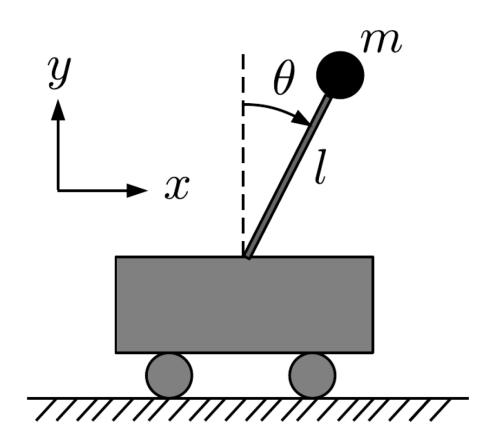
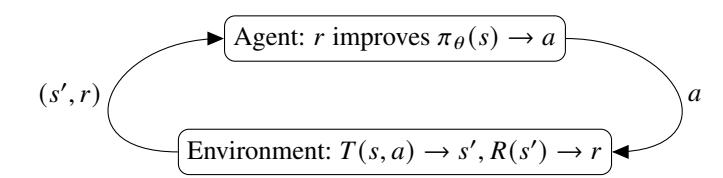
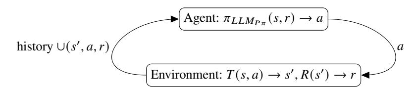
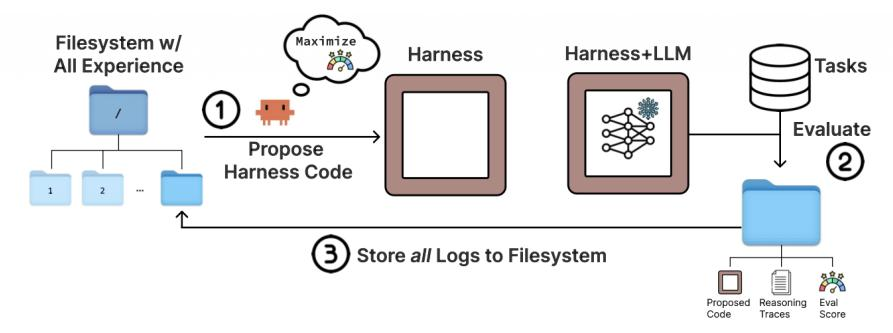
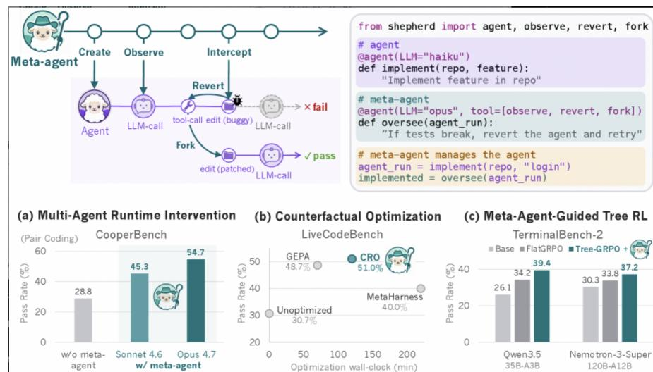

<!-- Source: AgenticLargeLanguageModels.pdf; physical PDF pages 391-402; Marker split PDF pages 1-12. -->

{0}------------------------------------------------

## Chapter 20

# \*Advanced Transformer and Agentic Architectures

#### What You Will Learn

In this chapter, you will learn about advanced Transformer and agentic architectures. Specifically, you will be able to:

- Understand the concept of *Turing-completeness*, and learn that transformers are, in principle, Turing-complete.
- Understand that transformer models can perform planning, when we train them on *decision traces*, instead of on natural language.
- Describe how embeddings can be connected directly to other embeddings, in *looped language models*, skipping tokenization layers.
- Describe how agents can perform *reinforcement learning in-context*, by storing a history of state-action-reward triples.
- Describe the advantages and disadvantages of *self-modifying* agents.
- Understand how metalearning can be applied to harness design, to create a *metaharness* that improves the basic harness.

## 20.1 Transformer Architectures

The success of large language models has opened new avenues for research on Transformer architectures. Although LLMs perform well on language tasks, they have been less successful at other tasks, such as reasoning and planning. This has led researchers to investigate the limits of the computations Transformers can perform. One question is whether Transformers are Turing-complete (Section [20.1.1](#page-1-0)). Weak performance on planning tasks has also motivated researchers to train Transformers directly on decision traces and test whether they can learn to plan and backtrack (Section [20.1.2](#page-1-0)). Finally, we will examine looped language models, in which models are connected

{1}------------------------------------------------

directly at the level of the embeddings.

#### 20.1.1 Transformers are Turing-complete

The difficulty LLMs have in managing state at inference time suggests that they may be limited in the computations they can perform. In theoretical computer science, *Turing-completeness* describes whether a computational system can simulate a universal model of computation, including one that manages state. Alan Turing introduced this idea in a landmark 1936 paper [\[Turing,](#page-10-0) [1936\]](#page-10-0). A Turing-complete system can simulate any other computational device and execute any algorithmically specified computation, given sufficient time and memory. Most general-purpose programming languages are Turing-complete.1

The difficulty LLMs—and Transformer-based models more generally—have in managing state might suggest that the Transformer architecture is not Turing-complete. However, Perez et al. studied this question in 2021 and proved that a Transformer can simulate a Turing machine, making the architecture Turing-complete [Perez et al.](#page-10-0) [\[2021\]](#page-10-0).

This is an encouraging result: it suggests there is no fundamental barrier preventing Transformers from managing state correctly. The remaining challenge may be to find suitable prompts and pretraining or fine-tuning data.

Theoretical possibility does not guarantee that a capability will be easy or efficient to achieve. Architectural extensions, for example, may make effective state management easier. The next section discusses methods designed to help Transformers solve decision-making and planning problems efficiently.

## 20.1.2 Pretraining on Decision Traces and Backtracking

The finding that Transformers are Turing-complete has encouraged research on planning and decision-making. This section describes studies that pretrain Transformer architectures on decision traces. The models discussed here are not trained on natural language and are therefore distinct from LLMs.

First, we consider models pretrained directly on decision traces: sequences of state–action–reward triples rather than language tokens. Several studies ask whether Transformers can learn policies from feedback and explore in order to discover better actions. Chen et al. [\[2021\]](#page-8-0), Lee et al. [\[2023\]](#page-9-0), and Wang et al. [\[2024\]](#page-11-0) showed that basic Transformer architectures can be pretrained and fine-tuned on decision traces from standard planning

1For example, the Python programming language is Turing complete, but simple regular expression matching, without backreferencing, is not.

{2}------------------------------------------------

Figure 20.1: The Cartpole Problem: Balance the Pole just by Moving the Cart Left or Right

tasks. A Transformer trained this way, without language pretraining, can exhibit in-context reinforcement learning (ICRL). So far, this has been demonstrated on toy problems such as Boyan's chain and CartPole (Figure 20.1). Encouraging results have also been reported in chess and Hex after training decision Transformers on minimax [\[Markeeva et al.,](#page-9-0) [2024,](#page-9-0) [Knuth and](#page-9-0) [Moore,](#page-9-0) [1975\]](#page-9-0) or Monte Carlo tree search (MCTS) [\[Browne et al.,](#page-8-0) [2012\]](#page-8-0) traces [\[Schultz et al.,](#page-10-0) [2024,](#page-10-0) [Kempinski et al.,](#page-9-0) [2025\]](#page-9-0). The models learned to look ahead and search several steps. Other studies report promising results in Othello [\[Li et al.,](#page-9-0) [2023,](#page-9-0) [Kempinski et al.,](#page-9-0) [2025,](#page-9-0) [Chen et al.,](#page-8-0) [2025\]](#page-8-0).

A further line of work studies how Transformers can learn to make decisions through *self-backtracking* [\[Yang et al.,](#page-11-0) [2026a\]](#page-11-0). The model is trained on decision traces that include a special `<backtrack>` token. When it makes an error during training, it learns to emit this token and search for an alternative solution. At inference time, the model uses an expand–backtrack–select procedure to examine alternative solutions to the current state.

Compared with standard baselines using small versions of DeepSeek-R1 and Qwen3, self-backtracking performs well on planning tasks such as the 24 Game and maze navigation. Adding a dedicated token and backtracking functionality enables the Transformer to search, blurring the boundary between training and inference.

These results are promising, but it remains unclear how far they address Transformers' weakness in state management. Applying inference-time ICRL to larger problems remains an active area of research.

{3}------------------------------------------------

## 20.1.3 Looped LLMs and Recursive Multi-Agent Systems

Increasing the expressive power of Transformers brings them closer to general-purpose computing architectures. This section covers two developments: looped language models and recursive systems.

LLM agents can communicate in natural language, the medium on which they were trained. However, this requires repeated tokenization and detokenization, which takes time and can introduce differences between embeddings. Could agents instead connect embeddings directly, bypassing tokenizers during training and inference?

[Giannou et al.](#page-9-0) [\[2023\]](#page-9-0) show that looped Transformers—whose input representations connect directly to the output representations of the same or another model—can emulate a basic calculator, a linear-algebra library, and in-context learning algorithms that use backpropagation. Further work explores the capabilities of this architecture [Yang et al.](#page-11-0) [\[2023\]](#page-11-0), [Saunshi et al.](#page-10-0) [\[2025\]](#page-10-0), [Zhu et al.](#page-11-0) [\[2025\]](#page-11-0).

A further development of direct embedding-to-embedding connections is recursive multi-agent systems [\[Yang et al.,](#page-11-0) [2026b\]](#page-11-0). This approach links heterogeneous agents in a collaboration loop, enabling in-distribution latent-thought generation and transfer of latent states between agents. An inner–outer-loop learning algorithm (metalearning; see Chapter 8) co-optimizes the system through shared, gradient-based credit assignment across recursion rounds. Experiments with four agents on mathematics, science, medicine, search, and code-generation benchmarks showed stable multi-agent training. Compared with single-agent, multi-agent, and recursive baselines, accuracy improved by several percentage points, inference was twice as fast, and token use fell by a similar proportion.

RecursiveMAS introduces a two-level recursive link. Training a multi-agent system can be difficult because gradients must flow through several models, which can make optimization unstable. RecursiveMAS addresses this by freezing the underlying LLM parameters and training only lightweight RecursiveLink modules. Training takes place in two stages.

## 20.2 Agentic Architectures

Research on agentic LLMs has also produced new agent architectures. First, we examine in-context reinforcement learning, in which an LLM can improve its policy when its prompt includes a history of state–action–reward triples. Next, we consider the benefits and drawbacks of self-modifying agents. Finally, we discuss meta-agents.

## 20.2.1 In-Context Reinforcement Learning

Recall from Section 2.2.3 that reinforcement learning seeks a policy that selects an optimal action for each state [\[Sutton and Barto,](#page-10-0) [2018\]](#page-10-0). As the agent

{4}------------------------------------------------

Figure 20.2: For reference, the standard reinforcement learning loop where the agent learns a $\theta$-parameterized policy $\pi_\theta$ from feedback rewards $r$ from the environment upon its actions $a$, selected from policy $\pi_\theta$, etc. [\\[Sutton and Barto,](#page-10-0) [2018\\]](#page-10-0)

converges toward this policy, it receives reward feedback from the environment at each time step. These rewards reinforce the agent's confidence in the actions selected by its policy in each state (Figure 20.2). The self-reflection methods discussed earlier borrow several ideas from reinforcement learning. We now turn to related methods that use in-context reinforcement learning to improve prompts.

Reinforcement-like learning mechanisms have been observed to emerge in LLMs when an external prompt optimizer provides them with environment histories. In some self-reflection loops, the LLM can improve its policy in this way. This phenomenon is called in-context reinforcement learning (ICRL) [\[Song et al.,](#page-10-0) [2025\]](#page-10-0); see Figure [20.3](#page-5-0).

[Krishnamurthy et al.](#page-9-0) [\[2024\]](#page-9-0) asked whether general-purpose LLMs trained on language can explore and learn from feedback in context. Several studies have since answered both questions positively [\[Demircan et al.,](#page-8-0) [2024,](#page-8-0) [Song et al.,](#page-10-0) [2025,](#page-10-0) [Moeini et al.,](#page-10-0) [2025,](#page-10-0) [Monea et al.,](#page-10-0) [2024,](#page-10-0) [Nie et al.,](#page-10-0) [2024,](#page-10-0) [Wang et al.,](#page-11-0) [2024\]](#page-11-0).

In ICRL, an external harness calls the LLM repeatedly and supplies the growing history of actions, states, and rewards as context (Figure [20.3](#page-5-0)). The LLM then improves its implicit policy and, over successive iterations, selects better actions. In this sense, it performs the essential policy-improvement step of reinforcement learning within the model.

In ICRL, the agent selects an *action*, takes a step, and receives a *state*–*reward* pair from the environment (Figure [20.3](#page-5-0)). In a Markov decision process (MDP), the previous state and action contain all information needed to determine the next state. The policy LLM's prompt therefore accumulates the relevant history of $(s,a,r)$ triples, which it can use to improve its action choices. Retaining a history of observations is a natural way to represent state, but how to model prompt improvement as an MDP remains an active research question.

In ICRL, the LLM serves as the agent's policy. A separately prompted LLM can also simulate the environment, as in some self-reflective agent harnesses.

In contextual reinforcement learning, a multi-turn harness prompts the agent and environment in repeated rounds. After the environment LLM generates a response, an LLM computes a numeric reward for that response.

{5}------------------------------------------------

Figure 20.3: ICRL: Prompt Optimization with Reinforcement Learning

At the next round, the agent LLM receives the same task together with the previous responses and rewards. As this context grows, response quality can improve, allowing the LLM to maximize its numeric reward at inference time. Song et al. [\[2025\]](#page-10-0) tested ICRL on Tree of Thoughts applications, including the 24 Game, creative writing, and ScienceWorld, and found that it outperformed Self-Refine and Reflexion.

How does ICRL work inside an LLM? At inference time, the model computes tokens through a forward pass of its Transformer network. Research suggests that this forward pass can implicitly implement reinforcement learning [\[Wang et al.,](#page-11-0) [2024\]](#page-11-0). In-weight learning uses parameters acquired during training; in-context learning uses examples supplied in the prompt at inference time; and ICRL uses an expanding sequence of state–action–reward triples generated during interaction. When this history is included in the context, the forward pass can implicitly improve the model's policy.

An LLM can serve as the agent and policy optimizer, and another can simulate the environment and generate the next state and reward. Using separate models helps prevent the agent from gaining unintended access to the environment's information. This remains an active area of research.

## 20.2.2 Self-Modifying Hyperagents

This book has discussed self-reflective prompt improvers based on search algorithms and reinforcement learning. Human researchers write the code for these external algorithms, and it does not change while the agent learns. As a result, prompt improvement is constrained by the capabilities of the fixed algorithms.

LLMs can manipulate and evaluate computer code [\[Zhuge et al.,](#page-11-0) [2024\]](#page-11-0). In principle, we could ask an LLM to write code for an agent harness or an ICRL harness, run it on a particular problem, and then use the results to revise the harness itself. If the model can use experimental results to improve its prompt-optimization code, this approach could outperform

{6}------------------------------------------------

standard approaches described in the literature.

Self-modifying code—programs that alter their own instructions while running—has a long history in computer science [\[Cai et al.,](#page-8-0) [2007\]](#page-8-0). It is supported by languages ranging from assembly to Lisp [\[Abelson and Sussman,](#page-8-0) [2022\]](#page-8-0) and Python, and can improve performance, for example through just-in-time compilation [\[Ansel et al.,](#page-8-0) [2011\]](#page-8-0). However, self-modification makes programs less predictable, complicates debugging, and raises security concerns. It may therefore be discouraged when predictable behavior is important.

An advantage of self-modifying agents is open-endedness: they can continue to improve without the fixed boundaries imposed by static algorithms [\[Schmidhuber,](#page-10-0) [2007\]](#page-10-0). Doing so safely remains a challenge [\[Zhang et al.,](#page-11-0) [2026b\]](#page-11-0). Darwin-Gödel Machine-Hyperagents combine (1) an agent that solves a target task and (2) a meta-agent that modifies both itself and the task-solving agent in a single editable program. Because the meta-level modification procedure is itself editable, the system can in principle improve both task-solving behavior and the process that generates future improvements [\[Zhang et al.,](#page-11-0) [2026c\]](#page-11-0). However, the experiments do not achieve full openness: they use a fixed task distribution and fixed protocols for parent selection and evaluation.

As approaches become more open-ended, controlling the improvement process becomes more difficult. Systems must keep improving without degenerating [\[Cemri et al.,](#page-8-0) [2025,](#page-8-0) [Ecoffet et al.,](#page-9-0) [2020\]](#page-9-0). More generally, powerful metalearning methods require stable learning processes: strong generation must be matched by strong evaluation and adaptation to the environment.

### 20.2.3 Meta-Agents

The two-level optimization used in many self-reflection methods can also guide agent-harness design. Several architectures follow this principle: the inner learning loop consists of the harness and the LLM, while the outer loop improves the inner harness's configuration. The harness typically manages prompts, memory, tools, security, and control, and can be represented in natural language or code. The outer loop analyzes the inner loop's execution traces and uses them to revise the harness configuration or code. We briefly describe several examples.

The *Self-Improving Coding Agent* [\[Robeyns et al.,](#page-10-0) [2025\]](#page-10-0) builds on self-modifying agents. Robeyns et al. show that an agent equipped with basic coding tools can edit its own system. Their approach raises performance on software-engineering benchmarks from 17% to 53%.

The *Meta-Harness* [\[Lee et al.,](#page-9-0) [2026\]](#page-9-0) also achieves promising results using external memory and text optimization. Figure [20.4](#page-7-0) illustrates its workflow: (1) a filesystem stores the source code, execution traces, and scores of previous candidates, which the agent uses to generate a new harness; (2) the proposed harness is evaluated on

{7}------------------------------------------------

Figure 20.4: Illustration of the Meta Harness approach [\[Lee et al.,](#page-9-0) [2026\]](#page-9-0)

Figure 20.5: Illustration of the Shepherd Meta Agent Environment [\[Yu et al.,](#page-11-0) [2026\]](#page-11-0)

evaluation tasks; and (3) the proposed code, reasoning traces, and evaluation scores are stored in a new directory before the loop repeats.

*Self-Harness* [\[Zhang et al.,](#page-11-0) [2026a\]](#page-11-0) and *Agentic Harness Engineering* [\[Lin et al.,](#page-9-0) [2026\]](#page-9-0) also explore harness design and report substantial improvements on software-engineering tasks. *Recursive Self-Evolving Agents* [\[Nguyen et al.,](#page-10-0) [2026\]](#page-10-0) focuses on how self-improving agents select among candidate changes.

Luo et al. describe another application [\[2026\]](#page-9-0): using a meta-harness to create a harness that turns a scientific paper into a conference poster. The work contributes both a method for building meta-harnesses and a specific poster-design harness, which the authors also use for their own paper.

The Shepherd system [\[Yu et al.,](#page-11-0) [2026\]](#page-11-0) provides a programming environment for functional meta-agents.2 Shepherd defines LLM agents as Python functions, allowing

2<https://shepherd-agents.ai>

{8}------------------------------------------------

an agent's execution traces to be monitored, rolled back, forked, modified, and resumed. Early experiments show significant performance improvements on three different benchmarks (Figure [20.5](#page-7-0)).

A broader survey of self-improving agent designs is provided by Ren et al. [\[2026\]](#page-10-0). Its taxonomy explicitly identifies this two-level architecture.

## 20.3 Concluding Remarks

This chapter has surveyed advanced architectures for both Transformers and agents. Both remain active areas of research.

## Bibliography

- Harold Abelson and Gerald Jay Sussman. *Structure and Interpretation of Computer Programs: JavaScript Edition*. MIT press, 2022. [397](#page-6-0)

- Jason Ansel, Petr Marchenko, Ulfar Erlingsson, Elijah Taylor, Brad Chen, Derek L Schuff, David Sehr, Cliff L Biffle, and Bennet Yee. Language-independent sandboxing of just-in-time compilation and self-modifying code. In *Proceedings of the 32nd ACM SIGPLAN conference on Programming language design and implementation*, pages 355–366, 2011. [397](#page-6-0)

- Cameron B Browne, Edward Powley, Daniel Whitehouse, Simon M Lucas, Peter I Cowling, Philipp Rohlfshagen, Stephen Tavener, Diego Perez, Spyridon Samothrakis, and Simon Colton. A survey of monte carlo tree search methods. *IEEE Transactions on Computational Intelligence and AI in games*, 4(1):1–43, 2012. [393](#page-2-0)

- Hongxu Cai, Zhong Shao, and Alexander Vaynberg. Certified self-modifying code. In *Proceedings of the 28th ACM SIGPLAN Conference on Programming Language Design and Implementation*, pages 66–77, 2007. [397](#page-6-0)

- Mert Cemri, Melissa Z Pan, Shuyi Yang, Lakshya A Agrawal, Bhavya Chopra, Rishabh Tiwari, Kurt Keutzer, Aditya Parameswaran, Dan Klein, Kannan Ramchandran, et al. Why do multi-agent llm systems fail? *arXiv preprint arXiv:2503.13657*, 2025. [397](#page-6-0)

- Lili Chen, Kevin Lu, Aravind Rajeswaran, Kimin Lee, Aditya Grover, Misha Laskin, Pieter Abbeel, Aravind Srinivas, and Igor Mordatch. Decision transformer: Reinforcement learning via sequence modeling. *Advances in neural information processing systems*, 34:15084–15097, 2021. [392](#page-1-0)

- Xinyi Chen, Yifei Yuan, Jiaang Li, Serge Belongie, Maarten de Rijke, and Anders Søgaard. What if othello-playing language models could see? *arXiv preprint arXiv:2507.14520*, 2025. [393](#page-2-0)

- Can Demircan, Tankred Saanum, Akshay K Jagadish, Marcel Binz, and Eric Schulz. Sparse autoencoders reveal temporal difference learning in large language models. *arXiv preprint arXiv:2410.01280*, 2024. [395](#page-4-0)

{9}------------------------------------------------

- Adrien Ecoffet, Jeff Clune, and Joel Lehman. Open questions in creating safe open-ended AI: Tensions between control and creativity. In *Artificial Life Conference Proceedings 32*, pages 27–35. MIT Press, 2020. [397](#page-6-0)

- Angeliki Giannou, Shashank Rajput, Jy-yong Sohn, Kangwook Lee, Jason D Lee, and Dimitris Papailiopoulos. Looped transformers as programmable computers. In *International Conference on Machine Learning*, pages 11398–11442. PMLR, 2023. [394](#page-3-0)

- Benjamin Kempinski, Ian Gemp, Kate Larson, Marc Lanctot, Yoram Bachrach, and Tal Kachman. Game of thoughts: Iterative reasoning in game-theoretic domains with large language models. In *Proc. of the 24th International Conference on Autonomous Agents and Multiagent Systems*, pages 1088–1097, 2025. [393](#page-2-0)

- Donald E Knuth and Ronald W Moore. An analysis of alpha-beta pruning. *Artificial intelligence*, 6(4):293–326, 1975. [393](#page-2-0)

- Akshay Krishnamurthy, Keegan Harris, Dylan J Foster, Cyril Zhang, and Aleksandrs Slivkins. Can large language models explore in-context? *arXiv preprint arXiv:2403.15371*, 2024. [395](#page-4-0)

- Jonathan Lee, Annie Xie, Aldo Pacchiano, Yash Chandak, Chelsea Finn, Ofir Nachum, and Emma Brunskill. Supervised pretraining can learn in-context reinforcement learning. *Advances in Neural Information Processing Systems*, 36:43057–43083, 2023. [392](#page-1-0)

- Yoonho Lee, Roshen Nair, Qizheng Zhang, Kangwook Lee, Omar Khattab, and Chelsea Finn. Meta-harness: End-to-end optimization of model harnesses. *arXiv preprint arXiv:2603.28052*, 2026. [397,](#page-6-0) [398](#page-7-0)

- Kenneth Li, Aspen K. Hopkins, David Bau, Fernanda Viegas, Hanspeter Pfister, and Martin Wattenberg. Emergent world representations: Exploring a sequence model trained on a synthetic task. In *The Eleventh International Conference on Learning Representations*, 2023. URL <https://openreview.net/forum?id=DeG07_TcZvT>. [393](#page-2-0)

- Jiahang Lin, Shichun Liu, Chengjun Pan, Lizhi Lin, Shihan Dou, Zhiheng Xi, Xuanjing Huang, Hang Yan, Zhenhua Han, Tao Gui, et al. Agentic harness engineering: Observability-driven automatic evolution of coding-agent harnesses. *arXiv preprint arXiv:2604.25850*, 2026. [398](#page-7-0)

- Yaxin Luo, Haobin Jiang, Jialv Zou, Xu Huang, Wenhao Yan, Haodong Li, Zhengrong Yue, Jing Li, Xiaofu Chen, Xiaohan Zhao, et al. Autodesign: Meta-harness optimization for long-horizon agentic design. *arXiv preprint arXiv:2608.13560*, 2026. [398](#page-7-0)

- Larisa Markeeva, Sean McLeish, Borja Ibarz, Wilfried Bounsi, Olga Kozlova, Alex Vitvitskyi, Charles Blundell, Tom Goldstein, Avi Schwarzschild, and Petar

{10}------------------------------------------------

Veličković. The CLRS-Text algorithmic reasoning language benchmark. *arXiv preprint arXiv:2406.04229*, 2024. [393](#page-2-0)

- Amir Moeini, Jiuqi Wang, Jacob Beck, Ethan Blaser, Shimon Whiteson, Rohan Chandra, and Shangtong Zhang. A survey of in-context reinforcement learning. *arXiv preprint arXiv:2502.07978*, 2025. [395](#page-4-0)

- Giovanni Monea, Antoine Bosselut, Kiante Brantley, and Yoav Artzi. LLMs are in-context reinforcement learners, 2024. [395](#page-4-0)

- Michael Nguyen, Quoc Nguyen, and Paul Vuong. Recursive self-evolving agents via held-out selection. *arXiv preprint arXiv:2606.28374*, 2026. [398](#page-7-0)

- Allen Nie, Yi Su, Bo Chang, Jonathan N Lee, Ed H Chi, Quoc V Le, and Minmin Chen. Evolve: Evaluating and optimizing llms for exploration. *arXiv preprint arXiv:2410.06238*, 2024. [395](#page-4-0)

- Jorge Pérez, Pablo Barceló, and Javier Marinkovic. Attention is Turing-complete. *Journal of Machine Learning Research*, 22(75):1–35, 2021. [392](#page-1-0)

- Zhe Ren, Yimeng Chen, Dandan Guo, Guowei Rong, Tonghui Li, RB Xiong, Qingfeng Lan, Wenyi Wang, Li Nanbo, Yibo Yang, et al. Self-improvements in modern agentic systems: A survey. *arXiv preprint arXiv:2607.13104*, 2026. [399](#page-8-0)

- Maxime Robeyns, Martin Szummer, and Laurence Aitchison. A self-improving coding agent. *arXiv preprint arXiv:2504.15228*, 2025. [397](#page-6-0)

- Nikunj Saunshi, Nishanth Dikkala, Zhiyuan Li, Sanjiv Kumar, and Sashank J Reddi. Reasoning with latent thoughts: On the power of looped transformers. *arXiv preprint arXiv:2502.17416*, 2025. [394](#page-3-0)

- Jürgen Schmidhuber. Gödel machines: Fully self-referential optimal universal self-improvers. In *Artificial General Intelligence*, pages 199–226. Springer, 2007. [397](#page-6-0)

- John Schultz, Jakub Adamek, Matej Jusup, Marc Lanctot, Michael Kaisers, Sarah Perrin, Daniel Hennes, Jeremy Shar, Cannada Lewis, Anian Ruoss, et al. Mastering board games by external and internal planning with language models. *arXiv preprint arXiv:2412.12119*, 2024. [393](#page-2-0)

- Kefan Song, Amir Moeini, Peng Wang, Lei Gong, Rohan Chandra, Yanjun Qi, and Shangtong Zhang. Reward is enough: Llms are in-context reinforcement learners. *arXiv preprint arXiv:2506.06303*, 2025. [395,](#page-4-0) [396](#page-5-0)

- Richard S Sutton and Andrew G Barto. *Reinforcement Learning*. Adaptive Computation and Machine Learning series. Bradford Books, Cambridge, MA, 2 edition, November 2018. [394,](#page-3-0) [395](#page-4-0)

- Alan Turing. On computable numbers, with an application to the entscheidungsproblem. *J. of Math*, 58(345-363):5, 1936. [392](#page-1-0)

{11}------------------------------------------------

- Jiuqi Wang, Ethan Blaser, Hadi Daneshmand, and Shangtong Zhang. Transformers learn temporal difference methods for in-context reinforcement learning. *arXiv preprint arXiv:2405.13861*, 2024. [392,](#page-1-0) [395,](#page-4-0) [396](#page-5-0)

- Liu Yang, Kangwook Lee, Robert Nowak, and Dimitris Papailiopoulos. Looped transformers are better at learning learning algorithms. *arXiv preprint arXiv:2311.12424*, 2023. [394](#page-3-0)

- Xiao-Wen Yang, Xuan-Yi Zhu, Ding-Chu Zhang, Wen-Da Wei, Jie-Jing Shao, Zhi Zhou, Lan-Zhe Guo, and Yu-Feng Li. Step back to leap forward: Self-backtracking for symbolic reasoning and planning in language models. In *Proceedings of the AAAI Conference on Artificial Intelligence*, volume 40, pages 27657–27665, 2026a. [393](#page-2-0)

- Xiyuan Yang, Jiaru Zou, Rui Pan, Ruizhong Qiu, Pan Lu, Shizhe Diao, Jindong Jiang, Hanghang Tong, Tong Zhang, Markus J. Buehler, Jingrui He, and James Zou. Recursive multi-agent systems, 2026b. URL <https://arxiv.org/abs/2604.25917>. [394](#page-3-0)

- Simon Yu, Derek Chong, Ananjan Nandi, Dilara Soylu, Jiuding Sun, Christopher D Manning, and Weiyan Shi. Shepherd: Enabling programmable meta-agents via reversible agentic execution traces. *arXiv preprint arXiv:2605.10913*, 2026. [398](#page-7-0)

- Hangfan Zhang, Shao Zhang, Kangcong Li, Chen Zhang, Yang Chen, Yiqun Zhang, Lei Bai, and Shuyue Hu. Self-harness: Harnesses that improve themselves. *arXiv preprint arXiv:2606.09498*, 2026a. [398](#page-7-0)

- Jenny Zhang, Shengran Hu, Cong Lu, Robert Lange, and Jeff Clune. Darwin godel machine: Open-ended evolution of self-improving agents, 2026b. URL <https://arxiv.org/abs/2505.22954>. [397](#page-6-0)

- Jenny Zhang, Bingchen Zhao, Wannan Yang, Jakob Foerster, Jeff Clune, Minqi Jiang, Sam Devlin, and Tatiana Shavrina. Hyperagents, 2026c. URL <https://arxiv.org/abs/2603.19461>. [397](#page-6-0)

- Rui-Jie Zhu, Zixuan Wang, Kai Hua, Tianyu Zhang, Ziniu Li, Haoran Que, Boyi Wei, Zixin Wen, Fan Yin, He Xing, et al. Scaling latent reasoning via looped language models. *arXiv preprint arXiv:2510.25741*, 2025. [394](#page-3-0)

- Mingchen Zhuge, Changsheng Zhao, Dylan Ashley, Wenyi Wang, Dmitrii Khizbullin, Yunyang Xiong, Zechun Liu, Ernie Chang, Raghuraman Krishnamoorthi, Yuandong Tian, et al. Agent-as-a-judge: Evaluate agents with agents. *arXiv preprint arXiv:2410.10934*, 2024. [396](#page-5-0)
