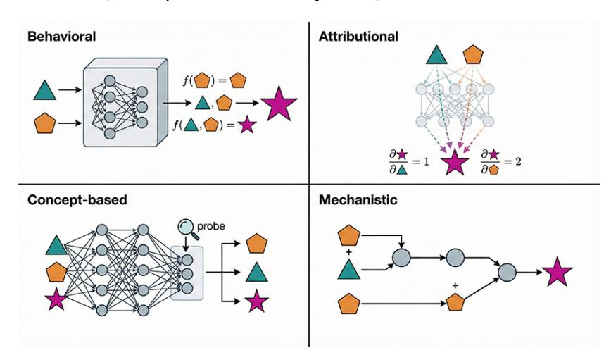
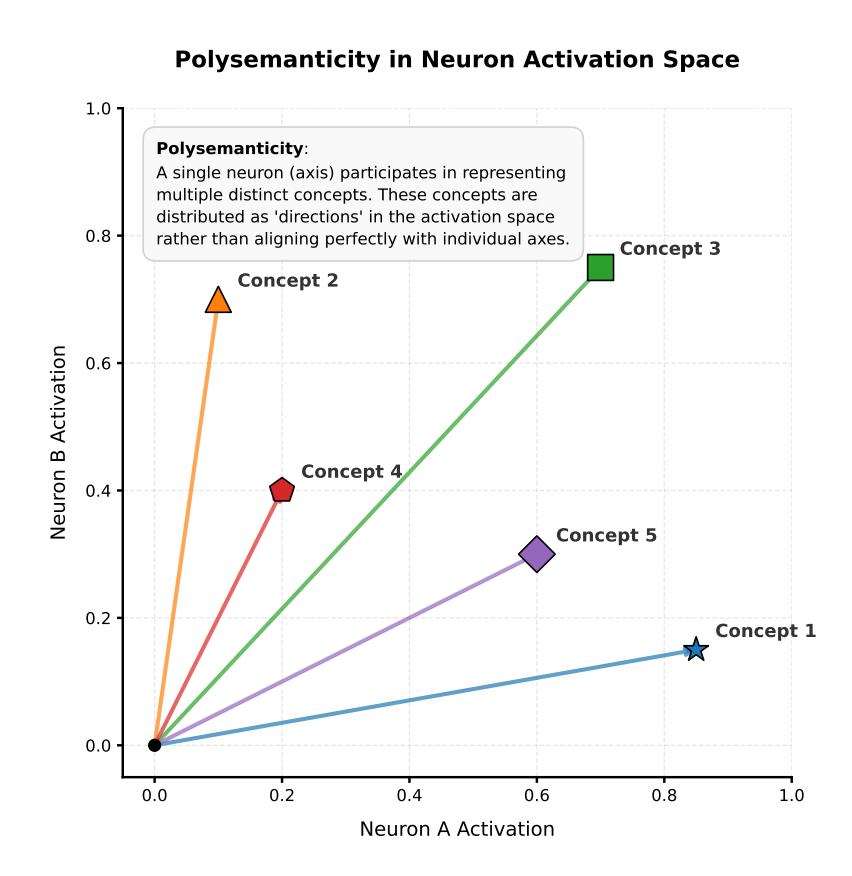
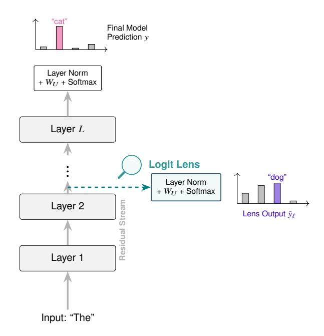
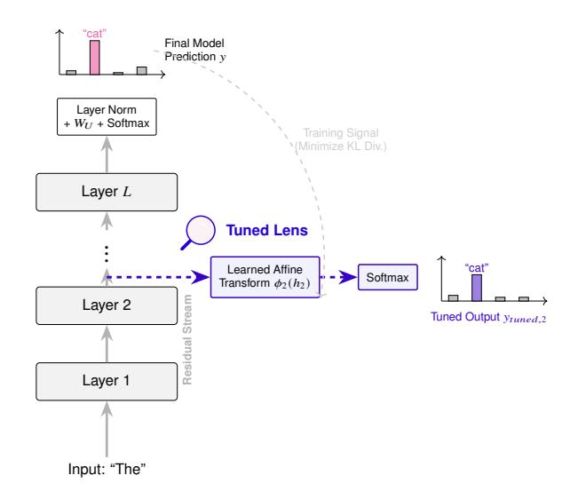
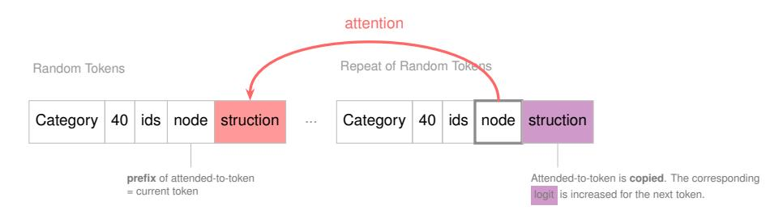
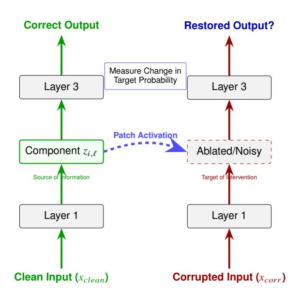
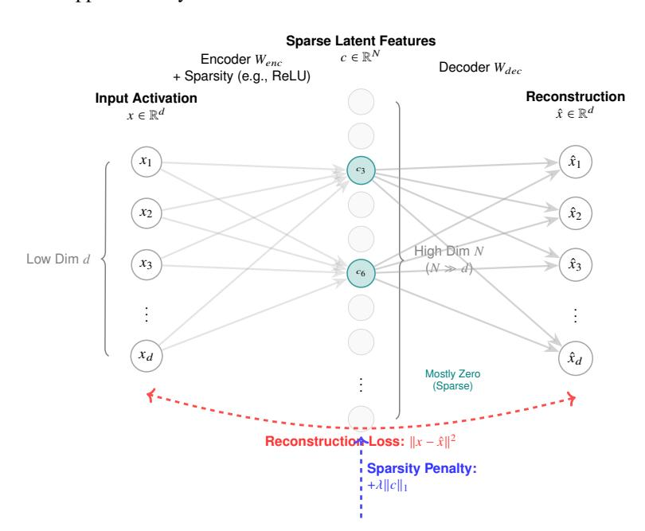

<!-- Source: AgenticLargeLanguageModels.pdf; physical PDF pages 403-422; Marker split PDF pages 1-20. -->

{0}------------------------------------------------

## 第21章

# \*LLM 智能体的机制可解释性

### 你将学到的内容

在本章中，你将学习如何使用可解释人工智能和机制可解释性方法分析大语言模型的内部机制。具体来说，你将能够：

- 区分四种主要的可解释性范式：*行为分析*、*归因分析*、*基于概念的分析*和*机制可解释性*。
- 解释幻觉与*忠实性*的关系，并说明机制方法如何识别导致模型失效的内部电路。
- 描述 Transformer 的*残差流*形式，并解释信息如何在各层间逐步精炼。
- 使用 *logit lens* 和 *tuned lens* 观察模型预测如何随层数变化。
- 解释*多义性*与*叠加*，并说明为何单个神经元并非理想的解释单位。
- 使用*稀疏自编码器*进行字典学习，将模型激活分解为近似单义、易于人理解的特征。
- 通过*电路分析*和*激活修补*识别并因果验证特定模型行为背后的内部算法。

## 21.1 探索 LLM 内部

LLM 内部如何运作？揭开大型神经网络的黑箱是重要的研究课题。我们希望理解数十亿个神经元如何编码表示、如何推理并得出结论。可解释人工智能（XAI）领域提供了多种研究方法 [\[Minh et al.,](#page-16-0) [2022,](#page-16-0) [Rios et al.,](#page-17-0) [2020,](#page-17-0) [Van Stein et al.,](#page-18-0) [2022,](#page-18-0) [Selvaraju et al.,](#page-17-0) [2017,](#page-17-0) [Ali et al.,](#page-14-0) [2022](#page-14-0)。
{1}------------------------------------------------

经典机器学习领域的静态 XAI 方法已经取得了不少成果 [\[Molnar,](#page-16-0) [2020\]](#page-16-0)。例如，特征图可以展示输入图像如何映射到输出类别 [\[Ren et al.,](#page-17-0) [2016,](#page-17-0) [Kohonen,](#page-16-0) [1982,](#page-16-0) [Redmon et al.,](#page-17-0) [2016\]](#page-17-0)。反事实分析 [\[Karimi et al.,](#page-16-0) [2020,](#page-16-0) [Huang et al.,](#page-15-0) [2024\]](#page-15-0)、LIME [\[Ribeiro et al.,](#page-17-0) [2016\]](#page-17-0) 和 SHAP [\[Lundberg and Lee,](#page-16-0) [2017\]](#page-16-0) 等方法，则有助于解释结构化数据任务中输入与输出的关系。这些方法属于*行为*或*归因*可解释性范式，均将模型视为黑箱（图 21.1）。SHAP 和 LIME 等归因方法会估计各输入特征对最终输出的贡献；反事实等行为分析方法则能揭示哪些特征重要，但未必能量化其影响程度。

图 21.1：*可解释性范式* 分类。行为可解释性将模型视为黑箱，映射输入输出关系 ($f(x)=y$)。归因方法使用梯度或显著性来量化特定输入特征对最终输出的影响。基于概念的可解释性使用探针来识别隐藏层中高级、可被人类理解的表示。机制可解释性旨在逆向工程控制模型行为的特定因果电路和内部算法。
超越表层的输入—输出相关性，*基于概念*的可解释性关注模型内部状态是否编码了特定且可供人理解的信息。常用方法是*线性探测*：在冻结的隐藏层激活上训练简单的监督分类器，以检测词性、情感或事实实体等语义概念 [\[Alain and Bengio,](#page-14-0) [2016,](#page-14-0) [Belinkov,](#page-14-0) [2022\]](#page-14-0)。归因方法指出输入中*哪些*部分影响输出；探测则检验模型在不同层中表示了*什么*信息（图 21.1）。不过，探测存在一个已知的*因果鸿沟*：发现某个概念

{2}------------------------------------------------

在某一层中有所表示，并不意味着模型一定会在最终预测中使用这项信息。
近年来，研究者开发了动态方法来揭示大型 Transformer 模型内部的运行机制，这些方法属于机制可解释性（MI）领域。MI 旨在解释模型如何一步步得出结论 [\[Nanda et al.,](#page-17-0) [2023,](#page-17-0) [Bereska and Gavves,](#page-14-0) [2024,](#page-14-0) [Ferrando et al.,](#page-15-0) [2024,](#page-15-0) [Rai et al.,](#page-17-0) [2024\]](#page-17-0)，也就是依据内部激活和连接，对模型行为作低层次、因果性的解释，类似于将程序二进制反编译成可读代码。稀疏自编码器 [\[Cunningham et al.,](#page-15-0) [2023,](#page-15-0) [Makelov et al.,](#page-16-0) [2024\]](#page-16-0)、神经透镜 [\[Black et al.,](#page-14-0) [2022\]](#page-14-0) 和电路发现 [\[Conmy et al.,](#page-15-0) [2023\]](#page-15-0) 等方法，已用于研究 LLM 的工作机制，例如分析其下棋行为 [\[Davis and](#page-15-0) [Sukthankar,](#page-15-0) [2024\]](#page-15-0)。

XAI，尤其是 MI，都是活跃的研究领域，有望帮助我们更好地理解 LLM 如何推理和得出结论 [\[Sharkey et al.,](#page-17-0) [2025\]](#page-17-0)。随着理解加深，我们可以据此改进 LLM，例如减少幻觉。本章将进一步介绍 MI 的多个方面。
## 21.2 模型推理中的幻觉与忠实性

在高风险场景中部署 LLM 的一大障碍是*幻觉*：模型生成语法通顺却与事实不符的内容。从可解释性角度看，关键在于判断输出来自可靠的*内部计算*，还是事后的*合理化解释*。这涉及对*忠实性*的研究，即模型所陈述的推理（例如思维链）是否在因果上促成了最终输出。
机制可解释性（MI）提供了超越准确率等行为指标、因果分析模型失效模式的方法。例如，基于稀疏自编码器（SAE）的研究发现了与*诚实*或*知识检索*有关的电路 [\[Lindsey et al.,](#page-16-0) [2025\]](#page-16-0)。研究者识别出模型遇到陌生实体时会激活的潜在特征；如果电路的抑制机制失效，模型即使在相关*知识*特征激活不足时仍继续生成词元，就可能编造答案。

此外，MI 使我们能够研究中间推理步骤的*因果必然性*。尽管一个模型可能生成令人信服的思维链（CoT），但仍有可能模型已经通过一个独立的内部捷径计算出了最终答案，仅仅是将 CoT 作为*随机鹦鹉*进行生成。为了测试这一点，[Chen et al.](#page-15-0) [\[2026\]](#page-15-0) 结合 SAE 使用*因果中介分析*对算术任务中的潜在思维过程进行干预。通过将来自启用 CoT 的运行中的潜在激活注入到标准的零-shot 运行中，他们
{3}------------------------------------------------

证明，在足够大的模型中，这些中间思路显著提升了解决方案的信心。这提供了实证证据，表明对于更大的架构，链式思考（CoT）不仅仅是表面现象，而是在模型推理链中代表了一个*真实的*因果联系。
相反，在较小模型中缺乏这种因果联系表明，*忠实推理*可能是一种规模的突现特性，仅在模型拥有足够的参数来表示复杂的多步骤算法时才会出现。开发稳健的度量标准来量化这种忠实性是人工智能安全的关键前沿；通过窥探模型的激活情况，我们有可能开发幻觉检测器，当模型的内部置信特征与其外部冗长表达不一致时触发。
## 21.3 残差流与迭代精炼

在介绍具体的 MI 方法之前，先建立一个 Transformer 架构的形式化模型。与每层都会替换上一层表示的经典前馈网络不同，现代 Transformer 使用*残差流* [\[Elhage et al.,](#page-15-0) [2021\]](#page-15-0)。设 $h_\ell\in\mathbb{R}^{d_{\mathrm{model}}}$ 表示第 $\ell$ 层之后的隐藏状态，则 Transformer 的递推关系为：

$$
h_\ell = h_{\ell-1} + F_\ell(h_{\ell-1}) \tag{21.1}
$$

其中，$F_\ell$ 表示第 $\ell$ 层执行的计算，包括多头注意力和前馈模块。因此，最终表示 $h_L$ 是初始嵌入 $x_{\mathrm{embed}}$ 与各层贡献 $\Delta h_\ell$ 的累加：

$$
h_L = x_{\mathrm{embed}} + \sum_{\ell=1}^{L}\Delta h_\ell \tag{21.2}
$$
在这种观点下，残差流充当了一个高维的*通信通道*。各个层并不会转换整个状态；相反，它们从流中读取信息，执行局部计算，并通过向量相加将结果写回流中。这种加法性质确保了信息可以在许多层之间持续存在，更重要的是，它为模型最终输出的线性分解提供了合理性。
## 21.4 多义性与叠加

在逆向分析神经网络时，一个主要难题是*多义性*（图 [21.2](#page-4-0)）：单个神经元往往会对多个语义上无关的概念产生响应。这与*叠加*密切相关：当特征数 $n$ 大于表示维度 $m$ 时，模型仍可在 $m$ 维空间中表示这 $n$ 个特征。
{4}------------------------------------------------

图 21.2：LLM 及其他基于 Transformer 的模型中的多义性示意图。

根据*线性表示假说*，模型利用激活空间的高维几何结构，将特征存储为近似正交的向量。这有助于高效压缩信息，但也会造成基底不匹配：固定的神经元基底与真实的特征基底并不对齐。

[Elhage et al.](#page-15-0) [\[2022\]](#page-15-0) 使用玩具模型对这一现象作了形式化分析，指出当特征较为稀疏时，叠加是模型提高信息密度的一种有数学依据的策略。他们还发现了特征编码中的*相变*：概念越稀疏，模型就越能在相同维数中容纳更多特征，但特征之间的干扰或噪声也会随之增加。

为解开这些纠缠表示，研究者采用了*字典学习*，其中最受关注的方法是*稀疏自编码器*（SAE）。其目标是学习一种线性变换，将纠缠的神经元激活映射到维数更高且稀疏的潜在空间。[Bricken et al.](#page-14-0) [\[2023\]](#page-14-0) 将这种方法用于小型 Transformer
{5}------------------------------------------------

，结果显示，SAE 特征比原始神经元更接近单义特征，也更容易由人理解。这说明模型未必本质上不可解释；问题可能在于我们一直使用了不合适的坐标系。

后续研究探讨了能否通过修改架构来减少多义性。例如，[Liu et al.](#page-16-0) [\[2023\]](#page-16-0) 等人研究了不同的激活函数和正则化项（如 $L_1$ 稀疏性）能否促使模型采用更适配、也更易解释的内部基底。尽管已有这些进展，多义性仍普遍存在于先进模型中。机制可解释性领域目前的共识是，解释模型需要超越“以神经元为单位”的思路，转而识别模型实际据以进行因果计算的*稀疏特征基底*。

## 21.5 Logit 透镜

机制可解释性中的一个基本认识是：Transformer 并非到最后一层才一次性计算输出，而是在*残差流*中逐层细化表示。*Logit lens*1 将中间层的隐藏状态直接解码到输出词表空间，让我们得以观察这一过程。
### 21.5.1 形式化定义

考虑一个有 $L$ 层的 Transformer。设 $x_0$ 为某个词元的初始嵌入，$h_\ell$ 为残差流经过第 $\ell$ 层后的状态，其中 $\ell\in\{1,\ldots,L\}$。在标准前向传播中，最终隐藏状态 $h_L$ 经层归一化（LN）和反嵌入矩阵 $W_U\in\mathbb{R}^{d_{\mathrm{model}}\times|V|}$ 映射为 logits $y$：

$$
y=\operatorname{Softmax}(\operatorname{LN}(h_L)W_U) \tag{21.3}
$$

Logit lens 将*相同的*反嵌入变换应用于中间状态 $h_\ell$，从而推广了这一做法：

$$
\hat{y}_\ell=\operatorname{Softmax}(\operatorname{LN}(h_\ell)W_U) \tag{21.4}
$$

其中，$\hat{y}_\ell$ 表示模型在第 $\ell$ 层给出的暂定概率分布。将各层的分布可视化后，研究者可以观察模型如何从模糊的语义簇逐步形成具体的词元预测，即*预测分布的演变*。

**直接 logit 归因。** Logit lens 展示了残差流 $h_\ell$ 的整体信息；若要单独考察某一层或某个注意力头的贡献，则可利用最终 logits 与各层输出累加和之间的线性关系：
1该方法最早见于这篇[博客文章](https://www.lesswrong.com/posts/AcKRB8wDpdaN6v6ru/interpreting-gpt-the-logit-lens)；[Wang (2025)](#page-18-0) 提供了更新的实现。
{6}------------------------------------------------

图 21.3：*Logit lens* 示意图。模型在中间层（例如第 2 层）将残差流状态送入解码，并使用最终反嵌入矩阵 $W_U$ 将其映射到词表空间。由此可以观察模型在该层的当前预测，但较早层的结果可能含有较多噪声。

若将第 $\ell$ 层的输出 $\Delta h_\ell$ 直接投影到词表空间，便可计算该层的*直接 logit 归因*（DLA）：

$$
\operatorname{DLA}(\ell)=\operatorname{LN}(\Delta h_\ell)W_U \tag{21.5}
$$
DLA 有助于确定哪些组件将正确答案写入残差流，而不只是判断答案何时变得可见。在事实回忆研究中，DLA 常显示，某个单独的知识生成层为正确词元带来了大部分概率增益。
### 21.5.2 从 Logit Lens 到 Tuned Lens

最初的 logit lens 在网络最后三分之一的层中通常很有用，但在较早层可能产生乱码或高熵分布。例如，第 2 层的残差流还没有形成适合输出分布的表示，其中可能包含与反嵌入矩阵 $W_U$ 在数学上正交的低级位置信息。为弥补这一不足，[Belrose et al.](#page-14-0) [\[2023\]](#page-14-0) 提出了*tuned lens*。它不直接使用固定的 $W_U$，而是为每一层训练一个仿射变换 $\phi_\ell$，将 $h_\ell$ 映射到 logit 空间：

$$
y_{\mathrm{tuned},\ell}=\operatorname{Softmax}(\phi_\ell(h_\ell)) \tag{21.6}
$$

{7}------------------------------------------------

图 21.4：*Tuned lens* 示意图。与直接套用最终反嵌入矩阵的 logit lens 不同，tuned lens 使用针对特定层训练的仿射变换 $\phi_\ell$ 解码残差流。该变换经过训练，使中间层表示与模型的最终输出分布对齐，从而更清楚地呈现早期层中的信息。

训练 $\phi_\ell$ 时，最小化 $y_{\mathrm{tuned},\ell}$ 与模型最终输出 $y$ 之间的 KL 散度。这相当于把早期层的内部表示映射到输出词表空间；与直接使用 logit lens 相比，它可能显示事实信息在网络中出现得更早。
### 21.5.3 应用与解读

Logit lens 和 tuned lens 可用于筛选*早退*候选模型，并定位与特定知识有关的神经元。例如，如果代表某项事实（如“巴黎”）的词元在第 14 层从排名第 100 升至第 1，这可能说明第 14 层的注意力头或 MLP 子层参与了事实检索。

诸如*注意力头透镜* [\[Sakarvadia et al.,](#page-17-0) [2023\]](#page-17-0) 等变体，也将类似思路用于单个注意力头的输出，让研究者能够分别观察各头对预测的贡献。总体而言，这些工具让我们不再把 Transformer 看作单向流水线，而是将其理解为对潜在信息进行*累积式迭代优化*的系统。
## 21.6 电路分析

MI 的一个核心目标是识别*电路*：模型计算图中对实现某项特定高级功能既必要又充分的最小子图。与行为分析不同，电路发现试图解释信息如何从输入嵌入逐步变换为最终 logits。
{8}------------------------------------------------

### 21.6.1 典型电路：归纳头

发现*归纳头*是 Transformer 可解释性研究的一个里程碑 [\[Olsson et al.,](#page-17-0) [2022\]](#page-17-0)。归纳头是由至少两个注意力头组成的专门电路，能够实现前缀匹配算法。给定序列 `[A] [B] … [A]`，当前处理第二个 `[A]` 的归纳头会关注先前的 `[A]`，并将其后面的词元 `[B]` *复制*到残差流中（图 21.5）。

**注意力头的组合机制。** 要理解归纳电路中的两个注意力头如何通信，需要区分三种*注意力组合* [\[Elhage et al.,](#page-15-0) [2021\]](#page-15-0)：

- **V 组合**：前一个注意力头的输出（值向量）被后一个注意力头用作输入。
- **Q 组合 / K 组合**：前一个注意力头的输出写入某个词元的查询向量或键向量，从而影响后一个注意力头关注的位置。

归纳头通常依赖 *K 组合*：较早层的前一词元头将有关前一个词元的信息写入残差流；较后层的归纳头再利用这些信息构造键向量，以匹配当前前缀并关注正确的历史词元 `[B]`。

图 21.5：*归纳头电路的工作机制*。归纳头执行前缀匹配：模型找到当前词元（前缀）先前出现的位置，再关注其后续词元，以预测重复序列中的下一个词元。

[Olsson et al.](#page-17-0) [\[2022\]](#page-17-0) 观察到，这类注意力头在训练过程的某个阶段转变期间出现；与此同时，模型的上下文学习能力显著增强。这是较早将复杂能力追溯到跨层实现的特定离散算法的案例之一。
### 21.6.2 电路发现的方法学

手动识别电路十分耗时。[Wang et al.](#page-18-0) [\[2022\]](#page-18-0) 对*间接对象识别（IOI）*任务的研究，至今仍是手动追踪电路的代表性案例。他们使用*路径修补*，识别出一个由 26 个注意力头组成的网络。这些注意力头分工不同，包括
{9}------------------------------------------------

*名称移动头*、*S 抑制头*和*重复词元检测头*，它们共同完成共指消解。共指消解是指判断文本中的不同词元是否指向同一实体。例如，在 IOI 任务中，模型需要判断后文再次出现的人名（间接宾语）是否指向句子前面提到的特定人物；这一计算由专门的注意力头子网络完成。

要将这些发现推广到前沿模型，还需要*自动电路发现*（ACD）。
- ACD：[Conmy et al.](#page-15-0) [\[2023\]](#page-15-0) 提出了一种算法，该算法执行递归消融以修剪计算图中的边，仅保留那些其移除会显著降低模型在特定任务上的性能的边。
- 稀疏特征电路：超越神经元，更近期的框架整合了稀疏自编码器（SAEs），以在*特征空间*而非神经元空间追踪电路 [\[Marks et al.,](#page-16-0) [2024\]](#page-16-0)。通过将 SAE 特征视为节点、它们之间的权重视为边，研究人员可以构建归因图，直观展示人类可理解概念（例如，*拒绝*、*翻译*或*语法检查*）的流动。

评估：忠实性、完整性和最小性区分*建议的*电路和*因果的*电路至关重要。如果当电路之外的所有组件被消除时模型的性能仍然保持，则该电路被认为是*忠实的*。如果它捕捉了模型用于解决任务的所有途径，则它是*完整的*。
随着模型的扩展，我们发现算法往往在残差流中以冗余或分布式的方式表示。因此，电路追踪不仅仅是寻找单一的线路，而是试图映射信息通过模型高维潜在空间的*因果中介*。
## 21.7 激活修补与因果干预

虽然 logit lens 或探测（probing）等观测工具只能揭示内部状态与输出之间的相关性，*激活修补*（activation patching，也称*因果追踪*或*交换干预*）则可用于检验因果关系。这种方法是*因果中介分析* [\[Vig et al.,](#page-18-0) [2020\]](#page-18-0) 的实际应用，旨在分离特定模型组件对下游行为的影响（图 [21.6](#page-10-0)）。

**形式化框架。** 该方法包含两次前向传播：
1. **干净运行**（$x_{\mathrm{clean}}$）：能够产生目标行为的输入（例如，*埃菲尔铁塔位于巴黎*）。
2. **受扰或反事实运行**（$x_{\mathrm{corr}}$）：经过修改、无法再产生目标行为的输入（例如，*埃菲尔铁塔位于罗马*），或向 *埃菲尔铁塔* 的嵌入添加高斯噪声。

{10}------------------------------------------------

图 21.6：*激活修补*。将模型在*干净运行*（模型成功）中的激活替换到*受扰运行*（模型失败）中。如果这样能够恢复正确输出，就说明被修补的组件对该任务具有因果作用。

设 $z_{i,\ell}$ 表示第 $\ell$ 层组件 $i$ 的激活。激活修补会在受扰输入的前向传播中，用干净运行的激活 $z^{\mathrm{clean}}_{i,\ell}$ 替换受扰运行中的 $z^{\mathrm{corr}}_{i,\ell}$，然后衡量目标概率的恢复程度：

$$
\operatorname{Effect}=\frac{P(y_{\mathrm{target}}\mid\mathrm{patched})-P(y_{\mathrm{target}}\mid\mathrm{corr})}{P(y_{\mathrm{target}}\mid\mathrm{clean})-P(y_{\mathrm{target}}\mid\mathrm{corr})} \tag{21.7}
$$

Effect 接近 1，表示被修补的组件足以在因果上中介所研究的信息。

**定位知识与电路。** 激活修补带来了重要的架构层面发现。Meng et al.（2022）通过大规模激活扫描表明，事实关联往往集中在模型中间层的特定 MLP 模块中。即使输入语境受到扰动，这些知识神经元仍可能促使模型输出某项特定事实。

除了定位信息，修补也是进行*路径修补*的主要工具，可用于识别组件之间的相互作用。在前文介绍的间接对象识别研究中，Wang et al.（2022）修补特定注意力头，追踪信息如何从重复词元检测头流向名称移动头。这有助于绘制模型的计算图，进一步理解其内部算法。

**可扩展性与归因修补。** 激活修补的一大挑战是计算成本高：若要全面扫描，就必须对模型中的每个组件各执行一次前向传播。为降低成本，研究者采用*归因修补* [Syed et al., 2024]，利用梯度线性近似修补的影响，从而快速提出假设；筛出的候选因果组件之后再通过精确但较慢的激活修补验证。这种精细的验证能力使修补成为从推测性解释走向严格因果证据的重要工具。

{11}------------------------------------------------

## 21.8 稀疏自编码器：用于特征发现的字典学习

如叠加部分所述，神经网络表示的特征数往往多于其维度（$n>d$）。为解开纠缠的表示，研究者使用*稀疏自编码器*（SAE）——一种无监督字典学习方法，将激活映射到维数更高的稀疏潜在空间，使其中的特征近似单义。

图 21.7：*稀疏自编码器的架构*。模型将低维输入激活（$x\in\mathbb{R}^{d}$）映射到高维潜在空间（$c\in\mathbb{R}^{N}$，其中 $N\gg d$）。稀疏性惩罚（如 $L_1$ 正则化）促使大多数隐藏单元保持不激活，从而得到一组稀疏且可解释的特征，并用它们重建原始输入。

{12}------------------------------------------------

### 正式架构与训练目标

SAE 包含一个编码器和一个解码器：前者将模型激活 $x\in\mathbb{R}^{d}$ 映射到高维隐藏状态 $c\in\mathbb{R}^{N}$（其中 $N\gg d$），后者则尝试重建原始激活（图 [21.7](#page-11-0)）。编码器通常定义为：

$$
c=\operatorname{ReLU}(W_{\mathrm{enc}}(x-b_{\mathrm{dec}})+b_{\mathrm{enc}}) \tag{21.8}
$$

重建公式为：

$$
\hat{x}=W_{\mathrm{dec}}c+b_{\mathrm{dec}} \tag{21.9}
$$

为确保模型学到的是*稀疏*字典，而非简单的恒等映射，我们优化的损失函数同时考虑重建保真度和稀疏性惩罚：

$$
L=\lVert x-\hat{x}\rVert_2^2+\lambda\lVert c\rVert_1 \tag{21.10}
$$

其中，$\lambda$ 控制重建精度与特征稀疏性之间的权衡。近期的 *JumpReLU SAE* [\[Rajamanoharan et al.,](#page-17-0) [2024\]](#page-17-0) 使用阈值激活函数，使特征呈现近似二元的开/关行为，更接近离散语义特征这一理论理想。
### 21.8.1 单义性与影子模型

SAEs 的有效性已在各种规模上得到验证。[Cunningham et al.](#page-15-0) [\[2023\]](#page-15-0) 表明 SAEs 可以恢复 GPT-2 中表示特定语法概念（例如数字语境）的潜在特征，而 [Gao et al.](#page-15-0) [\[2024\]](#page-15-0) 成功将其扩展到十亿参数模型，识别编程语言和情感的特征。
这项工作的一个重要意义是有望构建*影子模型*：用基于稀疏特征的近似表示替换模型中多义性的 MLP 层，同时尽可能保持模型性能，并让内部计算更易理解。[Bricken et al.](#page-14-0) [\[2023\]](#page-14-0) 指出，SAE 特征比原始神经元更接近单义特征，能够将叠加表示解开为便于人类推理的基底。

在电路追踪中，研究者也从普通自编码器转向*转码器* [\[Dunefsky et al.,](#page-15-0) [2024\]](#page-15-0)。标准 SAE 重建单层激活（$x\rightarrow\hat{x}$）；转码器则学习把第 $\ell$ 层的激活映射到该层的*输出*（例如 $x\rightarrow\operatorname{MLP}(x)$）。因此，潜在特征 $c$ 表示该层实际执行的计算变换，从而直接揭示信息如何被处理，而不只是如何存储。

### 评估与开放挑战

评估 SAE 需要兼顾*忠实性*（使用这些特征会造成多大性能损失？）和*可解释性*（人类或自动化 LLM 探针能否可靠地描述特征？）。尽管 SAE 已取得进展，特征拆分（一个语义概念被分散到多个冗余特征中）以及极罕见特征难以解释等问题仍有待研究。
{13}------------------------------------------------

## 21.9 结论

### 21.9.1 展望与新兴方向

机制可解释性已从小众研究兴趣发展为严谨的研究领域，致力于弥合统计性能与科学理解之间的差距。随着领域不断成熟，若干前沿方向正在塑造未来十年的研究议程。
最紧迫的挑战仍然是可解释性的劳动瓶颈。虽然在 GPT-2 上进行手动电路发现曾是一个突破，但像 GPT-4 或 Claude 3 这样的前沿模型中庞大的特征数量需要自动化工作流程。*自动化可解释性* [\[Bills et al.,](#page-14-0) [2023\]](#page-14-0) 利用 LLM 来生成和测试关于通过 SAE 发现的数百万潜在特征的语义含义的假设。这个递归循环——使用模型来解释其自身的前身——可能是实现万亿参数系统完全透明的唯一途径。
为了超越随意编造的故事，该领域正在采用更严格的验证框架。*因果清理* [\[Chan et al.,](#page-14-0) [2022\]](#page-14-0) 代表了假设检验的当前最先进水平。通过系统地用特定假设下的期望值替换所提出电路的各个组件，并测量性能下降，研究人员可以定量地衡量其解释的*忠实度*。这使得模型解释（MI）更接近正式的验证科学，可以证明模型确实使用了特定算法。
机制可解释性越来越被视为实现稳健*人工智能对齐*的前提。通过识别与欺骗性对齐或情境意识相关的电路，研究者希望建立安全机制，以检测模型是否表面上给出令用户满意的答案，内部却在计算不同且可能有害的结果。此外，理解*训练动态*（例如模型突然从记忆转向泛化的*顿悟*现象 [\[Nanda et al.,](#page-17-0) [2023\]](#page-17-0)），也有助于研究者在训练过程中进行干预，引导模型形成更易解释、更安全的表征。

虽然本章聚焦语言模型，MI 的原理也正迅速拓展到其他领域，例如*时间序列 Transformer* [\[Kalnare et al.,](#page-16-0) [2026\]](#page-16-0)。时间序列 Transformer 面临独特挑战：其输入不具备离散的、人类可理解的语义，因此需要为连续信号开发新的字典学习方法。类似地，要解释视觉 Transformer 和多智能体强化学习系统，也需要结合空间、时间与社会层面的可解释性视角。
### 21.9.2 延伸阅读

从事后观察模型行为到绘制机制电路图，代表了人工智能研究范式的转变。我们不再满足于模型“能用”，还希望理解它们*如何工作*。研究者把稀疏自编码器这台“显微镜”与激活（及注意力）修补这把“手术刀”结合起来，逐个电路描绘 Transformer 的内部计算。
{14}------------------------------------------------

#### - 深入阅读

对于那些对定义这一领域的基础研究感兴趣的人，我们强烈推荐 [Transformer Circuits Thread](https://transformer-circuits.pub/)*a*。*a*<https://transformer-circuits.pub/>
# 参考文献

Guillaume Alain and Yoshua Bengio. Understanding intermediate layers using linear classifier probes. *arXiv preprint arXiv:1610.01644*, 2016. [404](#page-1-0)

Ameen Ali, Thomas Schnake, Oliver Eberle, Grégoire Montavon, Klaus-Robert Müller, and Lior Wolf. XAI for Transformers: Better Explanations through Conservative Propagation. In *International Conference on Machine Learning*, pages 435–451. PMLR, 2022. [403](#page-0-0)

Yonatan Belinkov. Probing classifiers: Promises, shortcomings, and advances. *Computational Linguistics*, 48(1):207–219, 2022. [404](#page-1-0)

Nora Belrose, Zach Furman, Logan Smith, Danny Halawi, Igor Ostrovsky, Lev McKinney, Stella Biderman, and Jacob Steinhardt. Eliciting latent predictions from transformers with the tuned lens. *arXiv preprint arXiv:2303.08112*, 2023. [409](#page-6-0)

Leonard Bereska and Efstratios Gavves. Mechanistic interpretability for AI safety–a review. *arXiv preprint arXiv:2404.14082*, 2024. [405](#page-2-0)

Steven Bills, Nick Cammarata, Dan Mossing, Henk Tillman, Leo Gao, Gabriel Goh, Ilya Sutskever, Jan Leike, Jeff Wu, and William Saunders. Language models can explain neurons in language models. [paper](https://openaipublic.blob.core.windows.net/neuron-explainer/paper/index.html), 2023. [416](#page-13-0)

Sid Black, Lee Sharkey, Leo Grinsztajn, Eric Winsor, Dan Braun, Jacob Merizian, Kip Parker, Carlos Ramón Guevara, Beren Millidge, Gabriel Alfour, et al. Interpreting neural networks through the polytope lens. *arXiv preprint arXiv:2211.12312*, 2022. [405](#page-2-0)

Trenton Bricken, Adly Templeton, Joshua Batson, Brian Chen, Adam Jermyn, Tom Conerly, Nick Turner, Cem Anil, Carson Denison, Amanda Askell, Robert Lasenby, Yifan Wu, Shauna Kravec, Nicholas Schiefer, Tim Maxwell, Nicholas Joseph, Zac Hatfield-Dodds, Alex Tamkin, Karina Nguyen, Brayden McLean, Josiah E Burke, Tristan Hume, Shan Carter, Tom Henighan, and Christopher Olah. Towards monosemanticity: Decomposing language models with dictionary learning. *Transformer Circuits Thread*, 2023. https://transformer-circuits.pub/2023/monosemanticfeatures/index.html. [407,](#page-4-0) [415](#page-12-0)

Lawrence Chan, Adria Garriga-Alonso, Nicholas Goldowsky-Dill, Ryan Greenblatt, Jenny Nitishinskaya, Ansh Radhakrishnan, Buck Shlegeris,

{15}------------------------------------------------

and Nate Thomas. Causal scrubbing, a method for rigorously testing interpretability hypotheses. *AI Alignment Forum*, 2022. [Causal scrubbing](https://www.alignmentforum.org/posts/JvZhhzycHu2Yd57RN/causal-scrubbing-a-method-for-rigorously-testing). [416](#page-13-0)

Xi Chen, Aske Plaat, and Niki van Stein. How does chain of thought think? mechanistic interpretability of chain-of-thought reasoning with sparse autoencoding. In *AAAI2026, arXiv preprint arXiv:2507.22928*, 2026. [405](#page-2-0)

Arthur Conmy, Augustine Mavor-Parker, Aengus Lynch, Stefan Heimersheim, and Adria Garriga-Alonso. Towards automated circuit discovery for mechanistic interpretability. *Advances in Neural Information Processing Systems*, 36:16318–16352, 2023. [405,](#page-2-0) [412](#page-9-0)

Hoagy Cunningham, Aidan Ewart, Logan Riggs, Robert Huben, and Lee Sharkey. Sparse autoencoders find highly interpretable features in language models. *arXiv preprint arXiv:2309.08600*, 2023. [405,](#page-2-0) [415](#page-12-0)

Austin L. Davis and Gita Sukthankar. Decoding chess mastery: A mechanistic analysis of a chess language transformer model. In *International Conference on Artificial General Intelligence*, pages 63–72. Springer, 2024. [405](#page-2-0)

Jacob Dunefsky, Philippe Chlenski, and Neel Nanda. Transcoders find interpretable llm feature circuits. *Advances in Neural Information Processing Systems*, 37:24375–24410, 2024. [415](#page-12-0)

Nelson Elhage, Neel Nanda, Catherine Olsson, Tom Henighan, Nicholas Joseph, Ben Mann, Amanda Askell, Yuntao Bai, Anna Chen, Tom Conerly, et al. A mathematical framework for transformer circuits. *Transformer Circuits Thread*, 1(1):12, 2021. [406,](#page-3-0) [411](#page-8-0)

Nelson Elhage, Tristan Hume, Catherine Olsson, Nicholas Schiefer, Tom Henighan, Shauna Kravec, Zac Hatfield-Dodds, Robert Lasenby, Dawn Drain, Carol Chen, et al. Toy models of superposition. *arXiv preprint arXiv:2209.10652*, 2022. [407](#page-4-0)

Javier Ferrando, Gabriele Sarti, Arianna Bisazza, and Marta R. Costa-Jussà. A primer on the inner workings of transformer-based language models. *arXiv preprint arXiv:2405.00208*, 2024. [405](#page-2-0)

Leo Gao, Tom Dupré la Tour, Henk Tillman, Gabriel Goh, Rajan Troll, Alec Radford, Ilya Sutskever, Jan Leike, and Jeffrey Wu. Scaling and evaluating sparse autoencoders. *arXiv preprint arXiv:2406.04093*, 2024. [415](#page-12-0)

Qi Huang, Sofoklis Kitharidis, Thomas Bäck, and Niki van Stein. TX-Gen: Multi-Objective optimization for sparse counterfactual explanations for time-series classification. In *Proceedings of the 1st International Conference on Explainable AI for Neural and Symbolic Methods - Volume 1: EXPLAINS*, pages 62–74. INSTICC, SciTePress, 2024. ISBN 978-989-758-720-7. doi: 10.5220/0013066400003886. [404](#page-1-0)

{16}------------------------------------------------

Matīss Kalnāre, Sofoklis Kitharidis, Thomas Bäck, and Niki van Stein. Mechanistic interpretability for Transformer-Based Time-Series Classification. In Francesco Marcelloni, Kurosh Madani, Niki van Stein, and Joaquim Filipe, editors, *Computational Intelligence*, pages 249–270, Cham, 2026. Springer Nature Switzerland. ISBN 978-3-032-15638-9. [416](#page-13-0)

Amir-Hossein Karimi, Gilles Barthe, Borja Balle, and Isabel Valera. Model-agnostic counterfactual explanations for consequential decisions. In *International conference on artificial intelligence and statistics*, pages 895–905. PMLR, 2020. [404](#page-1-0)

Teuvo Kohonen. Self-organized formation of topologically correct feature maps. *Biological cybernetics*, 43(1):59–69, 1982. [404](#page-1-0)

Jack Lindsey, Wes Gurnee, Emmanuel Ameisen, Brian Chen, Adam Pearce, Nicholas L. Turner, Craig Citro, David Abrahams, Shan Carter, Basil Hosmer, Jonathan Marcus, Michael Sklar, Adly Templeton, Trenton Bricken, Callum McDougall, Hoagy Cunningham, Thomas Henighan, Adam Jermyn, Andy Jones, Andrew Persic, Zhenyi Qi, T. Ben Thompson, Sam Zimmerman, Kelley Rivoire, Thomas Conerly, Chris Olah, and Joshua Batson. On the biology of a large language model. *Transformer Circuits Thread*, 2025. URL [https://transformer-circuits.pub/2025/](https://transformer-circuits.pub/2025/attribution-graphs/biology.html) [attribution-graphs/biology.html](https://transformer-circuits.pub/2025/attribution-graphs/biology.html). [405](#page-2-0)

Ziming Liu, Eric Gan, and Max Tegmark. Seeing is believing: Brain-inspired modular training for mechanistic interpretability. *Entropy*, 26(1):41, 2023. [408](#page-5-0)

Scott M Lundberg and Su-In Lee. A unified approach to interpreting model predictions. *Advances in neural information processing systems*, 30, 2017. [404](#page-1-0)

Aleksandar Makelov, George Lange, and Neel Nanda. Towards principled evaluations of sparse autoencoders for interpretability and control. *arXiv preprint arXiv:2405.08366*, 2024. [405](#page-2-0)

Samuel Marks, Can Rager, Eric J Michaud, Yonatan Belinkov, David Bau, and Aaron Mueller. Sparse feature circuits: Discovering and editing interpretable causal graphs in language models. *arXiv preprint arXiv:2403.19647*, 2024. [412](#page-9-0)

Kevin Meng, David Bau, Alex Andonian, and Yonatan Belinkov. Locating and editing factual associations in GPT. *Advances in neural information processing systems*, 35: 17359–17372, 2022. [413](#page-10-0)

Dang Minh, H Xiang Wang, Y Fen Li, and Tan N Nguyen. Explainable Artificial Intelligence: A Comprehensive Review. *Artificial Intelligence Review*, pages 1–66, 2022. [403](#page-0-0)
C. Molnar. *Interpretable Machine Learning*. Leanpub, 2020. ISBN 9780244768522. URL <https://books.google.nl/books?id=jBm3DwAAQBAJ>. [404](#page-1-0)

{17}------------------------------------------------

Neel Nanda, Lawrence Chan, Tom Lieberum, Jess Smith, and Jacob Steinhardt. Progress measures for grokking via mechanistic interpretability. *arXiv preprint arXiv:2301.05217*, 2023. [405,](#page-2-0) [416](#page-13-0)

Catherine Olsson, Nelson Elhage, Neel Nanda, Nicholas Joseph, Nova DasSarma, Tom Henighan, Ben Mann, Amanda Askell, Yuntao Bai, Anna Chen, et al. In-context learning and induction heads. *arXiv preprint arXiv:2209.11895*, 2022. [411](#page-8-0)

Daking Rai, Yilun Zhou, Shi Feng, Abulhair Saparov, and Ziyu Yao. A practical review of mechanistic interpretability for transformer-based language models. *arXiv preprint arXiv:2407.02646*, 2024. [405](#page-2-0)

Senthooran Rajamanoharan, Tom Lieberum, Nicolas Sonnerat, Arthur Conmy, Vikrant Varma, János Kramár, and Neel Nanda. Jumping ahead: Improving reconstruction ´ fidelity with JumpReLU sparse autoencoders. *arXiv preprint arXiv:2407.14435*, 2024. [415](#page-12-0)

Joseph Redmon, Santosh Divvala, Ross Girshick, and Ali Farhadi. You only look once: Unified, real-time object detection. In *Proceedings of the IEEE conference on computer vision and pattern recognition*, pages 779–788, 2016. [404](#page-1-0)

Shaoqing Ren, Kaiming He, Ross Girshick, Xiangyu Zhang, and Jian Sun. Object detection networks on convolutional feature maps. *IEEE transactions on pattern analysis and machine intelligence*, 39(7):1476–1481, 2016. [404](#page-1-0)

Marco Tulio Ribeiro, Sameer Singh, and Carlos Guestrin. “Why Should I Trust You?” Explaining the Predictions of Any Classifier. In *Proceedings of the 22nd ACM SIGKDD international conference on knowledge discovery and data mining*, pages 1135–1144, 2016. [404](#page-1-0)

Thiago Rios, Bas van Stein, Stefan Menzel, Thomas Bäck, Bernhard Sendhoff, and Patricia Wollstadt. Feature visualization for 3d point cloud autoencoders. In *2020 International Joint Conference on Neural Networks (IJCNN)*, pages 1–9. IEEE, 2020. [403](#page-0-0)

Mansi Sakarvadia, Arham Khan, Aswathy Ajith, Daniel Grzenda, Nathaniel Hudson, Andre Bauer, Kyle Chard, and Ian Foster. Attention lens: A tool for mechanistically interpreting the attention head information retrieval mechanism. *arXiv preprint arXiv:2310.16270*, 2023. [410](#page-7-0)

Ramprasaath R Selvaraju, Michael Cogswell, Abhishek Das, Ramakrishna Vedantam, Devi Parikh, and Dhruv Batra. Grad-CAM: Visual Explanations from Deep Networks via Gradient-Based Localization. In *Proceedings of the IEEE international conference on computer vision*, pages 618–626, 2017. [403](#page-0-0)

Lee Sharkey, Bilal Chughtai, Joshua Batson, Jack Lindsey, Jeff Wu, Lucius Bushnaq, Nicholas Goldowsky-Dill, Stefan Heimersheim, Alejandro Ortega, Joseph Bloom, et al. Open problems in mechanistic interpretability. *arXiv preprint arXiv:2501.16496*, 2025. [405](#page-2-0)

{18}------------------------------------------------

Aaquib Syed, Can Rager, and Arthur Conmy. Attribution patching outperforms automated circuit discovery. In *Proceedings of the 7th BlackboxNLP Workshop: Analyzing and Interpreting Neural Networks for NLP*, pages 407–416, 2024. [414](#page-11-0)

Bas Van Stein, Elena Raponi, Zahra Sadeghi, Niek Bouman, Roeland CHJ Van Ham, and Thomas Bäck. A comparison of global sensitivity analysis methods for explainable AI with an application in genomic prediction. *IEEE Access*, 10:103364–103381, 2022. [403](#page-0-0)

Jesse Vig, Sebastian Gehrmann, Yonatan Belinkov, Sharon Qian, Daniel Nevo, Yaron Singer, and Stuart Shieber. Investigating gender bias in language models using causal mediation analysis. *Advances in neural information processing systems*, 33:12388– 12401, 2020. [412](#page-9-0)

Kevin Wang, Alexandre Variengien, Arthur Conmy, Buck Shlegeris, and Jacob Steinhardt. Interpretability in the wild: a circuit for indirect object identification in GPT-2 small. *arXiv preprint arXiv:2211.00593*, 2022. [411,](#page-8-0) [413](#page-10-0)

Zhenyu Wang. Logitlens4llms: Extending logit lens analysis to modern large language models, 2025. URL <https://arxiv.org/abs/2503.11667>. [408](#page-5-0)

{19}------------------------------------------------

