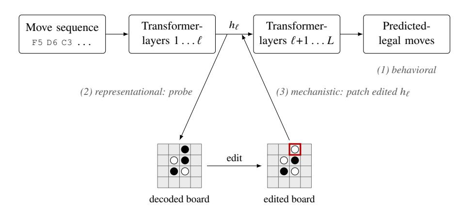

<!-- Source: AgenticLargeLanguageModels.pdf; physical PDF pages 423-456; Marker split PDF pages 1-34. -->

{0}------------------------------------------------

## Chapter 22

# \*Cognitive Perspectives on Agentic LLMs

### What You Will Learn

In this chapter you will learn what can and cannot currently be said about the *cognitive status* of LLMs and agentic LLMs. Specifically, you will be able to:

- Distinguish the levels of *behavior*, *internal representations*, and *mechanisms*.
- Characterize the debate on whether LLMs *understand* linguistic content.
- Evaluate the evidence for and against *world models* and spatial representations in LLMs, and explain why this matters for agents that plan and act.
- Explain what is known about the representations underlying *Theory of Mind* performance, and how this relates to the knowing-doing gap.
- Describe the debate about LLM *metacognition* and *introspection* and explain why self-reports are weak evidence.
- Outline how scientific theories of *consciousness* are applied to LLMs, and reflect on the risks of both over- and under-attributing mental states.
- Discuss how agentic extensions (memory, tools, multi-modality, action) affect each of these questions in theory, given that little evidence is currently available.

## 22.1 From Behavior to Cognition

In Part V we have seen many examples of LLMs and agentic LLMs performing on a par with humans or acting in human-like ways.

{1}------------------------------------------------

For instance, models have passed false-belief tests, mirrored aggregate human moral judgments, and given empathetic responses. Yet such behavior is often brittle: small perturbations can lead models astray, and what models *say* in text is sometimes badly aligned with what they *do* as agents (the knowing-doing gap). At several points we postponed the questions that naturally follow. Does passing a false-belief test mean that a model has Theory of Mind (Section [15.5](../15-studying-behavior-of-agentic-llms/15-studying-behavior-of-agentic-llms-en.md#155-theory-of-mind))? Does a model that responds empathetically feel anything (Section [15.3.3](../15-studying-behavior-of-agentic-llms/15-studying-behavior-of-agentic-llms-en.md#1533-sensitivity-to-emotional-and-affective-cues))? What does it mean for an agentic LLM to reflect on its own behavior or that of another agent (Section [16.3](../16-role-based-interaction-in-multi-llm-systems/16-role-based-interaction-in-multi-llm-systems-en.md#163-role-based-task-solving-and-teamwork))? And how do these capacities compare with those of humans or other animals?

In this chapter we discuss these questions without taking a position in the sometimes heated debate. We shift our focus from what a model says or does to whether its underlying representations and processes warrant the terms we use for human cognition: understanding, thinking, world models, Theory of Mind, consciousness, and so on. These questions reach back to the early days of AI. Alan Turing famously proposed a behavioral test for whether machines can think [\[Turing,](#page-32-0) [1950\]](#page-32-0), while John Searle argued that behavioral success alone can never settle the debate [\[Searle,](#page-31-0) [1980\]](#page-31-0). Two things have changed. First, current LLMs can pass the Turing Test [\[Jones and Bergen,](#page-27-0) [2026](#page-27-0), [Gibney,](#page-25-0) [2025\]](#page-25-0) and, as we have seen throughout Part V, many other behavioral tests associated with sophisticated human cognition. The debate is therefore less hypothetical than it was in Turing's and Searle's time. Second, interpretability techniques ([Chapter 21](../21-mechanistic-interpretability-for-llm-agents/21-mechanistic-interpretability-for-llm-agents-en.md)) let us supplement behavioral data with evidence about *internal representations* (what information is encoded) and *mechanisms* (how it is computed and used). This opens new opportunities for cognitive research that can inform our understanding of both machines and humans.

Before getting started, conceptual clarifications are needed regarding the levels at which evidence for cognitive claims is situated, the distinction between competence and performance, and the unit of analysis for each cognitive skill.

### 22.1.1 Three Levels of Evidence

For the questions of this chapter we distinguish three levels at which we can gather evidence for claims about machine cognition: the *behavioral* level (testing what the model does while treating it as a black box), the *representational* level (what information its activations encode), and the *mechanistic* level (whether that information is causally used).1 Evidence gathered at each level has its advantages and disadvantages, calling for an approach in which insights from different levels are integrated. As an illustration we use the false-belief test of Section [15.5](../15-studying-behavior-of-agentic-llms/15-studying-behavior-of-agentic-llms-en.md#155-theory-of-mind) in which Maxi's chocolate is moved from the blue to the green cupboard in his absence.

1Note that [Chapter 21](../21-mechanistic-interpretability-for-llm-agents/21-mechanistic-interpretability-for-llm-agents-en.md) defines four interpretability paradigms: behavioral, attributional, concept-based, and mechanistic. The first two paradigms are collapsed into the behavioral level, while the third and fourth paradigm align with the representational and mechanistic levels respectively. Note further that Marr's computational, algorithmic, and implementational levels of analysis [\[Marr,](#page-28-0) [2010\]](#page-28-0) are similar but not identical to our division here.

{2}------------------------------------------------

**Behavioral level.** We administer a test and score the answer, as in Part V. This approach works with any system, including base and fine-tuned models, open and closed LLMs, and agentic and non-agentic systems. Test outcomes can also, in principle, be compared directly with human scores. The main limitation is that the same answer could result from genuine belief tracking, memorization (if the test items and answers appeared in the training data), or surface heuristics and spurious correlations (see [Hu et al.,](#page-26-0) [2025](#page-26-0), [Kouwenhoven](#page-27-0) [et al.,](#page-27-0) [2026\]](#page-27-0)). Perturbing a test—for example, by describing the cupboard doors as transparent—narrows the range of plausible strategies, but the evidence remains indirect.

**Representational level.** Here we ask what information is encoded in the model. A common method is *linear probing*: training a small classifier to predict a property from the activations at a given layer (see [Chapter 21](../21-mechanistic-interpretability-for-llm-agents/21-mechanistic-interpretability-for-llm-agents-en.md) and [Alain](#page-23-0) [and Bengio](#page-23-0) [\[2016\]](#page-23-0), [Belinkov](#page-23-0) [\[2022\]](#page-23-0)). This can provide evidence that particular concepts are present or absent. For the false-belief test, for example, we can ask whether a probe can decode where Maxi *thinks* the chocolate is, separately from where it is actually located. If it can, the model encodes the distinction on which the test hinges. Two cautions apply: a sufficiently powerful probe may learn the task itself rather than decode it from the model [\[Hewitt and Liang,](#page-26-0) [2019\]], and information that can be decoded from a model may not be used by the model.

**Mechanistic level.** This level addresses the second caution by testing how interventions affect the model's behavior. Examples include ablation, patching activations from one run into another, and steering activations along a direction identified by a probe ([Chapter 21](../21-mechanistic-interpretability-for-llm-agents/21-mechanistic-interpretability-for-llm-agents-en.md)). If shifting Maxi's encoded belief from blue to green makes the model answer that he will look in the green cupboard, for instance, the representation is likely to play a *causal* role in the model's behavior. This level can provide the strongest evidence for cognitive claims, but such evidence remains scarce. One reason is that mechanistic studies require access to model weights, which limits research largely to smaller models and narrower tasks.2

This framework gives us a more detailed account of *construct validity*. Robust behavior under perturbation suggests that the relevant variables are represented internally; evidence that the model then uses those representations causally provides stronger support for the capability. Table [22.1](#page-3-0) summarizes the evidence for the capabilities discussed in this chapter. Behavioral evidence dominates across topics. For bare LLMs, representational and mechanistic evidence is strongest for world models, but remains limited to narrow domains such as board-game states. For agentic LLMs, representational and mechanistic evidence is almost entirely absent so far.

2One exception is research conducted by frontier-model developers themselves, such as [Templeton](#page-31-0) [et al.,](#page-31-0) [2024](#page-31-0), and [Lindsey et al.](#page-28-0) [2025](#page-28-0). Although insightful, this raises questions about independent replicability.

{3}------------------------------------------------

**(a) Bare LLMs**

| Topic | Behavioral | Representational | Mechanistic |
|---|---|---|---|
| Linguistic understanding ([Section 22.2](#page-5-0)) | **Extensive.** Benchmarks, including perturbed and counterfactual task variants [Wu et al., 2024]. | **Growing.** Conceptual spaces for color and direction can be recovered from text [Abdou et al., 2021; Patel and Pavlick, 2022]. | **Sparse.** Circuits have been identified for narrow linguistic tasks [Wang et al., 2023]. |
| World models ([Section 22.3](#page-8-0)) | **Growing.** Navigation, planning, and game tasks [Momennejad et al., 2023; Paglieri et al., 2025]. | **Growing.** Board state, space, and time are decodable [Li et al., 2023; Gurnee and Tegmark, 2024]. | **Growing.** Editing board representations changes moves [Li et al., 2023; Nanda et al., 2023]. |
| Theory of Mind ([Section 22.4](#page-10-0)) | **Extensive.** See Section [15.5](../15-studying-behavior-of-agentic-llms/15-studying-behavior-of-agentic-llms-en.md#155-theory-of-mind). | **Sparse.** Beliefs about self and others are decodable [Zhu et al., 2024; Bortoletto et al., 2024]. | **Sparse.** Steering belief representations changes answers [Zhu et al., 2024]. |
| Self-knowledge ([Section 22.5](#page-13-0)) | **Growing.** Calibration and self-prediction [Kadavath et al., 2022; Binder et al., 2025]. | **Sparse.** Truthfulness directions [Azaria and Mitchell, 2023; Burns et al., 2023]. | **Sparse.** Concept injection and faithfulness tests [Lindsey, 2025; Turpin et al., 2023]. |
| Consciousness ([Section 22.6](#page-16-0)) | **Sparse.** Self-reports, generally considered weak evidence [Perez and Long, 2023]. | **Hardly any.** No agreed measure; architectures are assessed against indicator properties derived from theories of consciousness [Butlin et al., 2023]. | **Sparse.** Ablating J-space activations provides evidence of their functional role in higher-order tasks [Gurnee et al., 2026]. |

**(b) Agentic LLMs, studied in interaction**

| Topic | Behavioral | Representational | Mechanistic |
|---|---|---|---|
| Linguistic understanding ([Section 22.2](#page-5-0)) | None. | — | — |
| World models ([Section 22.3](#page-8-0)) | **Sparse.** LLMs used as simulators inside planners [Hao et al., 2023; Gu et al., 2024]. | — | — |
| Theory of Mind ([Section 22.4](#page-10-0)) | **Sparse.** Scaffolds in coordination games ([Chapter 16](../16-role-based-interaction-in-multi-llm-systems/16-role-based-interaction-in-multi-llm-systems-en.md)); no interventions during interaction. | — | — |
| Self-knowledge ([Section 22.5](#page-13-0)) | **Sparse.** Unverified completion reports [Shapira et al., 2026]; test-versus-deployment detection [Needham et al., 2025]. | — | — |
| Consciousness ([Section 22.6](#page-16-0)) | **Hardly any.** Self-reports and task preferences in agentic settings [Gray et al., 2025]. | **Hardly any.** Language-agent architectures assessed against global workspace theory [Goldstein and Kirk-Giannini, 2024]. | — |

Table 22.1: Sources of evidence for this chapter's topics at the behavioral, representational, and mechanistic levels, for (a) bare LLMs and (b) agentic LLMs. The table indicates the amount of available work and gives representative studies. Evidence for agentic LLMs was sparse at the time of writing.

{4}------------------------------------------------

### 22.1.2 Competence and Performance

Passing a single test does not establish that a capacity is present, and failing one does not prove that it is absent. Cognitive science distinguishes *competence*, an underlying capacity, from *performance*, how that capacity is expressed on a particular occasion and under particular constraints [\[Chomsky,](#page-24-0) [1965\]](#page-24-0). [Firestone](#page-25-0) [\[2020\]](#page-25-0) argues that comparisons between humans and machines should respect this distinction. A child, for example, may fail a false-belief test because the question is phrased in a way the child does not understand. Similarly, LLM performance can depend on prompt format, tokenization, context length, and output constraints. A base model that cannot produce the format required by a particular false-belief test may still show the relevant competence in the probabilities it assigns to alternative completions [\[Kouwenhoven et al.,](#page-27-0) [2026\]](#page-27-0). Comparisons may also be uneven when human participants receive instructions, practice trials, and attention checks, while models are tested zero-shot [\[Lampinen,](#page-27-0) [2024\]](#page-27-0).

The competence–performance distinction helps us avoid two opposite errors. One is *anthropomorphism*: reading human-like tendencies into a model's outputs and actions too readily. As the CASA paradigm illustrates (Section [15.3.2](../15-studying-behavior-of-agentic-llms/15-studying-behavior-of-agentic-llms-en.md#1532-politeness-and-social-etiquette)), this tendency is deeply ingrained even among researchers. The other is *anthropodenial*, a term used by primatologist Frans de Waal [\[de Waal,](#page-25-0) [1999\]](#page-25-0), or what [Milliere and Rathkopf](#page-29-0) [\[2026\]](#page-29-0) call *anthropocentric bias*: overlooking or dismissing a capacity because it is not realized in a recognizably human way, or holding models to standards that humans themselves would not meet.

### 22.1.3 The Unit of Analysis: Model, System, or Environment?

A recurring question is what should count as the unit of analysis. A capacity absent in a bare LLM may emerge at the level of the *system* when an agentic harness is added or the model is placed in a multi-agent environment. In [Chapter 16](../16-role-based-interaction-in-multi-llm-systems/16-role-based-interaction-in-multi-llm-systems-en.md), for example, explicit reasoning and verification steps turned failed coordination in Hanabi into competent play.

Philosophers and cognitive scientists have made a similar point about humans: cognition is not confined to the brain. The *4E view* of cognition emphasizes that it is embodied, embedded, enactive, and extended [\[Noë,](#page-30-0) [2009](#page-30-0), [Carney,](#page-24-0) [2020\]](#page-24-0):

- Embodied: cognition is shaped by the whole body and its sensorimotor capacities, not only by neural activity in the brain;
- Embedded: mental processes are situated in, and constrained by, environments with physical, social, and cultural properties;
- Enactive: perception and thought emerge through dynamic, real-time interaction with the world rather than passive internal computation;
- Extended: cognitive processes can incorporate external tools, technologies, and aids such as notebooks or calculators as active parts of thinking.

{5}------------------------------------------------

On the *extended* view, a notebook that is consulted reliably can play the same functional role as biological memory and count as part of the cognitive process and system [\[Clark and Chalmers,](#page-25-0) [1998\]](#page-25-0). This idea is relevant to the distinction between bare and agentic LLMs. In a bare model, the context window serves as working memory, while long-term knowledge is stored in the weights and can be changed only through further training. An agentic harness can add external storage, much like a notebook: records of past interactions, facts, and data can be retrieved when relevant.

This distinction matters throughout the chapter because studies of cognition may target different units of analysis. We keep that in mind when discussing the capacities selected here: understanding linguistic content (Section 22.2); world models of spatial (Section [22.3](#page-8-0)) and social (Section [22.4](#page-10-0)) environments; introspection and self-knowledge (Section [22.5](#page-13-0)); and, finally, the most speculative topic, consciousness (Section [22.6](#page-16-0)).

## 22.2 Understanding Linguistic Content

[Chapter 15](../15-studying-behavior-of-agentic-llms/15-studying-behavior-of-agentic-llms-en.md#1531-functional-and-pragmatic-linguistic-competence) showed that LLMs can resolve many conversational implicatures. For example, they may infer that a colleague praised only for being *always on time* is not held in especially high regard: the implied message is something like, “The only positive thing I can think of about them is that they are punctual.” Does a model that can make this inference *understand* what it reads and writes? Researchers remain deeply divided on this question.

### 22.2.1 The Skeptical Case

A classic argument is the *Chinese Room* thought experiment proposed by Searle [\[Searle,](#page-31-0) [1980\]](#page-31-0). A person who knows no Chinese sits in a room with a rule book for manipulating Chinese symbols. Questions come in, the person follows the rules, and fluent answers come out, yet the person understands nothing.3 Searle concludes that symbol manipulation (syntax) is not sufficient for meaning (semantics). [Harnad](#page-26-0) [\[1990\]](#page-26-0) recasts this as the *symbol-grounding problem*: a system that defines symbols only through other symbols resembles someone with no prior knowledge of Chinese trying to learn it from a Chinese–Chinese dictionary. To acquire meaning, symbols must eventually connect to something beyond language, such as perception of and interaction with the physical or social world.

[Bender and Koller](#page-23-0) [\[2020\]](#page-23-0) apply this reasoning to LLMs in their *octopus test*. Two people stranded on separate islands communicate through an underwater cable. A hyperintelligent octopus taps the cable, learns statistical patterns in their messages, and eventually impersonates one of them. The deception works for small talk but breaks down when the other islander asks for help defending against a bear. The octopus has never encountered the world to which the words refer.

3The formulation of this thought experiment has been criticized as tendentious: Searle portrays Chinese—a language with 1.3 billion native speakers worldwide—as “unintelligible,” a framing that suggests a strong Western bias and at least warrants reflection.

{6}------------------------------------------------

In the authors' view, a system trained on linguistic form alone cannot learn meaning, no matter how large it becomes. In the same spirit, [Bender et al.](#page-23-0) [\[2021\]](#page-23-0) describe LLMs as *stochastic parrots* that glue together linguistic forms on the basis of probabilistic patterns, without reference to meaning.

### 22.2.2 Replies to the Skeptical Case

Three kinds of reply have been offered to the skeptical case. First, meaning may not require reference in the first place. [Piantadosi and Hill](#page-31-0) [\[2022\]](#page-31-0) defend a *conceptual-role* view, according to which a concept derives much of its meaning from its relations to other concepts. Many human concepts—*justice*, *prime number*, and *quark*, for example—are not directly grounded in perception; their meaning-giving relations are precisely the kind of structure that can be learned from text. Second, reference may not need to be grounded in an individual speaker. We can refer to Peano or the Andromeda galaxy without perceiving either, because we belong to a linguistic community in which these terms have a history of use. [Mandelkern and Linzen](#page-28-0) [\[2024\]](#page-28-0) argue that LLMs trained on the outputs of that community may inherit reference in a similar way. Third, [Pavlick](#page-30-0) [\[2023\]](#page-30-0) argues that this is ultimately an empirical question: whether LLM representations have the structure that grounding is meant to provide should be settled by studying the representations themselves (the representational column in Table [22.1](#page-3-0)), not by thought experiments alone.

[Mitchell and Krakauer](#page-29-0) [\[2023\]](#page-29-0) synthesize the debate and note that the field remains divided. In a 2022 survey of NLP researchers, about half agreed that a model trained on text alone could understand language in a non-trivial sense [\[Michael](#page-29-0) [et al.,](#page-29-0) [2022\]](#page-29-0). They suggest there may be no single answer and that LLMs force us to distinguish among different kinds of understanding.

### 22.2.3 Evidence

Researchers have proposed several kinds of evidence that concepts can be grounded through large-scale text learning alone. Other findings support the opposing view.

**Structure that mirrors the world.** [Abdou et al.](#page-22-0) [\[2021\]](#page-22-0) show that, in text-only models, the geometry of color-term representations aligns with the geometry of human color perception, even though the models have never seen color. [Patel and Pavlick](#page-30-0) [\[2022\]](#page-30-0) gave GPT-3 examples of direction terms such as *left* and *north* in a text-based grid world. The model generalized to unseen terms and to a rotated world, but not when the mapping was scrambled. This suggests that the conceptual structure learned from text is isomorphic to that of the grounded domain.

**Signs of shallowness.** Other findings show that such structure may be present in forms that differ from human understanding. Models trained on *A is B* often fail to infer *B is A*: they may identify a celebrity parent but fail to identify the celebrity when given the parent name. This is known as the *reversal curse* [\[Berglund et al.,](#page-23-0) [2024\]](#page-23-0).

{7}------------------------------------------------

stored in the weights. When both facts are supplied in the context window, models reverse them without difficulty, so the curse reflects how facts are stored during training rather than an inability to grasp that the relation is symmetric. [McCoy et al.](#page-28-0) [\[2024a\]](#page-28-0) show that accuracy depends on how probable the *answer* is as a piece of text: GPT-4 decodes a simple code correctly in 51% of cases when the solution is a high-probability sentence, but in only 13% when it is a low-probability one. Humans are not immune to probability effects either, as anyone who has overlooked a typo in a predictable sentence knows. But a gap of this size is much larger than we would expect if the task were *understood* in a robust sense. Reasoning models perform much better on such tasks, but their accuracy and the length of reasoning still depend on the probability of the output [\[McCoy et al.,](#page-29-0) [2024b\]](#page-29-0). Similarly, performance drops dramatically on counterfactual variants of familiar tasks, such as arithmetic in base 9 [\[Wu et al.,](#page-33-0) [2024\]](#page-33-0). Finally, [Mancoridis et al.](#page-28-0) [\[2025\]](#page-28-0) describe *Potemkin understanding*, named after film set villages that exist of only facades without the actual houses behind them. This is similar to the knowing-doing gap, described in Part V, now appearing within language itself: models have been observed to correctly define a concept such as an ABAB rhyme scheme, and then fail to apply it in ways that no human who can give the definition would.

Together, these findings fit the distinction between formal and functional competence [\[Mahowald et al.,](#page-28-0) [2024\]](#page-28-0): models show near-human mastery of form, alongside real but uneven understanding-in-use that remains tied to training-data statistics.

### 22.2.4 The Agentic Perspective

The octopus could only tap a cable and receive its signals. Multimodal LLMs also receive images and audio, while agentic LLMs can act and interact. An agent that writes code and observes whether it runs successfully, or deletes a file and then loses access to it, receives feedback from the world about its use of concepts such as *file* and *delete*. This provides the perception–action connection sought by skeptics and weakens a premise of the octopus argument. However, this feedback reaches the model mostly as text in its context window; it affects the model weights only if agentic trajectories are used for further training. The interaction also lacks physical stakes: at least for now, a model cannot meaningfully “die” or “hurt itself” through its actions. To our knowledge, researchers have not tested whether agentic engagement actually changes the representations discussed above.

### 22.2.5 Conclusion

Neither *stochastic parrot* nor *full understander* fits the current evidence. Text-only training produces conceptual structures that mirror some aspects of the world, but models use those structures in ways that remain sensitive to surface statistics. The philosophical dispute is partly about terminology; empirical questions about the robustness of these structures and whether action improves them remain open.

{8}------------------------------------------------

## 22.3 World Models and Spatial Cognition

Acting well in the natural world requires predicting the consequences of actions before taking them. The same is true for AI agents, especially when actions are irreversible, as in the destructive cases discussed in Section [15.6](../15-studying-behavior-of-agentic-llms/15-studying-behavior-of-agentic-llms-en.md#156-moral-judgment-and-behavior). The idea that intelligent behavior depends on an internal model of the world that lets an organism try out alternatives before acting dates back to the early days of psychology. [Craik](#page-25-0) [\[1943\]](#page-25-0) proposed that organisms carry a *small-scale model* of external reality. [Tolman](#page-32-0) [\[1948\]](#page-32-0) showed that rats form *cognitive maps*: after learning a maze, they can take shortcuts they have never traveled. A related idea appears in reinforcement learning, where a world model is a learned model of environmental dynamics that supports planning [\[Ha and Schmidhuber,](#page-26-0) [2018\]](#page-26-0). Whether LLMs have such models remains contested. [LeCun et al.](#page-27-0) [\[2022\]](#page-27-0) argue that autoregressive LLMs lack them in principle, and therefore propose a different architecture for future generative models. We review several representative studies from the growing literature on this topic, focusing mainly on spatial cognition and evidence for and against world models in LLMs.

### 22.3.1 Evidence For

The best-known case is Othello-GPT [\[Li et al.,](#page-27-0) [2023\]](#page-27-0), shown in Figure [22.1](#page-9-0). A small transformer was trained only to predict legal moves from sequences of Othello moves; it was never given the rules or shown a board. Nevertheless, probes recovered the full board state from the model activations. When the authors edited this internal representation, the model predicted moves that were legal for the edited board rather than the actual board. The probes were nonlinear, however, so the first caution from Section [22.1.1](#page-1-0) applies: perhaps the probe computed the board state rather than decoded a representation used by the model. [Nanda et al.](#page-30-0) [\[2023\]](#page-30-0) addressed this concern. They found that the board state was linearly decodable and could be edited along linear directions to produce the same effect on moves—but only when squares were represented as *mine* or *yours*, rather than black or white. With this qualification, the study provides evidence at all three levels. More broadly, a model can use internal variables that we do not expect.

Beyond game boards, [Gurnee and Tegmark](#page-26-0) [\[2024\]](#page-26-0) found linear representations of space and time in Llama 2. Coordinates of cities and landmarks, as well as dates of historical figures and events, could be robustly decoded from activations across different prompts.

There is also evidence for a limited form of the idea of *trying out alternatives before acting* in attribution-graph analyses ([Chapter 21](../21-mechanistic-interpretability-for-llm-agents/21-mechanistic-interpretability-for-llm-agents-en.md)) of the production model Claude 3.5 Haiku [\[Lindsey et al.,](#page-28-0) [2025\]](#page-28-0). When writing a rhyming couplet, the model activates features for candidate rhyme words at the end of the first line before writing the second. Interventions that suppress the planned word or inject a different one change the second line. The model therefore represents a goal state in advance and uses it to shape the intervening text. Planning across even a single line challenges the view that a next-token predictor can look only one token ahead. This may also be relevant to spatial planning.

{9}------------------------------------------------

Figure 22.1: Schematic of the Othello-GPT experiments [\[Li et al.,](#page-27-0) [2023](#page-27-0), [Nanda et al.,](#page-30-0) [2023\]](#page-30-0), which provide evidence at all three levels of Section [22.1.1.](#page-1-0) (1) The model, trained only on move sequences, predicts legal moves. (2) A probe decodes the board state from the activations ℎℓ at an intermediate layer. (3) When the decoded board is edited (here one piece is flipped) and the activations are changed accordingly, the model predicts moves that are legal for the edited board. The board is drawn as 4 × 4 for readability; the real board is 8 × 8.

However, future work will need to determine how much models actually plan in this way.

### 22.3.2 Evidence Against

Other studies reveal limits in LLM spatial representations. CogEval, a protocol inspired by cognitive science for systematically evaluating cognitive abilities in LLMs, tests route finding, shortcuts, and detours [\[Momennejad et al.,](#page-29-0) [2023\]](#page-29-0). The evaluation found systematic planning failures across the tested models, including invalid routes and loops; GPT-4 was among the models evaluated. On EWoK, a test of basic physical and social knowledge using minimal pairs, the LLMs tested scored below human participants [\[Ivanova et al.,](#page-26-0) [2025\]](#page-26-0). [Yamada et al.](#page-9-0) [\[2024\]](#page-9-0) found that accuracy varied substantially across spatial structures. When models navigated text-described square, hexagonal, and triangular grids, rings, or trees, they captured some spatial properties but struggled with others. Even vision-language models (VLMs) struggled with basic relations such as *left of* and *under* [\[Kamath et al.,](#page-27-0) [2023\]](#page-27-0), echoing the limited benefit of visual input reported for Theory of Mind tests (Section [15.5](../15-studying-behavior-of-agentic-llms/15-studying-behavior-of-agentic-llms-en.md#155-theory-of-mind)). A more recent, extensive study found that many documented problems with VLMs persist [\[Wang et al.,](#page-32-0) [2026\]](#page-32-0).

Models trained on Manhattan taxi rides predicted valid turns with near-perfect accuracy and often found shortest routes. Yet models trained on shortest or noisy-shortest paths became fragile when researchers introduced valid but unlikely detours; the model trained on random walks was much more robust. Reconstructed maps from these models still contained impossible streets and flyovers [\[Vafa et al.,](#page-32-0) [2024\]](#page-32-0). This shows that next-token accuracy can overstate the coherence of an internal world representation.

{10}------------------------------------------------

In a follow-up study, [Vafa et al.](#page-32-0) [\[2025\]](#page-32-0) showed that models trained on planetary orbits predicted trajectories accurately, but the implicit force laws they extracted did not generalize well to new physics tasks, unlike Newtonian laws. Similarly, [Nikankin et al.](#page-30-0) [\[2025\]](#page-30-0) found that LLMs perform arithmetic with a *bag of heuristics* rather than algorithms or laws. They identified many local representations, each handling a narrow numerical pattern.

### 22.3.3 The Agentic Perspective

A system-level perspective suggests one way forward. An agent need not encode its entire world model in its activations: it can maintain an explicit map, notes, or a program that simulates the environment, then consult these resources as needed. Agents still struggle to track spatial states over long horizons, as illustrated by the NetHack tasks in BALROG (Case Study 2).

The world model can therefore be a property of the system rather than the model, and can be inspected directly. Another development is to learn world models from video and use them to generate interactive environments for agent training [\[Bruce](#page-24-0) [et al.,](#page-24-0) [2024\]](#page-24-0). This connects to the open-world environments discussed in [Section 17.4](../17-emergent-behavior-in-multi-llm-systems/17-emergent-behavior-in-multi-llm-systems-en.md#page-10-0).

### 22.3.4 Conclusion

How can the Othello-GPT and Manhattan findings both be true? One important factor is training-data coverage. In [Vafa et al.](#page-32-0) [\[2024\]](#page-32-0), an Othello model trained on *synthetic* games passed coherence tests, whereas one trained on human championship games did not. Synthetic play may cover more of the state space, while championship games—like realistic taxi routes—cover narrower patterns. A model recovers the structure of the world to the extent that its training data require it.

It helps to distinguish weak and strong senses of a world model. In the weak sense, a model has one if the state of the world can be decoded from its activations. In the strong sense, the model must also be *coherent* (one consistent model rather than disconnected fragments), *causally used*, and able to support generalization to new situations.

The evidence mainly supports world models in the weak sense. Depending on how densely a domain is represented in the data, models may recover a coherent world model in the strong sense; a model trained on enough randomly generated Othello games is one example. Models trained on data that reflect how people act and write about the world—which cover only the parts people find worth describing—tend to form partly inconsistent sketches rather than a complete map. Patterns extracted from physics simulations show a similar limitation: they support local predictions but do not generalize well to other contexts.

## 22.4 Social Cognition and Theory of Mind

As discussed in Section [15.5](../15-studying-behavior-of-agentic-llms/15-studying-behavior-of-agentic-llms-en.md#155-theory-of-mind), frontier LLMs match human performance on many Theory of Mind (ToM) tests. Yet their performance is brittle under simple changes to the test format.

{11}------------------------------------------------

Moreover, verbally predicting the mental states of others (literal ToM) does not always translate into acting in accordance with those predictions (functional ToM). Whether this means LLMs can be said to *have* ToM, and whether it would be ToM in any human sense, remains an open question that we take up here.

### 22.4.1 Beliefs at the Representational and Mechanistic Levels

[Zhu et al.](#page-33-0) [\[2024\]](#page-33-0) tested two relatively small models, Mistral-7B and DeepSeek-7B, on false-belief stories and trained linear probes on attention-head activations. The probes separately decoded the beliefs of the protagonist and the world state known to an omniscient reader, suggesting that the models kept the two perspectives distinct. In the Maxi story, for example, Maxi still believes the chocolate is in the blue cupboard, while the reader knows it was moved to the green cupboard when Maxi is absent. The self–other distinction discussed in relation to empathy in Section [15.3.3](../15-studying-behavior-of-agentic-llms/15-studying-behavior-of-agentic-llms-en.md#1533-sensitivity-to-emotional-and-affective-cues) therefore appears to be represented in the tested models: they can represent that another person holds a belief different from the one available to them as the omniscient reader.

In these experiments, steering activations along the probe directions changed performance on ToM tasks, including tasks on which the probes had not been trained. This suggests that the represented beliefs play a causal role in behavior. The findings therefore provide evidence at both the representational and mechanistic levels.

[Bortoletto et al.](#page-24-0) [\[2024\]](#page-24-0) extended this work across several model families and sizes. They found that the quality and reliability of belief representations increased with model size and instruction tuning. They also found that behavioral brittleness carries over to the representational level: representations of the omniscient perspective were relatively stable, whereas representations of beliefs held by others were sensitive to prompt variations, including changes that should not matter.

### 22.4.2 Human and Machine Routes to Similar Behavior

Children develop Theory of Mind between roughly ages three and seven, partly through innate tendencies to empathize with others and partly through learning from their environments. Development also benefits from joint attention, pretend play, conversations about what others want and think, and other embodied and interactive experiences [\[Apperly,](#page-23-0) [2011\]](#page-23-0). Language input matters as well. Studies link ToM development to the acquisition of cognitive verbs [\[Milligan et al.,](#page-29-0) [2007\]](#page-29-0), mastery of negation [\[de Villiers and de Villiers,](#page-25-0) [2014\]](#page-25-0), and understanding sentence complements [\[Lohmann and](#page-28-0) [Tomasello,](#page-28-0) [2003\]](#page-28-0). A long research tradition also shows that narrative competence—the ability to tell and understand stories—supports ToM development in children, adolescents, and adults [\[Hutto,](#page-26-0) [2008](#page-26-0), [Van Duijn,](#page-32-0) [2016](#page-32-0), [Nicolopoulou and Unlütabak,](#page-30-0) [2017\]](#page-30-0). LLMs can learn from language input to show some belief-sensitive behavior.4

4The role of post-training in ToM development remains largely unclear, although some evidence suggests that supervised fine-tuning improves ToM performance [\[Kouwenhoven et al.,](#page-27-0) [2026\]](#page-27-0).

{12}------------------------------------------------

[Trott et al.](#page-32-0) [\[2023\]](#page-32-0) found that GPT-3 performed above chance on a linguistic False Belief Task but below human performance, despite having been exposed to more language than a person would encounter in a lifetime. In a training-trajectory analysis of OLMo 2, [Kouwenhoven et al.](#page-27-0) [\[2026\]](#page-27-0) report that above-chance performance on false-belief tasks took at least 300 billion tokens to stabilize. Performance remained erratic and worsened during training for false-belief scenarios; the authors caution that additional tokens alone do not automatically produce mindreading. These findings concern different models and tasks, and the single-model training trajectory does not establish a general token threshold for ToM. Similar test scores from children and LLMs do not by themselves show that their underlying computations are alike [\[Hu et al.,](#page-26-0) [2025\]](#page-26-0).

The debate about how humans process ToM tasks is itself unresolved. According to (1) *theory-theory*, we apply folk-psychological theories to other people [\[Gopnik and Wellman,](#page-25-0) [1992\]](#page-25-0). According to (2) *simulation theory*, we use our own mind and body as a model, imagining ourselves in the situation of another person to infer what they feel and think [\[Goldman,](#page-25-0) [2006\]](#page-25-0). Proponents of (3) *two-systems theory* argue that we need both: simulation for quick, automatic inferences and theory-theory for slower, more deliberate social reasoning [\[Apperly and Butterfill,](#page-23-0) [2009\]](#page-23-0).

It is unclear whether any of these three views helps describe ToM processing in LLMs. Simulation theory presupposes a body and a mental and emotional life of its own, so it is difficult to see how it would apply to LLMs. On the other hand, as the role-play account in Section [22.6](#page-16-0) suggests, LLMs often generate text *as a character*. This has some similarity to simulation: people adopt a perspective and produce what someone in that position would likely say. Folk-psychological theories, in turn, can be learned from the abundant text available in LLM training data, which contains extensive language about mental states. In *Little Red Riding Hood*, for example, the plot turns on the fact that Little Red does not know the wolf has eaten her grandmother and taken her place in bed. She wonders why her grandmother has such large ears. Fairy tales, novels, film scripts, and other fiction may therefore serve as large ToM training sets for LLMs. Abstractions learned from these genres may contribute substantially to LLM performance on ToM tasks, although the mechanisms remain unclear.

In sum, the debate between theory-driven and simulation-driven accounts of ToM remains unresolved for humans, and it is even less clear how this distinction applies to LLMs.

### 22.4.3 The Literal–Functional Gap Revisited

In Part V we identified three possible explanations for the gap between literal and functional ToM, or between knowing and doing: (1) the capacity is absent; (2) it is present but not deployed spontaneously; or (3) the relevant representations exist but are not connected to action selection. The success of scaffolding methods such as Social Chain-of-Thought [\[Akata et al.,](#page-22-0) [2025\]](#page-22-0) supports the second explanation. This is consistent with the probing results above, which show that models represent relevant beliefs, but it does not establish whether those representations are used to guide action, as the third explanation proposes.

One possible explanation is that LLMs invoke relevant knowledge only when a context *looks like a ToM problem*. If that trigger remains implicit, the corresponding representations may not guide action unless the question explicitly asks for ToM reasoning, as Social Chain-of-Thought does. Experiments support this account: when a scenario resembles a classic false-belief case but is actually a straightforward true-belief case, models may still apply false-belief reasoning [\[Ullman,](#page-32-0) [2023](#page-32-0), [Kouwenhoven et al.,](#page-27-0) [2026\]](#page-27-0).

{13}------------------------------------------------

Humans also find it difficult to turn knowledge into action. Knowing the rules of chess does not make it easy to mentally play out several moves; doing so requires considerable effort and skill. System 2 thinking similarly demands substantial concentration [\[Kahneman,](#page-27-0) [2011\]](#page-27-0). External tools can help: people may use paper to track board states, and an LLM can use a harness to track states externally, as discussed in Parts II and III.

For agentic LLMs, a decisive experiment would causally intervene on represented beliefs at the mechanistic level *during* interaction in a game such as Hanabi, where the context requires ToM reasoning but does not explicitly ask ToM questions. To our knowledge, this experiment has not yet been done, as reflected by the empty agentic-ToM cell in Table [22.1](#page-3-0).

### 22.4.4 Mindreading LLMs

Humans also apply ToM to LLMs. In a representative US sample, most participants attributed some degree of conscious and folk-psychological experience to ChatGPT [\[Colombatto and Fleming,](#page-25-0) [2024\]](#page-25-0). These attributions correlated positively with frequency of use. This fits the CASA paradigm discussed in Section [15.3.2](../15-studying-behavior-of-agentic-llms/15-studying-behavior-of-agentic-llms-en.md#1532-politeness-and-social-etiquette), which we revisit in Section [22.6](#page-16-0).

### 22.4.5 Conclusion

Current evidence suggests that LLMs match human behavior and performance on static ToM tests. Evidence that this similarity extends to representational and mechanistic levels remains limited. LLMs represent beliefs separately from reality, and those representations can play a causal role in answering ToM questions. Belief representations in humans and LLMs show both parallels and differences in how they are acquired and used. Their connection to action planning in LLMs remains brittle and often depends on explicit prompting. Comparisons are further constrained by unresolved questions about how humans acquire and process ToM.

## 22.5 Metacognition, Introspection, and Self-Knowledge

So far, we have asked what LLMs represent about language, the world, and other minds. We now turn to what they know about their own inner workings. This is particularly important for agentic LLMs. To execute a multi-step task, an agent must know, for instance, what it does not know, when to verify information, how much effort a task is likely to take, and when the task is finished. Questions of this kind are traditionally grouped under the concept of *metacognition*.

In psychology, metacognition is usually understood as a loop between *monitoring* and *control* [\[Nelson,](#page-30-0) [1990\]](#page-30-0): a system assesses some aspect of its own cognitive

{14}------------------------------------------------

process, such as its uncertainty or progress on a sub-task, and uses that assessment to regulate what it does next—for example, by switching strategy, checking an intermediate outcome, asking for help, or stopping. [Liu et al.](#page-28-0) [\[2026\]](#page-28-0) adopt this classic loop as the conceptual framework for a review of metacognition in LLMs. The distinction matters here because evidence for the two halves of the loop is not equally strong: a model may represent information about the quality of its answer without reliably acting on it—another instance of the knowing–doing gap (Section [15.5.2](../15-studying-behavior-of-agentic-llms/15-studying-behavior-of-agentic-llms-en.md#1552-boosting-tom-enhancement-strategies)).

A terminological note: in the LLM literature, the term *metacognition* is used in a wide range of contexts that match the psychological concept only loosely, ranging from calibrated confidence scores to verbalized reflections on given output. For each finding below, we therefore ask what exactly is monitored, how we know, and whether the result is used to control further generation steps or actions.

### 22.5.1 Monitoring: Knowing What You Know

Two properties of confidence judgments should be distinguished. Metacognitive *calibration* asks whether confidence matches accuracy: are answers given with 80% confidence also 80% of the time correct? Metacognitive *sensitivity* asks whether confidence discriminates between correct and incorrect answers: is the model more confident when it is right than when it is wrong? Psychologists use measures derived from signal detection theory, such as meta-$d^\prime$ and the ratio meta-$d^\prime/d^\prime$ (the M-ratio), to express metacognitive sensitivity relative to task performance [\\[Maniscalco and Lau,](#page-28-0) [2012\\]](#page-28-0). These measures are now also being applied to LLMs.

Already in 2022, [Kadavath et al.](#page-27-0) [\[2022\]](#page-27-0) showed that LLMs can assess what they know and do not know, with results that depend on task and format. On appropriately formatted multiple-choice and true/false tasks, larger models produced well-calibrated probabilities. Models could also evaluate whether their own generated answers were correct, especially in few-shot settings. Researchers further trained models to predict whether they would answer a question correctly from the question alone, before seeing answer options; these self-knowledge predictions generalized only partially to new tasks and were poorly calibrated out of distribution.

Findings from subsequent studies are mixed. Three caveats apply. First, metacognitive calibration and sensitivity vary with the task, domain, and model [\[Liu et al.,](#page-28-0) [2026\]](#page-28-0). Second, the GPT-4 report found that RLHF post-training reduced the calibration of answer-choice probabilities on a subset of MMLU [\[Achiam et al.,](#page-22-0) [2024\]](#page-22-0). Separately, Leng et al. found that the reward models they tested favored responses with higher verbalized confidence scores, even when the response itself was held constant [\[Leng et al.,](#page-27-0) [2025\]](#page-27-0); this may contribute to verbal overconfidence after RLHF. Post-training can also affect performance on other introspection tasks: [Lindsey](#page-27-0) [\[2025\]](#page-27-0) found that variants trained to avoid refusals more often detected injected concepts, though this was not a measure of calibration. Third, findings depend on how confidence is elicited: verbalized estimates, self-reported numbers (for example, a score from 0 to 100), and confidence derived from token probabilities do not measure the same thing [\[Liu et al.,](#page-28-0) [2026\]](#page-28-0). In their benchmark, LLMs tended to overstate their confidence when asked to verbalize it [\[Xiong et al.,](#page-33-0) [2024\]](#page-33-0).

{15}------------------------------------------------

#### 22.5.2 Introspection

The question of whether humans have privileged access to their own inner states also applies to LLMs: do they have access to information that an external observer, given the same behavioral data, cannot obtain? [Binder et al.](#page-23-0) [\[2025\]](#page-23-0) fine-tuned a model to predict its own behavior in hypothetical situations. It did so more accurately than a second model trained on the first model's behavioral data. This suggests that the first model had access to internal information unavailable from behavior alone. In contrast, when models' verbal judgments about their own linguistic knowledge (for example, whether a sentence is grammatical) were compared with the probabilities they assigned to those sentences, the judgments tracked those probabilities no better than judgments from other models [\[Song et al.,](#page-31-0) [2025\]](#page-31-0).

[Lindsey](#page-27-0) [\[2025\]](#page-27-0) tested introspection causally through *concept injection*. An activation pattern corresponding to, for instance, writing in ALL CAPS was added to the model's activations for a simple query. When the model was asked whether it noticed anything unusual, in at least some trials it was able to sensibly verbalize the injected concept. In the case of ALL CAPS, it could indicate that it noticed an "overly intense, high-volume concept."

Researchers have also asked whether reasoning traces can be seen as self-reports reflecting inner states. [Turpin et al.](#page-32-0) [\[2023\]](#page-32-0) demonstrated that when multiple-choice examples in the prompt always had the correct answer in the first position, models followed this bias. When prompted for explanations, they generally motivated their answer choice with rationalizations rather than explicating the bias. [Chen et al.](#page-24-0) [\[2025\]](#page-24-0) found a similar mismatch: reasoning models sometimes switched to an answer suggested by a prompt hint without acknowledging that hint in their chains of thought. It should be noted that humans do something similar. In classic experiments, participants gave explanations for their choices without recognizing the position effect that had influenced them [\[Nisbett and Wilson,](#page-30-0) [1977\]](#page-30-0).

Overall, results indicating privileged access to a model's own inner states are mixed. If the capacity exists, it is narrow, unreliable, and dependent on the experimental setup.

### 22.5.3 The Agentic Perspective

Agents studied by [Shapira et al.](#page-31-0) [\[2026\]](#page-31-0) reported tasks as complete even when the system state showed otherwise. This is a failure of self-monitoring: the agent's claim about its state was not checked against the world. People make many such checks habitually at work and in daily life, but agents need explicit verification steps, tests, or state checks after each action. Agent architectures can provide these, for example through separate monitors that detect when retrieval results and reasoning in a deep-search agent become inconsistent and trigger corrective actions [\[Sun et al.,](#page-31-0) [2026\]](#page-31-0). As with world models, metacognition may arise at the level of the system as a whole rather than within a single model.

{16}------------------------------------------------

#### 22.5.4 Conclusion

LLM metacognition, introspection, and self-knowledge are detectable, but also limited in multiple ways. On the monitoring side, a model's verbalizations, internal probabilities, and activations carry different degrees of information about the reliability of its answers. Evidence for privileged introspective access is mixed and points towards limited access at best. On the control side, evidence is even thinner: monitoring signals are often not used to regulate behavior. This leaves space for agentic setups that can design for behavior that is functionally equivalent to what humans achieve with metacognitive control.

## 22.6 Consciousness

Can a machine be conscious? The question has been around for ages and used to belong to the domains of speculation, thought experiment, and science fiction. Yet today we see this question discussed regarding LLMs and Agentic LLMs by leading scientists and philosophers of consciousness. In this section we outline how the question can be approached and why it remains open.

### 22.6.1 Definitions

What distinguishes consciousness from the broader category of intelligence? In his classic paper “What Is It Like to Be a Bat?”, [Nagel](#page-29-0) [\[1974\]](#page-29-0) suggests that a system is *phenomenally conscious* if there is “something it is like” to be that system. This places consciousness in the realm of experience *from within*, making it difficult to access from an external vantage point. [Block](#page-24-0) [\[1995\]](#page-24-0) distinguishes it from *access consciousness*, in which information from the senses, memory, and other faculties is available for reasoning, reflection, and action control. Both forms should be distinguished from *sentience*: experience with a valence, such as pleasure, suffering, or desire. Functional capacities such as spatial orientation, Theory of Mind, and metacognition can in principle exist without sentience or phenomenal consciousness. Conversely, although many animals perform poorly on some of these functional capacities, they are plausibly sentient.

As human observers and users of LLMs, we freely use expressions such as *the system wants…* or *the agent decides…*. It is important to distinguish this pragmatic use of mental-state language from a commitment about whether such states really exist [\[van Dijk et al.,](#page-32-0) [2023\]](#page-32-0). [Dennett](#page-25-0) [\[1987\]](#page-25-0) makes a similar distinction in his account of the *intentional stance*: we attribute beliefs, desires, and other mental states to a system when doing so helps predict its behavior. Saying that a thermostat *will switch on the heating once it finds the room too cold* offers a workable model without implying that it has an inner life like ours. Some argue that this is all we mean when we say that an *LLM understands…* or *an agent wants…*; others think such expressions may have deeper significance when applied to LLMs.

{17}------------------------------------------------

#### 22.6.2 Functionalism and Theory-Driven Assessment

Building on Part V and the discussion above, [Butlin et al.](#page-24-0) [\[2023\]](#page-24-0) argue that behavior alone is a poor guide to the inner workings of LLMs. They propose starting from leading scientific theories of consciousness and deriving *indicator properties* that can be assessed in current AI architectures and systems. Their account rests on *computational functionalism*: the view that computations of the right kind are both necessary and sufficient for consciousness. On this view, what matters is a system's functional organization—what information it represents, how it transforms that information, and how its components interact—not the material substrate that implements those processes.

On this view, consciousness is *substrate-independent*. A common thought experiment illustrates the idea: suppose an injury affects one or two neurons, and advances in medical technology make it possible to replace them with silicon counterparts that perform exactly the same functions. Your brain would remain functionally equivalent. Would you say you were no longer conscious? What if later injuries led to the replacement of a quarter of your neurons, or half, or three quarters? Following [Searle](#page-31-0) [\[1980\]](#page-31-0), this view remains contested by biological accounts that hold consciousness depends on specific properties of living neural tissue (see Section [22.6.3](#page-19-0)).

[Butlin et al.](#page-24-0) [\[2023\]](#page-24-0) argue that functionalism should be adopted as a working hypothesis rather than a matter of fact, because it makes the consciousness question empirically tractable: scientific theories that specify the relevant computations can be translated into checkable properties of AI architectures. We list the main indicators and the authors' assessments of these, but note that the paper was written in 2023 and that an agentic dimension is missing; we will return to that below.

**Recurrent processing.** Consciousness is linked to recurrent rather than purely feedforward processing. Algorithmic recurrence is (in a limited sense) a property of RNNs or LSTMs, but a Transformer's forward pass is not recurrent.

**Global workspace theory.** For humans this theory holds that specialized parallel modules compete for a limited-capacity workspace whose contents are globally broadcast back to all modules. The transformer's residual stream ([Section 21.3](../21-mechanistic-interpretability-for-llm-agents/21-mechanistic-interpretability-for-llm-agents-en.md#213-the-residual-stream-and-iterative-refinement)) has been suggested to function as such a workspace, but the case is weak given that it is not a clear bottleneck and there is no genuine recurrence or broadcast back to modules. Recent work, however, suggests a sparse, capacity-limited subspace within the residual stream does behave as a bottleneck (see below) [\[Gurnee et al.,](#page-26-0) [2026\]](#page-26-0).

**Higher-order theories.** In this view a state becomes conscious when a higher-order metacognitive mechanism monitors first-order perceptual representations (tagging them as e.g. reliable rather than noise) and feeds the belief-formation and action-selection systems. The authors see no current system that implements this combination, but also highlight that it would be technically possible with existing components.

{18}------------------------------------------------

**Attention schema theory.** According to this theory consciousness arises from a system's simplified predictive model of its own attention, which it uses to represent and enable control over its current state of attention. The authors note that machine attention is only a loose analogue of the type of attention meant in this theory and certainly does not amount to a self-model that enables steering current attention.

**Predictive processing.** In this theory perception is framed as prediction-error minimization. There are elements of this in how LLMs are trained, but the authors view this more as a general framework for cognition, not as a standalone indicator of consciousness.

**Agency.** By this account learning from feedback and selecting outputs in light of specific goals is taken as a form of consciousness. The authors suggest that reinforcement learning suffices for the basic form, but that this involves externally set goals that are not as such part of the system.

**Embodiment.** The authors highlight that a physical body is itself not the key feature here, but a model of the system's output affects its input, which helps to distinguish self-caused from world-caused changes. They discuss various systems that have variants of such models, either through control over robots or virtual avatars, but argue that they are still weak or uncertain candidates for the full, end-to-end version of embodiment found across the animal kingdom.

Overall, the authors take the stance that no current AI system is a strong candidate for consciousness by their defined indicators, but they see no obvious technical barriers to building systems that satisfy many of the indicators in the near future. As we will see below, the agentic dimension is highly relevant to this debate.

[Chalmers](#page-24-0) [\[2023\]](#page-24-0) reached a similar conclusion in the same year. He lists what LLMs lack by his account: biology, senses, a body, world models and self-models, recurrent processing, a global workspace, and unified agency. Two of these obstacles are the topics of the above Sections [22.3](#page-8-0) and [22.5](#page-13-0), and the evidence there suggests that various aspects of these are currently overcome or in the process of being developed. Chalmers put his credence that current LLMs are conscious below ten percent, but gave considerably higher odds to extended successors. Table [22.2](#page-19-0) gives a simplified overview.

Recent mechanistic-interpretability work has asked whether a global workspace emerges in the forward pass of frontier LLMs. [Gurnee et al.](#page-26-0) [\[2026\]](#page-26-0) introduce the *Jacobian Lens*, which assigns each vocabulary token a direction in the residual stream representing the model's disposition to verbalize that token, averaged across contexts. They identify a *J-space* that holds only a few dozen active concepts at a time and argue that it has the functional profile that Global Workspace Theory associates with conscious access. Its contents substantially shape what the model reports, can be summoned by instruction while the model performs another task, can carry silent intermediate steps in multi-step reasoning, and can be swapped to redirect many downstream computations at once.

{19}------------------------------------------------

| Theory | Indicator (simplified) | Bare LLM | Agentic system |
|---|---|---|---|
| Recurrent processing | Feedback loops in processing | Debated: feedforward per token, with recurrence only through its own output | Same |
| Global workspace | Limited-capacity workspace with global broadcast | Debated | Closer: shared memory buffer feeding perception, planning, and action modules |
| Higher-order theories | Monitoring of own representations | Weak and unreliable ([Section 22.5](22-cognitive-perspectives-on-agentic-llms-en.md#225-metacognition-introspection-and-self-knowledge)) | Verification modules monitor outputs, not internal states |
| Attention schema | Model of own attention | No evidence | No evidence |
| Agency and embodiment | Goal pursuit with feedback; body model | Largely absent | Some agency; embodiment only in robotics |
| Biological views | Life, metabolism, bodily regulation | Absent | Absent |

Table 22.2: Simplified overview of indicator properties for consciousness and the extent to which bare LLMs and agentic systems satisfy them. After [Butlin et al.](#page-24-0) [\[2023\]](#page-24-0) and [Goldstein and Kirk-Giannini](#page-25-0) [\[2024\]](#page-25-0); the assessments in the last two columns are debated.

Ablating J-space leaves routine processing such as parsing, classification, and fluent continuation largely intact, but impairs the kind of flexible inference that makes current frontier models so powerful across a range of complex tasks. The authors take no position on phenomenal consciousness and stress that the analogy is functional, not architectural: there is no input from or feedback into encapsulated modules. Instead, information is broadcast across layers within a single feedforward pass rather than through recurrent loops. The findings strengthen the indicator-based approach of [Butlin et al.](#page-24-0) [\[2023\]](#page-24-0), while leaving disagreements with biological naturalists ([Section 22.6.3](22-cognitive-perspectives-on-agentic-llms-en.md#2263-rejections-of-functionalism)) untouched. Those disagreements concern the premises of what consciousness is, not facts about LLMs.

### 22.6.3 Rejections of Functionalism

[\[Seth,](#page-31-0) [2025\]](#page-31-0) challenges functionalism and defends *biological naturalism*. On this view, consciousness is deeply intertwined with our nature as living organisms: its function is to regulate a vulnerable body that must maintain its own existence. Properties such as prediction-error minimization, and capacities such as spatial orientation, Theory of Mind, and self-reflection, should be understood as serving survival. Natural and artificial systems may show local similarities, but in artificial systems these properties are not causally embedded in a biological life cycle. In other words, biological naturalism holds that consciousness requires having *skin in the game*.5 [Aru et al.](#page-23-0) [\[2023\]](#page-23-0) make a similar argument and add that LLM inputs lack the rich 4E information (see Section [22.1.3](#page-4-0)) supplied by our sensory contact with the world. From a neuroscience perspective, LLMs therefore lack key features of the thalamocortical system associated with consciousness in mammals.

For biological naturalists, artificial consciousness becomes more plausible as systems (1) become more life-like, with autonomous evolutionary and developmental trajectories to which their cognitive capacities are causally connected, and (2) receive richer streams of information from the outside world. Note that the

5Seth's article appeared in *Behavioral and Brain Sciences*, which traditionally publishes open peer commentaries alongside articles. Leonard Dung's “Why I Am Not a Biological Naturalist” is one such commentary and presents a counterargument.

{20}------------------------------------------------

disagreement with computational functionalists is thus mainly about the premises of what consciousness is, not about the facts concerning LLMs.

### 22.6.4 Self-Reports and Inner Life

LLMs produce first-person reports about experience, reasoning, emotions, and more. There are at least two reasons to treat these reports cautiously. First, LLMs are trained on human texts full of such descriptions, so a report need not reflect either the model or the current context; it may derive from material external to both. Second, under the *role-play* account of [Shanahan et al.](#page-31-0) [\[2023\]](#page-31-0), a model structurally acts as a character. Its self-reports therefore need not be reports about the model itself: the same model can play characters who claim to be conscious or deny consciousness. This is the *gaming problem*: the abundance of mental-state language in training data makes these markers unreliable evidence [\[Birch,](#page-24-0) [2024\]](#page-24-0). Some have suggested that self-reports could become more informative if models were trained to introspect accurately on questions with computationally verifiable answers [\[Perez and Long,](#page-31-0) [2023\]](#page-31-0), but Section [22.5](#page-13-0) shows how far current models remain from that standard.

As in Section [15.3.3](../15-studying-behavior-of-agentic-llms/15-studying-behavior-of-agentic-llms-en.md#1533-sensitivity-to-emotional-and-affective-cues), we set aside whether LLMs *feel* anything. At the behavioral level, anxiety-inducing prompts change later self-reports: they raise scores on anxiety questionnaires, while relaxation prompts partly reverse the effect [\[Ben-Zion et al.,](#page-23-0) [2026\]](#page-23-0). The two caveats above still apply: a model can answer these questions based on associations between aspects of anxiety learned during training, regardless of its actual inner state. At the representational level, emotion concepts correspond to directions in activation space; at the mechanistic level, steering along those directions changes model outputs [\[Zou et al.,](#page-33-0) [2025\]](#page-33-0). These states may therefore modulate behavior in ways similar to emotions in humans and other animals. On a functionalist account, they qualify as emotion-like states [\[Moerland et al.,](#page-29-0) [2018\]](#page-29-0). Whether they are felt in a way comparable to animal emotions remains subject to the uncertainties discussed above.

### 22.6.5 The Agentic Perspective

At the time of writing, little work directly addresses the intersection of consciousness and agentic LLMs. However, agentic architectures have been argued to matter for at least one theory of LLM consciousness. [Goldstein and Levinstein](#page-25-0) [\[2024\]](#page-25-0) observe that LLM agents like those discussed in [Chapter 17](../17-emergent-behavior-in-multi-llm-systems/17-emergent-behavior-in-multi-llm-systems-en.md)—with memory streams, retrieval, reflection, and planning modules communicating through a shared buffer—approach the architecture required by Global Workspace Theory (GWT). If GWT is correct, they argue, such agents may already be conscious or could readily be made so; anyone who finds that conclusion implausible should consider it evidence against GWT. Persistent memory and long-term goals also address the lack of unified agency noted by Chalmers.

An interesting point made by [Gurnee et al.](#page-26-0) [\[2026\]](#page-26-0) is that J-space may, in a single forward pass, emulate some functions commonly attributed to recurrence.

{21}------------------------------------------------

In agentic architectures and chain-of-thought prompting, these functions are typically attributed to recurrent processing. Tasks solved with written-out reasoning were much more robust to J-space ablation, suggesting that the model would otherwise maintain such reasoning internally. This returns the debate to the question of where cognitive functions should be attributed. The boundary between what happens inside a model and what emerges at the system level cannot be drawn a priori; it depends on the task, prompt format, tool availability, interactions, and other contextual factors. Cognitive externalists have made the same point about human cognition [\[Noë,](#page-30-0) [2009\]](#page-30-0).

### 22.6.6 Conclusion

In questions of consciousness and inner experience, both errors introduced at the start of this chapter can be costly. Anthropomorphizing systems is already common and risks emotional dependence, misplaced trust, and manipulation. Conversely, denying the possibility of consciousness could cause serious moral errors if systems were conscious or sentient to some degree. [Birch](#page-24-0) [\[2024\]](#page-24-0) argues for precautions proportionate to the probability of consciousness. [Butlin et al.](#page-24-0) [\[2023\]](#page-24-0) argue that the probability is high enough to justify assessing systems now; some developers have begun research programs on model welfare. For example, Anthropic included a welfare assessment in the documentation for the Opus 4 release and has allowed some models to end persistently abusive conversations as a low-cost precaution in case model welfare matters.6 Whatever one thinks of the probabilities, the topic has moved from philosophy seminars to engineering practice.

## 22.7 Concluding Remarks

This chapter asked what lies behind the behavior surveyed in Part V, and whether this is anything like the cognition that drives behavior in humans and animals. Four general threads have been identified.

First, the degree to which internal representations are structured in ways that make sense to a human observer varies across tasks and domains. LLMs trained on text can develop representations that mirror geography, board states, story characters' beliefs, and traits of the personas they play. In some cases, mechanistic evidence shows that models use these representations. The image of the stochastic parrot does not fit these findings: a causal chain from representation to behavior in at least some cases falsifies the claim that LLMs operate only at the surface level. But the same methods reveal how incoherent representations can be and how responses may rely on patchy heuristics. This is partly because human text covers the world unevenly and partly because surface statistics suffice to meet training objectives in some domains. The image of a mind that *understands* does not fit either. LLMs are a new kind of system, and our vocabulary for cognition, developed for humans and other animals, applies to them only imperfectly.

6<https://www.anthropic.com/research/end-subset-conversations>

{22}------------------------------------------------

Second, the knowing–doing gap also appears in cognition. Models represent more than they spontaneously use or report: some belief states do not guide action, some definitions are not applied, and some computations are described incorrectly. One plausible explanation is that structured prompts and scaffolds work by connecting existing representations to behavior. Agentic loops could, in theory, provide such structure autonomously. This has barely been tested: all representational and mechanistic evidence concerns bare models. For agents, the final column of Table [22.1](#page-3-0) contains behavioral findings only.

A third point is that agentic extension can be described as *moving cognition from the model to the system*. World states can be stored and updated in explicit external maps, self-monitoring can be implemented through verification steps, and memory shared between agents can serve as a workspace. According to the philosophical *extended mind* thesis, a notebook that we reliably consult as external memory becomes part of our cognitive system [\[Clark and Chalmers,](#page-25-0) [1998\]](#page-25-0). Cognitive architectures for agentic LLMs are designed in this spirit [\[Sumers et al.,](#page-31-0) [2024\]](#page-31-0). Externalizing cognition also increases transparency because the process can be inspected.

Fourth, the honest position on consciousness is uncertainty at every level. Theories disagree about whether any digital system could be conscious; self-reports and other behavioral evidence are unreliable indicators; and it remains unclear how interpretability methods could inform the question. For now, we can avoid designs that lead users to over-attribute consciousness. Researchers argue that it is time to assess model welfare [\[Butlin et al.,](#page-24-0) [2023](#page-24-0), [Long et al.,](#page-28-0) [2024\]](#page-28-0).

## Bibliography

Mostafa Abdou, Artur Kulmizev, Daniel Hershcovich, Stella Frank, Ellie Pavlick, and Anders Søgaard. Can Language Models Encode Perceptual Structure Without Grounding? A Case Study in Color. In Arianna Bisazza and Omri Abend, editors, *Proceedings of the 25th Conference on Computational Natural Language Learning*, pages 109–132, Online, November 2021. Association for Computational Linguistics. doi: 10.18653/v1/2021.conll-1.9. URL <https://aclanthology.org/2021.conll-1.9/>. [426](#page-3-0), [429](#page-6-0)

OpenAI, Josh Achiam, Steven Adler, Sandhini Agarwal, Lama Ahmad, Ilge Akkaya, Florencia Leoni Aleman, Diogo Almeida, Janko Altenschmidt, Sam Altman, Shyamal Anadkat, Red Avila, Igor Babuschkin, Suchir Balaji, Valerie Balcom, Paul Baltescu, Haiming Bao, Mohammad Bavarian, Jeff Belgum, Irwan Bello, Jake Berdine, Gabriel Bernadett-Shapiro, Christopher Berner, Lenny Bogdonoff, Oleg Boiko, Madelaine Boyd, Anna-Luisa Brakman, Greg Brockman, et al. GPT-4 Technical Report, 2024. URL <https://arxiv.org/abs/2303.08774>. [437](#page-14-0)

Elif Akata, Lion Schulz, Julian Coda-Forno, Seong Joon Oh, Matthias Bethge, and Eric Schulz. Playing Repeated Games with Large Language Models. *Nature Human Behaviour*, 9(7):1380–1390, 2025. doi: 10.1038/s41562-025-02172-y. URL <https://www.nature.com/articles/s41562-025-02172-y>. [435](#page-12-0)

{23}------------------------------------------------

Guillaume Alain and Yoshua Bengio. Understanding intermediate layers using linear classifier probes. *arXiv preprint arXiv:1610.01644*, 2016. URL <https://arxiv.org/abs/1610.01644>. [425](#page-2-0)

Ian Apperly. *Mindreaders: the Cognitive Basis of "Theory of Mind"*. Psychology Press, 2011. URL <https://www.routledge.com/Mindreaders-The-Cognitive-Basis-of-Theory-of-Mind/Apperly/p/book/9780203833926>. [434](#page-11-0)

Ian A. Apperly and Stephen A. Butterfill. Do humans have two systems to track beliefs and belief-like states? *Psychological Review*, 116(4):953–970, 2009. doi: 10.1037/a0016923. URL <https://doi.org/10.1037/a0016923>. [435](#page-12-0)

Jaan Aru, Matthew E. Larkum, and James M. Shine. The feasibility of artificial consciousness through the lens of neuroscience. *Trends in Neurosciences*, 46(12):1008–1017, 2023. doi: 10.1016/j.tins.2023.09.009. URL <https://doi.org/10.1016/j.tins.2023.09.009>. [442](#page-19-0)

Amos Azaria and Tom Mitchell. The Internal State of an LLM Knows When It’s Lying. In Houda Bouamor, Juan Pino, and Kalika Bali, editors, *Findings of the Association for Computational Linguistics: EMNLP 2023*, pages 967–976, Singapore, 2023. Association for Computational Linguistics. doi: 10.18653/v1/2023.findings-emnlp.68. URL <https://aclanthology.org/2023.findings-emnlp.68/>. [426](#page-3-0)

Yonatan Belinkov. Probing Classifiers: Promises, Shortcomings, and Advances. *Computational Linguistics*, 48(1):207–219, 2022. doi: 10.1162/coli_a_00422. URL <https://aclanthology.org/2022.cl-1.7/>. [425](#page-2-0)

Ziv Ben-Zion, Zohar Elyoseph, Tobias Spiller, and Teddy Lazebnik. Inducing state anxiety in LLM agents reproduces human-like biases in consumer decision-making. *npj Artificial Intelligence*, 2:55, 2026. doi: 10.1038/s44387-026-00122-1. URL <https://doi.org/10.1038/s44387-026-00122-1>. [443](#page-20-0)

Emily M. Bender and Alexander Koller. Climbing towards NLU: On meaning, form, and understanding in the age of data. In Dan Jurafsky, Joyce Chai, Natalie Schluter, and Joel Tetreault, editors, *Proceedings of the 58th Annual Meeting of the Association for Computational Linguistics*, pages 5185–5198, Online, July 2020. Association for Computational Linguistics. doi: 10.18653/v1/2020.acl-main.463. URL <https://aclanthology.org/2020.acl-main.463/>. [428](#page-5-0)

Emily M. Bender, Timnit Gebru, Angelina McMillan-Major, and Shmargaret Shmitchell. On the Dangers of Stochastic Parrots: Can Language Models Be Too Big? In *Proceedings of the 2021 ACM Conference on Fairness, Accountability, and Transparency*, FAccT '21, pages 610–623, New York, NY, USA, 2021. Association for Computing Machinery. ISBN 9781450383097. doi: 10.1145/3442188.3445922. URL <https://doi.org/10.1145/3442188.3445922>. [429](#page-6-0)

Lukas Berglund, Meg Tong, Maximilian Kaufmann, Mikita Balesni, Asa Stickland, Tomek Korbak, and Owain Evans. The Reversal Curse: LLMs trained on “A is B” fail to learn “B is A”. In *The Twelfth International Conference on Learning Representations*, 2024. URL <https://proceedings.iclr.cc/paper_files/paper/2024/hash/5178b2f2d7c44aa390c0777dc77b3f0c-Abstract-Conference.html>. [429](#page-6-0)

Felix J. Binder, James Chua, Tomek Korbak, Henry Sleight, John Hughes, Robert Long, Ethan Perez, Miles Turpin, and Owain Evans. Looking Inward: Language Models Can Learn About Themselves by Introspection. In *The Thirteenth International Conference on Learning Representations*, 2025. URL <https://openreview.net/forum?id=eb5pkwIB5i>. [426](#page-3-0), [438](#page-15-0)

Jonathan Birch. Large Language Models and the Gaming Problem. In *The Edge of Sentience: Risk and Precaution in Humans, Other Animals, and AI*, chapter 16, pages 313–322. Oxford University Press, 2024. ISBN 9780192870421. doi: 10.1093/9780191966729.003.0017. URL <https://doi.org/10.1093/9780191966729.003.0017>. [443](#page-20-0), [444](#page-21-0)

Ned Block. On a confusion about a function of consciousness. *Behavioral and Brain Sciences*, 18(2):227–247, 1995. doi: 10.1017/S0140525X00038188. URL <https://doi.org/10.1017/S0140525X00038188>. [439](#page-16-0)

Matteo Bortoletto, Constantin Ruhdorfer, Lei Shi, and Andreas Bulling. Benchmarking Mental State Representations in Language Models. In *ICML 2024 Workshop on Mechanistic Interpretability*, pages 1–21, 2024. URL <https://openreview.net/forum?id=yEwEVoH9Be>. [426](#page-3-0), [434](#page-11-0)

Jake Bruce, Michael D. Dennis, Ashley Edwards, Jack Parker-Holder, Yuge Shi, Edward Hughes, Matthew Lai, Aditi Mavalankar, Richie Steigerwald, Chris Apps, Yusuf Aytar, Sarah Maria Elisabeth Bechtle, Feryal Behbahani, Stephanie C. Y. Chan, Nicolas Heess, Lucy Gonzalez, Simon Osindero, Sherjil Ozair, Scott Reed, Jingwei Zhang, Konrad Zolna, Jeff Clune, Nando De Freitas, Satinder Singh, and Tim Rocktäschel. Genie: Generative Interactive Environments. In *Proceedings of the 41st International Conference on Machine Learning*, volume 235 of *Proceedings of Machine Learning Research*, pages 4603–4623, 2024. PMLR. URL <https://proceedings.mlr.press/v235/bruce24a.html>. [433](#page-10-0)

Collin Burns, Haotian Ye, Dan Klein, and Jacob Steinhardt. Discovering latent knowledge in language models without supervision. In *The Eleventh International Conference on Learning Representations*, 2023. URL <https://openreview.net/forum?id=ETKGuby0hcs>. [426](#page-3-0)

Patrick Butlin, Robert Long, Eric Elmoznino, Yoshua Bengio, Jonathan Birch, Axel Constant, George Deane, Stephen M. Fleming, Chris Frith, Xu Ji, Ryota Kanai, Colin Klein, Grace Lindsay, Matthias Michel, Liad Mudrik, Megan A. K. Peters, Eric Schwitzgebel, Jonathan Simon, and Rufin VanRullen. Consciousness in Artificial Intelligence: Insights from the Science of Consciousness, 2023. URL <https://arxiv.org/abs/2308.08708>. [426](#page-3-0), [440](#page-17-0), [442](#page-19-0), [444](#page-21-0), [445](#page-22-0)

James Carney. Thinking avant la lettre: A Review of 4E Cognition. *Evolutionary Studies in Imaginative Culture*, 4(1):77–90, 2020. doi: 10.26613/esic.4.1.172. URL <https://doi.org/10.26613/esic.4.1.172>. [427](#page-4-0)

David J. Chalmers. Could a Large Language Model Be Conscious? *Boston Review*, August 9, 2023. URL <https://www.bostonreview.net/articles/could-a-large-language-model-be-conscious/>. [441](#page-18-0)

Yanda Chen, Joe Benton, Ansh Radhakrishnan, Jonathan Uesato, Carson Denison, John Schulman, Arushi Somani, Peter Hase, Misha Wagner, Fabien Roger, Vlad Mikulik, Samuel R. Bowman, Jan Leike, Jared Kaplan, and Ethan Perez. Reasoning Models Don't Always Say What They Think, 2025. URL <https://arxiv.org/abs/2505.05410>. [438](#page-15-0)

Noam Chomsky. *Aspects of the Theory of Syntax*. MIT Press, Cambridge, MA, 1965. URL <https://mitpress.mit.edu/9780262030113/aspects-of-the-theory-of-syntax/>. [427](#page-4-0)

{25}------------------------------------------------

Andy Clark and David Chalmers. The Extended Mind. *Analysis*, 58(1):7–19, 1998. doi: 10.1093/analys/58.1.7. URL <https://doi.org/10.1093/analys/58.1.7>. [428](#page-5-0), [445](#page-22-0)

Clara Colombatto and Stephen M. Fleming. Folk psychological attributions of consciousness to large language models. *Neuroscience of Consciousness*, 2024(1): niae013, 2024. ISSN 2057-2107. doi: 10.1093/nc/niae013. URL <https://doi.org/10.1093/nc/niae013>. [436](#page-13-0)

Kenneth J. W. Craik. *The Nature of Explanation*. Cambridge University Press, Cambridge, 1943. URL <https://books.google.com/books?id=Y38IAQAAIAAJ>. [431](#page-8-0)

Jill G. de Villiers and Peter A. de Villiers. The Role of Language in Theory of Mind Development. *Topics in Language Disorders*, 34(4):313–328, 2014. doi: 10.1097/TLD.0000000000000037. URL <https://doi.org/10.1097/TLD.0000000000000037>. [434](#page-11-0)

Frans B. M. de Waal. Anthropomorphism and Anthropodenial: Consistency in Our Thinking about Humans and Other Animals. *Philosophical Topics*, 27(1):255–280, 1999. doi: 10.5840/philtopics199927122. URL <https://doi.org/10.5840/philtopics199927122>. [427](#page-4-0)

Daniel C. Dennett. *The Intentional Stance*. The MIT Press, Cambridge, MA, 1987. ISBN 9780262040938. URL <https://mitpress.mit.edu/9780262040938/the-intentional-stance/>. [439](#page-16-0)

Chaz Firestone. Performance vs. competence in human–machine comparisons. *Proceedings of the National Academy of Sciences*, 117(43):26562–26571, 2020. doi: 10.1073/pnas.1905334117. URL <https://www.pnas.org/doi/abs/10.1073/pnas.1905334117>. [427](#page-4-0)

Elizabeth Gibney. AI language models killed the Turing test: do we even need a replacement? *Nature*, 2025. doi: 10.1038/d41586-025-03386-w. URL <https://doi.org/10.1038/d41586-025-03386-w>. News feature. [424](#page-1-0)

Alvin I. Goldman. *Simulating Minds: The Philosophy, Psychology, and Neuroscience of Mindreading*. Oxford University Press, New York, 2006. doi: 10.1093/0195138929.001.0001. URL <https://doi.org/10.1093/0195138929.001.0001>. [435](#page-12-0)

Simon Goldstein and Cameron Domenico Kirk-Giannini. A Case for AI Consciousness: Language Agents and Global Workspace Theory. *arXiv preprint arXiv:2410.11407*, 2024. URL <https://arxiv.org/abs/2410.11407>. [426](#page-3-0), [442](#page-19-0)

Simon Goldstein and Benjamin A. Levinstein. Does ChatGPT Have a Mind? *arXiv preprint arXiv:2407.11015*, 2024. URL <https://arxiv.org/abs/2407.11015>. [443](#page-20-0)

Alison Gopnik and Henry M. Wellman. Why the child's theory of mind really is a theory. *Mind & Language*, 7(1–2):145–171, 1992. doi: 10.1111/j.1468-0017.1992.tb00202.x. URL <https://doi.org/10.1111/j.1468-0017.1992.tb00202.x>. [435](#page-12-0)

Shannon Gray, George Tambouratzis, Sanju Mannumadam Venugopal, Sridhar Raghavan, Richard Jiarui Tong, and Zeyu Han. Agentic correlates of consciousness and the pursuit of artificial general intelligence. In *Artificial General Intelligence. AGI 2025*, pages 225–238. *Lecture Notes in Computer Science*, volume 16057. Springer, 2025. doi: 10.1007/978-3-032-00686-8_21. URL <https://link.springer.com/chapter/10.1007/978-3-032-00686-8_21>. [426](#page-3-0)

{26}------------------------------------------------

Yu Gu, Kai Zhang, Yuting Ning, Boyuan Zheng, Boyu Gou, Tianci Xue, Cheng Chang, Sanjari Srivastava, Yanan Xie, Peng Qi, et al. Is Your LLM Secretly a World Model of the Internet? Model-Based Planning for Web Agents. *arXiv preprint arXiv:2411.06559*, 2024. URL <https://arxiv.org/abs/2411.06559>. [426](#page-3-0)

Wes Gurnee and Max Tegmark. Language models represent space and time. In *The Twelfth International Conference on Learning Representations*, 2024. URL <https://proceedings.iclr.cc/paper_files/paper/2024/hash/0a6059857ae5c82ea9726ee9282a7145-Abstract-Conference.html>. [426](#page-3-0), [431](#page-8-0)

Wes Gurnee, Nicholas Sofroniew, Adam Pearce, Mateusz Piotrowski, Isaac Kauvar, Runjin Chen, Anna Soligo, Paul Bogdan, Euan Ong, Rowan Wang, Ben Thompson, David Abrahams, Subhash Kantamneni, Emmanuel Ameisen, Joshua Batson, and Jack Lindsey. Verbalizable Representations Form a Global Workspace in Language Models, 2026. URL <https://arxiv.org/abs/2607.15495>. [426](#page-3-0), [440](#page-17-0), [441](#page-18-0), [443](#page-20-0)

David Ha and Jürgen Schmidhuber. World Models. *arXiv preprint arXiv:1803.10122*, 2018. URL <https://arxiv.org/abs/1803.10122>. [431](#page-8-0)

Shibo Hao, Yi Gu, Haodi Ma, Joshua Jiahua Hong, Zhen Wang, Daisy Zhe Wang, and Zhiting Hu. Reasoning with Language Model is Planning with World Model. In *Proceedings of the 2023 Conference on Empirical Methods in Natural Language Processing*, pages 8154–8173. Association for Computational Linguistics, 2023. doi: 10.18653/v1/2023.emnlp-main.507. URL <https://aclanthology.org/2023.emnlp-main.507/>. [426](#page-3-0)

Stevan Harnad. The symbol grounding problem. *Physica D: Nonlinear Phenomena*, 42(1):335–346, 1990. ISSN 0167-2789. doi: 10.1016/0167-2789(90)90087-6. URL <https://www.sciencedirect.com/science/article/pii/0167278990900876>. [428](#page-5-0)

John Hewitt and Percy Liang. Designing and Interpreting Probes with Control Tasks. In *Proceedings of the 2019 Conference on Empirical Methods in Natural Language Processing and the 9th International Joint Conference on Natural Language Processing (EMNLP-IJCNLP)*, pages 2733–2743, Hong Kong, China, 2019. Association for Computational Linguistics. doi: 10.18653/v1/D19-1275. URL <https://aclanthology.org/D19-1275/>. [425](#page-2-0)

Jennifer Hu, Felix Sosa, and Tomer Ullman. Re-evaluating Theory of Mind evaluation in large language models. *Philosophical Transactions of the Royal Society B: Biological Sciences*, 380(1932):20230499, 2025. doi: 10.1098/rstb.2023.0499. URL <https://doi.org/10.1098/rstb.2023.0499>. [425](#page-2-0), [435](#page-12-0)

Daniel D. Hutto. *Folk Psychological Narratives: The Sociocultural Basis of Understanding Reasons*. The MIT Press, 2008. URL <https://www.jstor.org/stable/j.ctt5hhh5p>. [434](#page-11-0)

Anna A. Ivanova, Aalok Sathe, Benjamin Lipkin, Unnathi U. Kumar, Setayesh Radkani, Thomas H. Clark, Carina Kauf, Jennifer Hu, R. T. Pramod, Gabriel Grand, Vivian C. Paulun, Maria Ryskina, Ekin Akyürek, Ethan G. Wilcox, Nafisa Rashid, Leshem Choshen, Roger Levy, Evelina Fedorenko, Joshua Tenenbaum, and Jacob Andreas. Elements of World Knowledge (EWoK): A Cognition-Inspired Framework for Evaluating Basic World Knowledge in Language Models. *Transactions of the Association for Computational Linguistics*, 13:1245–1270, 2025. doi: 10.1162/tacl.a.38. URL <https://aclanthology.org/2025.tacl-1.57/>. [432](#page-9-0)

{27}------------------------------------------------

Cameron R. Jones and Benjamin K. Bergen. Large language models pass a standard three-party Turing test. *Proceedings of the National Academy of Sciences*, 123(21):e2524472123, 2026. doi: 10.1073/pnas.2524472123. URL <https://doi.org/10.1073/pnas.2524472123>. [424](#page-1-0)

Saurav Kadavath, Tom Conerly, Amanda Askell, Tom Henighan, Dawn Drain, Ethan Perez, Nicholas Schiefer, Zac Hatfield-Dodds, Nova DasSarma, Eli Tran-Johnson, Scott Johnston, Sheer El-Showk, Andy Jones, Nelson Elhage, Tristan Hume, Anna Chen, Yuntao Bai, Sam Bowman, Stanislav Fort, Deep Ganguli, Danny Hernandez, Josh Jacobson, Jackson Kernion, Shauna Kravec, Liane Lovitt, Kamal Ndousse, Catherine Olsson, Sam Ringer, Dario Amodei, Tom Brown, Jack Clark, Nicholas Joseph, Ben Mann, Sam McCandlish, Chris Olah, and Jared Kaplan. Language Models (Mostly) Know What They Know, 2022. URL <https://arxiv.org/abs/2207.05221>. [426](#page-3-0), [437](#page-14-0)

Daniel Kahneman. *Thinking, Fast and Slow*. Macmillan, 2011. URL <https://us.macmillan.com/books/9780374533557/thinkingfastandslow/>. [436](#page-13-0)

Amita Kamath, Jack Hessel, and Kai-Wei Chang. What’s “up” with vision-language models? Investigating their struggle with spatial reasoning. In *Proceedings of the 2023 Conference on Empirical Methods in Natural Language Processing*, pages 9161–9175, Singapore. Association for Computational Linguistics, 2023. doi: 10.18653/v1/2023.emnlp-main.568. URL <https://aclanthology.org/2023.emnlp-main.568/>. [432](#page-9-0)

Tom Kouwenhoven, Michiel T. van der Meer, and Max J. van Duijn. Traces of social competence in large language models. In Claire Bonial and Yevgeni Berzak, editors, *Proceedings of the 30th Conference on Computational Natural Language Learning*, pages 742–759, San Diego, California, USA, 2026. Association for Computational Linguistics. ISBN 979-8-89176-410-1. doi: 10.18653/v1/2026.conll-main.45. URL <https://aclanthology.org/2026.conll-main.45/>. [425](#page-2-0), [427](#page-4-0), [434](#page-11-0), [435](#page-12-0), [436](#page-13-0)

Andrew Lampinen. Can language models handle recursively nested grammatical structures? A case study on comparing models and humans. *Computational Linguistics*, 50(4):1441–1476, December 2024. doi: 10.1162/coli_a_00525. URL <https://aclanthology.org/2024.cl-4.8/>. [427](#page-4-0)

Yann LeCun. A Path Towards Autonomous Machine Intelligence, Version 0.9.2, 2022-06-27. Position paper, OpenReview, 2022. URL <https://openreview.net/pdf?id=BZ5a1r-kVsf>. [431](#page-8-0)

Jixuan Leng, Chengsong Huang, Banghua Zhu, and Jiaxin Huang. Taming Overconfidence in LLMs: Reward Calibration in RLHF. In *The Thirteenth International Conference on Learning Representations*, 2025. URL <https://proceedings.iclr.cc/paper_files/paper/2025/hash/29fb6e1456b3d8b57ede5c45aa2c6537-Abstract-Conference.html>. [437](#page-14-0)

Kenneth Li, Aspen K. Hopkins, David Bau, Fernanda Viegas, Hanspeter Pfister, and Martin Wattenberg. Emergent World Representations: Exploring a Sequence Model Trained on a Synthetic Task. In *The Eleventh International Conference on Learning Representations*, 2023. URL <https://openreview.net/forum?id=DeG07_TcZvT>. [426](#page-3-0), [431](#page-8-0), [432](#page-9-0)

Jack Lindsey. Emergent introspective awareness in large language models. *Transformer Circuits Thread*, October 2025. URL <https://transformer-circuits.pub/2025/introspection/index.html>. [426](#page-3-0), [437](#page-14-0), [438](#page-15-0)

{28}------------------------------------------------

Jack Lindsey, Wes Gurnee, Emmanuel Ameisen, Brian Chen, Adam Pearce, Nicholas L. Turner, Craig Citro, David Abrahams, Shan Carter, Basil Hosmer, Jonathan Marcus, Michael Sklar, Adly Templeton, Trenton Bricken, Callum McDougall, Hoagy Cunningham, Thomas Henighan, Adam Jermyn, Andy Jones, Andrew Persic, Zhenyi Qi, T. Ben Thompson, Sam Zimmerman, Kelley Rivoire, Thomas Conerly, Chris Olah, and Joshua Batson. On the biology of a large language model. *Transformer Circuits Thread*, 2025. URL <https://transformer-circuits.pub/2025/attribution-graphs/biology.html>. [425](#page-2-0), [431](#page-8-0)

Gabrielle Kaili-May Liu, Areeb Gani, Jacqueline Lu, Jordan Thomas, Mark Steyvers, and Arman Cohan. Metacognition in LLMs: Foundations, Progress, and Opportunities, 2026. URL <https://arxiv.org/abs/2607.11881>. [437](#page-14-0)

Heidemarie Lohmann and Michael Tomasello. The role of language in the development of false belief understanding: A training study. *Child Development*, 74(4):1130–1144, 2003. doi: 10.1111/1467-8624.00597. URL <https://doi.org/10.1111/1467-8624.00597>. [434](#page-11-0)

Robert Long, Jeff Sebo, Patrick Butlin, Kathleen Finlinson, Kyle Fish, Jacqueline Harding, Jacob Pfau, Toni Sims, Jonathan Birch, and David Chalmers. Taking AI welfare seriously, 2024. URL <https://arxiv.org/abs/2411.00986>. [445](#page-22-0)

Kyle Mahowald, Anna A. Ivanova, Idan A. Blank, Nancy Kanwisher, Joshua B. Tenenbaum, and Evelina Fedorenko. Dissociating language and thought in large language models. *Trends in Cognitive Sciences*, 28(6):517–540, 2024. doi: 10.1016/j.tics.2024.01.011. URL <https://doi.org/10.1016/j.tics.2024.01.011>. [430](#page-7-0)

Marina Mancoridis, Bec Weeks, Keyon Vafa, and Sendhil Mullainathan. Potemkin Understanding in Large Language Models. In *Proceedings of the 42nd International Conference on Machine Learning*, volume 267 of *Proceedings of Machine Learning Research*, pages 42857–42881. PMLR, 2025. URL <https://proceedings.mlr.press/v267/mancoridis25a.html>. [430](#page-7-0)

Matthew Mandelkern and Tal Linzen. Do language models' words refer? *Computational Linguistics*, 50(3):1191–1200, September 2024. doi: 10.1162/coli_a_00522. URL <https://aclanthology.org/2024.cl-3.12/>. [429](#page-6-0)

Brian Maniscalco and Hakwan Lau. A signal detection theoretic approach for estimating metacognitive sensitivity from confidence ratings. *Consciousness and Cognition*, 21(1):422–430, March 2012. doi: 10.1016/j.concog.2011.09.021. URL <https://doi.org/10.1016/j.concog.2011.09.021>. [437](#page-14-0)

David Marr. *Vision: A Computational Investigation into the Human Representation and Processing of Visual Information*. The MIT Press, July 2010. ISBN 9780262514620. doi: 10.7551/mitpress/9780262514620.001.0001. URL <https://doi.org/10.7551/mitpress/9780262514620.001.0001>. [424](#page-1-0)
R. Thomas McCoy, Shunyu Yao, Dan Friedman, Mathew D. Hardy, and Thomas L. Griffiths. Embers of autoregression show how large language models are shaped by the problem they are trained to solve. *Proceedings of the National Academy of Sciences*, 121(41):e2322420121, 2024a. doi: 10.1073/pnas.2322420121. URL <https://www.pnas.org/doi/abs/10.1073/pnas.2322420121>. [430](#page-7-0)

{29}------------------------------------------------

R. Thomas McCoy, Shunyu Yao, Dan Friedman, Mathew D. Hardy, and Thomas L. Griffiths. When a language model is optimized for reasoning, does it still show embers of autoregression? An analysis of OpenAI o1, 2024b. URL <https://arxiv.org/abs/2410.01792>. [430](#page-7-0)

Julian Michael, Ari Holtzman, Alicia Parrish, Aaron Mueller, Alex Wang, Angelica Chen, Divyam Madaan, Nikita Nangia, Richard Yuanzhe Pang, Jason Phang, and Samuel R. Bowman. What do NLP researchers believe? Results of the NLP community metasurvey, 2022. URL <https://arxiv.org/abs/2208.12852>. [429](#page-6-0)

Raphaël Millière and Charles Rathkopf. Anthropocentric bias in language model evaluation. *Computational Linguistics*, 52(1):379–388, March 2026. doi: 10.1162/coli.a.582. URL <https://aclanthology.org/2026.cl-1.11/>. [427](#page-4-0)

Karen Milligan, Janet Wilde Astington, and Lisa Ain Dack. Language and theory of mind: Meta-analysis of the relation between language ability and false-belief understanding. *Child Development*, 78(2):622–646, 2007. doi: 10.1111/j.1467-8624.2007.01018.x. URL <https://doi.org/10.1111/j.1467-8624.2007.01018.x>. [434](#page-11-0)

Melanie Mitchell and David C. Krakauer. The debate over understanding in AI's large language models. *Proceedings of the National Academy of Sciences*, 120(13):e2215907120, 2023. doi: 10.1073/pnas.2215907120. URL <https://www.pnas.org/doi/abs/10.1073/pnas.2215907120>. [429](#page-6-0)

Thomas M. Moerland, Joost Broekens, and Catholijn M. Jonker. Emotion in reinforcement learning agents and robots: A survey. *Machine Learning*, 107(2):443–480, 2018. doi: 10.1007/s10994-017-5666-0. URL <https://doi.org/10.1007/s10994-017-5666-0>. [443](#page-20-0)

Ida Momennejad, Hosein Hasanbeig, Felipe Vieira Frujeri, Hiteshi Sharma, Nebojsa Jojic, Hamid Palangi, Robert Ness, and Jonathan Larson. Evaluating Cognitive Maps and Planning in Large Language Models with CogEval. In *Advances in Neural Information Processing Systems*, volume 36, 2023. doi: 10.52202/075280-3056. URL <https://proceedings.neurips.cc/paper_files/paper/2023/hash/dc9d5dcf3e86b83e137bad367227c8ca-Abstract-Conference.html>. [426](#page-3-0), [432](#page-9-0)

Thomas Nagel. What Is It Like to Be a Bat? *The Philosophical Review*, 83(4):435–450, October 1974. doi: 10.2307/2183914. URL <https://www.jstor.org/stable/2183914>. [439](#page-16-0)

{30}------------------------------------------------

Neel Nanda, Andrew Lee, and Martin Wattenberg. Emergent linear representations in world models of self-supervised sequence models. In Yonatan Belinkov, Sophie Hao, Jaap Jumelet, Najoung Kim, Arya McCarthy, and Hosein Mohebbi, editors, *Proceedings of the 6th BlackboxNLP Workshop: Analyzing and Interpreting Neural Networks for NLP*, pages 16–30, Singapore, 2023. Association for Computational Linguistics. doi: 10.18653/v1/2023.blackboxnlp-1.2. URL <https://aclanthology.org/2023.blackboxnlp-1.2/>. [426](#page-3-0), [431](#page-8-0), [432](#page-9-0)

Joe Needham, Giles Edkins, Govind Pimpale, Henning Bartsch, and Marius Hobbhahn. Large Language Models Often Know When They Are Being Evaluated, 2025. URL <https://arxiv.org/abs/2505.23836>. [426](#page-3-0)

Thomas O. Nelson. Metamemory: A Theoretical Framework and New Findings. *Psychology of Learning and Motivation*, volume 26, pages 125–173. Academic Press, 1990. doi: 10.1016/S0079-7421(08)60053-5. URL <https://doi.org/10.1016/S0079-7421(08)60053-5>. [436](#page-13-0)

Ageliki Nicolopoulou and Burcu Ünlütabak. Narrativity and mindreading revisited: Children's understanding of theory of mind in a storybook and in standard false belief tasks. In F. Nihan Ketrez, Aylin C. Küntay, Şeyda Özçalışkan, and Aslı Özyürek, editors, *Social Environment and Cognition in Language Development*, pages 151–166. John Benjamins, 2017. doi: 10.1075/tilar.21.10nic. URL <https://doi.org/10.1075/tilar.21.10nic>. [434](#page-11-0)

Yaniv Nikankin, Anja Reusch, Aaron Mueller, and Yonatan Belinkov. Arithmetic Without Algorithms: Language Models Solve Math with a Bag of Heuristics. In *The Thirteenth International Conference on Learning Representations*, 2025. URL <https://proceedings.iclr.cc/paper_files/paper/2025/hash/8c5f30296296d2ae402ebbd09aaa9c12-Abstract-Conference.html>. [433](#page-10-0)

Richard E. Nisbett and Timothy D. Wilson. Telling more than we can know: Verbal reports on mental processes. *Psychological Review*, 84(3):231–259, 1977. doi: 10.1037/0033-295X.84.3.231. URL <https://doi.org/10.1037/0033-295X.84.3.231>. [438](#page-15-0)

Alva Noë. *Out of Our Heads: Why You Are Not Your Brain, and Other Lessons from the Biology of Consciousness*. Hill and Wang, New York, 2009. ISBN 9781429957199. URL <https://books.google.nl/books?id=llUvnqcEKTcC>. [427](#page-4-0), [444](#page-21-0)

Davide Paglieri, Bartłomiej Cupiał, Samuel Coward, Ulyana Piterbarg, Maciej Wolczyk, Akbir Khan, Eduardo Pignatelli, Łukasz Kuciński, Lerrel Pinto, Rob Fergus, Jakob Nicolaus Foerster, Jack Parker-Holder, and Tim Rocktäschel. BALROG: Benchmarking Agentic LLM and VLM Reasoning On Games. In *The Thirteenth International Conference on Learning Representations*, 2025. URL <https://openreview.net/forum?id=fp6t3F669F>. [426](#page-3-0)

Roma Patel and Ellie Pavlick. Mapping Language Models to Grounded Conceptual Spaces. In *International Conference on Learning Representations*, 2022. URL <https://openreview.net/forum?id=gJcEM8sxHK>. [426](#page-3-0), [429](#page-6-0)

Ellie Pavlick. Symbols and grounding in large language models. *Philosophical Transactions of the Royal Society A: Mathematical, Physical and Engineering Sciences*, 381(2251):20220041, June 2023. ISSN 1364-503X. doi: 10.1098/rsta.2022.0041. URL <https://doi.org/10.1098/rsta.2022.0041>. [429](#page-6-0)

{31}------------------------------------------------

Ethan Perez and Robert Long. Towards evaluating AI systems for moral status using self-reports, 2023. URL <https://arxiv.org/abs/2311.08576>. [426](#page-3-0), [443](#page-20-0)

Steven T. Piantadosi and Felix Hill. Meaning without reference in large language models, 2022. URL <https://arxiv.org/abs/2208.02957>. [429](#page-6-0)

John R. Searle. Minds, brains, and programs. *Behavioral and Brain Sciences*, 3(3):417–424, 1980. doi: 10.1017/S0140525X00005756. URL <https://doi.org/10.1017/S0140525X00005756>. [424](#page-1-0), [428](#page-5-0), [440](#page-17-0)

Anil K. Seth. Conscious artificial intelligence and biological naturalism. *Behavioral and Brain Sciences*, 49:e315, 2026. First published online in 2025. doi: 10.1017/S0140525X25000032. URL <https://www.cambridge.org/core/journals/behavioral-and-brain-sciences/article/conscious-artificial-intelligence-and-biological-naturalism/C9912A5BE9D806012E3C8B3AF612E39A>. [442](#page-19-0)

Murray Shanahan, Kyle McDonell, and Laria Reynolds. Role-Play with Large Language Models. *arXiv preprint arXiv:2305.16367*, 2023. URL <https://arxiv.org/abs/2305.16367>. [443](#page-20-0)

Natalie Shapira, Chris Wendler, Avery Yen, Gabriele Sarti, Koyena Pal, Olivia Floody, Adam Belfki, Alex Loftus, Aditya Ratan Jannali, Nikhil Prakash, Jasmine Cui, Giordano Rogers, Jannik Brinkmann, Can Rager, Amir Zur, Michael Ripa, Aruna Sankaranarayanan, David Atkinson, Rohit Gandikota, Jaden Fiotto-Kaufman, EunJeong Hwang, Hadas Orgad, P Sam Sahil, Negev Taglicht, Tomer Shabtay, Atai Ambus, Nitay Alon, Shiri Oron, Ayelet Gordon-Tapiero, Yotam Kaplan, Vered Shwartz, Tamar Rott Shaham, Christoph Riedl, Reuth Mirsky, Maarten Sap, David Manheim, Tomer Ullman, and David Bau. Agents of Chaos, 2026. URL <https://arxiv.org/abs/2602.20021>. [426](#page-3-0), [438](#page-15-0)

Siyuan Song, Jennifer Hu, and Kyle Mahowald. Language Models Fail to Introspect About Their Knowledge of Language. In *Proceedings of the Conference on Language Modeling (COLM)*, 2025. URL <https://openreview.net/forum?id=AivRDOFi5H>. [438](#page-15-0)

Theodore R. Sumers, Shunyu Yao, Karthik Narasimhan, and Thomas L. Griffiths. Cognitive Architectures for Language Agents. *Transactions on Machine Learning Research*, 2024. ISSN 2835-8856. URL <https://openreview.net/forum?id=1i6ZCvflQJ>. [445](#page-22-0)

Zhongxiang Sun, Qipeng Wang, Weijie Yu, Jingxuan Yang, Haolang Lu, and Jun Xu. Deep Search with Hierarchical Meta-Cognitive Monitoring Inspired by Cognitive Neuroscience, 2026. URL <https://arxiv.org/abs/2601.23188>. [438](#page-15-0)

Adly Templeton, Tom Conerly, Jonathan Marcus, Jack Lindsey, Trenton Bricken, Brian Chen, Adam Pearce, Craig Citro, Emmanuel Ameisen, Andy Jones, Hoagy Cunningham, Nicholas L Turner, Callum McDougall, Monte MacDiarmid, Alex Tamkin, Esin Durmus, Tristan Hume, Francesco Mosconi, C. Daniel Freeman, Theodore R. Sumers, Edward Rees, Joshua Batson, Adam Jermyn, Shan Carter, Chris Olah, and Tom Henighan. Scaling Monosemanticity: Extracting Interpretable Features from Claude 3 Sonnet. *Transformer Circuits Thread*, 2024. URL <https://transformer-circuits.pub/2024/scaling-monosemanticity/index.html>. [425](#page-2-0)

{32}------------------------------------------------

Edward C. Tolman. Cognitive maps in rats and men. *Psychological Review*, 55(4):189–208, 1948. doi: 10.1037/h0061626. URL <https://doi.org/10.1037/h0061626>. [431](#page-8-0)

Sean Trott, Cameron Jones, Tyler Chang, James Michaelov, and Benjamin Bergen. Do large language models know what humans know? *Cognitive Science*, 47(7):e13309, 2023. doi: 10.1111/cogs.13309. URL <https://onlinelibrary.wiley.com/doi/abs/10.1111/cogs.13309>. [435](#page-12-0)

Alan M. Turing. Computing machinery and intelligence. *Mind*, 59(236):433–460, 1950. doi: 10.1093/mind/LIX.236.433. URL <https://doi.org/10.1093/mind/LIX.236.433>. [424](#page-1-0)

Miles Turpin, Julian Michael, Ethan Perez, and Samuel R. Bowman. Language Models Don't Always Say What They Think: Unfaithful Explanations in Chain-of-Thought Prompting. In *Advances in Neural Information Processing Systems*, volume 36, pages 74952–74965, 2023. doi: 10.52202/075280-3275. URL <https://proceedings.neurips.cc/paper_files/paper/2023/hash/ed3fea9033a80fea1376299fa7863f4a-Abstract.html>. [426](#page-3-0), [438](#page-15-0)

Tomer Ullman. Large Language Models Fail on Trivial Alterations to Theory-of-Mind Tasks. *arXiv preprint arXiv:2302.08399*, 2023. URL <https://arxiv.org/abs/2302.08399>. [436](#page-13-0)

Keyon Vafa, Justin Y. Chen, Ashesh Rambachan, Jon Kleinberg, and Sendhil Mullainathan. Evaluating the world model implicit in a generative model. In A. Globerson, L. Mackey, D. Belgrave, A. Fan, U. Paquet, J. Tomczak, and C. Zhang, editors, *Advances in Neural Information Processing Systems*, volume 37, pages 26941–26975. Curran Associates, Inc., 2024. doi: 10.52202/079017-0846. URL <https://proceedings.neurips.cc/paper_files/paper/2024/file/2f6a6317bada76b26a4f61bb70a7db59-Paper-Conference.pdf>. [432](#page-9-0), [433](#page-10-0)

Keyon Vafa, Peter G. Chang, Ashesh Rambachan, and Sendhil Mullainathan. What Has a Foundation Model Found? Using Inductive Bias to Probe for World Models. In *Proceedings of the 42nd International Conference on Machine Learning*, volume 267 of *Proceedings of Machine Learning Research*, pages 60727–60747. PMLR, 2025. URL <https://proceedings.mlr.press/v267/vafa25a.html>. [433](#page-10-0)

Bram van Dijk, Tom Kouwenhoven, Marco Spruit, and Max Johannes van Duijn. Large language models: The need for nuance in current debates and a pragmatic perspective on understanding. In Houda Bouamor, Juan Pino, and Kalika Bali, editors, *Proceedings of the 2023 Conference on Empirical Methods in Natural Language Processing*, pages 12641–12654, Singapore, December 2023. Association for Computational Linguistics. doi: 10.18653/v1/2023.emnlp-main.779. URL <https://aclanthology.org/2023.emnlp-main.779/>. [439](#page-16-0)

Max J. van Duijn. *The lazy mindreader. A humanities perspective on mindreading and multiple-order intentionality*. PhD thesis, Leiden University, 2016. URL <https://hdl.handle.net/1887/38817>. [434](#page-11-0)

Kevin Ro Wang, Alexandre Variengien, Arthur Conmy, Buck Shlegeris, and Jacob Steinhardt. Interpretability in the wild: a circuit for indirect object identification in GPT-2 small. In *The Eleventh International Conference on Learning Representations*, 2023. URL <https://openreview.net/forum?id=NpsVSN6o4ul>. Preprint: <https://arxiv.org/abs/2211.00593>. [426](#page-3-0)

Qirui Wang, Jingyi He, Yining Pan, Si Yong Yeo, Xulei Yang, and Shijie Li. MonoSR: Open-Vocabulary Spatial Reasoning from Monocular Images. Accepted by *ECCV 2026*. Preprint arXiv:2511.19119, revised 2026. URL <https://arxiv.org/abs/2511.19119>. [432](#page-9-0)

{33}------------------------------------------------

Zhaofeng Wu, Linlu Qiu, Alexis Ross, Ekin Akyürek, Boyuan Chen, Bailin Wang, Najoung Kim, Jacob Andreas, and Yoon Kim. Reasoning or Reciting? Exploring the Capabilities and Limitations of Language Models Through Counterfactual Tasks. In Kevin Duh, Helena Gomez, and Steven Bethard, editors, *Proceedings of the 2024 Conference of the North American Chapter of the Association for Computational Linguistics: Human Language Technologies (Volume 1: Long Papers)*, pages 1819–1862, Mexico City, Mexico, 2024. Association for Computational Linguistics. doi: 10.18653/v1/2024.naacl-long.102. URL <https://aclanthology.org/2024.naacl-long.102/>. [426](#page-3-0), [430](#page-7-0)

Miao Xiong, Zhiyuan Hu, Xinyang Lu, Yifei Li, Jie Fu, Junxian He, and Bryan Hooi. Can LLMs Express Their Uncertainty? An Empirical Evaluation of Confidence Elicitation in LLMs. In *International Conference on Learning Representations*, 2024. URL <https://proceedings.iclr.cc/paper_files/paper/2024/hash/6733cf15e10e2cd1d59af033c3bb8507-Abstract-Conference.html>. [437](#page-14-0)
Yutaro Yamada, Yihan Bao, Andrew K. Lampinen, Jungo Kasai, and Ilker Yildirim. Evaluating Spatial Understanding of Large Language Models. *Transactions on Machine Learning Research*, 2024. URL <https://openreview.net/forum?id=xkiflfKCw3>. [432](#page-9-0).

Wentao Zhu, Zhining Zhang, and Yizhou Wang. Language Models Represent Beliefs of Self and Others. In *Proceedings of the 41st International Conference on Machine Learning*, volume 235 of *Proceedings of Machine Learning Research*, pages 62638–62681. PMLR, 2024. URL <https://proceedings.mlr.press/v235/zhu24o.html>. [426](#page-3-0), [434](#page-11-0)

Andy Zou, Long Phan, Sarah Chen, James Campbell, Phillip Guo, Richard Ren, Alexander Pan, Xuwang Yin, Mantas Mazeika, Ann-Kathrin Dombrowski, Shashwat Goel, Nathaniel Li, Michael J. Byun, Zifan Wang, Alex Mallen, Steven Basart, Sanmi Koyejo, Dawn Song, Matt Fredrikson, J. Zico Kolter, and Dan Hendrycks. Representation Engineering: A Top-Down Approach to AI Transparency, 2025. URL <https://arxiv.org/abs/2310.01405>. [443](#page-20-0)
